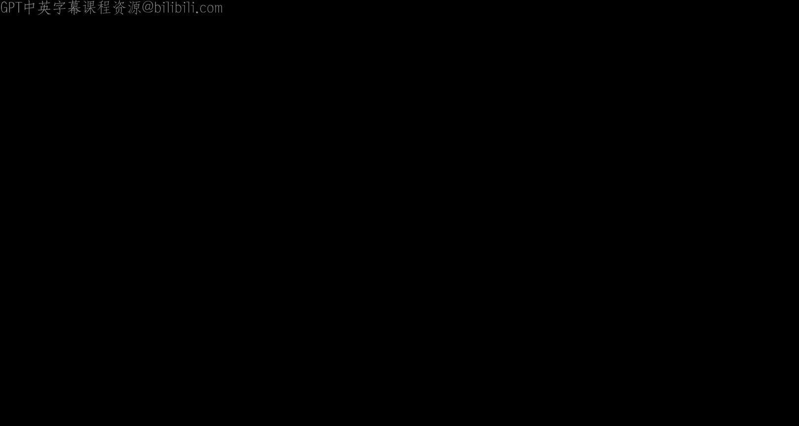
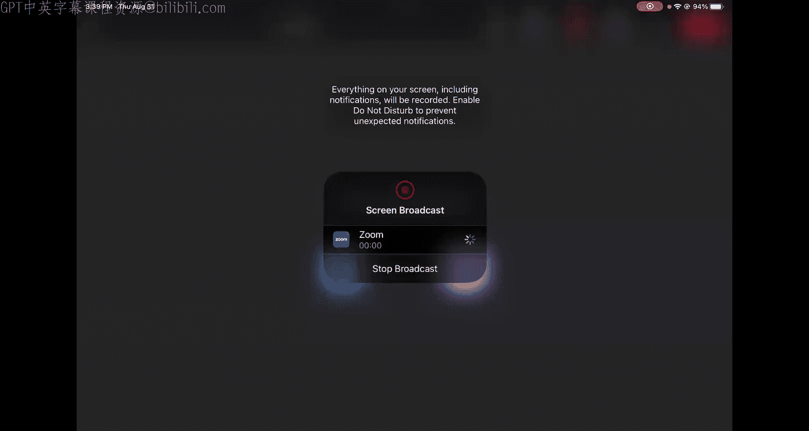
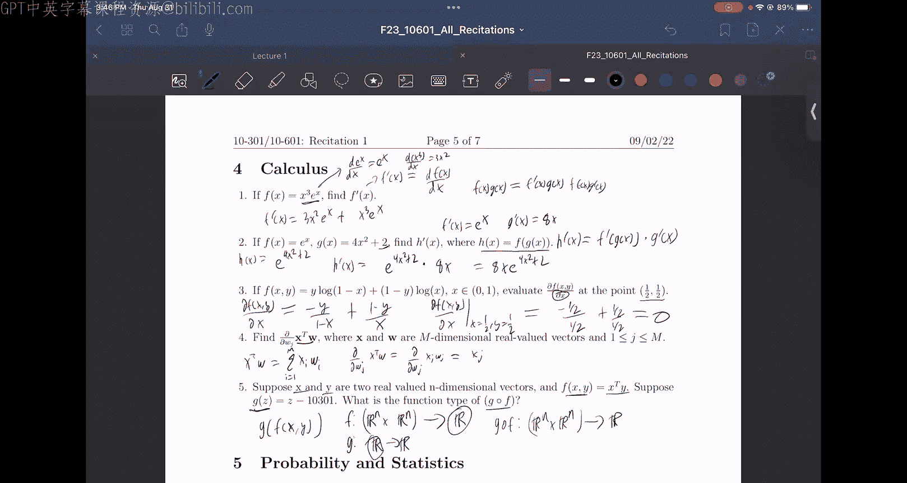

# CMU《机器学习导论｜Fall 2023 10-301⧸601 机器学习导论》中英字幕教程

## 1. 求导法则

在本节中，我们将学习如何求导。

### 1.1 乘积法则

**公式**：\( f(x) = u(x)v(x) \)，则 \( f'(x) = u'(x)v(x) + u(x)v'(x) \)

**示例**：\( f(x) = x^3e^x \)，则 \( f'(x) = 3x^2e^x + x^3e^x \)

### 1.2 链式法则

**公式**：\( f(g(x)) \)，则 \( f'(g(x)) = f'(g(x))g'(x) \)

**示例**：\( h(x) = e^{4x^2 + 2} \)，则 \( h'(x) = e^{4x^2 + 2} \cdot 8x \)

## 2. 偏导数

在本节中，我们将学习如何求偏导数。

### 2.1 偏导数的定义

**公式**：\( \frac{\partial f}{\partial x} = \lim_{\Delta x \to 0} \frac{f(x + \Delta x) - f(x)}{\Delta x} \)

### 2.2 偏导数的计算

**示例**：\( f(x, y) = \ln(x - y) \)，则 \( \frac{\partial f}{\partial x} = \frac{1}{x - y} \)，\( \frac{\partial f}{\partial y} = -\frac{1}{x - y} \)

## 3. 向量值函数的导数

在本节中，我们将学习如何求向量值函数的导数。

### 3.1 向量值函数的导数

**公式**：\( \frac{\partial \mathbf{f}}{\partial \mathbf{w}} = \begin{bmatrix} \frac{\partial f_1}{\partial w_1} & \frac{\partial f_1}{\partial w_2} & \cdots & \frac{\partial f_1}{\partial w_m} \\ \frac{\partial f_2}{\partial w_1} & \frac{\partial f_2}{\partial w_2} & \cdots & \frac{\partial f_2}{\partial w_m} \\ \vdots & \vdots & \ddots & \vdots \\ \frac{\partial f_n}{\partial w_1} & \frac{\partial f_n}{\partial w_2} & \cdots & \frac{\partial f_n}{\partial w_m} \end{bmatrix} \)

**示例**：\( \mathbf{f}(\mathbf{x}) = \mathbf{x}^T\mathbf{w} \)，则 \( \frac{\partial \mathbf{f}}{\partial \mathbf{w}} = \mathbf{x} \)

## 4. 函数类型

在本节中，我们将学习如何确定函数的类型。

### 4.1 函数类型的定义

**公式**：\( f: A \to B \)，表示函数 \( f \) 的定义域为 \( A \)，值域为 \( B \)

### 4.2 函数类型的计算

**示例**：\( f(x, y) = x^T y \)，则 \( f \) 的类型为 \( \mathbb{R}^n \times \mathbb{R}^n \to \mathbb{R} \)

**示例**：\( g(z) = z - 10 \)，则 \( g \) 的类型为 \( \mathbb{R} \to \mathbb{R} \)

## 总结

本节课中，我们一起学习了求导法则、偏导数、向量值函数的导数和函数类型。希望这些知识能够帮助你在机器学习领域取得更好的成绩。