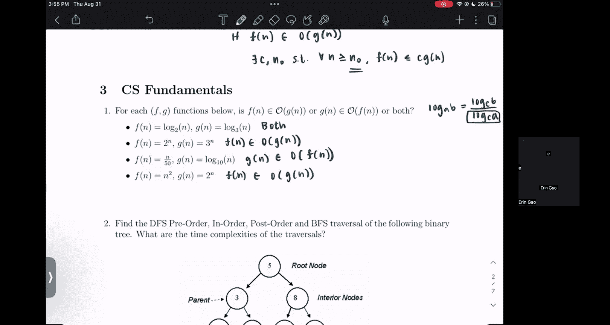

# CMU《机器学习导论｜Fall 2023 10-301⧸601 Introduction to Machine Learning》中英字幕（deepseek p33 Recitation_HW1_Computational_Complexity.zh_en -BV1Z2cUefE4A_p33-

Okay， so to start off CS fundamentals， we have a little bit about time complexity。

This should have been covered maybe in an earlier class that you guys took， such as 122。

 but just as a refresher。Yes。F of n is in O of G of n。It means that there exists some C。

And end night。Such that for all n greater than or equal to n naught。F of N。

Is less than or equal to c times G of N。Okay， and this is just a definition。And so with that。

 let's jump right into the problems。😔，So for all of these。

 we're trying to determine if F of N is in O of G of N， if G of n is an O of F of N or both。Now。

 for the first problem。It is actually both。And this is because of the log base change formula。

 So actually like here we don't care about the log basis because the log base a of B can be written as。

Log base， C of B over。Log base C of A and this bottom part just becomes a constant and that is the C here that we would be talking about。

And that's why for the first one， we have that F of n is an O of G of n and G of n is an O of F of n。

For the second one。If we just thought about it right logically two to the ns grows much slower than three to the n and so in this case。

S and N would be in O of G of N。For the third one。And over 50 grows。Initially。

 it might grow a little bit more slowly than Logway's Hena been。But as the value of n grows larger。

 right， we can find a value of n not large enough。Such that lock base 10 of n is actually smaller。

 and so we have that G of n is n of F of n。And for this last one。Even if we plotted it。

 we would see that2 to the n grows much faster than n squared and so again we have。F of N the N O G。

