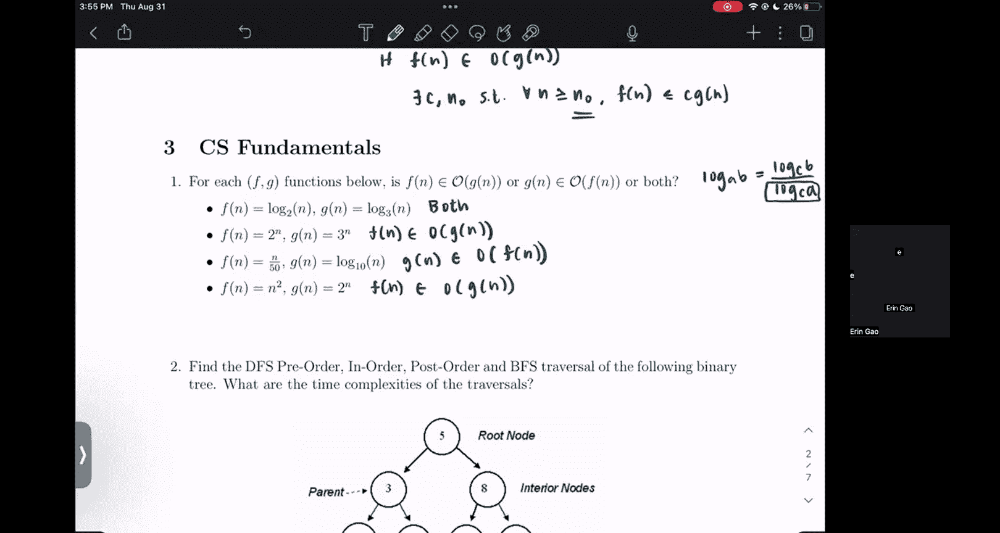

# CMU《机器学习导论｜Fall 2023 10-301⧸601 Introduction to Machine Learning》中英字幕教程

## 📚 1. 时间复杂度基础

在本节课中，我们将学习时间复杂度的基础知识。

### 1.1 时间复杂度定义

时间复杂度是衡量算法运行时间的一个指标。**公式**：\( F(n) \in O(G(n)) \) 表示存在某个常数 \( C \) 和 \( n_0 \)，使得对于所有 \( n \geq n_0 \)，\( F(n) \leq C \times G(n) \)。

### 1.2 时间复杂度问题

本节我们将解决以下问题：

1. 判断 \( F(n) \in O(G(n)) \)，\( G(n) \in O(F(n)) \) 或两者都成立。
2. 利用对数换底公式进行判断。
3. 分析不同函数的增长速度。

## 📚 2. 时间复杂度问题解析

### 2.1 问题一

**分析**：\( F(n) \in O(G(n)) \) 和 \( G(n) \in O(F(n)) \) 都成立。

**原因**：利用对数换底公式，\( \log_a b = \frac{\log_c b}{\log_c a} \)，其中 \( \log_c a \) 为常数。

### 2.2 问题二

**分析**：\( 2^n \) 的增长速度比 \( 3^n \) 慢。

**结论**：\( S(n) \in O(G(n)) \)。

### 2.3 问题三

**分析**：\( \log_{10} n \) 在 \( n \) 较小时增长速度较慢，但随着 \( n \) 的增大，存在某个 \( n \) 使得 \( \log_{10} n < \log_{10} n \)。

**结论**：\( G(n) \in O(F(n)) \)。

### 2.4 问题四

**分析**：\( 2^n \) 的增长速度比 \( n^2 \) 快。

**结论**：\( F(n) \in O(G(n)) \)。

## 📚 3. 总结

本节课中，我们一起学习了时间复杂度的基础知识，并分析了几个典型的时间复杂度问题。希望这些内容能帮助你更好地理解算法的性能。