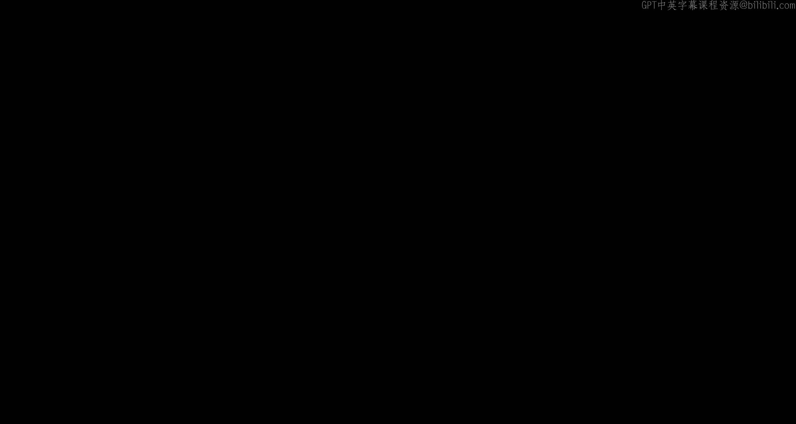
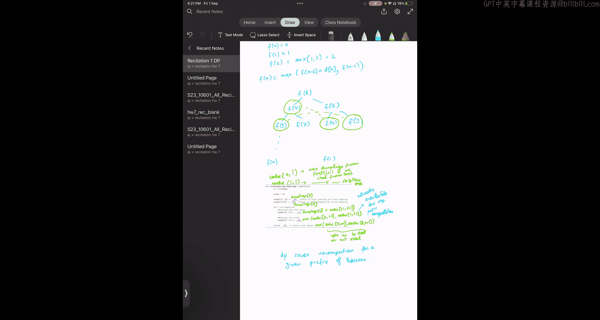

# CMU《机器学习导论｜Fall 2023 10-301⧸601 Introduction to Machine Learning》中英字幕（deepseek p34 Recitation_HW1_Dynamic_Programming.zh_en -BV1Z2cUefE4A_p34-

Recording input。

Hello， for this DP section on assertation one we be attemptinging this question。那他路。

So the question is you are for the kung fu pannda whose favorite food is steamed pork dumplings。

 so he plans to steal them from village houses。Aranged in a straight line。

 there's also a special security system in place that alerts master Shifu if there has been a theft in to consecutive houses。

诶， these houses啊嗯。So you need to help by employing the bottom of dynamic programming approach to steal the maximum number of dumplings from the houses without alerting。

Master shiftful。For any given house with index I。You just need to write the logical statement to calculate the value after。

King from this house。嗯，So logisticity。How do we attack。Yes。嗯。The dumplings are given us。This。

So like we start with a course approach。So net F and。Deote。Max dumplings。You can get。On the first。

暗 houses。For example， F of0。You just beze。F one。Will be one and half of two will just be。麦axoft。

because you cannot have one or two both because see that two kinds of kerosis would be max of1 or two。

 that will be two。So how do we calculate in a general sense， we would judge to f of n。Equal to。

My maxof。Suppose we steal the dumpling at n。What look like。

Then we cannot see the happening at 10 minus1。不。It plus dumpling。我讲。嗯。Yes。

And if we do not shield it up at end， then it puts us beautiful1 miles。I this here。对。Yeah。

 so how does a good for supposed look next， for example， we have to calculate it。嗯。Or example F six。

We will need to calculate。F of4 and f of5 from this formula and for F of4， we really need f of3。

 F of2。And I got five billion later of four。If three。Soう。We carry on we teach f of0。Or F of1。

 which we know the values for and you can see that we are calculating。These values multiple times。

What is exactly。These values multiple times， for example。嗯。So。

This is kind of a repeated calculation and D helps us to prevent that let's see how。没有。

So here is the catchy cache we store the values whatever we get in the cache。嗯。我该兴，我知道干什么，我该兴。Yeah。

他的。自億こはい。Is。有。Max dumplings。唔系。乾かしたい。Yeah。Plus1 dumplings。Yes。第。Steal it， steal from the last。

I'm Cashy。关个麦。Is the same thing， but we skip this one。

And cashching is like a tick so that if we calculate it once， we do not have to calculate it again。

So see here。What we can do is。悯农。That the value of cacheing 00 is。If you steal the first time。

 So it we could just be。Dumplings。知咯。Right。And。If。Cash 10， if we skip the second dumpling。

 you can just steal the first one again， so it will be dumpling 0。Yeah。哦。As we see here。

 we have to fill in this follow loop so we it in increasing values of I and what we see here is what does cache is zero I mean。

It means be actually stealing from this house， so it will be。Tumplings。系い。Okay。6。感谢。

One i minus1 because now we cannot see from I minus1。And here。Similarly， it will be。

Goashly one eye similarly means。Add。Is skipping this ho？So if you're skipping this house。

They just means that。We can do whatever at the previous house。It will be Maxof。那是。View I minus1。该谢。

I昧。Because we get the choice because。We can do whatever， because we did not。Yes， keeping this off。

And都。买啲蓝色。Is given by。Maxer。家谢。嗯。表爱。干什。要关问。Okay。我系。好。Okay。Because it's up to us。不是第。はい。あのし。Yeah。

So here we see this cache is already。A1ment。Due to。B。Computs。完析キ。Yes。Thecomp。4。For given。Ethics。

我 houses。Yeah。This is kind of a D task it maintains a storage where you calculate calculate and store previous showed value which you need later。

And then you can reuse them as you wish。

