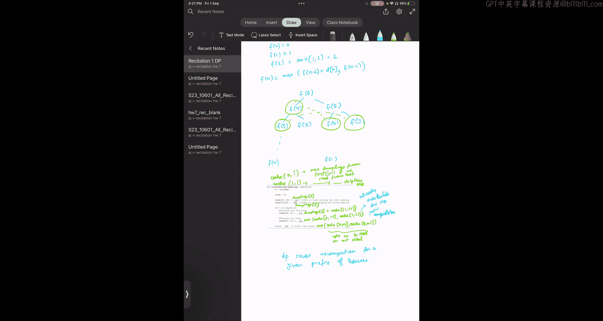

# CMU《机器学习导论｜Fall 2023 10-301⧸601 Introduction to Machine Learning》中英字幕教程


## 动态规划：小笼包盗窃问题

在本节课中，我们将学习如何使用动态规划解决一个有趣的问题：如何在不触发警报的情况下，从一排房子中偷取最多的蒸饺。

### 问题背景

假设有一个喜欢蒸饺的功夫熊猫，他计划从一排排列整齐的村庄房子中偷取蒸饺。如果连续两间房子被盗，则会触发警报系统。我们需要帮助熊猫通过动态规划方法，在不触发警报的情况下，从这些房子中偷取最多的蒸饺。

### 动态规划方法

为了解决这个问题，我们可以使用动态规划方法。对于任意给定的房子，我们需要编写一个逻辑表达式来计算从该房子开始能偷取的最大蒸饺数量。

**公式**：

\[ f(n) = \max(f(n-1), f(n-2) + 1) \]

其中，\( f(n) \) 表示从第 \( n \) 间房子开始能偷取的最大蒸饺数量。

### 动态规划实现

以下是动态规划实现的步骤：

1. 初始化一个数组 \( f \)，其中 \( f[0] = 0 \)，\( f[1] = 1 \)，\( f[2] = 2 \)。
2. 对于 \( i \) 从 3 到 \( n \)，计算 \( f[i] \) 的值。
3. 返回 \( f[n] \) 作为结果。

### 缓存机制

为了避免重复计算，我们可以使用一个缓存机制来存储已经计算过的值。这样，我们就可以在需要时直接从缓存中获取值，而不是重新计算。

**代码**：

```python
def max_dumplings(n):
    cache = [0] * (n + 1)
    cache[1] = 1
    cache[2] = 2

    for i in range(3, n + 1):
        cache[i] = max(cache[i - 1], cache[i - 2] + 1)

    return cache[n]
```

### 总结



本节课中，我们学习了如何使用动态规划解决小笼包盗窃问题。通过动态规划方法，我们可以有效地计算出在不触发警报的情况下，从一排房子中偷取最多的蒸饺数量。