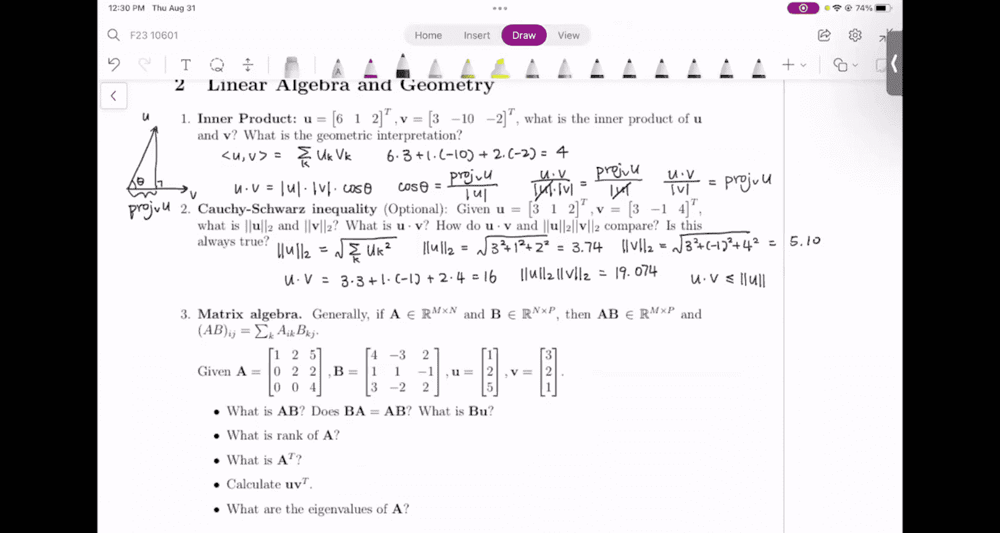
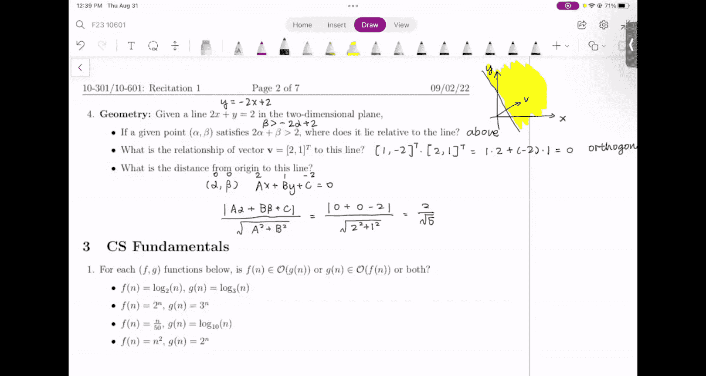

# CMU《机器学习导论｜Fall 2023 10-301⧸601 Introduction to Machine Learning》中英字幕（deepseek p35 Recitation_HW1_Linear_Algebra_and_Geometry.zh_en -BV1Z2cUefE4A_p35-

This is a solution video for Section 2， linear algebra and geometry。

Our first question is asking for an inner product of two vectors， U And B。

 So the formula for computing an inner product is that the inner product of U and B。

Is the sum of every paired elements in these two actors。In our example。

 we have six times 3 plus1 times negative 10 plus 2 times negative2。So we get a result of four。

The geometric interpretation is that the inner product is proportional to the projection of vector U on vector B。

So we have our vector U and B。The projection of vector U on B is this value。Over here。

 And if you try to understand this， because in our example， the UB are both in real value space。

 So the inner product is also a dot product。So we can recall the dot product formula is that。

Ass the magnitude of U times the magnitude of V times cosine theta where theta is the angle between these two actors。

Also in our graph on the left， we can see that the cosine theta can be calculated by the projection of U on B。

Divided by the magnitude of you。If we combine these two， we can get。

You thought V divided by the magnitude of U and the magnitude of V is equal to the projection of U on B。

Divided by the magnitude of you。 And we cancel some of the terms out。 So here we can see that。

The dog product of U MV。Is proportional to the projection of U on B。In our next question。

 we are given two vectors and we are going to calculate the norms of these two vectors。

The formula for calculating the norm。Is that we are going to take the square root。

Of the sum of every element scored。In our example， the norm of you。

Equals to the square root of three squared plus one squared plus two squared。We got 3。74。

The norm of V is the square root。Of three squareird plus negative one square plus four square。

And we get 5。1。And then we are also going to compute the dot product。

Which is  three times 3 plus  one times negative 1。Plus， two times 4。Which is 16。

And then the product of the norms。It's going to be 19。Dot 0，7，4。If we compare these two values。

 we found that the product of the norms is larger。Is this always true Here。

 We will recall the culture assurances in inequality。

Which is that the do product of two actors is always smaller or equal to the product of syns。

So yes， this is always true。

Our third question is matrix algebra， if we're given a matrix A of M by N and a matrix B of M by P。

 we get aB a matrix of M by P。First， we're going to calculate AB。

So because A and B are both three by3 matrix， A B is also going to be three by3。To compute AB。

 we are going to take every row in A and perform dot product with every column with B。

To get our first column。To get our first vote。So our first row is going to be。21。Negative 11 and 10。

 Then we take our second row in a and to perform dot product with every column in B。

We get eight and negative2 and two， and then we use our third row in a perform dot product with every column in B。

You get 12。Negative8 and8。Thus B equals to A B， the answer is no and you can try to compute B。

And compare this with AB。唔快乐以。Compute B， U。 So you is。re by one。B is3 by3。

 So B U is going to be a3 by one matrix。We are going to take every row in B。

To perform that product with you。And get our three numbers here， which is 8。Negative2 and9。

What is the rank of a， So the rank of a matrix is the total number of independent columns in the matrix。

 Here we see all three columns in A are independent。 So the rank of a S B。What is a transpose。

 So to transpose a matrix， you are going to flip it by the diagonals。So a transpose is going to be 1。

0，0。2，2，0。5，2，4。Yeah。Calculate you V transpose。 So U is a3 by one matrix。 V is also 3 by one。

 So V transpose is going to be 3，2，1， which is one by 3。

So our result should be a three by three matrix。So here is going to be  one times 3。1 times 2。

 one times  one。And then use two here， so it's going to be two times three。Two times2， two times one。

And finally five times three。Five times2 and five times one。Finally， what are the eigenvalues of a。

 so to compute eigenvalues， we are looking for a lambda value that for every non0 vector v A V equals to lambda v。

We can rewrite this formula。S A B minus lambda I B equals to 0。

 where I is the identity matrix with one on the diagonals。Here we can pull the V out。

Because V is a non zero vector。We are going to solve the equation of a minus lambda I equals to 0。

 because I is the identity matrix。We can subtract lambmbda anti di of a。

And then we will continue to solve for this。So here we get one minus lambda times 2 minus lambda times 4 minus lambda and the rest of these two terms after we calculate。

 we found out they're both zeros。So this is our equation and lambda can be values 1，2， and 4， so 1，2。

 and4 are the ion values of a。our final question is about geometry。

We are given a line 2 x plus y equals to 2 in 2 d space。

 and also we are given a point alpha beta that satisfy2 alpha plus beta is larger than2 what's its relative position to the line。

If we draw our line into this space。It roughly looks like this。

We can rewrite our line as y equals 2 negative2 x plus 2。

And also rewrite this inequality as beta is larger than negative to alpha。Plus 2。

 so here we can see that our point alpha beta always lies above this line。

Our next question is what's the relationship of a vector V to this line。

 So if we look at the equation of this line， we find that for every increase one unit increase in x。

 there is a two unit decrease in y so we can say that our line is parallel to the vector of one negative2。

So if we perform that product。Of vector 1 negative 2 with B。We can get 12 plus negative2 times1。

 we get zero。So the vector B is。Orgongonal to this one negative2 vector。

 And because our one negative2 vector is parallel to our line。

 our line is orthogonal to the vector B。So this is R vector B。Finally。

 what's the distance from the origin to this line here we will recall the formula from a point to align the distance formula。

 which is。For a point alpha beta。And align A X plus B， Y plus C equals to 0。

The formula is going to be a alpha plus B。Beta plus C。Divided by the square root of a squared。

 plus B squared。So here our alpha beta are 0。A is2， B is 1， C is negative 2。

 so we plug in our values。To get 0 plus 0-2。Divided by two square， plus 1 square square root。

We get to over square root of five。And this is our distance from the origin to this line。

