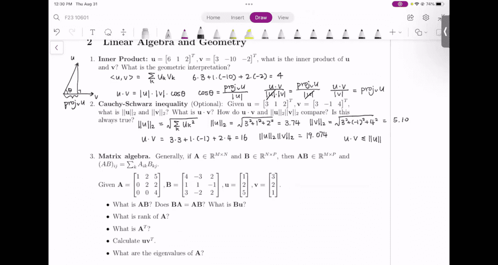
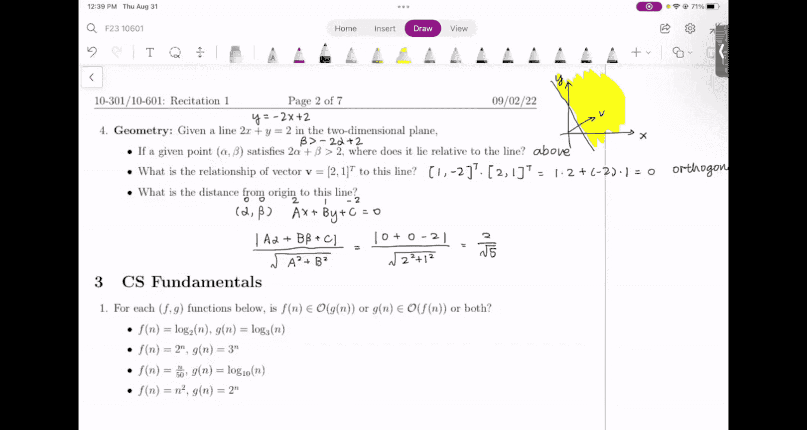

# CMU《机器学习导论｜Fall 2023 10-301⧸601 Introduction to Machine Learning》中英字幕教程

## 1. 线性代数和几何

### 1.1 内积

**公式**：内积 \( \mathbf{U} \cdot \mathbf{B} = \sum_{i=1}^{n} U_i \times B_i \)

**解释**：两个向量 \( \mathbf{U} \) 和 \( \mathbf{B} \) 的内积是它们对应元素的乘积之和。

### 1.2 几何解释

**公式**：内积与向量 \( \mathbf{U} \) 在 \( \mathbf{B} \) 上的投影成正比。

### 1.3 点积

**公式**：点积 \( \mathbf{U} \cdot \mathbf{V} = |\mathbf{U}| \times |\mathbf{V}| \times \cos(\theta) \)

**解释**：点积等于两个向量的模长乘积与它们之间夹角的余弦值的乘积。

### 1.4 规范化

**公式**：向量 \( \mathbf{U} \) 的范数 \( ||\mathbf{U}|| = \sqrt{\sum_{i=1}^{n} U_i^2} \)

**解释**：向量的范数是它各元素平方和的平方根。

### 1.5 规范化乘积

**公式**：两个向量的范数乘积 \( ||\mathbf{U}|| \times ||\mathbf{V}|| \)

### 1.6 点积不等式

**公式**：点积 \( \mathbf{U} \cdot \mathbf{V} \leq ||\mathbf{U}|| \times ||\mathbf{V}|| \)

**解释**：两个向量的点积小于或等于它们的范数乘积。

## 2. 矩阵代数

### 2.1 矩阵乘法

**公式**：矩阵 \( \mathbf{A} \) 和 \( \mathbf{B} \) 的乘积 \( \mathbf{AB} \)

**解释**：矩阵乘法是将 \( \mathbf{A} \) 的每一行与 \( \mathbf{B} \) 的每一列进行点积。

### 2.2 矩阵转置

**公式**：矩阵 \( \mathbf{A} \) 的转置 \( \mathbf{A}^T \)

**解释**：矩阵转置是将矩阵的行和列互换。

### 2.3 特征值

**公式**：求解 \( \mathbf{A} \mathbf{v} = \lambda \mathbf{v} \)

**解释**：特征值是使得 \( \mathbf{A} \mathbf{v} = \lambda \mathbf{v} \) 成立的 \( \lambda \) 值。

## 3. 几何

### 3.1 直线方程

**公式**：直线方程 \( 2x + y = 2 \)

**解释**：直线方程表示在二维空间中直线的位置。

### 3.2 点与直线的相对位置

**公式**：点 \( \alpha, \beta \) 满足 \( 2\alpha + \beta > 2 \)

**解释**：点 \( \alpha, \beta \) 位于直线上方。

### 3.3 向量与直线的平行关系

**公式**：向量 \( \mathbf{V} \) 与直线平行

**解释**：向量 \( \mathbf{V} \) 与直线的方向向量平行。

### 3.4 向量与直线的垂直关系

**公式**：向量 \( \mathbf{V} \) 与直线垂直

**解释**：向量 \( \mathbf{V} \) 与直线的方向向量垂直。

### 3.5 原点到直线的距离

**公式**：距离 \( d = \frac{|Ax + By + C|}{\sqrt{A^2 + B^2}} \)

**解释**：原点到直线的距离是 \( \alpha, \beta \) 到直线的距离的平方根。