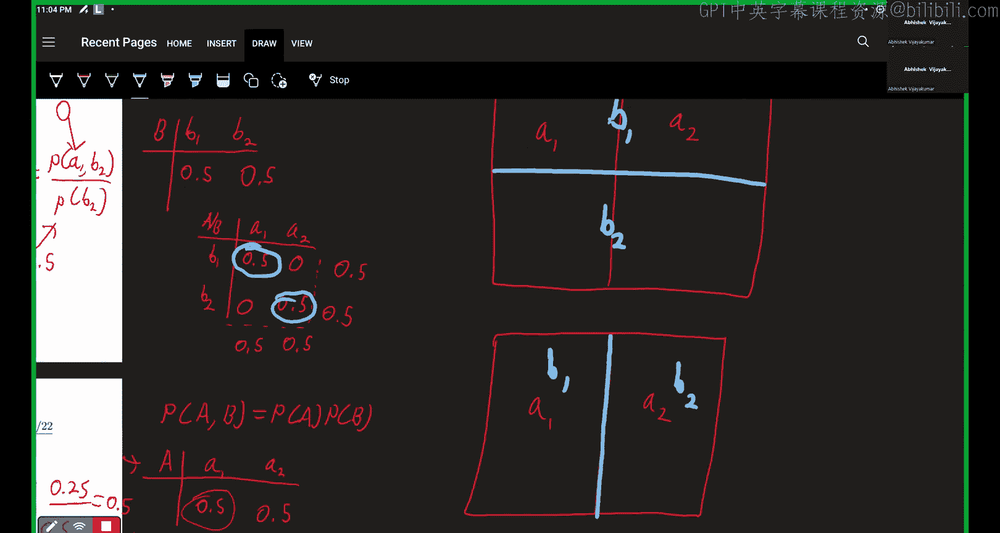

# CMU《机器学习导论｜Fall 2023 10-301⧸601 Introduction to Machine Learning》中英字幕（deepseek p37 Recitation_HW1_Probability_(Part_1).zh_en -BV1Z2cUefE4A_p37-

In this section of the recitation， we're going to be covering probability and statistics。

 you should already be familiar with some of the basic concepts of probabilities such as events or outcomes in a sample space。

However， in this class， most of our content is going to focus on random variables and their distributions。

In this section of the recitation， we're going to be covering two concepts。

 the idea of disjointness and the idea of independent random variables。

For the notation we will be using。If you are unfamiliar with some of the ideas expressed in written form。

 please look at the notation guide on the course website for this class。Now。

 suppose we have two random variables， A and B。A takes on one of two outcomes， either A1 or A2。

And B takes on one of two outcomes， either B1 or B2。

We are given that the probability that a equals a1 is 0。5， the probability that B equals B1 is 0。5。

Given that， since we know that the possible outcomes are only A1 and A2 for A and only B one and B2 for B。

That is， these are known as binary random variables。

We know that all of the probability that is not on the first outcome must be on the second outcome。

So we can infer that the probability of A2 is 0。5 and the probability of B2 is likewise 0。5。

In this class， we'll see binary render variables pretty often and they'll often have the outcome0 and one。

Now let's consider the relationship between A and B。First。

 let's suppose that A1 and B2 are destroyjoint outcomes。 this means that if A1 occurs。

 B2 cannot occur。We can then draw out a probability table for both A and B simultaneously。So。

Let's write our outcomes A1， A2 here and our outcomes B1 and B2 here。

And we know that the total probability of a1 must be 0。5， so whatever is in this column a sum to 0。

5 and whatever is in this column a sum to 0。5 for a2 Similarlyly。

 the totals for B1 and B2 must also be 0。5。Now， we know that if A1 occurs。

 B2 cannot occur because A1 and B2 are disjoin。So the A1 B2 cell of this table must be 0。

The probability of a equals a1 and B equals b2 is0。And that answers our first question here。

This is0 because A1 and B2 are defined to be disjoint。

Then let's look at the probability of A1 and B1， so we know that this column must sum up to 0。

5 and we know that this value is 0， so this value has to be 0。5。Using this。

 we can actually fill in the entire rest of the table。

 We now know that this first row has to sum to 0。5， so this cell has to be 0。

 and that forces this to be 0。5 as well so that the remaining sums work out。So given this。

 we can go back and answer our second question that A1 and B1 occurring together have to have a probability of 0。

5。Oh。Our next question is a bit trickier。 We're asking now about a conditional probability。So。

The definition of conditional probability tells us we're asking for。

Probability A 1 given B2 equals probability of A 1。

 comma B2 or A1 and B2 divided by the probability of B2。The probability of B2 is given here by 0。5。

 as we discussed earlier。And then the probability of A1 and B2 is in our table as zero。

So this actually is also a 0 that given that B2 occurred， the probability that A1 occurs must be 0。

 And that's， again， another way of kind of talking about disjointness。

So it's important to note that there is a difference between this first and this third question。

 The first question is asking， what is the probability A 1 occurs and B2 occurs。

In the third question， we're saying we're telling you that B2 already occurred。 Now。

 what is the probability that A 1 occurs。 In this case， they do both happen to be 0。

For our second question， we're going to look at the case where A and B are independent。

That is the probability of A comma B or A and B for some outcomes of A And B is equal to the probability of A times the probability of B。

Let's see how this plays out with our probability tables。

Our tables for A And B before still work out。 So we still have that。A。Has probabilities a1 was 0。

5 and A2 is 0。5。And we still have B with outcomes。B1，0。5， and B 20。5。

But our joint table for A and B might look different because we've now changed the relationship between A and B。

So。Just as before。We have that the sum of the values of。The outcomes for a1 must be 0。5。

And the sum of the outcomes for A2 must also be 0。5。It sameme for B1 and B 2。

 Just notice that I switched these here for A and B， So I'm going to。

Put them back to mirror the same order we had in the original table。

So we now have this additional constraint that the probability of a comma B for a given case must be the probability of a times B for that case。

 So let's look at the probability that we're asking compute。The probability。

A equals a1 and B equals B2。Is equal to the probability that a equals a1。

Times the probability that b equals B2。Looking into our table， we see that。These values are both 0。5。

So this probability is actually equal to 0。25。So we can actually just read that information directly from these two tables and then plug into this table。

So it turns out that all four cells in our table have the same probability of。0。25。

Going on to our second question。We have probability of A1 B1， and again， looking into our table。

 that's the probability of just a1 to 0。5 times the probability of just B1， and we get 0。25 again。

Finally， we come to this conditional probability case。So now we're looking at the probability of。A1。

 given B2 is equal to the probability of A1 and B2。Divided by the probability of B2。

And for probability of B2， we look into our table and we get 0。5 for the probability of A1 and B2。

 we look into our table and we get 0。25。So our answer is 0。5 again。

So now we've done all these exercises pictorially using these probability tables。

 but we can also look at this idea of disjointness and this idea of。Independence more graphically。

 so suppose we have some kind of graphical representation of our sample space or。

Of all possible outcomes。The independencedepend case looks something like this。

We divide up our space， kind of evenly between the。A1， A2 event。So let's use lowercase in。

Just to keep our notation consistent。And the B1 and B2 events。Looking at this here。

 we see that each of these cells takes up。Kind of an equal amount of our sample space。

 And knowing that we're in just the B1 half of this picture doesn't tell us any more information about whether we're more likely to be in A1 or A2 because we've kind of evenly divided that space such that the A's and B's don't bias each other。

 And that's our notion of independence。Our notion of disjoint outcomes or having something be mutually exclusive looks more like this。

 we divide a space with a1 and a2， but now we say that our outcomes A1 and B2 are disjoint so。

In the case where A1 occurs， B2 cannot occur， B2 must only occur in this A2 case。

And since B2 and A2 both have a probability of one。Oh sorry it was 0。

5 then this must be the same size region of our sample space。

 so we now have A1 B1 being one half of space and A2 B2 being one half of the space and telling us that we're at A1 tells us exactly that we must be in the B1 case as well and that's kind of represented in our table right here where we have the 0。

5 here and 0。5 here but zeros in the other cases。In our next section。

 we're going to look at some of the applications of probability。

