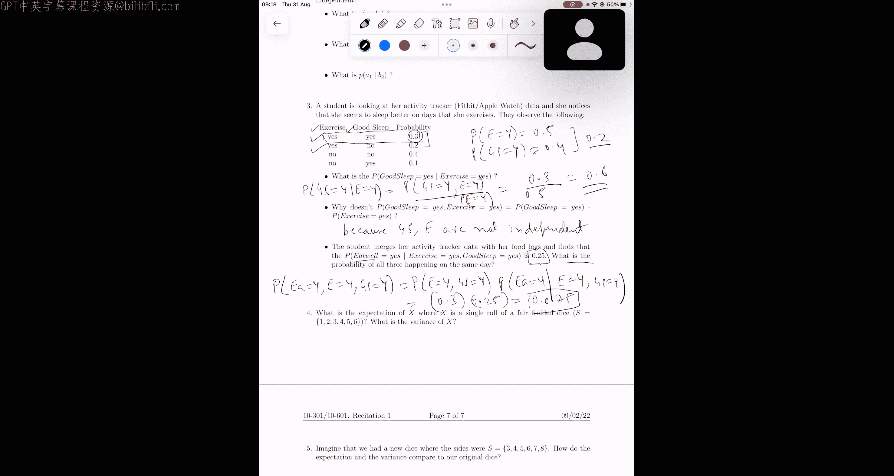
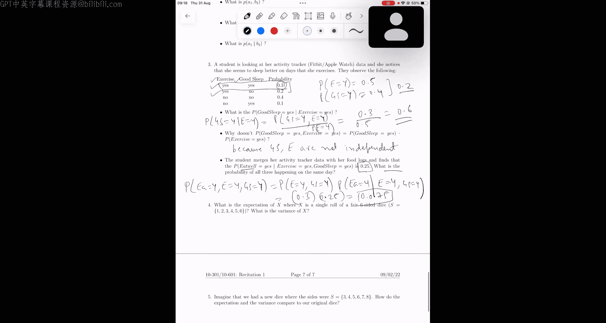
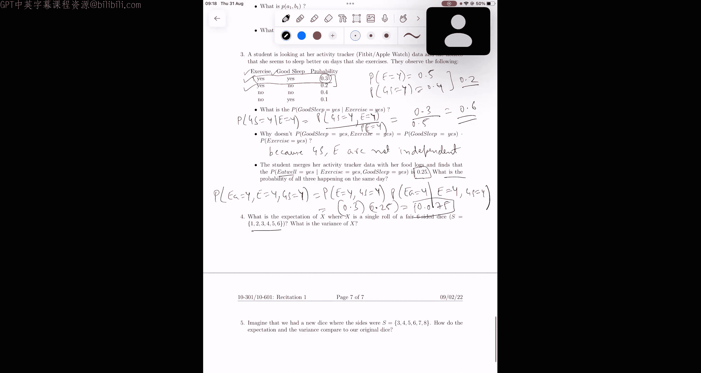
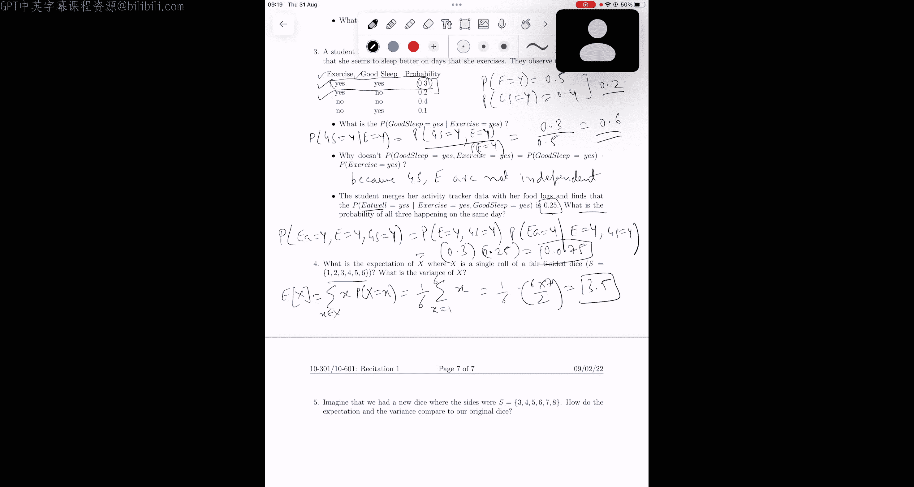
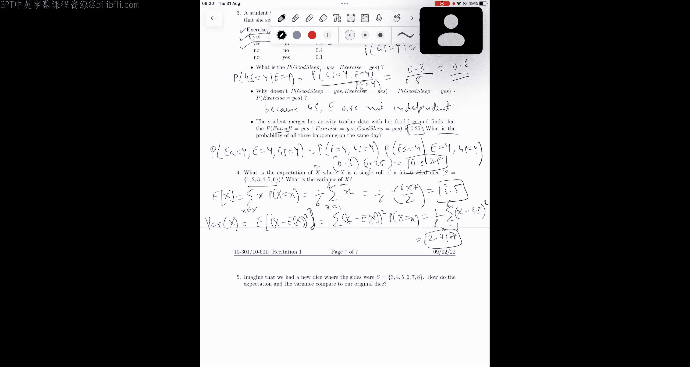
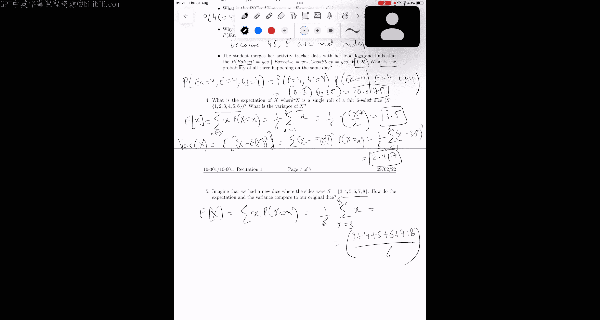
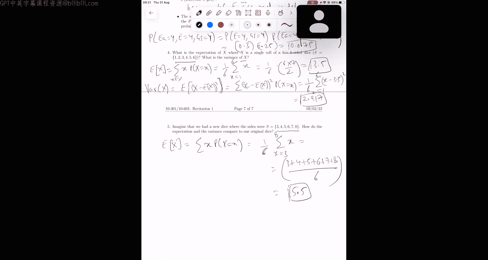
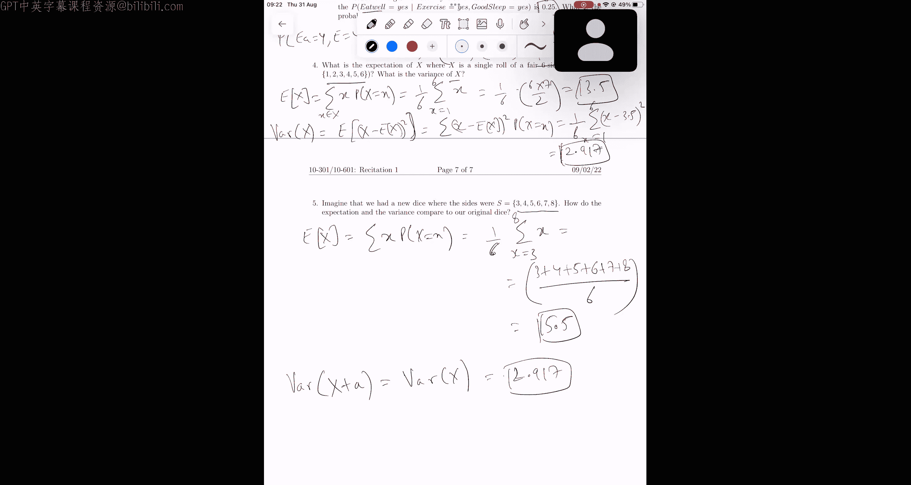

# CMU《机器学习导论｜Fall 2023 10-301⧸601 Introduction to Machine Learning》中英字幕（deepseek p38 Recitation_HW1_Probability_(Part_2).zh_en -BV1Z2cUefE4A_p38-

Continue with some questions on probabilityability and statistics。

 so let's look at the third question in which we are given this joint distribution of two random variables exercise。

Exercise and good sleep and then we are given the joint distribution of each of the values which these to the undervariable stakes which is at the yes or no。

 and then we are asking questions about conditional ourability and independence and it's answer those in the first part we are asked to calculate the probabilityability that good sleep equals yes given that exercises yes so using the equations we saw in the last couple of questions this would just equate to。

probabilityability that good sleep equals yes， given that exercise equals yes。

 this is just the joint probability。Of good sleep equals yes， and exercise equals yes divided by。

The probability that exercise equals yes now the first the term in the nuiliator can be seen as the first row here where both these random variables take the values of yes。

 this is just 0。3 and to calculate the probability that exercise equals yes。

 we can just add the first and the second those together because that would marginalize out the good sleep random variable and we would just get 0。

3 plus 02 which is 0。5。So the answer becomes 0。6 with the first part。

Now for the second part we're asked why doesn't good sleep the probability that the joint probability that good sleep equals yes and exercise equals c equals the product of the two marginals and for this let's first see if this is true or not so in the last part we saw that the probability that exercise equals yes is a 0。

5 and similarly if we add the first though in the last we get the probability that good sleep equals yes to be 0。

4 and then the product of these two is 0。2 which is not equal to 0。

3 and then the reason why the product of the two individual probabilitybilities is not equal to the joint probabilityability is because。

These two underizables are not independent。Because if they were independent。

 then we would know that the product of the joint， the part of the marginal should equal the joint。

 but because they are not， we can say that because good sleep and exercise are。Not independent。

And finally， let's move on to the last part in which we are given this probability。呃 that a。

We are given some other third random variable called E12 and then we are given this conditional probabilityability that the probability that E2 takes the value yes。

 given that exercise and good sleep for yes is 0。25 and then we are asked what is the probability that all the randomom variables take the value yes on the same day so we essentially want to calculate probability E12 equals yes and exercise equals yes and good sleep equals yes and then using the product rule of conditional probability we can break this down and we can basically condition this entire probability on the on exercise and good sleep and then use this other term so we can write this as probability that exercise equals yes and good sleep equals yes times the probability that E12 equals yes given that these two random variables for yes。

And then this term we just calculated we know this from the table here， so this is just03。

 so this is0。3 and then the second term we are given from this part which is025。

So the overall probability becomes 0。075。Yeah， so this is the joint probability that all three random variabless eat well exercise and good sleep take the value yes。

 simultaneously。

Okay， so now let's move on to the fourth question in which we are asked to calculate the expected value of for random variable x and x is a single z of a first excited die so s can basically select we are given this sample space of1 to3。

4，5 x and each of these is equally likely and we are asked to calculate the expected value of a random variable x where x is just the value obtained on a single hole。

So we know that the expected value of any randommedable x is just for all x in which the values x can take it's just x times probability ability that x equals x so in this case this would just be because each of these values as like equally likely we can just type this as one by6 each so we just take one by6 out the probability and then we are just left with x where x can take the value from1 to6 and then this is just the sum of the first n natural numbers from one to n which we know is just6 into 7 by2 so this answer becomes 3。

5。

And to calculate the variance， so now we also have to calculate the variance of x。

 so we know that the variance of a random variable x is just the expected value of x minus expected value of x。

 the square of this。So this essentially me， this is just。

F in submission formula will get the submission of x minus。Expected value of x squared。

And the probabilityability that x takes the value x and this would amount to1。

 we just take the probabilityability out because it's constant and were left with just x minus 3。

5 squared。And x takes value one to six， and if you solve this， you would get an answer of 2。917。

 you can modify this。Just by plugging in the values from one to six and just comparing。

Okay， now let's move on to the last part where we're given this we also another excited dive but this time the values on the faces are different。

 we now have the values as 3，4，5，6，78 so essentially we've just added to to all the values to all the existing values on the fair and now we want to calculate the expected value on the variances again so we can just use the same approach as we used before。

 so we would again look at the。Expected value and this time you will just have so this would this time you will have x from3 to eight。

And then， if you just add。嗯。So this is what we get。

And if you just simplify for this， you will look at the value as 5。5。

 which also makes sense because if you're adding two to all the individual。

Individual cases on the die you basically add two to the mean as well so initially the mean was 3。

5 and2 you add 2 to every single value on the die the mean would also increase by2 and for the variance this is a property of the variance that because we are adding a constant numbers to every single every single every single value which is anmedable can take the effective variance would not change because variance is in essence just the spread around the mean and because we have shifted all the values by a constant amount the spread would mean the same but it's just that the mean would shift to another new point and this can be represented by this that the variance of an undermedable x if you add some constant value8 to it this is just same as the variance of x and from the last part we know that this was 2。

917 so we basically get the same value of the variance as it was before。

怎样读？