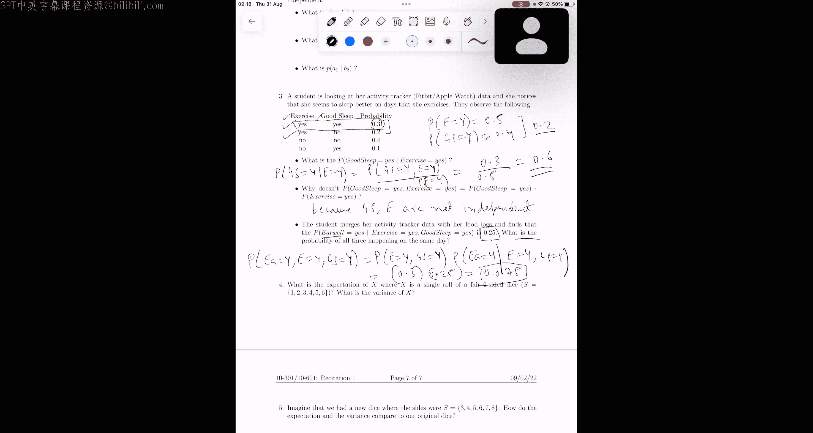
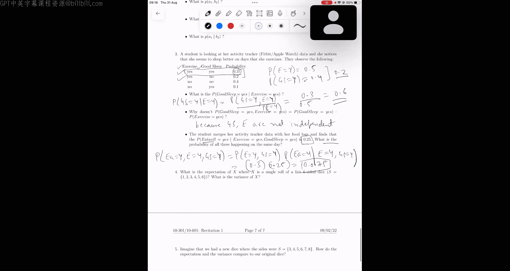
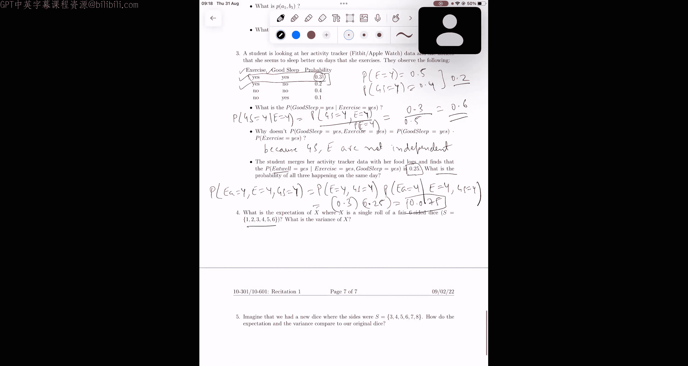
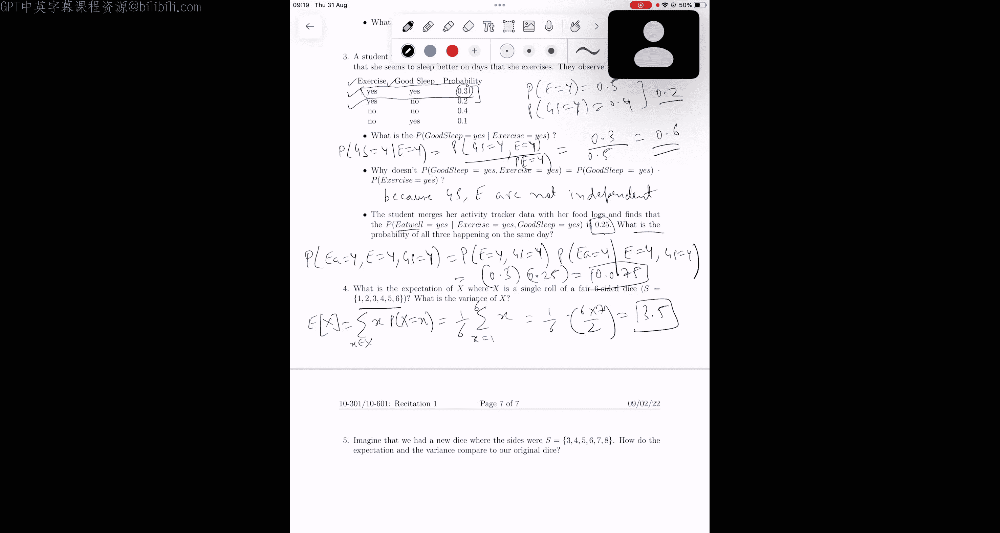
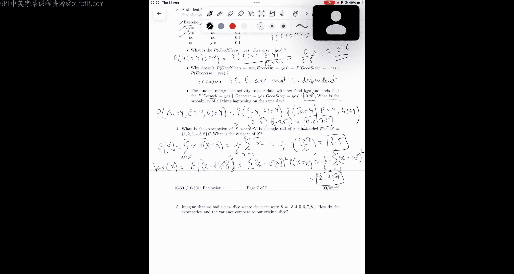
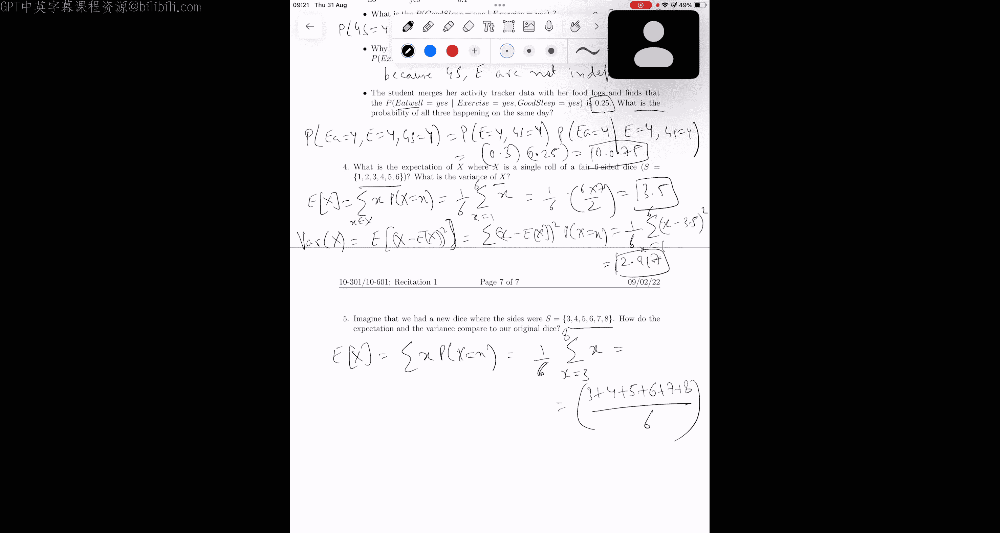
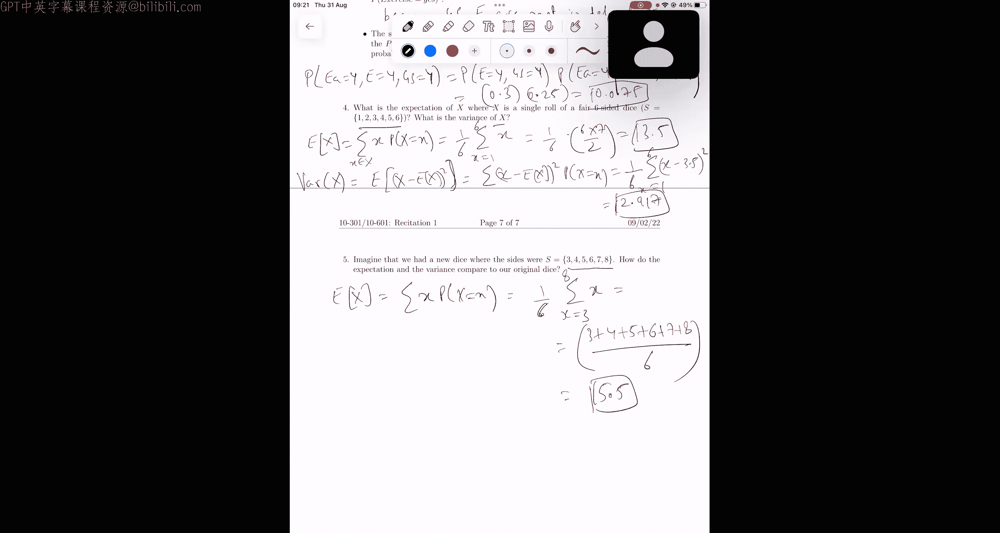
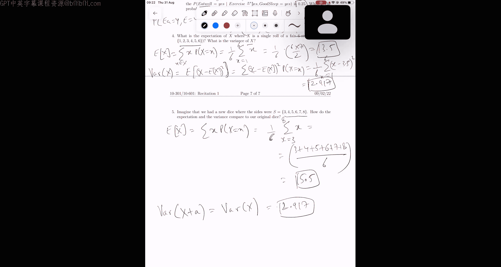

# CMU《机器学习导论｜Fall 2023 10-301⧸601 Introduction to Machine Learning》中英字幕教程

## 练习：概率和统计问题

在本节课中，我们将学习如何解决概率和统计问题，特别是涉及条件概率和独立性的问题。

### 1. 联合分布和条件概率

**问题**：给定两个随机变量X和Y的联合分布，计算条件概率P(Y=是|X=是)。

**解答**：

- 联合概率公式：P(X=是, Y=是) / P(X=是)
- 计算步骤：
  - 联合概率：0.3
  - P(X=是)：0.5
  - 条件概率：0.3 / 0.5 = 0.6

### 2. 独立性和边际概率

**问题**：为什么P(Y=是, X=是)不等于P(Y=是) * P(X=是)？

**解答**：

- 独立性检验：P(Y=是) = 0.4, P(X=是) = 0.5
- P(Y=是) * P(X=是) = 0.2 ≠ 0.3
- 原因：X和Y不是独立的

### 3. 条件概率和联合概率

**问题**：给定一个额外的随机变量E2，计算P(E2=是, X=是, Y=是)。

**解答**：

- 条件概率公式：P(X=是, Y=是) * P(E2=是|X=是, Y=是)
- 计算步骤：
  - P(X=是, Y=是) = 0.3
  - P(E2=是|X=是, Y=是) = 0.25
  - 联合概率：0.3 * 0.25 = 0.075

### 4. 随机变量的期望值和方差

**问题**：计算一个公平骰子的期望值和方差。

**解答**：

- 期望值公式：E(X) = Σ(x * P(X=x))
- 计算步骤：
  - x的可能值：1, 2, 3, 4, 5, 6
  - P(X=x)：1/6
  - E(X) = (1+2+3+4+5+6) * (1/6) = 3.5

- 方差公式：Var(X) = E(X^2) - [E(X)]^2
- 计算步骤：
  - E(X^2) = Σ(x^2 * P(X=x))
  - Var(X) = 2.917

### 5. 改变骰子值的影响

**问题**：如果将骰子的值改为3, 4, 5, 6, 7, 8，计算新的期望值和方差。

**解答**：

- 期望值：5.5
- 方差：2.917
- 原因：期望值增加2，方差不变

本节课中我们一起学习了如何解决概率和统计问题，包括条件概率、独立性、期望值和方差。