# CMU《机器学习导论｜Fall 2023 10-301⧸601 Introduction to Machine Learning》中英字幕（deepseek p41 Recitation_HW3.zh_en -BV1Z2cUefE4A_p41-

We can start discussing potential solutions， do you guys come up with some solutions？

Does anybody want to go first？嗯。And I guess'm give you guys the solution。

 so potentially what we'll want to do is classify all of this。

All these three clusters into one individual partitions so that there's no sc at all。

 so how we're going to do that is。Find a coordinate in either x1 or x2 in the beginning and then proceed from there further so in the decision tree given on the right hand side we start with x1 so we're going to see if we can find a potential number on x1 that will split it into two individual clusters so let's take four if we。

Draw line at 4。It would split the green into one cluster and the purple and yellow into another so we isolated the green cluster and then if we consider another number on x2 and see if we can classify the purple and yellow into one cluster so again I'm going to take four。

And we have all the three clusters isolated。 so here alpha is going to be。

4our and x2 over here beta is also going to be4， so when x1 is less than4 we have to choose between we have to choose value on x2。

 but when it's greater than4 we have classified the entire region as green。

And when we have x2 less than4， that's this region。

 we classify those points as yellow and when x2 is greater than4 is this region and we classify that as purple。

Do you guys have any doubts？I it's not a question。Can you pick any value between35 and4 for excellent？

I on school have zero traininger。Yeah， so。It should just fall between these two partitions。And。

Any other questions？So moving on to the next question。So。

This question is kind of a different variation from the first in the beginning in the first question we didn't want to have any error at all so it should all be perfectly classified over here we can have errors but it should be minimized by the mean squared error so how are we going to tackle this situation。

So the split is still going to be the same because that's the best split we can do。

 so I'm just going to take this split from the previous question。Yeahや。

And how do we find the values of alpha and be such that the training mean squared error is minimized？

So how we're going to handle that situation is let our means squared error the formally is submission。

我 one over。Wl square so we're going to take the derivative of this one。

 derivative of the loss function， so let's say this is J。And。This things quite。

 So we're going to take。Sorry about that。 you can take the derivative with respect to y that's nothing but and we have to equal it to0 to find the error。

 so it's going to be。嗯。In dis someal。无能啦。Yeah。喂。And if we equally。And we  equi this to zero we have。

😔，Not to zero and。Smation of。Y I equal to1 convert n， we split this。And we get。

We've just taken these oations。Some all I had。 so this。Can be just written as NY。

 so we have sum of I equal to 1 over and Yi。Equal to NY。

Soty NY hat and Y hat is nothing but summation of I equal would1 to n， Y I hat divided by n。

 which is nothing but the mean value。

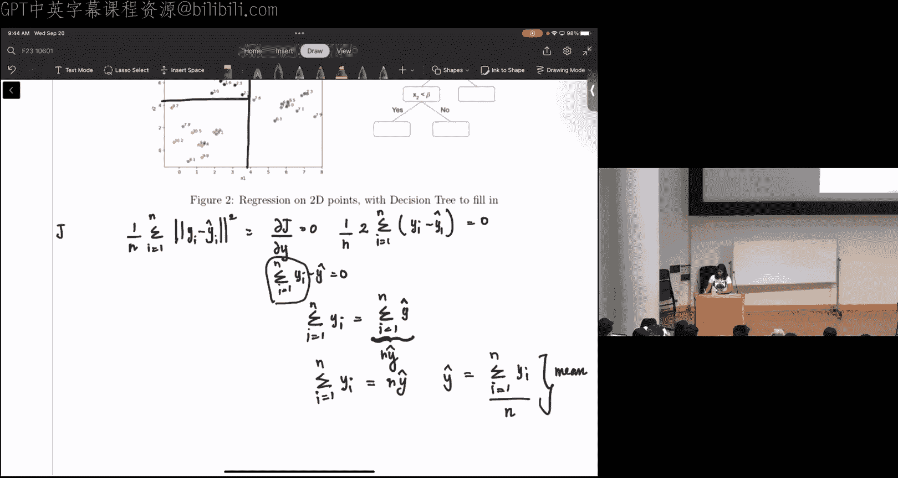

So all these coordinates have a value over here if you can zoom around see so this is 7。66。

3 so for this。

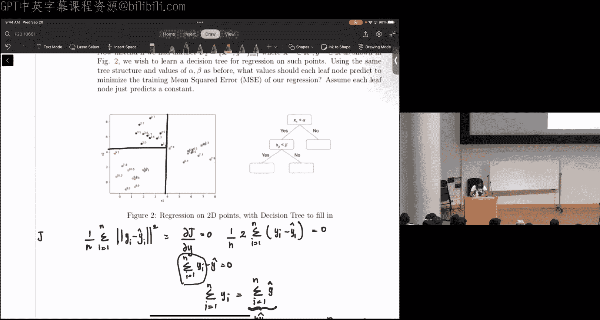

Particular green cluster which just going to take the main value and that would so alpha is going to be4 beta is going to be4 but the values that are going to be filled inside these boxes are going to be the main values so i'm just going keep the answer but you guys can verify it later so it's going to be 6。

9 for this one 2。5 for this one and 9。2 for this one do you guys have any questions。

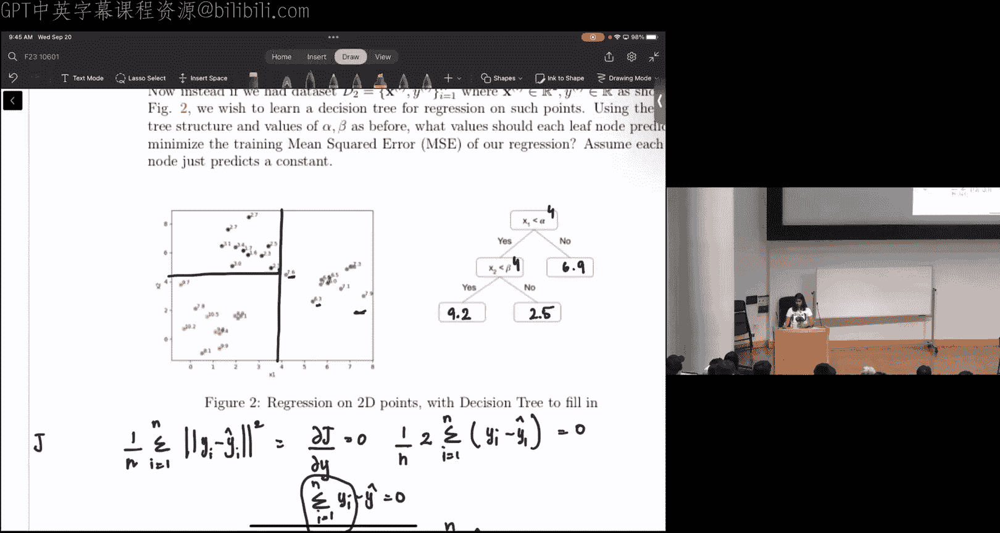

If not， we can move to the next question。what might happen if we increase the max depth of the tree when predicting on onseen data would you prefer a depth to tree above or a very deep tree so first let's handle the first part of the question what might happen if we increased the depth of the tree。

6所。Yes， sure。30。はい对这就す。We we did get the exact understate。Oh， I just took the mean of the cluster。

So we partitioned at four right so everything in x1 everything greater than4 falls into the green cluster。

😊，So since we're trying to minimize the mean squared error。

 the value that would take the place of the box would be the mean of the cluster。

 so each of these coordinates have a value。

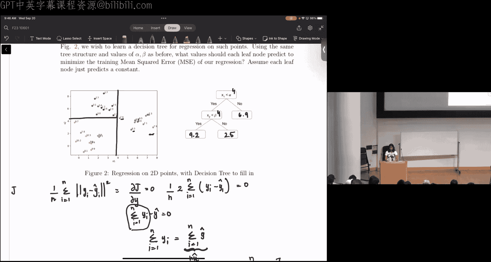

Right above it like 7。6， yours 6。5，7。3。Yeah， you just have to take the mean of that value and that would be the answer。

给で三。Okay。Getting mean of the cluster。最没で。我 did。can you speak you the points specific color and then your the value of that point No。

 it's just the mean， yeah， just the mean。So the map below is it's because we have to minimize the mean squared error。

 right？😊。

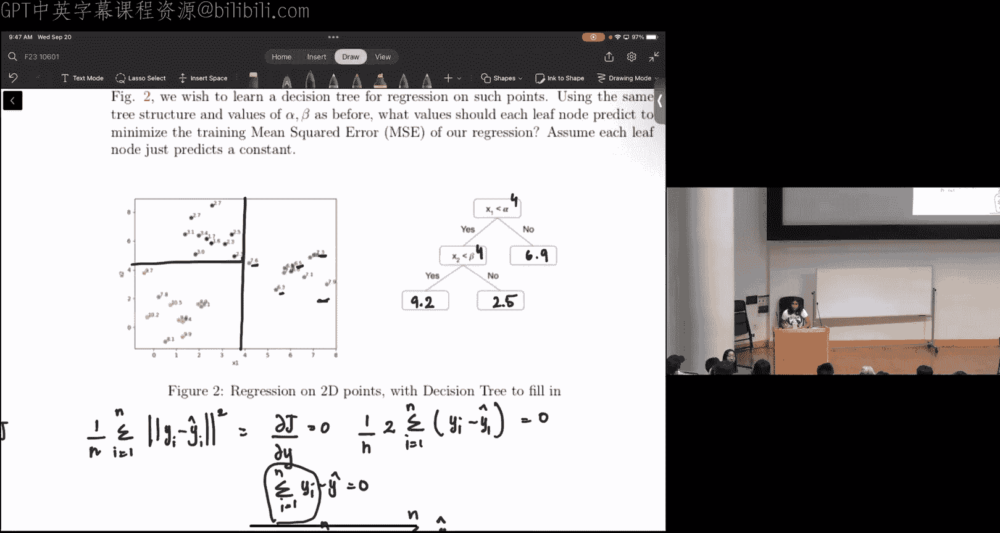

So we while finding the derivative and equating it to zero， we find that the minimum value。

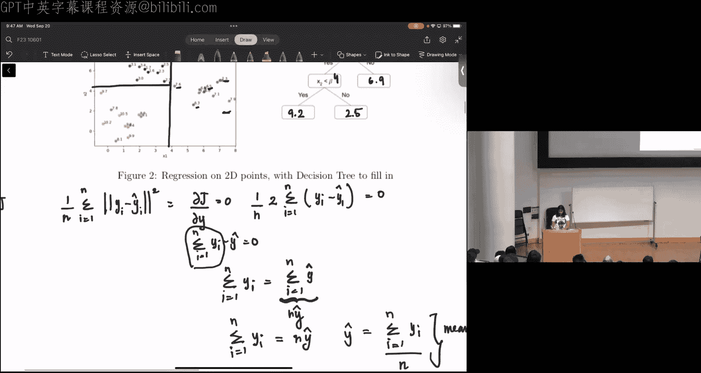

If we minimize the mean squared error， it would be the mean of the cluster。

That's the derivation for it。就们。Should I go at it again Okay do you guys have any other questions？

I was wondering this why hat our Botted going。Oh I'm sorry， I forgot to explain that， yeah。

 this is the ground truth。I'm sorry， there shouldn't be in Iowa。Yeah。

 it's the ground truth and whyi is the predictive value。

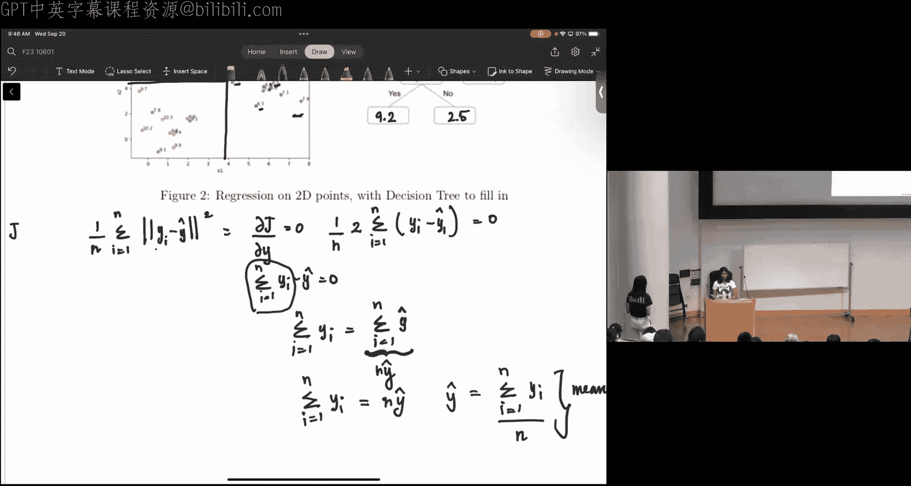

So here why hat would be like either of these categories， it could vary from like yellow。

 green or purple。😊，S。Should it be why instead of？我wi系。Because we're only predicting one vote。Take。

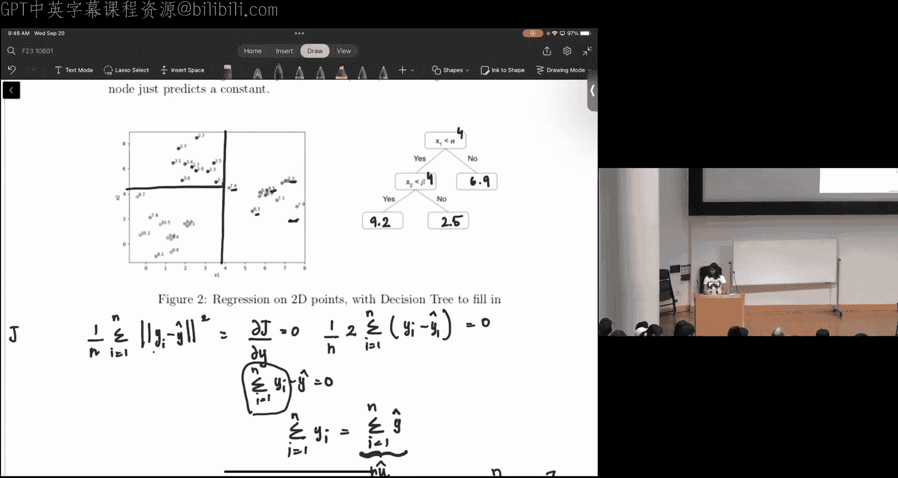

Okay， I think I might have been wrong why hat is the predicted I just swap it my bad I'm sorry why hat is the predicted why I is the ground truth。

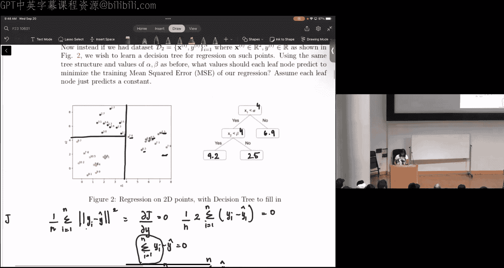

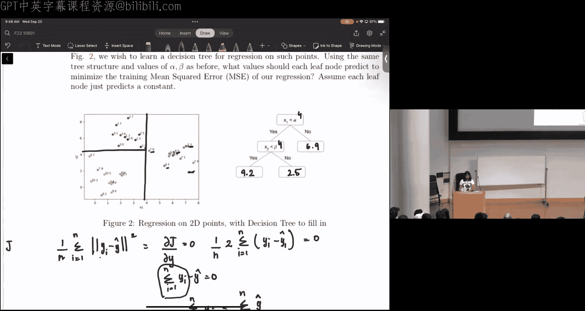

Then should it be perfect derivativeed with a segment about that？

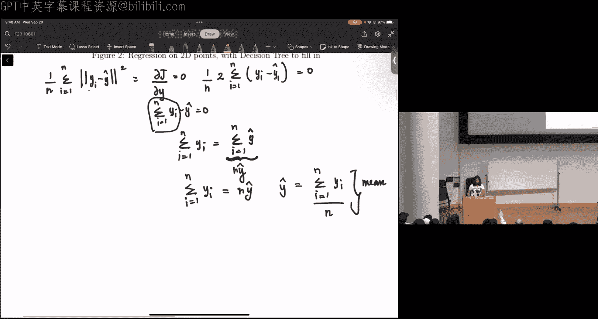

Yeah， I swap putting numbers that's。

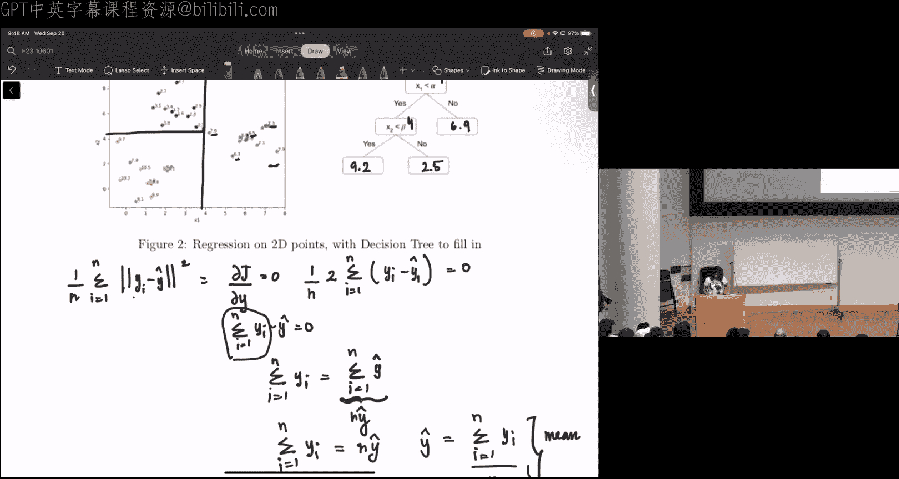

Yeah， it should be。Sorry。I'm sorry about that。Yeah。就你不得。If there are no further questions。

 can we move to the next one？Okay， so any answers on why what might happen if we increase the max depth of the tree？

So if we increase the max depth of the tree， we will be able to get more closer finite partitions for example。

 let's take the previous example and let's say that there were even more。

Or we could just even narrow down this cluster a little more。

 we could probably like have a partition over here and then we could probably have one over here and then。

to be here。 So what it would do is essentially it would。Have even more narrower clusters。

 so the more depth we have we will have more finite partitions and how that might be an issue do you guys have any idea how that might be an issue。

Yeah。So would we for while predicting on an unseen data。

 would we prefer a depth throw tree or tree with a larger maximum depth？What would be your call？

So I personally would go with a depth tow tree because。

When we're predicting on unseen data it's better to have a partition that's more generalizable so that we can reduce the error so like your fellow classmate told if we have a tree with a larger max step then we would have overfitting so one example of that could be let's say we have points。

Like this。And we have a。Decision boundary。Like this。

 so when we're trying to this is not the ideal partition。

 but this is the partition that if we have a larger max step that would give so when we have a point。

 let's say we have an unseen test point。So how this would not be classified as a negative point because it's outside the decision boundary。

But let's say that we have our。把这是。😔，Let's see we have the same points。And we have our。

Decision boundary to be。This one。That way we can classify the green point as a negative so it's always better to have a partition that would generalize better to avoid overfitting do you guys have any other questions and then moving on to cananan so let's let's start with canan so canaan is。

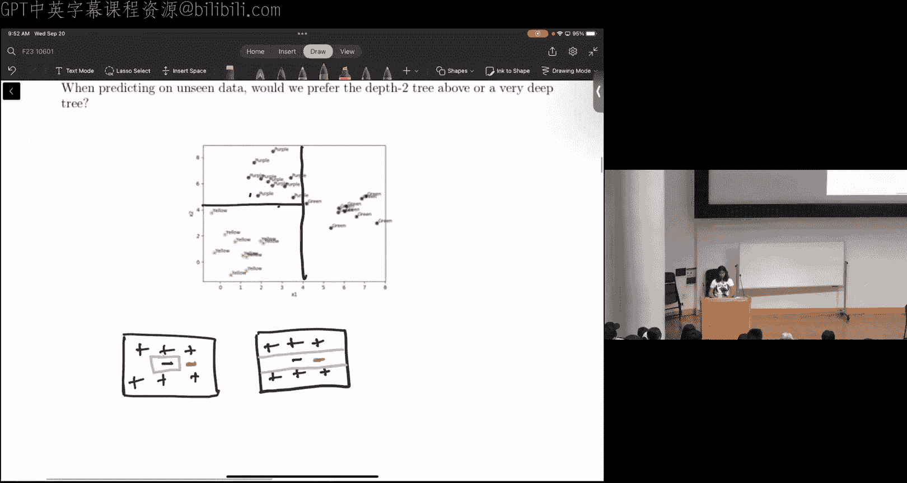

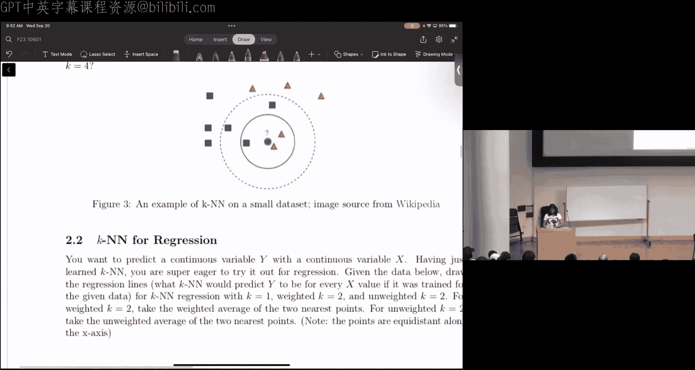

Like a very simple non parametric supervised algorithm。

 it can be used for both classification as well as regression。So first。

 we will look at how to apply K&N for。A classification example。

So here we have a data set of two classes， a class one。

 which is blue and class2 which is red and we have a new data point which is highlighted in green here。

And for different values of k， we just need to。Predict what would be the most likely label for this green point。

So when k equal to3， does anyone want to say what what the label would be？Yeah。

 so there's there's two red neighbors and there's two red neighbors and one blue neighbor。

 so by majority vote， we can say that for K equal to。Three， our point would be classified as right？

Now for k equal to 5， we can make use of these concentric circles to identify the nearest neighbors and by the same logic we can。

Predict the label as blue。Now， when k equald to 4， we notice that there are exactly two blue and two red points。

 which are our nearest neighbors。So there's a tie basically。

 anyone like have suggestions for this tie break。Its together。Yeah。

 so that that's one of the solutions so we can select。The class randomly， any other。We也 this三。Yeah。

 so based on the weighted distance， you can assign values to each of the neighbors and then get the corresponding label。

 that's one。Any other suggestions？So one， one other thing could be that you can change your k since K is just a hyperparameter。

 you can either。Add k plus or minus1 so and check if the tie is broken and if it is not。

 you can again use any of the other three。So in this case， let's say we go for a random classifier。

We can either predict it as red or blue。Yeah， any questions on the Canaan classification question？

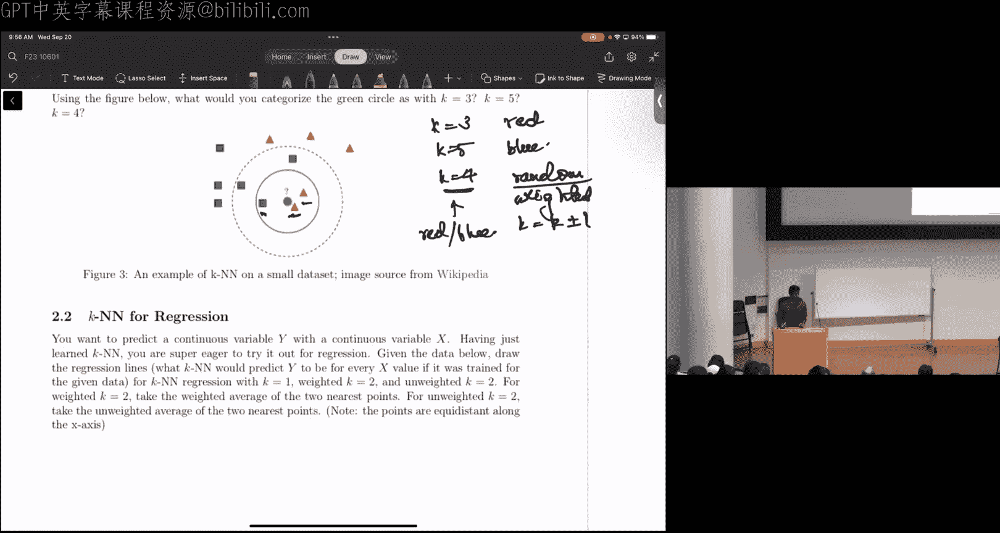

So let's move on to Canon for regression， so regression is a task where you predict continuous values for any given input。

So here we are。We have a set of data points in one dimension and one dimension output x and y。

And just to note here that all these points。Are equally spaced on the x axis。

And for ease of visualization， we can assign numbers to each of the points。So。

This is our data points on x。So in the first case， we have to like。

Pot the values of y or all the values of x， given that case is equal to 1 as our nearest neighbor。

So to do this， it would be easier to visualize different points on the x axis。If I。

 if I select a point in this。At this location。Let's say this is my nearest neighbor for this point。

 the value would be。Predicted as the same as the y value for this point。And度。

If I select some other point over here， the nearest neighbor would be。3。

 the 03 and the corresponding y value would be its label。And I guess， so the。

The similar thing can be done for all the values of effects can anyone tell me where the value would switch？

Or where the value would change。As we move along the x axis yeah so the value would switch exactly at the midpoint of these data points。

 so if I take an exact midpoint i let's say 4。5。呃。So till 104。5。

 we would be classifying the or regressing the value as。This value and exactly after 4。

5 we would switch the value to this。And so the findings。

regressiongress plot would look something like this。V了。Exactly， at the midpoints。We would。

We would switch the regression value and if we continue along。

This way for either axis either side of the x axis。

The nearest neighbor would still be the last point here。

 so this is how the regression lot would look like。Any questions on this example？Okay。So。

 next we will look at two cases where k is equal to 2， so first we look at the unweighted gate。

 so here for every data point on the x axis we consider two nearest neighbor。

And based on the y values of those two nearest neighbors， we get the prediction。So again。

The points are equally spaced。So let's say we pick a point over here， point B。

So the two nearest neighbors for this point would be the point corresponding to this as well as this so theyre corresponding why values of this。

And in the unweighted case， we just take the average of the y values corresponding to each of the nearest neighbors。

So the average would be somewhere around here。So this would be the value predicted for P。Similarly。

 if I take a point here。The nearest neighbors would be these two。

And the value would be the average of these two， which would be this。So by continuing this， we can。

We can't plot the values for y as the average of the two nearest neighbors in that location。

 so between this point and this point this would be the average。Here， this would be the average here。

 this is the average and here， this is the average。Again。

 we consider the cases where case where x extends beyond the range of our data point values。

 so let's say we pick。We pick an X over here。So just by Euclidean distance we see that the two nearest neighbors for x are these two points。

 so the y values we consider would be these two。And the regression would be this。

 so this would just continue on this way and here it would be this。Any questions on this example？

Yeah。I'm sorry you to draw lights？Yeah， so we are going for that question next。

 so here we saw unweighted wherein we gave equal importance to each of the neighbors regardless of how far they are。

So， in this case， we will wait the wait the neighbors based on their distance so again。

 if I take the same point P。Let's call this。Data set point1， data set point2 and this point P。

So we first calculate we know that the two nearest neighbors for point p are d1 and d2 we first calculate the distance between p and D2 and p and D1 let's call this m and N。

And the closer the data point is we give more importance while predicting the y values。So。

We could come up with a simple formula， such as。The value for y would be m times D to y。Plus。

10 times even y upon。Ilic， where D2 y and D and y are the y values corresponding to these points。

So this sort of gives more importance to the nearest neighbor while predicting the values。

 so if you notice this。This forms a straight line between these two points for all points between D1 and D2。

 this is how the regression would look like。And similarly， for all other points。

This is how the regression would look like。And again， we will consider the case。不道。😔。

X values lying outside the range of the data set。So let's pick a point P here。So again。

 the nearest neighbor。Nearest two neighbors would be this and this。And。If we wait the。

Regression value based on the distances， we would get somewhere。Maybe closer to this point but not。呃。

Not exactly how。So if this is the。Exact average of where。The value of these two points are p by。

你个人你度啊。So here this would be regress to this and as we move closer to this point it will be closer here and as the limit to infinity we we reach this average value。

And similarly， here。This is how it。

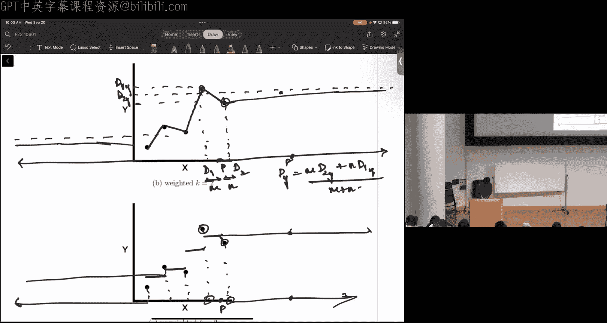

Yeah， any questions on this？Example for weighted k equal to 2。Or regression。

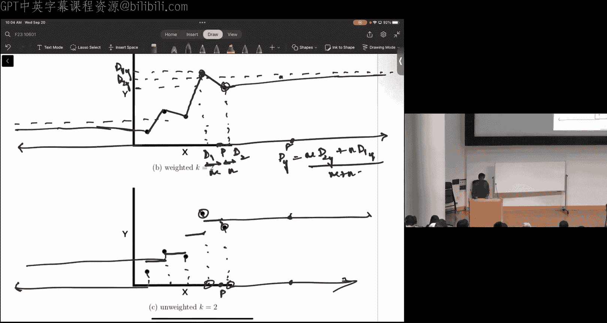

Yeah。So now we can move on to the decision boundary。

So here we have to draw a decision boundary for the 2 d space。

 we have data points in 2 d and we have to consider our k equal to 1。So。

 so decision boundary basically means the boundary at which the yeah。Oh， I'm sorry。嗯白。Yeah25。Yeah的要的。

Yeah。いつて？Yeah， so if I choose a point very close to one of the data points。

 it would be like it would be much closer to the first neighbor。单 the。

It would be me much closer to this than this， so the value would be predicted here。

 but as we move like really far away。The two distances would be roughly equal。

 so they would finally meet the average。Any other questions for other regression examples？So。

 the decision boundary is basically the boundary at which the prediction label changes so here again we are dealing with two classes blue and red。

We have to draw a decision boundary， which demarcates the。

Classes are the points belonging to classes blue and red。 So for this。

 we can first consider a simple case where we have we just have。

Two points belonging to two different classes。Let's say we have a blue point and a green point。So。

Can anyone like tell me where the decision boundary between these two？A point would be。有。对。

Yeah exactly， so it would be on the perpendicular bisector joining the two line。嗯。

So this is how the decision boundary would look like。

 which means that any point here would belong to the blue class。

And any point here would belong to the green plus。And as this boundary， the class prediction changes。

 So in this example， we do the same thing where we take。

We consider two points of different classes and just draw the perpendicular bisector for each of them。

So here， this would look something like。This and for these two points。

It would be something like this。And for these two， it would look something like this。

So any points belonging here would be classified blue。

Point here would be classified as red for the k equal to1 case。

Any questions on the decision boundary example？How do we so I guess since we are we are using Euclidean distance to measure the how far each point is we can just get an equation for。

For two nearest neighbors and equ them so you will get a quadratic equation and for k equal to one you get a linear equation。

So as the number of neighbors increases， the decision boundary becomes more complex。

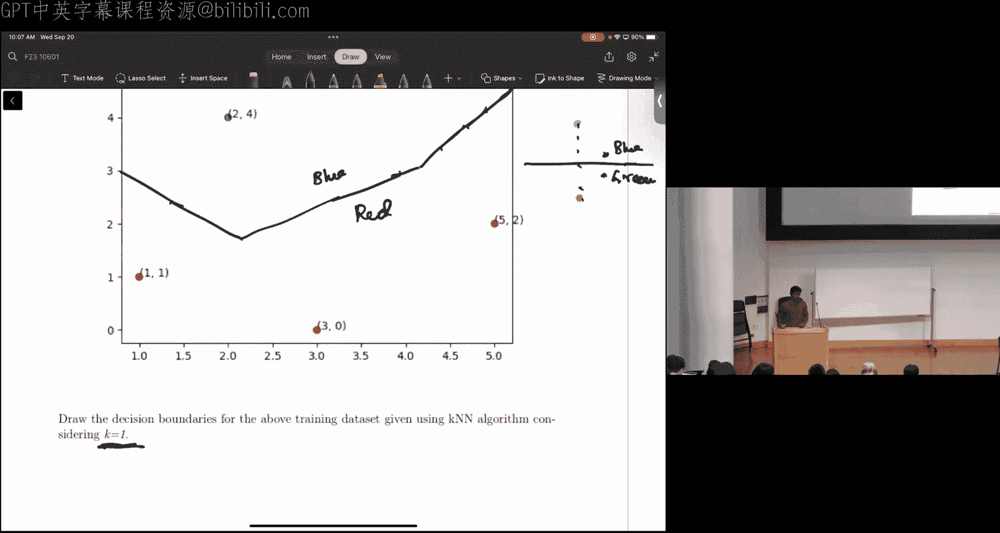

Okay。

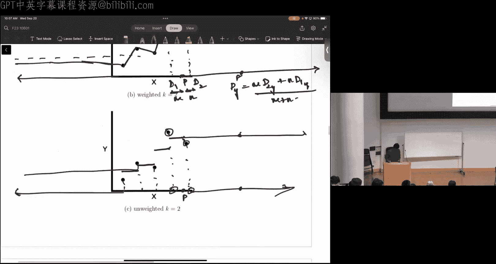

One question about our so will we come to that much of a first state point why will we propose that of course？

呃。给你微信。So as we go much further away to the left of X。

So it will finally tend towards the average value between the two data points。

So if I choose a point very close to this data point， these are the two nearest neighbors。

 but it's much closer to this point so the value would be closer here。

 but as we move much further away the distances to these two points。Would be roughly equal。

 so its it's more more like taking an average of the two values and it finally regresses to the average value so here this is the average of these two values。

Yeah。Any other question for the canon section？

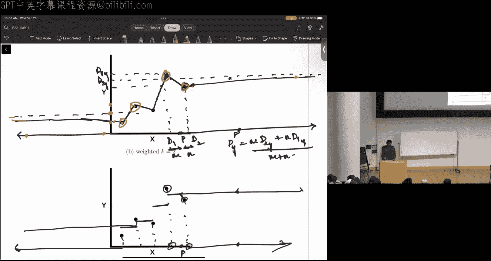

Okay。So we'll now move on to linear regression。HeCan you hear me？Okay， great。

 So now let's just do a brief refresher on linear regression first before we get started in the problem。

 So for linear regression， our goal is。To predict。So the difference between like linear regression and classification is that here our goal is to predict real value outputs right so this is slightly different from our setup for classification because for a classification our outputs are mostly like categorical or binary like a zero or a one so for linear regression our data would look something different so it would look something like so we have this D that represents our data and then we'll have pairs of data where X is like this vector。

😊。

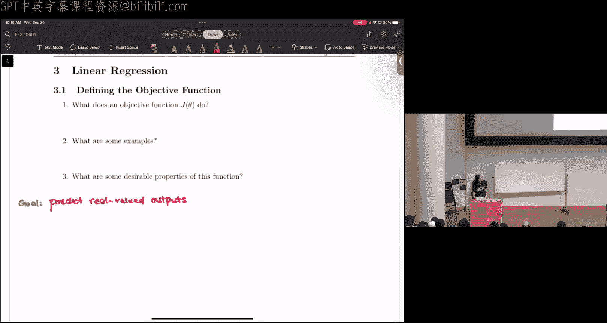

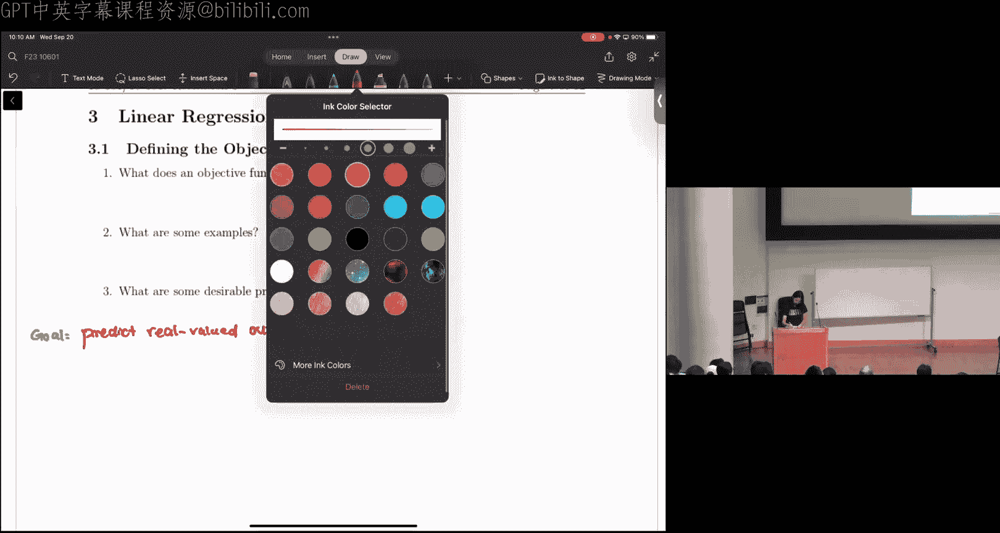

And then we'll have Y， which is our real value output。And this will be over and samples。

So we'll have this x vector being of length M， so this represents that there will be M different attributes to the x vector and for our y。

 it will just be a real value number。Right， so the goal of。Lanal regression is for us。

 so for example， a sample data set that we might have could look something like this where we have different points here。

So what we want to do is to try and predict。The line through this data set that would reduce the errors that we could get。

 So something that we could come up with could be something like this， This line over here， right。

 So then our goal is to。

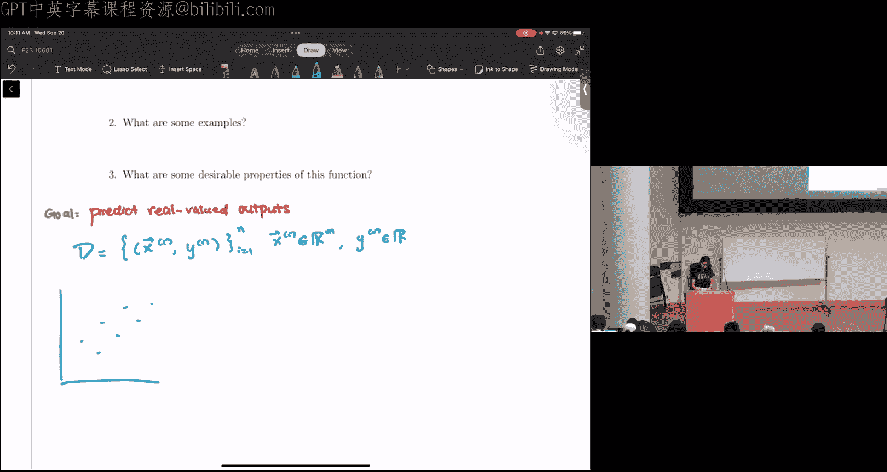

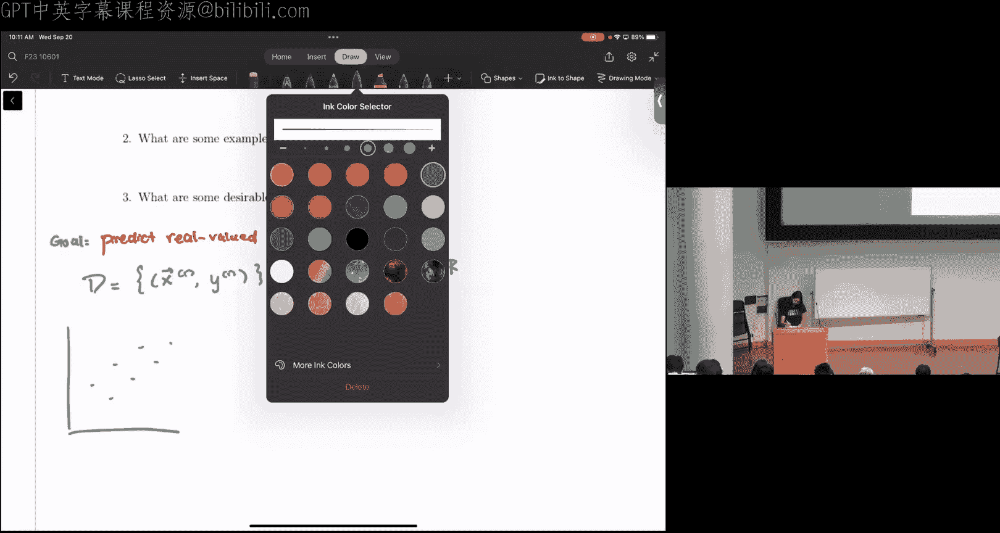

Reduce our error that we get between， like this。

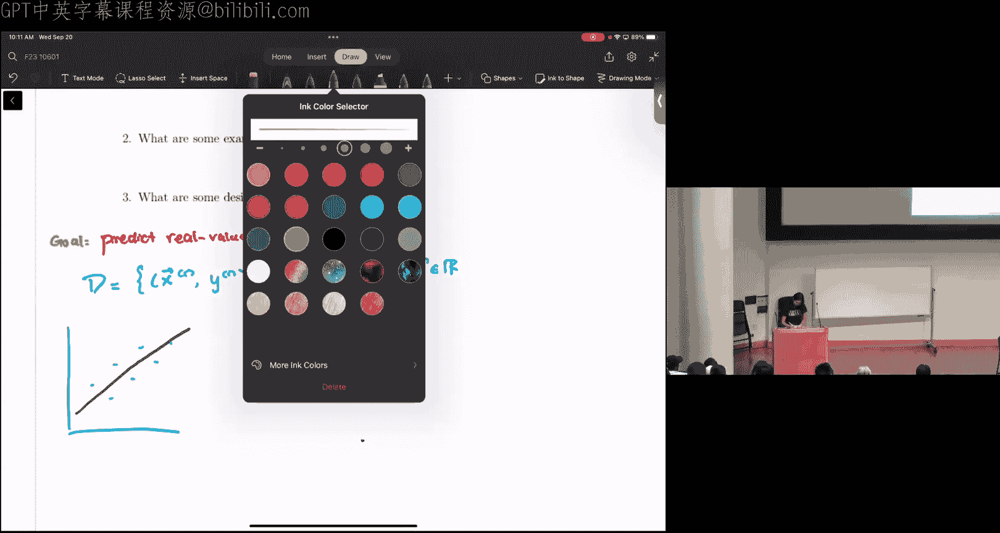

This would be like the residuals right we want to minimize this distance between our actual points in our data set as well as our predicted values。

So this would be the residual， so this would be like E1 E2 E3 and so on。

 so each of these EIs would be equals to the distance between the observed YI。

 which is like the ground truth that we're trying to predict。

And we'll subtract it with our prediction of why hat。Right， so what this is is actually。

This value over here is equals to。Our。H of x。I， so what this H is is the parameters that we're trying to learn。

So this is what we're trying to learn， right， H has parameters。W。

 which are the weights as well as the bias to。That。We want to predict and learn in order to minimize。

The residuals。So intuitively， this is what we want to strive for because we want to reduce like the sum of all the residuals that we get with the data set。

 which will give us like the best representation of what we've learned through our training data set。

Right， so now this brings us to this first question about what an objective function does。

 So does anyone have any suggestions。Okay， so I'll say that。It is a function。To measure。How good。

The linear model is。Right， so the over here is the weights that we learn through the W and the。

The bias term， this shouldn't be a vector type。This is what we learn from the parameters and we want to find the best parameters to measure like how good our linear model is so some examples of this objective function。

 as I mentioned that one of our goals is to minimize the residuals so how we calculate the residuals could be either with mean。

Square error。 which is just the average of the sum。

Of acrosss all n samples of the squares of the residuals right so we're just taking all of these residuals and squaring them and summing it up and then dividing it so that's where you first get the square error and then you get the mean of it so this is one of the examples that we could set our objective function to。

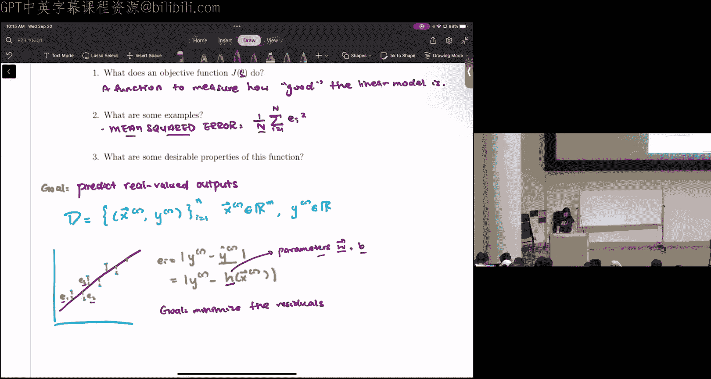

Another example would be mean absolute error。So this is also similar to means square error。

 except that we're not taking the square of the residual。

 but instead we're just taking the absolute value of the residual。

So then the next question that you might ask is。

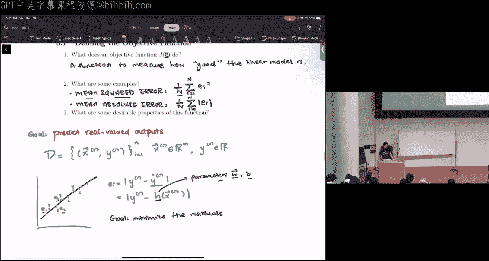

What， what like helps us decide between like which objective function we want to use？

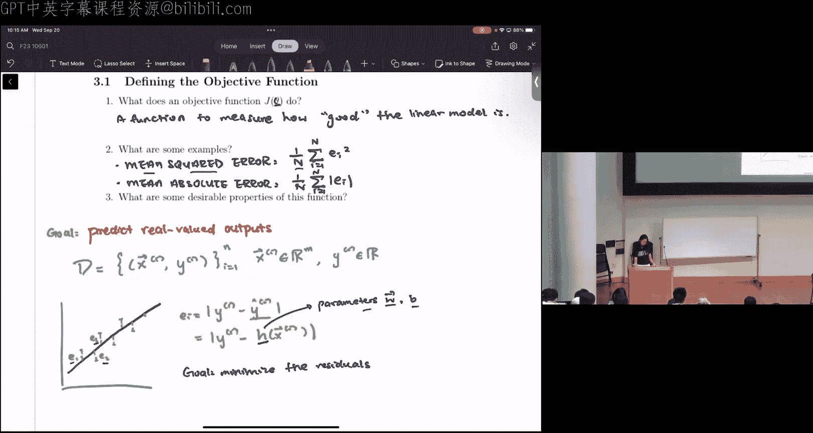

So this ties into the next point about what are some like desirable properties that we would like this function to have。

 So one difference between like mean square error and mean absolute error is that mean square error is differentiable。

So why would we want？Objective functions to be differentiable。

 It is because we can easily take like the derivative of the objective function and find like the direction of greatest ascent and will move in the opposite direction。

 because we want to minimize。

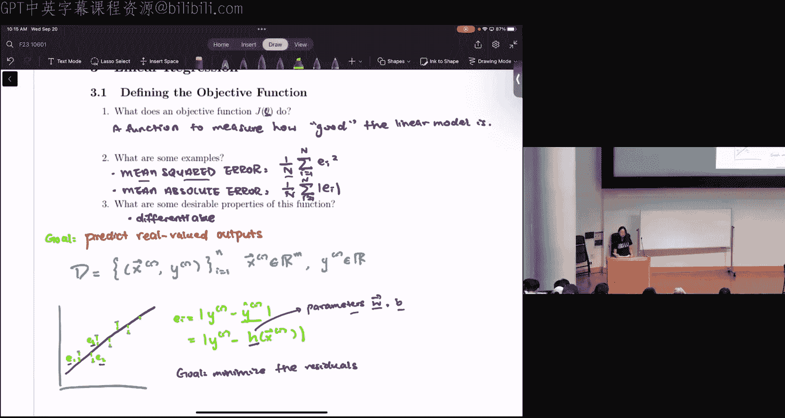

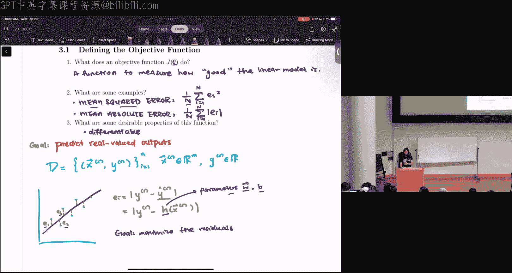

Our error。 So we want to take the largest ascent and go in the opposite direction to help us go in the largest direction of decrease。

So with a differentiable objective function， well be able to calculate the gradient very easily and therefore make the correct like gradient updates。

And also， another desirable property would be that it is preferably convex。

So what this means is I'll just give an example， so for a convex function。

It will look something like this， right？So， we only have one。Local minimum。

 that is definitely a global minimum as well。 right， So once you've found a minimum。

 you can be guaranteed that it will definitely be the global minimum。

This is as opposed to something that is non convex， it could have a weird shape， for example。

 something like this。Right so this is the true global minimum， but for example。

 during your gradient descent， maybe you somehow end up here。

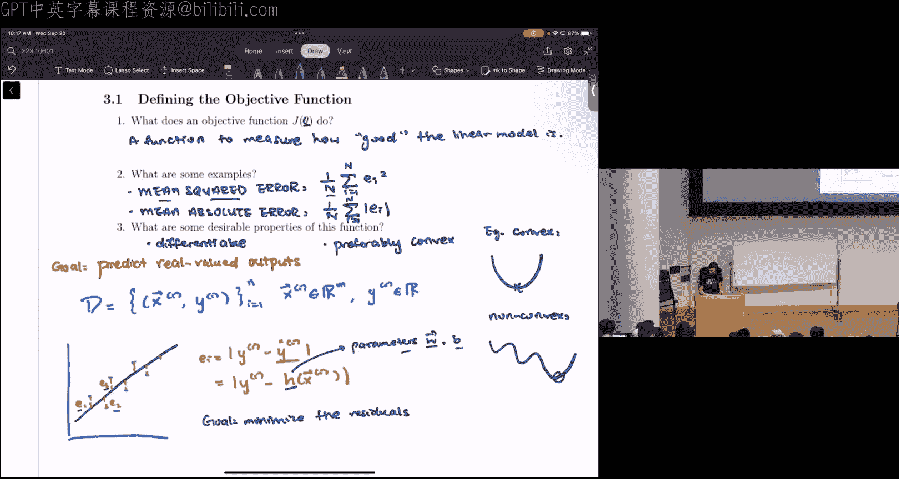

Or here right so you think that it is a minimum， but it's only a local minimum and not a global minimum So this this you might just fall into the trap of thinking that you've gotten the best model when you're somewhere here right so this is why we want to prioritize something and objective function that is convex so that we are guaranteed to have reached the global minimum once we find a minimum。

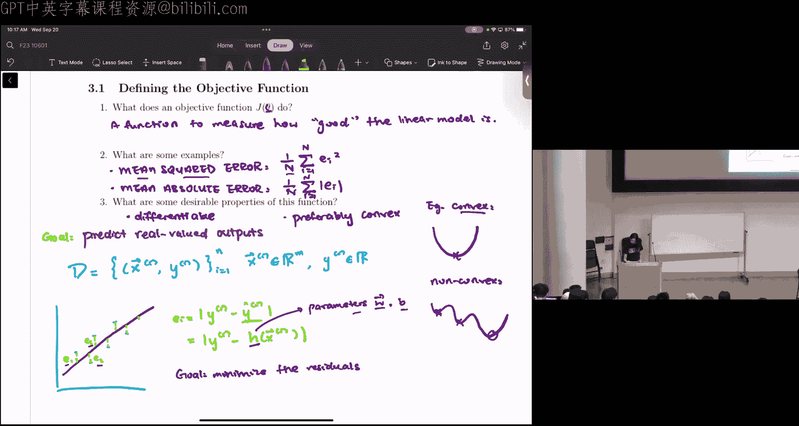

And we know that we can no longer further decrease the error of our model。

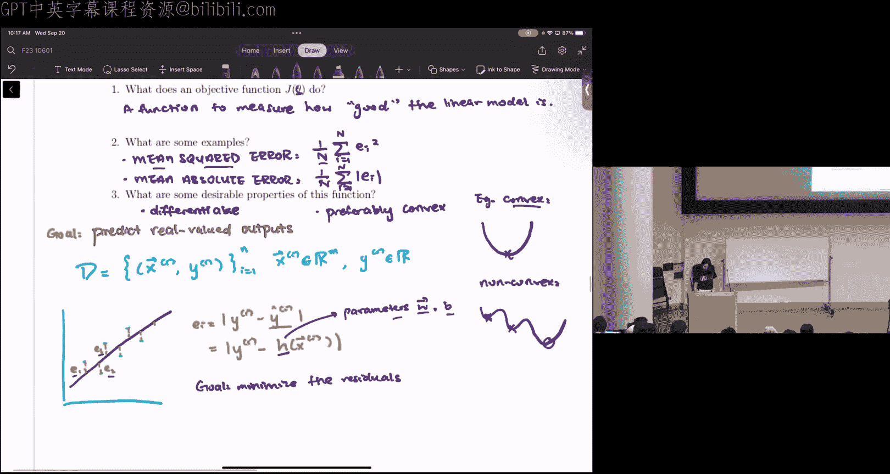

Alright， so now I've touched a briefly on gradient descent。

 So just want to give like a refresher of gradient descent。

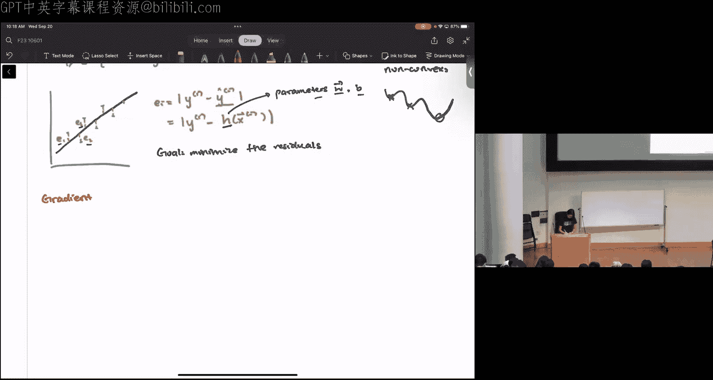

Right so for gradient descent， what we want to do is we want to arrive。

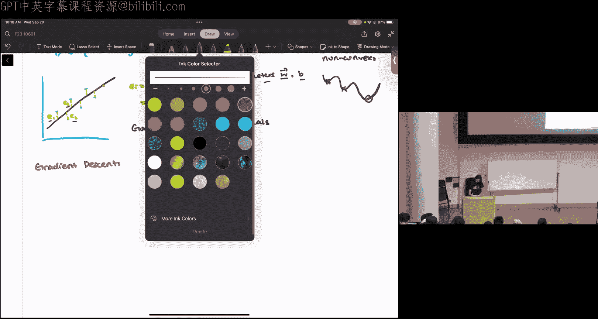

At。The minimum。G， theta。Right， our objective function。And this minimum。Corresponds to。The parameters。

Of our learn weights， as well as the bias。That best fits our training data。

So how we find these parameters would be through gradient descent， right。

 so the algorithm looks something like this。As was covered in lecture firstly。

 all we want to do is we want to first。

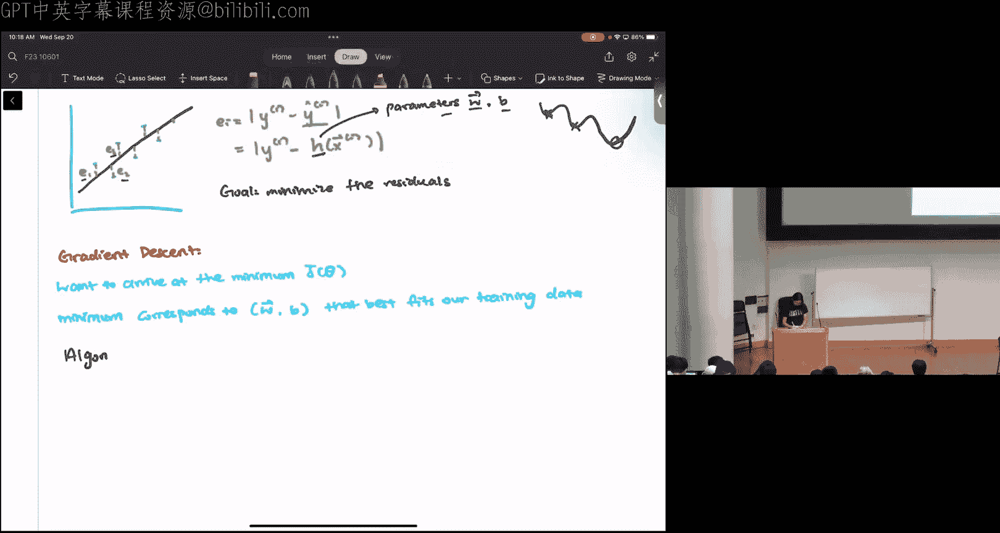

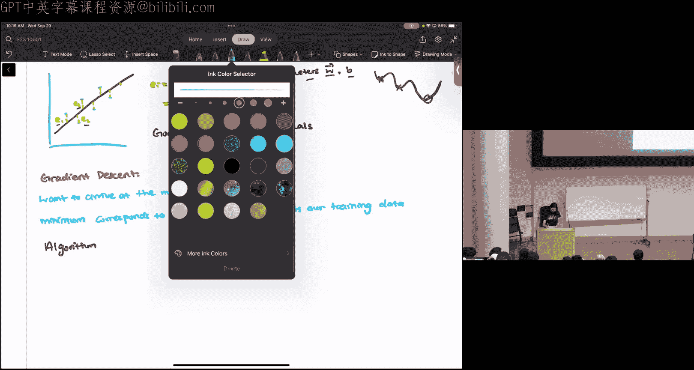

Choose an initial point。For our starting。Weights， right， we just typically。We'll set it all to zeros。

And then we will start。Our。Loop。First， well want to compute。A gradientdient。With respect to。Our。

Data here， so the gradient would be something like this。

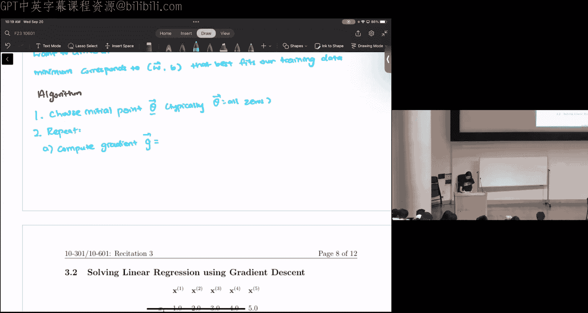

Right， so we're trying to find。The gradient。

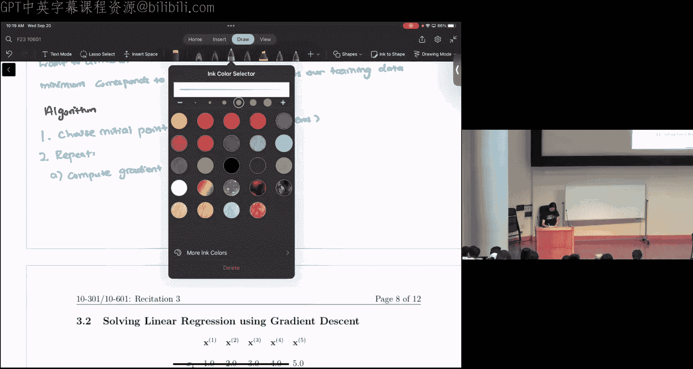

哦。Our objective function。 And once we've computed our gradient。We would select。A step size。

And what this step size does is it tells us how much we should update our gradients by every iteration。

RightSo we will update our parameters。With the。Would be equals to theta minus the step size multiplied by our gradient。

 right， So here is a minus sign， because again， gradient。Itself。

 we're finding the direction of maximum ascent， so we want to subtract that to find the direction of minimal maximumim descent。

 right， that's how we are going to be able to minimize our mean square error。And lastly。

 once we are done， we will reach a stopping condition。So then we will return data。

When the stopping criterion is reached。So that will represent our best learned weights on our training data。

And then we can just apply this to our test data。So one example of a stopping criterion might be that when this gradient that we calculate here approximately approaches zero。

 maybe like it's less than like a really minuscule amount。

 so maybe like once the power of like negative six so we know that the gradient is pretty small and we can stop our training of our algorithm。

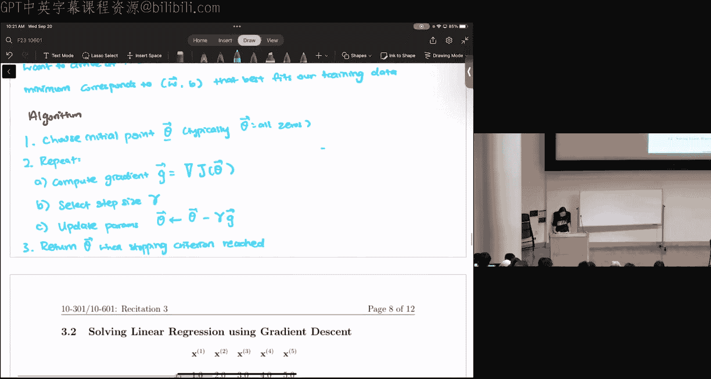

Right， so this is just a brief overview of regression and gradient descent。

 so now we can go on to look at an actual problem。

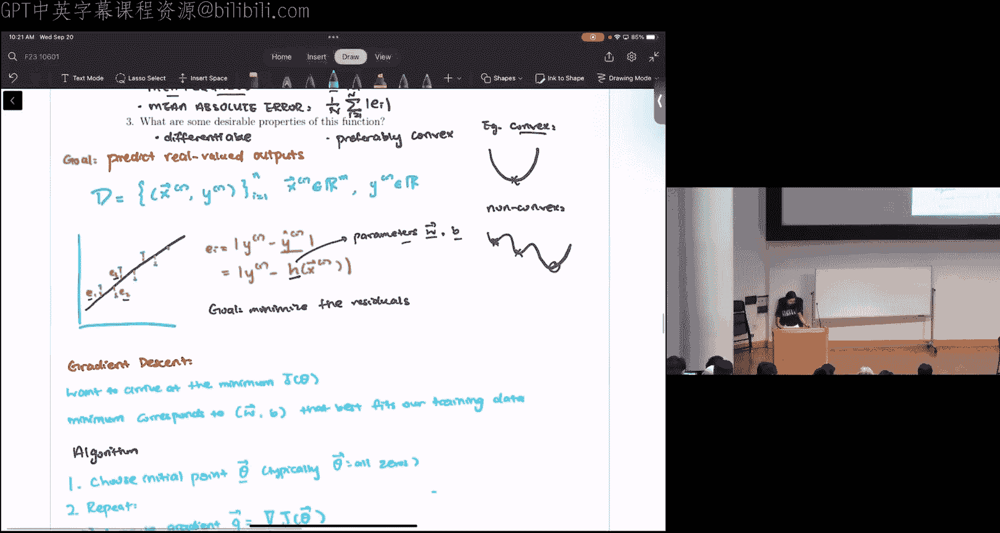

So here we have this data set over here where we have n equals to five data points， right sample one。

2， three，4 and5， and for each of these points we'll have two x attributes as well as this y here that we want to predict。

RightSo now we want to implement this gradient descent method just for one iteration and we're given here that our step size would be 0。

1 and the， as we mentioned previously one of the ways to initialize it is just to a vector of all zeros。

So one thing to note here is that here this data is of length three， right， but。

We see that for our data we only have X1 and X2。 So where does the third item come from。

 So this is where this bias folding in the intercept term comes in。

 So if you recall from lecture what we do by what we mean by folding in the intercept term。

Insteads that if we have x， right， which is in this case， equal to x1 and x2。

 what we want to do is to append a1 in front of this x1 and x2， which represents our intercept。

 right and similarly for theta， then we'll have this bias term that corresponds to the intercept and then we'll have theta 1 and theta 2。

Which corresponds theta 1 will correspond to x1 and theta 2 will correspond to x2。 So in this sense。

 what we're doing is that we're actually appending an x not to all of these data points with a one here。

So this is where so the advantage of this is that it makes us it makes it easier for us to like just regard linear functions as a simple dot product right。

 so our prediction would just be theta transpose X。Right。

 as opposed to having to write it out explicitly like with a Theta 1， Theta 2 x plus。The bias term。

 right， So this just makes notation slightly simpler for us。Right， so now。

Once we've just had this basic setup， we want to calculate the gradient of this objective function with respect to Theta。

So this would be this step28 of our algorithm over here。

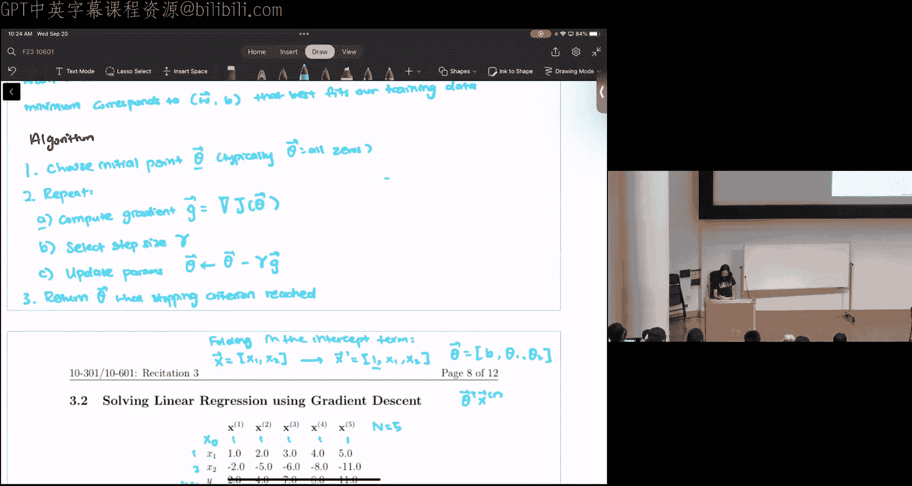

Right， so how we want to calculate this gradient is that。

Firstly， we recall that the gradient would be。This。Right here。

 the gradient would be equals to this vector over here。Where we have。The J theta over the theta0。

 This is respect to our first term in our weights。 and then with respect to our second term in our weight。

 and also with respect to the third term。Right， so again。

 the length is because we have like three points x， not x 1 and x 2。 So therefore， in our gradient。

 we correspondingly have these three terms。RightSo now we want to go about just calculating one of these values and once we find like the general formula for each one of this。

 we'll be able to go back to this vector form easily。Right， so how this looks like is the。

J the over the data。 Let's just call the subscript K in this case。 So it could K could be like 0，1，2。

 and also even more in other cases where our vector is longer， right？ So what we have here is that。

We have。Well write our vector as this because our J theta is the mean squared error， right， So。

 and we have five samples where n is equals to 5。 So we'll take the average over five samples of the sum from I equals to  one to5 of。

Our。嗯。This would be with respect to each of our samples。So from I equals to 1 all the way to 5。

 we'll be taking the derivative。Of our objective function with respect to every single sample。

 and then we'll sum it up， and then we'll take the average of it。

So what this looks like is we'll take this average and。

If you recall J J is just the mean square error， which will look like this， right。

 So why I is the ground truth and then our predicted value at this stage will be the dot product of our current weight vector with this I sample in a data set。

 So this is。Our predicted value。Yeah， so I'll。Oh， right， good points。 Sorry， This should be K， right。

 Yeah， So this is a little tricky in the sense that you'll have to deal with like two different indices。

 So this one， the sub， the superscript here would correspond to the sample。 So X 1， x 2， X3， x  Y。

 x 5， whereas this， this over here。😊。

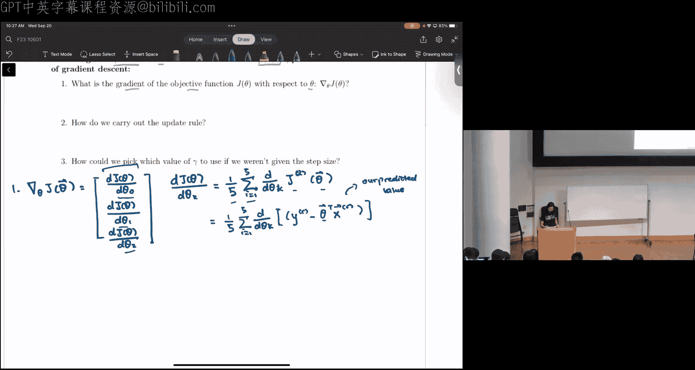

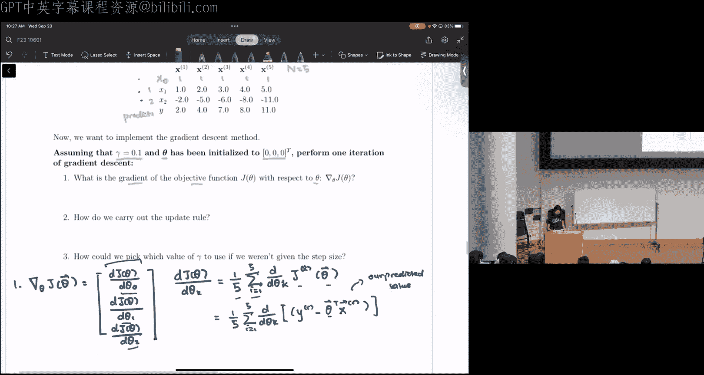

，Subscript。Corresponds to。I just erasseed something by accident。This should I be here， Right。

 So this is。

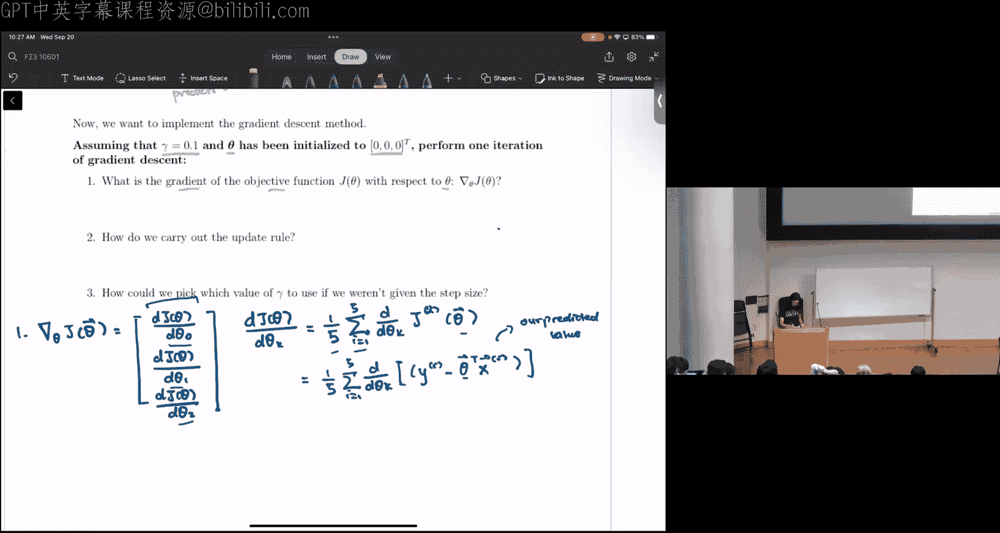

This theta K， we're learning it with respect to x1 and x2 and x n。

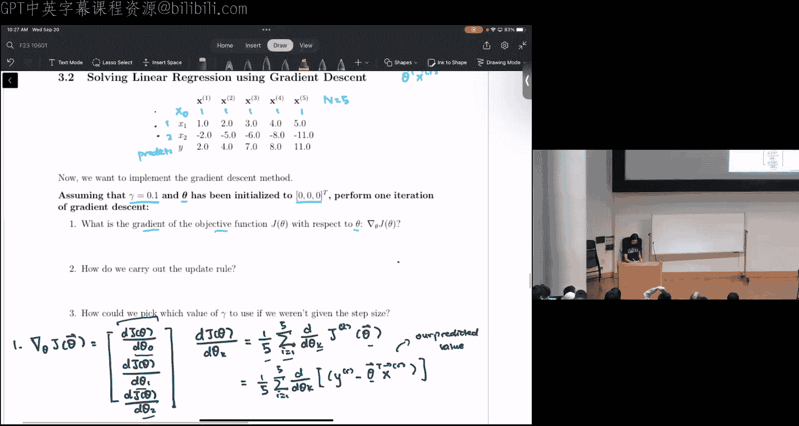

Right， so then。

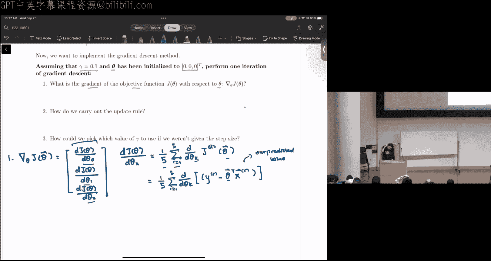

We have this predictive value over， so is it here？W whoho asked that question？Ex， okay， cool。

 So then we just like go about， yeah， this is a square here because this is not mean square error。

 right， So we just go about expanding it。 So what we have would be。😊，Just using our product rule。

 So we'll have。2， and then we'll just bring this down Y I minus theta。

And then we'll multiply it with。Again， this。Right， so this is just doing like chain rule。

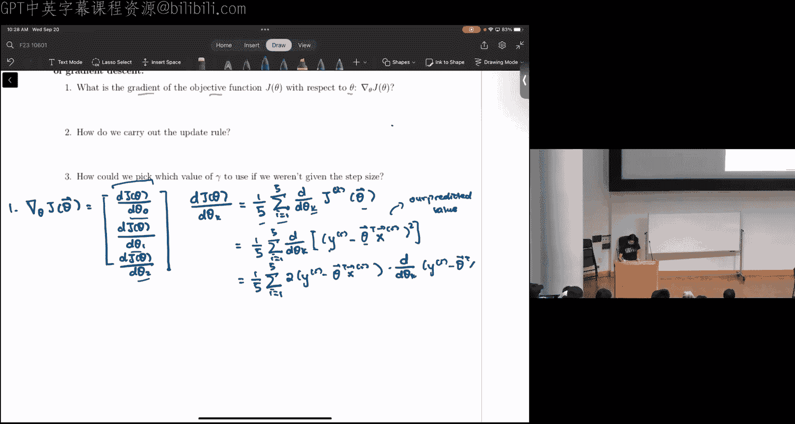

搜。The reason why I'm expanding this out is that you'll notice that。

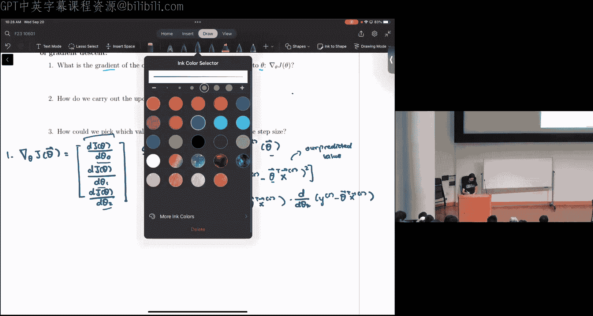

What we have here， right， when we want to differentiate it with respect to theta K。

 this would be this， this is a dogt product， right， So this is equal to theta。0， x。0。

 the I sample plus theta 1 x 1， the I sample plus theta 2 x 2。

So you'll notice that since we are taking this derivative with respect to theta K。

 only one of them would match either like theta 0， theta1 or theta 2。

 So when we do take like the derivative with respect to theta K。

 what we'll get is only x K and then the rest of the terms would just be we just cancel out we' just be0 right。

 so what this means is that we can evaluate this to。😊。

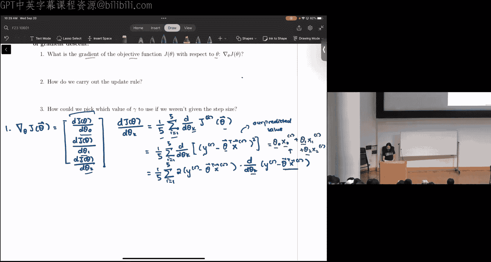

Something much simpler， right， We'll have this with。This will be the same as before。But over here。

 we will just have。The minus of。X。K。Right， so this would be our simplified expression for the gradient for one of these points。

 right， so then we can just like plug this into all of these three points。 So what we'll get is。😊。

This huge looking。Vector over here right so what we have would be equals to one over5。

 so we're just plugging in this， so we are taking the k and then bringing it over here。

 So what this looks like would be just the summation from I equals to1 to5 of or we found so xk here would be x not and then the I sample and then we'll just bring over this y minus itta。

And then the pattern is the same for the rest of this。 So we're still summing over all five samples。

 But now we're doing x sub I x sub1 here， and then everything else remains the same。And also， lastly。

 for this point here。The third。Parameter， it will just be。X sub2。Wow。

 with the all summing over all of the。Samples。

Right so now we have this and then this expression over here will help us to we want to substitute in the values that we have from this data set over here。

 right， so we'll take a look and see that x n is always just one， right。

So for this first one， it just simplifies to one over five we can do like negative two over5。

 we just bring out the minus2 and then we note that since we initialize theta to all zeros so this term is actually just zero so for this is only for our first step right so for our first step when we want to calculate the sum of all the y I all we do is just we just add up2。

4，7，8 and 11。

Right so that is for this first term over here， right， So this would just be two plus。

4 plus 7 plus 8 plus 11。

And then similarly for this term over here， this is still zero since our theta we initialize it as0。

 so then it's just over here it' with respect to x1， so we have to multiply it with x1 so it's 1，2，3。

4，5 so this would be equals to 1 times 2 plus2 times 4 plus three times 7。

Plus  four times 8 plus  five times 11。 So where I'm getting these numbers from is the the one would be equals to the value of x1 at this particular sample。

 And then I'll multiply it by the Y value at this particular sample because that's what our formula tells us。

 right， X1 times y 1。

And then minus is zero term since theta is 0 at the start。 right， So similarly。

 if we do the same thing。

But the interest of time， I'll just say that。You can also check this on the website later and you can do this computation yourself just to make sure that it makes sense。

 right， so in the end， what we'll have is this will be equals to-12。8-47。2 and 0。

4 right so this would be。

The gradient。Of our objective function with respect to data after just one iteration。

 So this is what we have。

Right， so next， we want to carry out this update rule。 So if you recall from what we have over here。

 we will update these parameters as such， right， so in general。

 we can just write this equation over here where at。

 say like the k iteration or theta will be equals to theta at the K minus1 iteration minus the step size multiplied with our gradient。

At this。K minus with respect to our K minus-1。Vector， right so。

When we just plug in our values， since we're having。At this pay stage， we have K equals to。One now。

 when we going to carry out our update rule。 So initially， our at K equals K minus-1。

 this will be equals to 0， so。😊，We initialize it as all zeros and then well subtract and then multiply it with our step size over here right over here then we defined it as 0。

1 and then we just plug in the values over here right so this will be minus-12。8。

-47。2 and 10。4， right， So this would give us。1。28。4。72 and minus-10。04。

You can also do these computations just to verify by yourself。

And lastly， the next question that we want to ask is here we are given that the step size is 0。1。

 But what would we do if we weren't given the step size。

So one way we could do this is just true。

It just right here， we can do this。 Does anyone have any ideas on how we can select the step size。

Okay， so it was briefly covered in lecture， we can use cross validation。

So the idea of cross validation is simply say like you have maybe like split your data。

Into say like key chunks。

So maybe you'll have like this chunk from like 1，2，3 all the way to K。 So on iteration one。

You would take all of from one all the way to K -1。As train， your training data set。

 and then you will validate。On the cave chunk on your iteration one。

And then like maybe on iteration2， what you do is you take all your data from 2 to K as your train。

And then number one as your validation。

So the idea is basically you do this K times， so you will get the results across and then during each iteration you will test out different values of the step size and you will want to find the the step size that gives you the best。

The best mean squared error， right， It reduces your mean square error the most。

And that's how you will pick the step size， right， So just one last thing about like the importance of picking a good step size。

 So if you have something like。

This right， if you have this step size is too big。What happens is that maybe if you start here。

 you would just like end up oscillating around and you never actually get to this point。Right。

 but also if your step size is too small。What happens is that you would take too long to reach like the。

Minimum， right， you could just like keep jumping， jumping very slowly。 So this is also not ideal。

 So you want to find a step size that is just right that you can。Converge。

 find the minimum in a minimum amount of steps without like missing the minimum， right。

 So that is just intuition behind like， why you want to pick a good value of a step size and you can use like cross validation to find the step size。

RightSo that's all for regression， so we just have one last part on the perceptron。Wait actually。

 does anyone have any questions Yeah yeah in lecture he mentioned about scheduling Yeah yeah that's definitely also a good way so。

😊。

Yeah， doing due to the interest of time， I couldn't like go through it。

 but definitely step size scheduling is a pretty big thing that many practitioners do to change their step size dynamically over the training period。

If you do sub scheduling， and you still have to。Do crop to find the。Well， actually。

 there are like different step size schedulers as well。 Like some of them are like exponential decay。

 Other like having and different things like that， so。😊。

You could actually also use like cross validation to find the optimal step size scheduler。 right。

 So that's also like another thing that you want to work on。

 And generally it also is cross validation is also just useful for you to find a good starting point for your scheduler for your step size。

 So even though you do have a scheduler。 Your step size is。

 it' still good for you to find a good starting point for your step size。 Yeah， so in all cases。

 I would say cross validation is a good technique。😊，Yeah。Anything else？

Okay， great， let's move on to perceptron。Yeah， so that's more than the last section perceptron。

 so perceptron is like a very simple supervised binary class classification algorithm。嗯。

So let's go over a few definitions before solving the problems。

 so let's say we have this data set of 2D points。With us。 And we want to create a。

Create a classifier which which distinguishes between both the classes。

 So here we have defined a linear boundary。Which classifies the positive and negative classes。

No here。Theta star represents the linear decision boundary that that classifies good。Two glasses。

And R is the radius。Of the。Raddius of this sphere centered at origin which encapsulate all the data points in our data set。

Now there's another term a gamma and。To define that will go over。

A few points to see what exactly gamma is。So for any given linear decision boundaries such as this and any point in our data set。

The perpendicular distance between the data point and the linear decision boundary。Is。

Is called the margin of the。Data point so this margin can be defined for each and every data point for each and every classifier so this is this would be one margin。

 this is the other margin。So this word is known as margin for a given set of data points s。

呃。

For a given set of data points s the smallest margin would be the point which is closest to the linear classifier and in this case like by roughly estimating we would say this is。

The point which is closest to this particular decision boundary。

And we can so this is for a single classifier， we can consider many other linear classifiers which classifies this data set。

And you can see that for different decision boundaries or linear classifiers。

 the margin would be different so for this one it would be this distance gamma W and for this classifier maybe this is gamma W。

So what we want to define is out of all the possible linear classifiers and out of all the points in our data set。

 we want to get the maximum margin corresponding to a given classifier so in that case this would be our classifier。

With the maximum margin。So that's the definition of gamma。

And then this is how the update rule happens if if you remember from class we only update our decision boundary when we make a mistake。

 so if this if theta represents the hyperplane which separates the data set we update it as。

Theta plus x if we make a mistake on a positive sample and theta minus x。

If we make a mistake on a negative sample。And another thing to note is if our data set is。

A set of n dimensional points。We have to define theta， which is。A linear classifier。

 which is an n minus one dimensional hyperplane in that space。Yeah。

 and once once we stop making mistakes， that is once we stop updating the theta vector。

 we say that the perceptron algorithm has converged。

And now we want to find out is there an upper bound or is there a limit of the number of mistakes or number of updates to our hyperplane while。

While while training our perceptpro algorithm。Yeah， any questions on the definitions so far？

YeahI just want to verify for mistake balance， does mistake mean mistakes on thetestine or the yeah it's mistakes when training okay。

you found a good linear separator urgent over all possible， so the the assumption is that。

So it's tough to classify as a good linear separator。

 what we want is we want the margin of any linear separator to be the maximum out of all the possible linear separators。

And using this， we can get like a like a quantifiable upper bound for the number of mistakes that we make。

You have a very bad separator which lies completely on one side of the。

And is。something that lies。You know， on one end of the thing which almost makes mistakes all the time。

 but it's still a linear separator and it would have。

A lady small margins。 Okay， so you want to mean that。

Like a decision only like this。Yeah， so this is not considered because we assume that while calculating the margin that it is the data set is linearly separable and we have found the classifier which can separate them。

And we make the computation after that。Yeah any other questions on the definitions？結構点。

So it depends on what space your data site is in， so iss the n dimensional ball。

And the important thing to note is it is center at the origin and not just any ball which encapsulate the data points。

Yeah， so we'll look at a quick example to see how to calculate this。Decision， sorry。

 the mistake bound for a perceptron。

So we have a data set of endpoints。With input point X and labels by。

And we know that their finance size inputs because they all lie in a ball of radius are centered at the origin。

And we are also given that they are linearly separable， which means we can define a hyperplane theta。

Which。Whi separates the data points。 And we know that the margin of。The data points is gamma。

 that is all points in our data set is at least a distance of gamma away from the decision boundary。

So now we want to make a claim on the number of mistakes made by the perceptron algorithm while its being trained and we say that it is equal to R upon gamma squared。

So here we have a data set of three points and just for better visualization we can just plot it。

So if we look at the positive examples， one is at 1 minus1。Which is this。And the other is at 40。

And the negative example is that 02。

And the decision boundary is given as minus1 and1 and since we know how to draw the linear decision boundary。

 we just plot the point and。Get the corresponding vector to origin and this will be perpendicular to our decision boundary week。

So this is the decision boundary of this perceptra。

And now to calculate the mistake bound we would need to two parameters one is r and one is gamma。

 So if we see the three data points the。The circle which encloses all the data points is of radius4。

And for gamma。We can see that this is our nearest data point。

And we need to calculate that distance of that point to this margin。This boundary。

 so that would be just a distance between the point and a line， which would be。Given by this formula。

So here theta is minus1 and1。Xs。One goma minus1。So by plugging this in to get。-1 into1 plus。

1 into minus-1。Absolute value divided by root of minus1 squared plus one squared。

This is two upon route2， which is root  two。So our gamma is root2。

 so our mistake bound would be given by R upon gamma， the whole square， which is。Or。Byru2。

A whole square which is eight so we can guarantee that when we are training a perceptron algorithm on this particular data set。

The most number of mistakes that we will make on this training data set is Act。

Any questions？On the calculation of mystic bomb。And yeah。

Another thing which we can note here is that there is no biast in this data set， but if there were。

 if there was， we can just append that to our vector as1 comma x1 comma x2。

And the corresponding decision boundary would become B come up。T到完 go嘛提到。

And we can follow the same exact。Procedure for finding the decision like the mistake bound and training the perceptron algorithm。

Any questions on the perceptron section？Yeah， the first thought like x1 equals one x x2 equals to minus one like always plus you use all the do versus just like random Yeah。

 so I assume you're asking for calculation of margin。

So margin is defined as the distance from the linear decision boundary to the closest point in our data and if we calculate the distances of each of the points。

 we see that this particular point is the closest one and we use that point to calculate the the margin。

It's sort of like calculating the distances of all points with the boundary and then picking the minimum one so here just for just for the example。

 I picked the one which I know is closest to the point。

