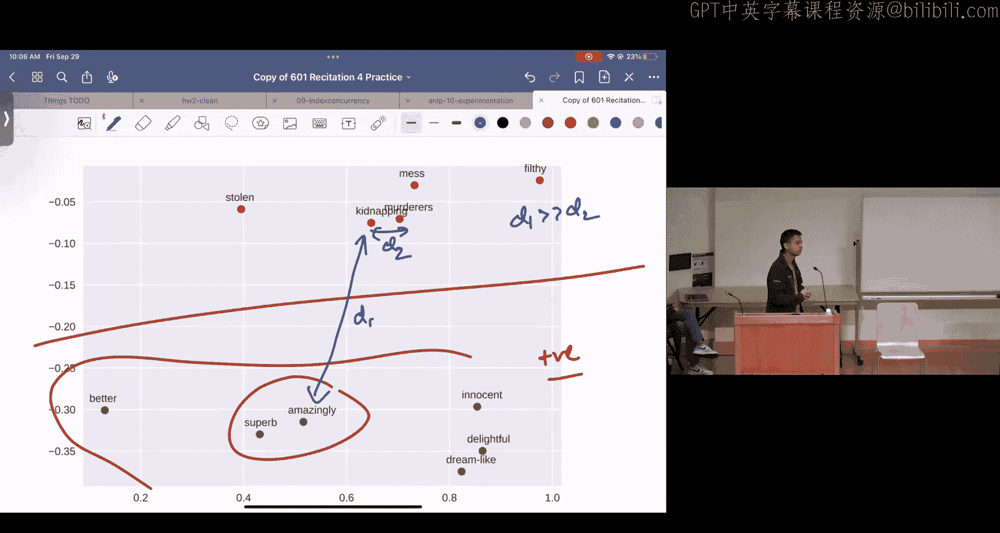
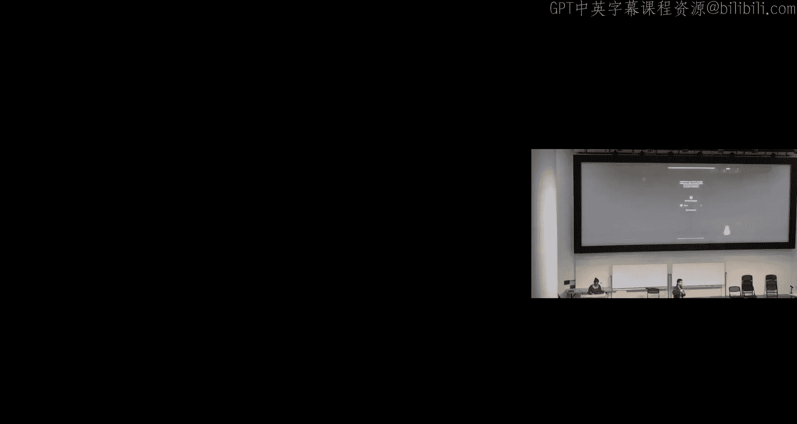
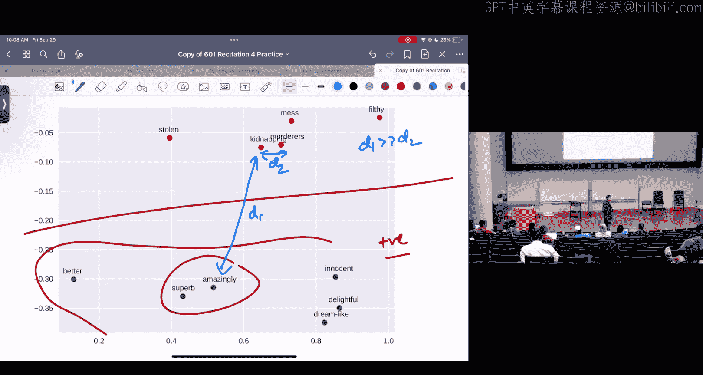
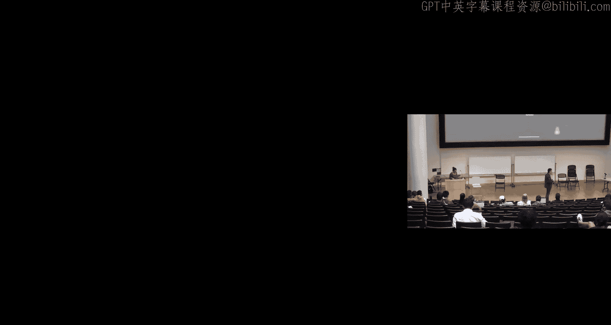

# CMU《机器学习导论｜Fall 2023 10-301⧸601 Introduction to Machine Learning》中英字幕（deepseek p42 Recitation_HW4.zh_en -BV1Z2cUefE4A_p42-

Hi everyone， welcome。 So this is 103301601 homework floor recitation。 My name is Maherre。

 and we'll just be going over a couple problems， starting with some about regression。

So in this problem， what we're going to try and do is find a closed form solution for regression。

So the setup that we have here is what you've probably seen already before in this course。

 we have a data set which is a bunch of tuples where the first element in each of these tus。

 X I is a vector of our features and then the second element of the tuple YI is the label for that sample。

Yeah。呃。I don't think it's up there yet， but we will post it after restit if that's okay。Right。

 can you check。Okay。So the loss function J that we want to minimize in this case is written here。

So what we want to do in order to minimize this loss function with respect to the weight vectors。

 the weights in our weight vector W， we're going to take the partial derivative of this function with respect to every element in our weight vector。

 which we'll call W sub K。What we can do once we take that derivative is just set it equal to0 and then solve for the element of the weight vector。

 which is L OK。So when you're in general trying to optimize a loss function。

 this is the standard process that you would go through。Cool。

 so what we're going to do is first is just get started with the partial derivative。

 So what we want to do is take the partial derivative of J。With respect to Ws O。

 and we can write this out。Plugging in our loss function room from here。Cool， so。

Now that I've plugged this in， we can kind of break up this expression to start taking the derivative。

 So the first thing that we can notice is that we have a big outer sum here。

 right So when we take the partial derivative with respect to this expression that just has an outer sum。

 the sum is going to stay in our answer。Then the next thing we can see is that the first term we have when we're looking at the partial of what's inside the sum now is y sub IRA。

 So this is the label for each sample， which doesn't depend on our weight vector， W sub K。

 So when we take the partial of just Y I with respect to w sub K。

 this term is going to go to zero so we can ignore that。Now what we have is this negative here。

 so I'm just going to pull this out。 This also stays in our derivative。

So now all we want to do is take the partial derivative of this inner term with respect to Ws O K。go。

So I'll do that down here。What we want to do is take the partial with respect to W use of K。

Of the sum。Over all the L， de piece of L。Some over。All the M of W sub J。Cool。

So to see what this partial derivative is going to look like。

 I'm just going to write out some of the terms in this outer sum。

So when we have little L is equal to one， this sum looks like。

 or this expression looks like the sub one。 and we still have。Our inner sun。

All the way to one of these terms where little L is equal to K。 We'll have w sub K。

Some J equals 1 to M。And then finally， we have our last term where little L is equal to big L will look like。

Okay， we ran out of room there， but that's okay。So now we can just focus on taking the partial derivative of each of these expressions。

 right？So because we're taking the partial with respect to W sub K。

 we'll just ignore this term first because it might be a little bit different when we're calculating the partial。

 but let's just first look at the partial derivative with respect to this term。

 W sub1 times that sum。So when we take that partial derivative。We're just left with W of1 times x。

K to the eye。And we can do that for every other term in this sum， again， ignoring this one for now。

And we get。All of the terms looking the same up to a WL X K to the I。Now。

 looking at the partial of this term that we were ignoring before。

We're going to use the product rule to take this partial derivative。

 So it's first just the summation times the partial derivative of W sub K with respect to W sub K。

 which is just one。 So we're just left with this sum。Plus， the other term。

 which is like the same as the partials we were taking before。

 W sub K times the derivative of that sum with respect to w sub K， which is just x sub k to the I。

Does anyone have any questions about this so far？Cool。

So now we can simplify this expression that we've written here to be this term， which is just a sum。

 J equals 1 to M。Of W sub J X。I， and we can write all of the other terms as the sum from J equals 1 to M of W sub。

O。Sorry。This should be over L。Little L equals1 to big L of。W some L。

 and they're all times x sub K for the Ithe example。Cool。So now that we've calculated that partial。

 we can put that into our expression before。 So we had J equals 1 to M of ws sub J。X of J to the I。

Plus。X sub K for the It sample times the sum over all L of W subbel。

And that's our partial derivative of that loss function。Good。So like I said at the beginning。

 once we have that expression， what we want to do is set it equal to 0 and then solve for w is sub K。

So it' will do that here。嗯， same面了 little。Okay go。So this first line is just exactly what I wrote and we're setting it equal to zero。

Now what we want to do in each of these inner summations here。

Is isolate the W the term in these sums that has w is sub K。 right。

 So a trick to do that that you'll probably use pretty commonly when doing these kinds of problems is that you can keep this sum over all of the little J that are not equal to our little K that we're solving for。

 So you would write。A condition here that this little J is not equal to K。

 and then pull out the term that when little J is equal to K。

 this inside of the expression is just equal to w K X， K to the I。

 So we're just pulling that out of the summation so we can solve for it later。

Then we can do the exact same in this other sum。 So we say that little L is not equal to K and then pull out the term w sub K times x sub K for the I sample。

That makes sense。Okay， cool。So now that we have these two terms which are exactly the same。

 we're just going to pull them outside of this whole big sum over all of our samples。

 and that becomes negative two times the sum over all the samples。Of W sub K， x sub K to the I。

And then these terms on the right hand side just stay the same。Cool。

So we have a couple steps left in order to solve for W sub K。

 The first thing we can do is just bring this term over to the right hand side。

 so we get two times the sum from I equals1 to n。W sub K X sub K to the I。Which is equal to。

The whole right hand side， okay。Cool。And then we can note that this W sub K does not depend on the I that we're summing over so we can bring this outside。

Of the summation， and just write this as2 W sub K。Some from I equals 1 to N。And then finally。

 all we need to do is divide by this two and this summation to loop just w sub K on this side。嗯。

I guess I can write it out again。 So we have W sub K is equal to。This whole right hand side。

 in the numerator。Divided by two times the sum over all of our samples。Of。X sub K for that sample。

So that makes sense。 So now we've found the element of our weight vector that minimizes the loss function J that we were starting with。

 and it's exactly equal to this expression here。Okay。Any questions before I move on。Yeah。

 can you scroll up to the first page？Yeah。So。I was just wondering if I have some。

And it goes from like some variable。That's not present。In the right side of the sun。

 you just get rid of the sun。嗯。it's someg from O equals one to capital oil。ま。Like WK。

 like there's no element。Would you just get rid of the。So in that case。

 what you're writing is like just。Whatever the top of your sum。

 it's like that many terms times w sub J x。Like something like this， right？Okay。

 so just take to partial。I other question。Cool。Okay， let's get a question。2。大改了。

So in this question we're looking at binary logistic regression so we have a very similar setup with the data set exactly how I explained it before。

 the only change that we're making in this case is that our labels are all either equal to zero or one So when that's the case we call this binary logistic regression。

So since we want to take noise into account when making these predictions。

 we'll predict the probability of each of these outcomes given the input features that we have so we'll predict the probability of our label being equal to zero。

Given our features and our parameters and also the probability that this label is equal to one。

 given our features and our parameters。And then when we want to make prediction。

 we can just take the Arc Max or whichever label makes this probability greater。

 and that will be how we predict for that sample。Okay， cool。

So we just have some definitions here to recall that we'll use during this problem。

 so the first is the sigmoid function， which is defined in this way。

And then we can write the conditional probability as in the case that we're trying to predict the probability that the label is equal to one。

 that's exactly equal to or the sigmoid of the linear combination of our parameters with our features。

And then the probability that the label is equal to 0 is just1 minus the probability that we had above。

So。Normally we don't write this piecewise function when we're trying to express this probability。

 so we have this somewhat nicer form of this expression that removes the need for the piecewise。

 so the first thing we want to do is just show why this second expression is equal to the piecewise function that we had before。

So one way in which you can do that is just case on whether this Y I is equal to 1 or0 and then see what this expression comes out to。

So in the case that we have Y I equal to 1。Then the probability of the label。

 given our features and our parameters is equal to the sigmoid of this linear combination。Times 1。

 because that's our label times 1 minus the same sigmoid。Times 1 -1。

So the exponent of this term is equal to 0。 So this just goes to one。

And we have left that this is just equal to the sigmoid of this linear combination。

Which is exactly what we have in this case here。 these are different color。Then， in the second case。

If our label is equal to 0， then we have that this probability。Of Y I。

 given our features and our parameters is equal to the sigmoid of。Theta transpose X I times 0。

Times 1 mine is the same。Said mine。Times 1，-0。So， in this term。This expression evaluates two one。

 so we're just left with1 minus the sigmoid。Which is exactly what we have in the second case of our piecewise function。

Right。So we can see in both cases， whether a label is equal to 1 or 0。

 This expression is the same as the piecewise。 So from now on， we'll just write it in this form。

called。So now we want to look at what the likelihood is of this expression and what we're going to do is assume that our data or features arely are independent and identically distributed。

 so we can also write this as IID for short。So this means that we can write the likelihood as just the product of these conditional probabilities。

 because we're assuming that their're independent just the probability of each of these data points separately。

So in this case， we'll write our likelihood。J of theta is equal to the negative。

And we take the average when we're doing the log likelihood。Of the product over all of our features。

 I equals 1 to n of this probability that we were calculating above。Okay。

 so this is just a general expression for the negative conditional log likelihood。And then。

All we're gonna do is just use， oh， I forgot the log， sorry。Should be a log here。

What we're gonna do is just use log rules on this to pull this product out of the log。

 And then we just get。The average over the sum of the samples。Of the log probability。

Any questions so far。Okay， so now all we want to do is just plug in the probability that we calculated above into this expression。

 So now that we have。Our， our function， J is equal to the negative。Average over all of our samples。

Of the probability， which we calculated as the log of this sigmoid function。Data transpose X， I。

To the why I。Times 1 minus theta。Transpose X， I。To the1 minus y。Yeah。So once again。

 we're just going to use some log rules to simplify this。 So we see that we're taking the log over。

The product of these two terms first， so we can simplify that to be the log of the first term。

 plus the log of the second term。So we get that this is equal to negative1 times the sum from i equals 1 to n。

Of the log。Sigmide， the have transpo。Plus。Oh哇 god。1 minus6。To the1 minus Yi。

And then one other thing we can do is we're taking the log of some expression to some power so we can bring that power down in front of the log。

 And we just get that this is equal to。好。Not rewrite it， but。Why I hear。And then。

1 minus Y I times this log。that makes sense。Cool。So now we're going to look at the case of trying to do stochastic gradient descent with this objective function J。

So remember in stochastic gradient asscent， we're looking at just a single sample from our data set so that we're going to call that X I and X I is the vector of features for that sample。

And we're given that we're just going to write， instead of writing the sigmoid of this linear combination。

 every single time， we're just going to write this variable fee。

And then we're given our loss function in this case。

 which you can remember is exactly what we had before。

 but we're looking at the case of stochastic gradient descent。

 so we no longer have to take this sum over all of the samples in our data。

 so this is the same expression but without the sums。

Is the objective function that we want to look at？So now we just want to take the partial derivative of this loss function with respect to the J parameter in our parameter vector。

 which is theta。And。We're given that this is。What the partial derivative is equal to。

 So we want to just show that this is true。So what we're going start with is taking。

The partial derivative， with respect to one element of our parameters。Of。

The objective function for the Ithe sample。And we can write this as。The partial， again。

 of this objective function here。So I'm just going to copy that here。Cool。

So now we're taking the partial derivative of this expression。

 which is just something minus something else。 So we'll just look at the partials of these two separately。

So if we're taking the partial derivative of this first term with respect to data sub J。

Remember that this fee that we calculated before or that we defined before。

Depends on our theta or theta vector， right， So when we take the derivative of it。

 we have to take that with respect to theta as well。So， this。

Partial derivative can be done as negative Y I times the derivative of log of Phi。

 which is just one over feehi。Times the partial derivative of phi， which we'll figure out later。

And then we can do the same for this other expression。So we have a minus out here。

And this partial goes like1 minus Y I times the partial of log of1 minus vhi。

 which is just one over one minus vhi。Times， again， the partial of。

Phis sub I with respect to theta sub J。Or sorry， this should be of。1 minus。Okay。Cool。

 we'll just simplify this expression a little bit further。

 Note that when we're just taking the derivative of one with respect to our parameters。

 this will just go to 0。 So I'll just pull this。Negative sign out。So instead， we can write this as。

This out here， this becomes a positive。We can just write。This term。As。

The partial of v sub I with respect to theta sub J。Any questions about what I just？Okay， cool。

So now what we can do is take the partial derivative of。This feast of I term。

With respect to our parameters data sub J。So we're given that that is equal to。This expression here。

 so we don't have to take that partial。 So what we're just going to do is simple。

Substituted in instead。So for the first term， we get。This first expression stays the same。Times。

This expression above phi sub I times 1 minus phi sub I times the derivative of theta transpose x。

Times。Our parameters。And then we can do the same for the other term， and we get one minus。

Y sub I times 1 minus vhi sub I。Times。Theta sub I times 1 minus。Okay。粉笔。O。

So now that we have this expression。We can just do some simplifying。

 So we see that we have this fee in the top and the bottom。

 We also have a one minus fee in the top and the bottom here。And then， we also have。That。

We can see or we can try and see what this。Partial derivative looks like。

 so we're taking the partial of this linear combination between our parameters and our features with respect to our parameters。

So this is just equal to x sub J。In both cases。So now what we're left with is negative y sub I times1 minus p sub I。

Times x sub J plus1 minus y sub I。Times vhi sub I times x of J。So we can， I guess。

 factor out the x of J and then do some foiling of these inside terms to get that this is equal to negative y sub I plus y sub I times phi sub I。

Plus v sub I minus y sub I times v sub I。All times x sub J。And then once again。

 we can simplify these two terms cancel out。And we're just left with。Negative y sub I plus v sub I。

All times x sub J。And remember， we defined this fee before this wasn't in our original problem。

 so we can just write this as negative y sub I plus the sigmoid of theta transpose X I。

All times x of J for the these should be all for the I sample， but。And， I think。

That's all we had for this problem。 Does anyone have any questions before we move on。

Now we will talk about question 3， recitation4。So this is about feature representation for sentiment classification。

So this is one of the things you will be doing in homework for。

So in many many machine learning problems like we have to find appropriate representations of the input we try trying to give give to the model so one of the examples can be like words。

 English words。啊 so。So， many of times you cannot feed it directly to the model。

 obviously so we need to convert it to some kind of numerical form。

So here we are using a logistic regression for sentiment classification task。

And the model takes us input a paragraph of movies， movie reviews。Which is our collection of words。

And it outputs the binary any value representing whether the review is positive positive review meaning the person liked the movie with the characters or not。

😊，And like to build appropriate representation before fitting into the model we need to have some sort of representation numerical representation of the review itself。

😊，So how do people do that is usually using globe bottom beddings。😊。

So the idea is that basically you have。On a numerical form for every word。So we will talk about that。

So let us just consider that we have a dictionary here so this is the all the words we have the representations for at this point usually this is much larger in size this is just for illustration purposes。

😊，So these other words we have learned and the numbers along with that。

So this is usually called as vab。And this is the sentence we want to encode。

Any doubts until you like for the motivation of the problem set up？Yes。最。

Any there not motivation might you want to do this。现在啊。

Select word bes are kind of vector representations of every word the vectors can be like of any chosen size and they will constant size of every word。

😊，And they they should represent something meaningful。

 so they cannot be random numerical representations。 So one of them is。

Gver em beddings And what the idea behind them is similar sounding semantically similar words should have closer embeddings so if you。

Actually plot them in the embedding space the similar sounding words similar semantically similar words will have similar so they have they are closer in distance。

 So lets see an example。 So here what we have done is even though glow embeddings are a very high dimension。

😊，We have reduced your dimension to 2 using PCA。😊，And this lack of visualization of embeddings。So。

 we selected a few positive words and few negative words and you see how that looks。

 I will just zoom in。😊，So， for example， you can see this this clearly a。😊。

The separation between two kinds of words so here you see all the green words are like positive sounding like better amazingly superb。

😊，Innocent delightful dream like even more so we can also see that these two are relatively closer。

 right。😊，No， and for the negative words， those are。Theres a way up here clustered among themselves。

 So like stolen murder， mass， kidnapping。So， the basic idea is that the numbers are telling us a lot about the words themselves because this distances。

😊，D 1 and for example， distance is d2 so d1 is higher than d2 right so it is basically telling us that。

These two words are more similar to each other than kidnapping and amazingly。

 So this is like the idea of behind glove em mes they already exist。

 So we are just like kind of using the idea behind them。😊。

Any doubts on the definition of embeddings and what they are trying to do。Is that is your。いいです。

Also the clever buttons are like high dimensional so like its like 300 dimension for every word every word they will give you a 300 size vector so what we are trying to do here is we want to visualize them and obviously the max we can visualize this two dimension so we brought them down to two dimension using a dimensional reduction technique。

😊。

不知道。Am sorry。Oh in in the sense that there is no meaning behind them is just like a numerical form like if you have to feed for example super into the model。

 you have to feed it as numbers right？😊，And those numbers should ideally mean super。

But there is no like featured name if you are seeing like the first dimension does not semantically mean anything in the real world。

It。Yes。So you are saying how do you train global bes？第二。変こは。Sure。

 so this is just an idea like it not the the c of positive negative is not really like something big。

😊，我们。So I am just trying to say semantically similar whatever embeddings we have the embedding models should should have a property that the words which are similar sounding similar similar meaning they should be close together right that is how the model we know these words are similar there is no other way to tell what is the meaning of the word to the model other than the numbers right。

😊。

ok。Okay。Yes。Sure。我就叫过你嘅。So is there sort of procedure where you can actually have those new words that are coming out now？

Just put them at these oh I see so so what which are not present in the vocab so in logistic regression of for example any machine learning in technique what you usually do is we do not consider them for example。

 they are also often very very often first names names we don't usually have embeddings for them but it's like a new meaning which actually has a meaning and it's not there in the vocab you usually tend to like ignore them and how do you get them beddings for that is just like however you got the glove embeddings for these words you have to like them model glove model。

😊。

And it is not part of the assignment， but I will tell you it uses like the big corpus English language it stand using the web。

😊，开始呀。So， these is are basically like observations and findings like the glovetings are kind of doing a good job at separating out the meanings of the words。

😊，Any other questions？Okay。So now once we have a sentence we want to feed it to the model we actually have to construct a feature set out of it right because what that is what our logistic regression model requires it constructs some it needs some sort of features and the dimension should be constant across all sentences even though the sentences might have different kind of words。

So。We have to use these word embeddings to get our sentencebeddings。😊。

And the center sym should all have the same dimension。So one approach to doing that。

I to average out all the vector representations of every word in the sentence whichever we have them bidding for as I just explained so for example。

😊，This is a sentence a hot dog flies like a sandwich。😊。

We can find this embedding for this text by adding individually。

Each embedding of these words and since they are constant dimension。

 the addition will also have the same dimension。And if we don't have that body for word in our vocab。

 we just try to ignorenovarate。So let's work through an example for this。So。

 suppose we have this is our dictionary or boab and here for simplicity the dimension is 2 so every word has a two dimensional vector associated to it。

😊，This is already given to us and now we want to get the sentence abe to train our logistic regression model。

😊，So。We want to encode this sentence so first we will see which sentence is present in our voccap and which is not so a is here。

 hot is here。Dog is not here， is is here。Not。一。Sandwich。Because it's not here。哦。It also is not true。

I is here。Not的行啊。qua is here。 So basically， what we will do is。

We will add the embeddings of all these nine words。

 whichever we would find in the book app and that will give us the embedding of the sentence。😊。

So just averaging these out。So we have let start from here is phi square。That's why you hot。P 2，5 is。

It is just like a compact way to write it because there are two ways in the sentence。There's2 F。

Why not。Plus25 a。Plus5 sandwich。So basically， we are trying to average out the embeddings of all these notes。

And we have the corresponding five values in conditionary。Finish I visit out。

I believe it comes out to be。嗯。0170。Any questions on how did we calculate the bes， yes？

Is don't happen heading it。Sure， so like the way of creating evidence is。It's not there。

 but it is usually like developed in the corpus， a big corpus of English language and if somebody is not there or is present insufficiently when we cannot get it emdding with reasonable confidence so like theres no no em for that。

 for example， if if it's unseen by the glove model then it cannot reasonably get your em So we just treat them as like unknowns and not have an embe。

Because they have at question everybody name goes evil。

That will be something different because that will say I will。

 so let's just say that they don't have number。This usually occurs to like first names。

 s names more often than birds like dogs dog is usually present in any good ver you can find is like the small example。

Okay， we can move on to the next question。So discussion is about gradient descent and stochastic gradient descent。

啊。So can anyone tell me like what。These methods， too， what are they used for in general。Okay。

 so these are like good items。They exist， which is used to optimize any objective function。

 which is set to the parameters。 and one such setting is。ADgression here。So。

 these are like two different optimization methods and we will learn about them using their pseudo code。

So， consider any model with。This parameter m dimensional parameter theta。

And we have a feature matrix。😊，You can say the design matrix in generality。And labels。

And we are trying to like， minimize。Some sort of error or an objective function。

 let us just say is called J theta x Y。And it's。Some of the individual errors over all the samples is number of n。

And will say an epoch refers to one complete cycle So a data set， data set， meaning the N samples。

Okay。So the first question ask us to complete the pseudo code for gradient in descent。

So anyone point out like what gradient descent is in general。

Of or what it is time to do before we go into this question。Okay。

 so getting to decide it is like a general purpose or quantum for finding local。😊。

Global optima for convex functions。So we'll study about this in this context。So。

 assume this function is given to us DJ what it does is it gives us the gradient of J for this example I。

Patting it out。If J theta。Ex way。Looks like this。Then defating it with guitar。Right， so。

We assume this this is being given to us by this function。

It returns that we don't need to commit the pseudo court for this。So what we need to do is。

Write the overall gradient and des function。Oh。So what gradient decent does is。

It updates the parameters。哦。We don new。At every point。Will be。Some learning rate。Into。记住俾啲 data家。

Right， so to run GD， we run this for the number of iterations， number of imports。So this the what。

 so they are。这 right那个。Start with calculating the gradient。We initialize it at zeros。M。

 it should be an m dimensional vector。And then we'll dictate it over the samples。

And we called the function for GI。So this this completes the calculation of the gradient and now we have to update the theta using the gradient descent formula。

So， theta will be。So this completes the pseudo code of this function。 This will go here， that is。

Any doubts？Indi pocket。Yes。그。那你都怪宣子。O， so now we turn to the second algorithm for doing the same thing is called to castastic gradient descent。

So can anyone tell me what is the difference between gradient in the center and stoastic grid in thecent these are like two very similarsums。

With a minor difference。Yes exactly so if we observe here we are kind of waiting for the full gradient competition in the gradient descent we are itating over the samples and it has not been updated in the fall loop。

😊，But this item and stochastic gradient descent is you iterate a lot more that is you update your tweet a lot more so every time。

😊，You get a gradient even a part of the gradient you update data using that and then you will use the new value of theta。

啊。For further irs。So we will also just run one epoch of SGD as we run around1 epoch of GD。

And we'll compare the two， as well。So。So here you can see。

We have to complete this part of the code and。Once again， DJ is given to us。So， here we can write。

Okay， so this is this is the this complete tele algorithm and I just zoom in so that we can see the difference so we are what we are trying to do here is。

Now what' return on you。Comparing it with this。It will look like for I。e。In the in end。3。系い。

So this is a part that is different。This is basically these two things are the same thing here we are updating it much faster there we are waiting for the computation for full DJ by dereta。

 but here we are updating the same thing n times。😊。

And it will lead to a different result because the DJ is taking the theta as input。

So once you update data， you will have a different value of DJ for that example。

Anyth not being since or any questions？So let's first look at something that will help us in our programming assignment basically the Python library in Numbai its highly likely you may have already used it in previous assignments previous homeworks here。

 but this homework onwards you will absolutely need to use Numbai to pass any of like your autod S cases while let me get into it。

So Nmpy basically makes thing operations super fast okay Python internally like inherently is a pretty slow language and when when it comes to machine learning there is a lot of scope for parallelization because you will be doing like sort of the same operation on different kinds of data okay so Numpy is a Python library which is able to do this basically it is able to parallelze a whole bunch of operations using a concept called vectorization okay basically that's all you need to know is like NI is able to do things much faster。

Let's look into a quick example of， how much faster Numbai is。

If you consider A and B to be two vectors。Just for another second Yeah so A and B here are like two vectors of size。

And basically， and this is a simple formula for dot product， standard dot product formula。

So now if you look at this Python code that we have written here to use Numbai。

 you have to sort of install it and then you have to import it。

 this is one of the ways you can import it and use it in your program。

Now vector size here is like a variable which weve defined to be a very。

 very large value basically all right， so we can basically then see。😊，On these big values。

 how different the performance is。So first we create A and B to be two nuy arrays all right so in Ny to use sort of their vectorization you have to use their data type which is numpy arrays so we are creating random not random sort of populated with random values and the size is vector dot size。

And Python arrays are just like your standard Python arrays。

 we basically created it to be sort of the same as these A and B by value。

 but the data type is different。Now， if you want to do a dot product in Numpy。

 another bonus of using Numpy has a lot of great built in functions you can just do NP。

 dot to get the dot product of A and B。😊，For Python you would sort of like manually go through this A1 B1 e to B to formula using a for loop。

 so this code over here is in and of itself a pretty optimized code in Python it sort of optimizes the way it its over the AR and BR。

Even then， if you actually end up running the code， we see that Nai is 100 times faster than Python。

All right， so long story short， Nmai uses vectorization to run things in parallel。

Definitely make sure that you get familiar with NumpI before you start homework for coding and also for a little bit more context on NumpI we've posted some background videos on Panopto so if you look there's like a folder on Panopto it's called like recitation or something if you click into that。

It's the homework One recitation on Numbai， goes a little bit more into NI indexing， et cetera。

 so that might also help you out。Okay， quickly going over some numberai useful operations。

 you can like sort of do Ma to do a simple matrix multiplication。😊，Unique returns。

 the unique elements enough we want to consider going across an axis。😊，So。

Explaining what an axis is if you consider like a 2D matrix an axis can be like either one of these axises like you know one of the direction。

 the rows or the columns or whatever so if you want to sort of take the unique elements across an axis if you specify this axis then what it does is it looks at all the elements in this column and takes a number of unique elements in this column all right so doing operations across axis is also very powerful in number if you consider like even a sum if you take sum along a particular axis it will sort of compress this matrix into a single row and sum up all the elements in each column okay so that's also something you might you might find useful in future assignments。

At stack basically sort of horizontally stacks two matrices together。

 you also have v stack which does a vertically。Expand dim sort of plays around with the shape of an empire array。

If you come to NP log and NP EXP， these are basically functions which basically apply。

 take the log of each and every element in the matrix。

 so if we had to do it using Python we would like iterate over the entire array and modify each and every value。

😊，In N just do NPR log， and it just like does it in a super optimized way。So yeah。

Any question at this point？All right， let's get into like a toy example of logistic regression now。😊。

嗯。Let's first understand our data set here。 Allright。So if we consider。

 so this basically is our entire data set。😊，Each row here corresponds to a single data point。The x1。

 x2 and x3 are the features of our data set。Why is our binary label is going to be either 0 or 1 so we kind of are building like a logistic regression model to predict this binary label this is our training data al right。

And for the purpose of this question， this theta here is the parameters of our model that we're starting with。

😊，Any questions， Does everyone understand us？Okay， so does anybody know the formula for G of theta？

Okay， I'm going to write it out。All right， you should have seen this formula and lecture and I believe recitation too cool。

😊，Let's sort of understand this formula。 sort of this is alluding to what Meher had gone over previously。

 but。The way this formula is designed is we know that y I for every data point。

 so I here refers to each row okay I refers to a particular single data point。So Yi is like 1。

1 and 0 for the three data a。If you look at the formula when y I is equal to 1 right the first the second part of the formula this term becomes equal to 0 so we sort of0 out this part and we only look at this term all right and then if it is 0 if y is 0 then we zero out the first part and we only look at the second term alright。

Does that make sense， any questions here？Okay， so now let's plug and play into this formula so we want to calculate Jf theta given this particular parameter vector that we have。

😊，Can someone tell me what theta transpose x will be for the first data point？

Can you guys calculate that out？Yes， three is correct so let's go with the calculation for that So theta is this vector here and our first data point is the first row here so we are looking at the feature values we don't consider the label when we are doing theta transpose x so it is going to be minus2 times1 plus2 times2 plus1 times 1 which is equal to3 okay。

😊，So now let's actually write out the formula for this theta value。What is N going to be here？

So n refers to the number of data points that we have。

 which is3 over here because we have three rows， all right。And then。

Like I said yi when y is equal to 1 we look at the first half of the formula right and theta transpose x for the first data point was 3 alright so we are going to make this we are going to look at the first half for the first data point so that is log sigmoid of 3。

O， that's the first term in the summation for the first data point， is everyone clear on this part？

Okay so we are just going to go ahead and I'm just going to write it out for the second and third data point。

 the dot part for the second data point is minus1 so what would be the second term。Yes。

 log sigmoid of -1。And for the third term， we have Yi， so the dot product is equal to minus5。

But we have y equal to0。 So what would it be？The third term。So it would be。

 we'd look at the second part so that will be log。😊，1 minus sigoid of minus5？

So thats that for this formula， I'm just going to go ahead and plug in like the answer。

 if you do the actual calculation， this is what youll get。😊，滚。Okay。

 now let us look at calculating the partial derivatives of the loss with respect to our parameters。😊。

Let me just write out a formula first。Okay。Can anyone tell me what I and Jake correspond to in this formula zooming out a bit？

嗯。Sort of。So we are taking the partial elevators of J with respect to the individual parameter values。

 right？😊，So J here is basically looking at which feature。

You are looking at sort of so that is corresponding to these values， okay？

And I is which data point are you looking at okay so jumping a bit ahead in letochastic gradient descent what we do is we take the partial oh sorry we take the partial derivative of J with respect to the parameter for each specific data point and then we use that to update our parameters right？

Everyone clear on this， any questions？Okay， so I'm going to do a few quick examples of this。

Let's do it for Dl J1 of Theta， del Theta 1。Alright so what is X J I so what we are doing is we are looking at for I is 1 so that means we are looking at our first data point and J is one which means we are looking at our first feature so that is one alright。

😊，Okay， what is sigmoid of theta transpose x for the first data point？Or rather。

 what is the transpose x for the first data point？Yeah， three exactly。

 we just calculated it and y I for the first the point is one。😊，Okay。

Everyone clear on like how we plugged in the value to this formula。

Okay now I'm going to do it for this term， alright。Okay。

So now we are going to can anyone tell me what the value would be。

 what this xj of I would be for this formula for1 and2？So。

 we are looking at the first training example and the second feature okay so that is going to be first training example second feature。

 so thats2 okay。😊，Two times sigmoid of again three because we are still looking at the first data point。

Mineus again y because we are still looking at the first data point and so if you calculate this out。

 it comes to be this。😊，Any questions at this point is everyone clear on this？So the3 is a。

Its basically theta transpose x。For the first data point。Okay， x here is the gi X I。

 which is your first data point。So it was like this。Theta vector multiplied by these values。Okay。

 any other questions？Okay， so for the third one， I'm just going to write out the answered。

It's minus0。05， so you can do this calculation later。Oh yeah， also。

 I forgot to mention sure mention at the beginning。

 but the recitation PDF is like up on the website now if you wanted to just like have these questions on your N2。

😊，Okay， now let's do it for these terms。😊，This time we're basically looking at the second training example。

😊，So， let's do this example。Okay， can someone tell me what XIj will be for this term？

We're looking at the second in example， and we're looking at the first feature value。Yeah。

 one exactly。 So that is just to be super clear。 the second training example。

 first feature values there is one over there。So that's one times now the sigmoid of minus1 as like is going to give you an answer。

 you can like altercating it on your own time。-1 is basically the product of this vector。

 this theta vector and this second data point。So if you calculate this out， it comes to be minus 0。

75。So similarly， I'm going to go ahead and just write out the answers for these two。Okay。

 so we calculated J and then we calculated the partial derivatives of J with respect to our theta parameters for two different data points is everyone with me anyone has any questions at this point。

😊，Okay， now let's do， yeah， sorry good。好。The 날씨。啊。Okay， I'm going over ahead。

Now green stochastic gradient descent we just discussed whether difference green stochastic gradient descent and gradient descent is right stochastic gradient descent means you calculate the gradients。

Of J with respect to the theta parameters for one particular data point and then you update theta using those gradients。

嗯。So。What we do is we write out the parameters。This is basically the same as this theta vector right what we want how do we update it。

 we do this minus the learning rate， so learning rate is given to be 1。Times the gradients。

What are going to be the gradients here？Hint， we already calculated them。In a previous sub。

 we won the gradients of J with respect to the second training example。Yeah， exactly。

 exactly this entire vector。😊，All right， and then like if you actually calculate this out。

 this is the answer。😊，Does this make sense to everyone？Okay。

 what is the new Jf theta after doing the above update so you basically need to take this J of theta formula that we discussed in the beginning。

Right and then just plug all the values in as we did before。

 but instead use our new theta that we just calculated。So I'm not very okay this was。

so I'm not going to go into all the calculation again， I'll just give you the answer。It's 0。09。

Now let's look at the second part， would you expect it to decrease or increase G of theta？

Increase our degrees。 What do you guys think。Okay， yeah。 but we would expect it to decrease y。

Okay because we are doing gradient descent okay so if you sort of like revise what we went through and lecture the way gradient descent is designed is youre kind of trying to minimize you're trying to reach the minima of the function of J of theta okay that is the way gradient descent is designed like that' is the math behind it so we would expect that when we are taking a step you know sort of in the direction of the gradient then that is actually decreasing it。

😊，Does that make sense？Okay， now so。Looking at the big picture kind of we have like we have like some initial parameters。

 we have some training data， we use our training data to update our parameters。

 we got a new parameter vector by doing one iteration of stochastic gradient descent so we basically only use a second data point but basically we now have like a new updated parameter vector。

Now now what we actually want to do is we want to predict something so let's try predicting something so here is a data point we don't have a y because we want to predict that right these are the feature values for this data point。

😊，How do you actually use this theta values to predict 0 or1？

 so first let's calculate theta transpose x。Does anyone want to try calculating this one or how would we rather calculate it。

 This is our theta。This is edX。Do you guys want to try alterating that one。Okay。

 at the end of the calculation， so it' is going to be1。25 times 1 plus 2。75 times 3 plus 0。

25 times4 dot product。 Okay， I'm just going to write it out the expansion。Okay。So this。

 if you actually calculate it out， it equal to 8。😊。

So the way we actually use this it and we turn it into a prediction。

We're going to do sigmoid of theta transpose x， so that is sigmoid of 8。All right。

 so if you actually evaluate this function， it happens to be roughly equal to 0。999。😊。

And so the way we sort of sigmoid function like if you've seen it it is like sort of between 0 and1 it goes like this Al right it's like bounded by0 and1。

 So what we do is we set a threshold value okay of the sigmoid so like sort of on the x axis。Okay。

 you have like sigmoid。And on the y axis， you have x， so we set our threshold kind of at 0。5。Okay。

So then you just check if it is greater than 0。5。If it is greater than 0。5。

 then your prediction is 1， otherwise it is 0。 so here your prediction is 1。😊，Okay。

That's it for this question。Any any doubts on this overall process？Okay。

 thanks for coming for the presentation， guys。

