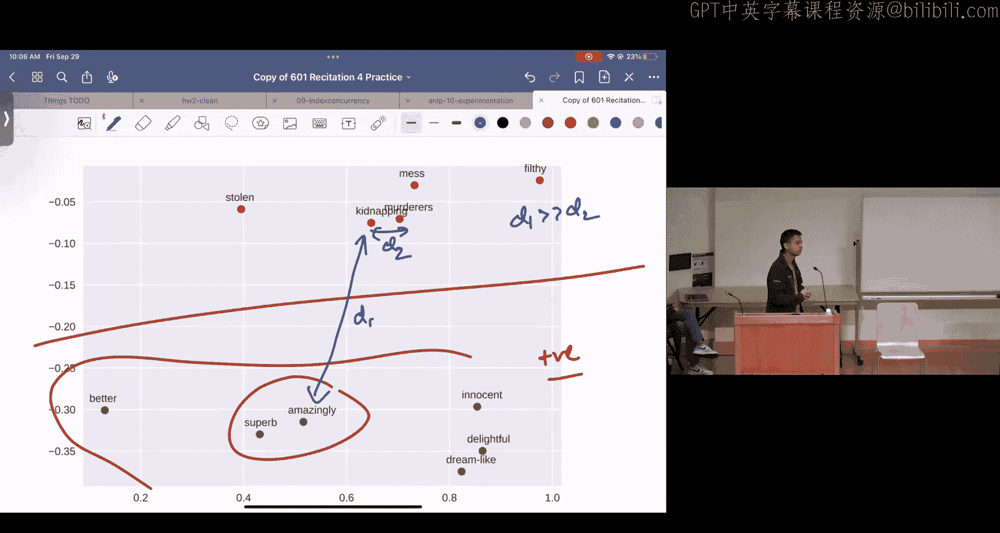
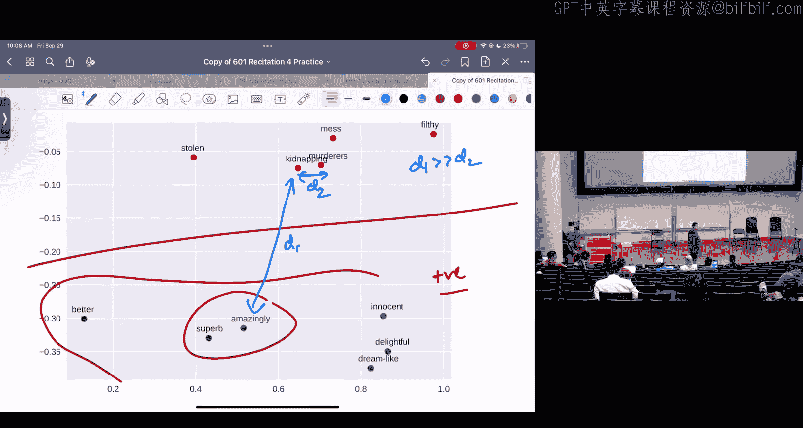

# CMU《机器学习导论｜Fall 2023 10-301⧸601 Introduction to Machine Learning》中英字幕（deepseek p42 Recitation_HW4.zh_en -BV1Z2cUefE4A_p42-

## 1. 回归问题求解

**概述**：本节将介绍如何使用闭式解法求解回归问题。

**核心概念**：

* **数据集**：由特征向量 \(X_i\) 和标签 \(Y_i\) 组成的元组集合。
* **损失函数**：用于衡量预测值与真实值之间差异的函数，例如均方误差。
* **权重向量**：用于控制模型预测的参数。

**步骤**：

1. **定义损失函数**：选择合适的损失函数，例如均方误差。
2. **计算权重向量的偏导数**：对损失函数关于权重向量 \(W\) 的每个元素求偏导数。
3. **设置偏导数为零并求解**：将偏导数设置为零，并求解权重向量 \(W\) 的元素。

**公式**：

\[ J(W) = \frac{1}{2} \sum_{i=1}^{n} (Y_i - W^T X_i)^2 \]

\[ \frac{\partial J}{\partial W_k} = -X_i (Y_i - W^T X_i) \]

\[ W_k = \frac{1}{n} \sum_{i=1}^{n} X_i (Y_i - W^T X_i) \]

## 2. 二元逻辑回归

**概述**：本节将介绍如何使用二元逻辑回归进行分类。

**核心概念**：

* **sigmoid 函数**：将输入值映射到 0 到 1 之间的概率。
* **条件概率**：给定特征和参数，预测标签的概率。
* **似然函数**：衡量模型对数据的拟合程度。

**步骤**：

1. **定义 sigmoid 函数**：将线性组合 \( \theta^T X \) 映射到 0 到 1 之间的概率。
2. **计算条件概率**：使用 sigmoid 函数计算标签为 0 和 1 的条件概率。
3. **计算似然函数**：将条件概率相乘并取对数。
4. **使用梯度下降法优化参数**：使用梯度下降法最小化似然函数。

**公式**：

\[ \sigma(z) = \frac{1}{1 + e^{-z}} \]

\[ P(Y=1 | X, \theta) = \sigma(\theta^T X) \]

\[ P(Y=0 | X, \theta) = 1 - P(Y=1 | X, \theta) \]

\[ L(\theta) = \prod_{i=1}^{n} P(Y_i | X_i, \theta) \]

\[ \log L(\theta) = \sum_{i=1}^{n} \log P(Y_i | X_i, \theta) \]

## 3. 特征表示与情感分类

**概述**：本节将介绍如何使用词嵌入进行情感分类。

**核心概念**：

* **词嵌入**：将单词映射到高维向量空间。
* **GloVe**：一种常用的词嵌入模型。
* **句子嵌入**：将句子映射到向量空间。

**步骤**：

1. **获取词嵌入**：使用预训练的词嵌入模型，例如 GloVe，获取单词的向量表示。
2. **构建句子嵌入**：将句子中每个单词的向量表示相加或平均，得到句子嵌入。
3. **训练模型**：使用句子嵌入作为特征，训练情感分类模型。

**公式**：

\[ \text{word\_embedding}(w) = \mathbf{v} \]

\[ \text{sentence\_embedding}(s) = \frac{1}{|s|} \sum_{w \in s} \text{word\_embedding}(w) \]

## 4. 梯度下降与随机梯度下降

**概述**：本节将比较梯度下降和随机梯度下降。

**核心概念**：

* **梯度下降**：使用整个数据集的梯度更新参数。
* **随机梯度下降**：使用单个数据点的梯度更新参数。

**步骤**：

1. **梯度下降**：计算整个数据集的梯度，并使用学习率更新参数。
2. **随机梯度下降**：随机选择一个数据点，计算其梯度，并使用学习率更新参数。

**公式**：

\[ \theta_{t+1} = \theta_t - \alpha \nabla J(\theta_t) \]

\[ \theta_{t+1} = \theta_t - \alpha \nabla J(\theta_t, X_i, Y