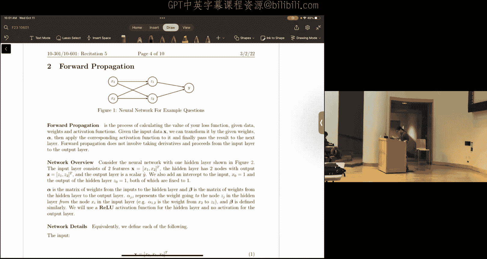
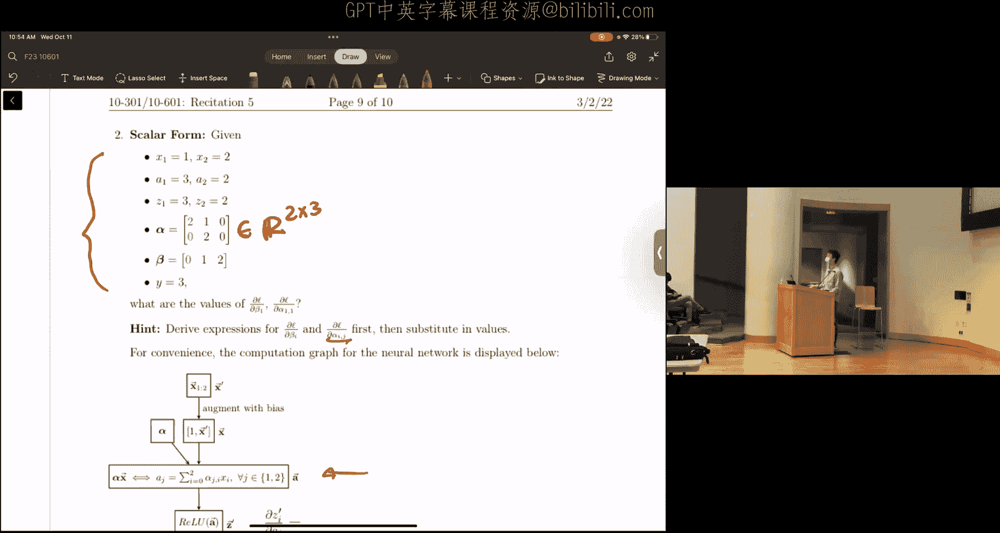

# CMU《机器学习导论｜Fall 2023 10-301⧸601 Introduction to Machine Learning》中英字幕（deepseek p43 Recitation_HW_5_Review.zh_en -BV1Z2cUefE4A_p43-

Okay， everyone， can everyone hear me in？Yeah。We're going to be starting the recitation approximately now。

Does everyone have a copy of the handout， I think we upload it to the course website。

It's going to go with a yes。So。I can't actually hide that。

The first topic we're going to be covering today is matrix calculus。

We've seen a little bit of this with homework4 and also it's a large part of homework5。

 so I'd recommend that if you take away like one thing from this matrix calculus。

 not to say that datas aren't important， but。We're going to try to formalize some of the things we've been doing when we've kind of handw some vector solutions over a couple of optimization techniques such as logistic regression。

 and we're going to try to show a couple methods that you guys can use to derive your own solutions to new Banrics calculus derivatives or other problems where you haven't seen the answer before。

So the first thing we're going to have to talk about is what's known as like a layout convention or a layout notation。

There are a few that are widely used in practice， the most common are called numerator layout notation and denominator layout notation the one we use in this class is called denominator layout notation I this right that here on the side。

And the。Reason we use this convention， as we'll soon see。

 is it makes using derivatives to update values very convenient。However。

 if you look at some papers in the machine learning world or on other subjects you might see a lot of numerator layout notation or some even some mixed conventions where its kind of hard to determine what's going on so just be aware that if you see some like extra transpos here you're not used to or later on you see some transposes where you're not used to seeing them from this class that this is mostly a matter of layout notation rather than doing their derivative incorrectly so to speak。

Yep。Oh yeah， perfect。Okay， is that better？A little bit， not really better。Okay， so。

The first thing we'd want to talk about with this idea of notation is like what does denominator that notation actually mean？

And we'll do that by looking at a scalar example and seeing how that translates to a vector matrix calculus example。

😊，So let's suppose first that we have two scatterar functions， G and F。So when I say scalar function。

 I mean something that goes from the real numbers to the real numbers。In this case， if we。

Compute some sequence of function of applications， so we take our variable x and then we compute y is equal to f of x。

 and then we compute G is equal to or say z is equal to G of y。So let's say z is equaling G of y。

Then in our scalar kind of regular calculus and single variable calculus。

 we can compute a derivative Dz dx， because z is a function of x。And using the chain rule。

 what would we normally get for DZDX？Yeah， I heard Dz D， DY， Dx。

And DZDY and DYDx are both scalar values。So it would be equally as correct to say Dy Dx， Dz DY。

That right， sounds right。So normally we write it this way because that's the way we've been taught。

 but just algebraic manipulation， we can just switch the order of this multiplication because scalar multiplication is commutative and we're easily allowed to write it in this other fashion。

 but we'll see for matrix calculus that's not always the case。

 there's usually one correct way to write the ordering and that throws a lot of people off。

 especially since was' de non regulargular annotation， it might not look very familiar。So。

Let's first talk about now what that denominator layout actually means。

So we're going back to this setting right here where we have x in RPp， Y and R R and Z in RN。

 so each of these is now a vector。In this case， we have a derivative DYDx。

 which is going to be the derivative of like each element of y with respect to each element of x。

 so can anyone tell me if this is a scalar vector or a matrix。Yeah， it's a matrix。

 so there's kind of one dimension for the elements of y and one dimension for elements of x。

So now that we're writing out that or another we know that this is a matrix。

 we know that this shape is going to be like something cross something。

 but we have to fill in what those two things actually are。

This is where denoinated notation comes in。With denominatorator。

 we take the shape of the denominator first and then the shape of the numerator。

 so in this case this would be a P by R matrix because x is an RPp and y is an RR。Similarly。

 we have DZDY is an R by N matrix， and can anyone tell me what DZDx is supposed to be？Yep， P ban。So。

In this case， all we're really doing here is taking the shape of the first vector to be the numerator and then or the first dimension to be the numerator shape and the second dimension to be the denominator sorry。

 all taking the dimension of the。First access to be the denominator shape and the second one to be the numerator shape。

So in other conventions you might see it would be common to flip those this gets a little bit trickier when we're working with something like a scalar by vector derivative or a scalar by matrix derivative。

But the general idea would be， say I have a scanner value， let's call it a。And I have a vector value。

 let's call it B， capital B。Then I would take the shape of B。

 so this has the shape of whatever B shape is。And then similarly。

 if I had a scalar A and I had some vector， like B， this would still be like the shape of B。

 so denominator annotation in general is wherever possible you use the shape of the thing on the bottom when you have a scalar on the top。

And when you have like two vectors there， you use the first dimension and the second dimension。

Are there any questions about how we're kind of coming up with these shapes？Yep。

 is that why we need to assume that there's anybody else be getting like in the mess？

So in this case here these are we're talking about the scalar case。

 so the reason these commute is because that scalar multiplication。

 we'll see actually that this is not a communive operation once we move to the vector case。

So only when we make the assumption that these are all real numbers or scary values， does this？Yeah。

 so just saying that let's use the technique of shape matching。

hich is we look at the shapes of all the things we have。

 we look at what our scalar form kind of looks like。

 and then we just kind of guess how to multiply these things together until they have the right shape。

So as you can probably tell them a method， it' not very rigorous。

 we're just putting together numbers until they match。But sometimes it actually can work。

 especially in the very simple case。So using shape matching， we have DZDX， which is a P by n matrix。

And we need to get this from multiplying DYDX and DZDY in some way。

So can anyone tell me what happens if we do Dz DY？D Y DX。

 which was our first derivative that we wrote down。Yeah， I saw some shakehead。That's exactly right。

 we can't multiply these things because the shapes of these are R by N and P by R。

 so this multiplication does not work out。However， this kind of brings us back to why I wrote on this over here。

RightIf we go here， we can write down。DYDX， Dz DY。And this is the shape of P by R。

 this is the shape of R by N， so their product is a P by N matrix just like we want DZDX to be。

 it turns out in this case this actually is the correct derivative。

And the kind of important thing to note here is that we didn't get。

We didn't get to like write these down arbitrarily in any order that we wanted。

 we had to have a specific order for this to work out for deomator lampnotation。

 it will turn out that it's usually kind of this reverse order from what you may be familiar with where your like deomator variables kind of on the leftmost side here and your numerator variables is kind of on the rightmost side here。

😡，So this technique works when we have like the simplest possible derivatives。

 but we'll see that it doesn't always work。And sometimes your shapes aren't actually specific enough to constrain your derivatives。

So the easy example for that is when we have a square matrix。😡，Suppose we have a matrix A。

 which is n by n， now both dimensions are the same， and we have the vector x， which is an Rn。

So can anyone tell me what the shape of Ax is？Yeah， n by one or just n so Ax is a vector in Rn。

Because we're multiplying n by n matrix within linkx vector。And x is also a vector in RN。

 so as we talked about before， if we have a Linkin vector of the numinator and a LiIn vector the numerator。

 our shape must be n by n。收。Going from that， let's first drum。Look at this next question here。

 which kind of gives us the basis of the generalizing a single element method what we want to do is compute the derivative of a single element of that matrix。

 so DAX DX is a N by N matrix we want to compute element Ij of that。And using that。

 we want to generalize to the vector form of that by finding some vector form that naturally incorporates that single element form。

So this kind of leads into our first question here， what is the element IJ of this matrix？

If I have D AX， D X， this gives me some。Big matrix for both mentions are n by N。

And I want to element IJ， so say I is here and J is here。What I an I J。

Is that going to be the derivative of element？I of de numerator with respect to J the denominator。

 or I as a denominator with respect to J the numerator。Raise your hands for option one。

Raise your hands for option two。Oh yeah， so the question is basically what's written down there is the element I J of this matrix equal to the derivative of element J of the denominator with or I of the numerator with respect to J the denominator or J of the numerator with respect to I of the denominator？

Yeah， so like when we did our poll before， we got that most people of the people who voted considered this to be the correct answer。

That it's equal to DX J。DxiI。And that's because kind of like we talked about before。

 the first dimension comes from the denominator， second one comes from the numerator。

 so the first index should actually go into the denominator as well， and to see that that works out。

 you can kind of go back to our previous example and say what if they had different shapes。

 then would the indexing even work out properly if we put those indices in the right place and the answer would be unless you had denominator first den numerator。

 you run into a place where your shapes wouldn't line up so one of your indices would kind of go beyond the bounds and one of them would like not cover the entire axis？

So now that we established this。We can compute this directly with sc calculus because we're kind of working in the scatter world again。

 so we have DX。Dx。Ij is equal to D X J。So just to be clear， we're taking element J of the vector Ax。

 not element J of the vector x。Dxii。Right and that's equal to if we took out。Kind of the J row of a。

So I'm going to write that as like J Com Coran。So we're taking out the entire J throw of a and we're multiplying that with x to get like the element J of that matrix product。

And then we're taking the derivative of that respect to Xi。

Writing that out as estimation sumation might make it a little clearer， so let's do D D X I。

Of the sum from cas1 to N。Of a Jk times xk and from here we have a pretty simple scalar calculus derivative。

 can anyone tell me what I might get here？Yep， AjiI。And then the final question we have is。

What is our matrix form of some matrix that has element IJ equal to a JI？

What is the matrix that has element IJ of that matrix equal to AJI？Yep， a transpose。

So a transpose and A both have shape n by N， but we've kind of shown here that it's not necessarily the case that we can just like write down a and call it day a transpose is actually the correct answer here。

 so shape matching only gets you so far and especially when you have two dimensions that are the same size。

 it does not really get you all the way to the correct answer。so。

It transpose that derivative for here。We're going to do one more example。

 but this time we're going to kind of take this basic role we've derived and try to apply it in a more like real life situation and see if we can do this derivative entirely without doing single element steps。

So。The first thing we can do is tri shape matching。

So we're trying to take the derivative of this quantity。With respect to zero or sorry。

 with respect to theta and then set it to zero。And that's how we get the close form if you'll call for something when we're doing optimization。

 so in like logistic regression or linear regression。

 we've previously done this a lot with scalar values where we've taken the derivative with respect to a scalar and said that equal to zero Now we're going to do the derivative with respect to the entire vector at once。

So。If I wrote down。This quantity。This is the L to norm of some vector squared。

 which means that it's actually a scalar value itself， so this is a real number。

And we're taking derivative with respect to Theta， which is in RD。

So my derivative let's just write down DL。Did they呢。Has the same shape as data， it's an RD。Now。

 what is the shape of x transpose y？So we have x is in R n by D and y is in RN。Yeah。

 so x transpose y is also an RD， but if anyone remembers the cloth form for linear regression。

 this is not actually our solution。So to find a closed form solution， let's step to this derivative。

We have。D over D theta。Of this quantity， y minus。X theta。

Square okay so this is a little hard to work with I have this al two norm going on。

 but I don't really know how to do a derivative through an al two norm can anyone tell me how I might simplify this into something that's a little bit easier to work with on the matrix side。

Yeah， so the alternative vector is that vector transpose times itself。

 also means like the dot product of the vector width itself when we square the one。

So now that we have this， we can distribute this because this works just like a regular multiplication。

So we have D over D theta here， D over D theta。Of y transpose y minus y transpose x theta。

Minus x theta transpose。Why。Plus， x theta transpose。X theator。

And I've been careful here to not immediately combine the two turns on the inside here。

 the y transpose X theta。X thetata transpose y but we'll see here that we actually can do so in this case it's very easy to notice because y is a vector of length n X datata is also a vector of length n so this is the dot product between two vectors of length n which gives us the scalar value so since these are both scalar values we can kind of flip that arbitrarily like we talked about doing。

In some previous cases。We get y transpose y minus let's do2 y transpose x theta。Thus。

 extator transpose。X theta。Okay， so everyone good so far。

 this looks like kind of what we do if it was scalealrs。

 we're just multiplying and expanding some terms out。

The next thing we're going to do is a little tricky， but it'll help us work with the thetas later。

So we're going to keep the white transpose wide， but we're going to simplify this term and we're going to simplify it in a way that makes it look more complicated。

Okay。So what we did here is we took the notion of matrix multiplication being associative。

 so we had a y transpose times an x times the theta。

And then we put the parentheencies around this instead of the x theta。

And then y transpose x is the same thing as x transpose y transpose because。

If you apply that transpose inward that。First which is the order of these。

 so you get y x transpose and then transposees each element， so you get y transpose X spec。

So the reason we've done this is to make that data appear on the right side in a little more convenient fashion。

And we'll see why that's really helpful in just a second。

So next thing we want to do is actually apply this DD theta to each of these terms individually so can anyone tell me what the derivative of y transpose y is with respect to data？

Yep， seeing some zeros。Okay， so let's say zero。 Now can anyone tell me what the derivative of this term is。

With respect to。Dtator。So this is a little tricky right。

 let's write down what we have we have some term that looks like minus2。X transpose y transpose。

 and I'm putting the minus two inside the transpose just to make it。A little simpler。Right。

 because it's a scaling multiplication doesn't affect anything。And then we have this multi by the。

That。In this case， let's just say this is some。Mattrix B， right， we have B times theta。

 and we're doing the derivative of that with respect to data。So the derivative is。Yeah。

 so this is B transpose as we derive tier， we just switched like a to B and theta to x。

So we transport this entire thing right here。And we get minus2 x transpose y。

And that's why we pulled it out with transports effectively。😊，And then we have this third term here。

 right we have plus。So we have that the derivative up here of DX with respect to x is equal to a transpose。

 so in this case we have DB theta with respect to theta is B transpose， but B transpose。

Or B is equal to this thing already with the transpose in it， so the two transpos is cancel out。

And it will evolve to de with D theta of。X theta transpose x theta。Right， and now we're kind of in a。

A little more stuck position because we don't have an existing rule that helps us easily deal with this。

But one thing we can easily do here is。Think of what what happened in the scalar case？

So we have the derivative。Of let's say。X，I guess I was write x datata over the lowercase x here。

With respect to data， and if we assume these are both scalrs， this is actually an x theta squared。

 right we're multiplying it with itself。So in the scale case。

 we'd apply the chain rule and we'd get something that looks like anyone want to take a stab at this？

Yeah， so we get 2x data times。Here review with respect data next data。

It turns out that in the matrix calculus sense。This actually does work for deomator layout notation as long as we put that second term。

This 2x data term second， and we won't go over the proof of that for time。

 but encourage you to either go over it yourself or to look at the matrix calculus notes that are linked on the course schedule。

 which should have a proof of this。So this is equal to minus2 x transpose y。Plus， D over D theta。

X datata。Times2 x theta。And then we have our repeated application of that same rule。

 the derivative of some matrix times some vector with respect to that vector is going to be the matrix transpose。

So0 minus 2 x transpose y。This' x transpose， x theta and' move the two to the outside。

So now we've further taken this derivative without doing any kind of matrix steps。

The next step is or any sorry any scalar pipe steps we've only done matrix operations。

 the final step is to set this to zero and solve， so we have zero equals minus2 x transpose y plus。

X T X datata， right， so we can divide by two， move the other term over the data side X trans plus y is equal to。

X transpose x theta。And then datata is equal to x transpose x。Inverse x transpose y。

And that gives us our solution。So。If you've seen this before。

 this is the closed form solution for linear regression。

And we've done this derivation entirely without。Any kind of scalar or like dropping down to the scalar level by applying only two of these matrix calculus rules。

So deriving a few of these rules by hand is nice to get a lot of intuition。

 but once you have a small toolkit of them， you can use them in a lot of situations and you'll basically have to stop doing this at the scal level entirely。

Therere any questions about mat calculus？Yeah。Yeah， so this was。

Dirivative of x theta with respect to x or sorry respect to theta。

 so this is the same as our case of like derivative of AX with respect to x。

From before where the a becomes the matrix x of all the points and this lowercase x here becomes the vector theta。

Oh， sorry。 That was an arrow that I was drunk very poorly。Very better。Yeah， okay。

So basically repeated application of this rule， doing a lot of things that look like their scalar counterparts。

 just is a little weirder with like expanding things with distributive property。

 multiplying terms together， treating a squared term like a square term。

Any other questions about Scalr to matrix calculus or anything that might be different between the two？

Yeah。this step。Yeah， so this rule is a another one of those rules like the one we developed before。

 I did not actually derive it here just for the sake time。

 but it works similarly to how in the scalar case， we would do this derivative of x squared and we would get like2 x theta times derivative spec theta of the inter term。

这张州。呃，可以。St。就是。So basically a transpose times a acts the same way as a squared in terms of doing a lot of matrix calculus in practice it doesn't actually operate the exact same way。

 notably it's not commutative， so in the matrix case we can't actually write down this derivative in this form for denominator layout notation。

 we have to write it down in this form here。But in terms of figuring out what the rule looks like。

 it's kind of a good intuitive thing， just like we did on the very first page where we said。

 what's the scalar form look like and our matrix form looked like one of the possible scalar forms。

Yeah， so the derivation of the rule to go from this to this is almost the same style as the derivation we just did on the previous page takes probably a little bit more work。

 but it's definitely something you can do for practice or in case it shows up on like exam two or something like that。

there another questions on matrixtricycls， I'm going to hand it off。Okay。Okay。

 can guys hear me so the second part is for propagation。😊。

And here's a description of forward propagation so I'm just going to read it For propagation is the process of calculating the value of your loss function given data weights and activation functions。

 given the input data X we can transform it by the given weights alpha then apply the corresponding activation to it and finally pass the result to the next layer For propagation does not involve taking derivatives and proceeds from the input layer to the output layer。

And that's just a。A description of propagation and here's an example neural network with one hidden layer and the description is consider the neural network with one hidden layer as shown in this figure。

😊，The input layer consists of two features x equals to x1， x2 transpose， So it's a。Column vector。

 the hidden layer has two node with output Z equals to Z1 Z Z2 transpose。

 and the output layer is a scalar Y hat。 We also add an intercept to the input X 0 equals to one。 So。

 for example， in this figure， we can say there's。

There's an addition x0 or equals to one here。And the output of the hidden layer d0 equals to one。

 So there's an intercept t0 equals to one， and both are fixed to one。

And alpha is the matrix of weights from the input to the hidden layer and beta is the matrix of weights from the hidden layer to the output layer。

 so alpha JI represents the weights going to the node ZJ in the hidden layer from the node XI in the input layer。

So for example， alpha 12 is the way from x2 to z1。So actually， this edge is alpha 1，2。Okay。

 and beta is defined similarly， so like beta 1 is the weight from D1 to y hat。So like beta1。

And for activation function， we use Strtified linear unit and we only have activation function for the hidden layer and no activation function for the output layer。

😊，Okay。That， and to say these mathematically， we have。The input x represented as x0 x1。

 x2 where x0 is 1， and linear combination at first layer is Aj equals to the sum of I from0 to 2 of alpha j times xs。

And the activation function at the first hidden layer is D DJS equals to rectified linear unit of AJ。

 so it is equivalent to taking the max of0 and AJ and。Then after we calculated z1 and z2。

 we can add the t0 equals to 1 here to get z。And the linear combination。

 the second layer is similar to the first layer， so like y hat equals to beta j times c j and then taking the sum。

Okay。Thank you。Any questions about。嗯。This neural network。Okay。诶。Yeah， and then we define the loss as。

Simply the half of y hat minus y squared。Okay， so the first question。

Why and how do we includeude an intercept term in the input and in the hidden layer？

Does anyone has any idea？我一次。Yes， so for the y it's similar to linear regression because in linear regression we also included an intercept term and so the reason is just to better fit the data so we can move the whole line like up or down to better fit the data so the reason is like similar to。

Linear regression。We can better fit it there。Okay。So how do we include the interceptor？Yes。

 so actually， we had have the answer here。 We fold it in， fold。The interncept turned in。

And how do we do it is by。Adding a zero term。And fix it to one。Okay。

Any questions about the first question， Oh yeah。Better。Okay。Second question。

 why do we use long linear activation function in our neural net？And yes。

What happens if we use a linear activation function？Yes。

 so using a linear activation function is equivalent to linear regression。😊。

Because like every function in the like each layer is all linear。

 so combined is still a linear regression。😊，So we just say。A neural network with。林宁儿。Actation。放心。Yes。

Equivalent。2。20鸟的关深。Any questions about this one？Okay。TheNext page。

 we have specific values of alpha and beta， so alpha is this matrix and beta is this vector。

And we also have y， the true value of y is 3。So。Given x1 is 1， x2 is 2， what are the values of a。

So here they already give us the equation for a so we we can just calculate by plugging in the values。

😊，We can say。This is alpha 1 alpha 20 times x 0 plus alpha 2，1 times x 1 plus alpha 2，2 times x。

And then tuck in the values alpha2，1， alpha 2，0 is 0。

And x0 is1 because it's the intercept term and alpha 21 is 2。X1 is1。Alpha 22 is0， x2 is 2。

So in total， we get like0 plus 2 plus 0 is 2。Any questions about this。So alpha1 is similar。

 so I just ignore it here。Okay， the next one is calculate y hat and the loss。Again。

 we have the equation for white hat here。We can just plug in the value。

 So beta 0 times C 0 plus beta 1 times C1 plus beta 2 times C 2。And then。Beta 0 is0， beta z0 is 1。

And beta 1 is 1， z1 is zero。Beta 2 is 2。 Z2 is 2。As it always one， sorry。In total。

 we get y hat equals to2。And then the loss。We had the equation before。

 so it's just a half times y hat minus y squared。And then let me just a copy it here loss half of y hat minus y squared。

😔，And we have that Y hat equals to two， so half of two minus。And we have y equals to3。

 so 2 minus3 squared。This is the current two half。Any questions， yes。

Here' the values we calculate from the rest of the network part of the。嗯。So， we have the。嗯。

We have the value of z calculated here。 and if we use like the alpha and beta we had and。

Using the like initial x1 x2 in the previous section， previous question。

 then we are able to calculate the from using these values。关闭得。we didn' know be heard。被告。Yeah。

 so for this example is that they just give us the Z1 and Z2。

 so it's easier for us to copy Y hat loss。Any other questions？Okay。Next one。

 find the vector form of forward computation。Given a is a column vector。Yeah。Any idea。Yeah。

But actually， the answer is。下。A equals to alpha times x。And Xha， where X hat is the like， with the。

Intercept term。坐れ点。So why is this true？Write out alpha and X to verify。 So alpha is。Alpha D 0。

0 alpha。Wait， sorry， how far。Alpha 0，1， alphapha。I'm sorry， alpha 10， alpha 11， alpha 12， alpha 2，0。

 alpha 2，1， alpha 22， and then x hat is x0， x1， x， okay， is correct。

So if we calculate each term of the resulting vector matrix。Vectctor is a vector。 So we get alpha 1。

0 times x 0 plus alpha 1，2 times。Sorry， that's one one。1，1 times x 1 plus alpha1，2 times x2。

As the like the A1。And the second a2 is alpha 20 times x0 plus alpha21 times x1 plus alpha 22 times x2。

And we want this to equal to81 and aQ。And we can use。

This expression we derived before and verify that like a2 is equivalent to。This one。

They are equivalent and similarly， you can do the same thing for a to verify that like it is actually equivalent。

😊，Any questions about this？Okay。嗯。Okay， the next step in our neural network is D。

So using the equation before， Z is simply taking the rectified linear your unit。😊，Of alpha of a。

 and then uping the， like the interceptor。So， we can say。Will that Z equals 2。R， E， L， U of a。

 And then we say the hat is。嗯。1， Z1， Z2。 So we folded in the intercept term in Z hat。Now。

 what's why hat？Is in vector form。So we have the equation before Y hat is taking the sum of beta j times Cj for all js from0 to2。

Okay， so similar to what we had for a for I hat， we just have betaheim' C hat。And to verify it。

 we can say beta is。Beta0， beta 1， beta 2。And Z had a C，0， Z1， Z2。

Multiply it out to get the 0 beta 0。Yes。Let me say beta first， beta 0。

 d0 plus beta 1 z1 plus beta 2 d2。And this is a equivalent to what we have here。

So our white hat expression is correct。嗯。Any questions about for propagation？Okay。Okay。

 the next thing we're going to be talking about is computation diagrams。

So a computation diagram is a specific way of representing。

A series of mathematical operations or in general mathematical expression graphically。

It's not necessarily only useful for。Something like a neuralNe or this deep learning homework。

 but it's actually generally useful in computation optimization。

So you may have seen something like this before， even if not in this particular form。

We have a set of specific conventions for computation graphs for this class that will try to stick to as much as possible when showing you these and expect you to stick to as much as possible when we ask you to draw these。

 however note that these aren't very standard conventions as there are kind of too many different standards for how people draw these so if you see something kind of in the wild that looks slightly different。

 it's probably still a computation graph it just。Follows kind of a different notal convention。

So the general idea here is that we're going to take every elementary operation or kind of pick some level at which we call everything below at a simple elementary step and represent each of those as intermediate values on the way to having our final result notated。

So for this function F， we're going to start by having three inputs。 so let's draw out X。😔，Y and Z。

And you'll see in our notation， which I believe was presented on the slide and lecture or will be presented if it was not。

 that you normally want to write the name of a variable outside the graph and you write the expression for the variable inside box for the cell of the graph。

In this case as there inputs， we could just kind of skip over that as shorthand instead of just we could also write like X。

 Y， Z like this， but sometimes you'll see that we don't do that for input variables。

Next thing we want to do is figure out what are kind of immediate next things we can compute using only X。

 Y and ZR。So looking at this expression， does anyone have a suggestion for some intermediate quantity we can compute using the raw variables X。

 Y， and Z？Sure x times y， and we're going to call that a。So。

Let's make a box here and we can write down a equals x times y。

So the other thing we could do instead of writing down a equals x times y in the box is write down the function they gave of this computation。

So we could also write this down and let me just say inside the box as like F of x y equals x times y。

This gave us a kind of a convenient shorthand in the case where we have operations that are like represented by function。

 we can just write the function name in the box instead of writing like a equals function name。

For this particular computation graph for the rest of it， I'm going to be using。

That kind of notation and write the function inside of it。

 so it'll look a little nearer here because we're doing a lot of simpler operations like multiplication。

 but in practice it becomes a more efficient way to write these。

Once we write a new intermediate value， we also need to connect it to its inputs in this case we had x times y so our inputs were going to be x and Y。

For a next intermediate， which is spoiler is going to be x times z。we want to write that function。

 so in this case we'll write like f of x comma z equals x times z。

And then we want to connect those two intermediates。Sorry。

 that's not the actual intermediate involved。Yeah， we want to connect the two intermediates X and Z。

To this so。So what's called this B just to make sure we have a name for everything。

Now we've computed two intermediate values， XY here。X， Y again here and x0 right here。So from there。

 does anyone have a suggestion for what the next value we should compute is？Sure。

 so someone said we should do sign。Let's make a box here。

And the computation we're want to be doing is I'm just going to write down sign。

 which is that like I mentioned it shorthand， but what we're really doing is。

Not computing like sine of x times y from the inputs x and y。Right， so this。

Is kind of combining two steps we're not actually doing that let me just like draw an x there what we're actually doing is computing sine of a。

From the input A。We've already computed xY is the input A。

 and we're going to use that as the input to the sine function。

So let's draw that out here and let's call this， okay。

So that's kind of one of the nice parts about these computation graphs。

 we're not building up a giant expression by kind of adding the layer every time we're chaining together a bunch of simple expressions such that each step is still some elementary or atomic operation。

Anyone have a suggestion for another intermediate， maybe on'm like this bottom track right here。Ex。

Yeah。So we'll use the exponential function。We'll feed this in and then we'll call that L。

Right so now we're kind of moving forward on both these tracks we've covered。We have XY。

 we've covered sine of Xy。Any suggestions on what to compute next？Let's do this left side first。Yeah。

 so I heard division。Let's write this out as。And I'm going to use like the unambiguous like full notation。

😊，F of Xy equals x slash y just to write out like a division function。

 you could also just write out slash or division and would probably make sense to people。

 but because division has like this ordering involved， sometimes it's better to be precise。

In this case， I can be even more precise by actually writing down what our intermediates are。

So can anyone tell me what the two variables we're putting into this are？Yeah。

 so we're putting in K and Z。So just to be completely clear about the operation that's going on。

 I can write like K slash Z or write down the function to keep our notation。Oh。

And this arrow from Z is going to come all the way from over here。

Which is just like other kind of example of this rereeuse idea where we're。

Not making like a separate Z cell or like instantating a separate cell in our graph for that we want to reuse them me just as much as possible。

And let's call this one C。Next up we have one more。

I guess intermediate value before we get to our final result。Any ideas what that step is？

The Z mobile one division。 we have a。Exper in term here L。

And then we want to divide that by some quantity， which is x times y。

 but we already have an x times y representing in our graph。

 so there's no need to recompute that from elementary steps， we can just write down a here。

And then this like we can write down the function to be completely in line with the course convention by just writing down a slash for division or writing down L/lash a。

 which is like the expression that you're computing。

Is usually sufficient in context like outside of a greater assignment just to get your point across。

对。So we'm dragging that arrow down from A。Now when we use that， we'll call that D。

 and then we get our final edition step， let's say C plus D， we can write down that function again。

 C comm D。And that gives us our output value， which we'll call F。

So this illustrates a very like important step here， which is this reuse in the variable A。

In general， the reason we write out these computation graphs is not just so we have a mental picture of what's going on。

 we can represent them either pictorially or also like programmatically to use them to make optimizations like this。

 this reuse of a， because we know that a has to be reused。

 we can store this in some intermediate variable and bring it back later when we're computing the value of D and because we know that for example B is not used after we compute L。

 we can throw away the value of B， we don't need to store it in some cache anywhere and when we're moving forward in our computation。

 we can save some memory that way。When you're doing algorithms like back propagation for a neural net。

 this becomes very important because you need to know which values you want to save for why you're doing your forward prop in order to do your back prop efficiently and which values you want to discard。

If you just save every value， you're going to run on a memory very quickly。

 and if you don't save any values， you're going to have to do extra computation to make up for not having that value cache from the forward pass。

So drawing out a computation graph like this tells you kind of exactly where a variable stops being necessary。

Speaking of that， we're going to try to draw out a computation graph for this neural network。

 this might look familiar to you from the last question。

And we're going to use all the same conventions where this wave matrix here is alpha。

 this wave matrix here is beta。And we also said here that we want to write out the shape of everything and anyone tell me what the shape of。

All of these terms was going to be。So Al is。A two by three。And beta is。A one times three。Okay。So。

Going on here， let's also just write out that our vector X。So just x1 and x2 is an R2。

But it's like x1， x2， and then our vector is z。There are two。And that's Z1， Z2。

And our value y is in R。So noticely I didn't include the bias， we'll get to that in a second。

But what we're going to do is write out a full computation graph for this neural network。

 it'll be similar to the one near the top of homework five and。

We're going to add a little bit extra detail into this one just to talk specifically about how the bias gets folded in。

So we start out with our inputs。Right。This is vector x。

Notice here that we don't really care about x1 and x2 as separate variables we trying to do everything in this vector form。

 so we're not going to represent on a separate node in our computation graph。After that。

 we need to do some operation before we multiply with alpha like we saw before。

 does anyone know what that operation is？Yeah， we have to concatenate or augment the bias term into this vector。

 so that'll look something like。Making some new vector where the first element is one and then the rest of the vector is。

Like the vector X that we had before。In this case， we're going to call this vector， let's say。

Like x prime just to have that bias in there。This is not really an operation per se on the inside。

 I guess you could like define some operation called like Kcat or something like that。

In like purely mathematical terms， if you wanted to represent this as a matrix multiplication。

 you also could do that。So there are like quite a few ways you can work around this in order to get a representation of this operation for now we're going to gloss over the details of how we implement it in favor of just like lighting down the graph。

So the next step we want to do is that forward step。We want to compute some。

Intermediate vector that is the result of that matrix multiplication or that linear operation between x prime and the weight matrix alpha。

So if we recall from the previous time， we're going to multiply alpha with x prime and we'll call that vector A。

And A here is before we actually apply that activation function。

 notice that it's not represented in this graph here。

 and this graph we directly went to z assuming the activation was applied right after the linear。

 the going to be very explicit because every computation is represented as a node regardless of whether it's like a neural network layer computation or activation or something else。

So moving on from that， we can apply our activation function。

So we'll row down and then we'll get vector Z。After that， just like we talked about before。

 we need to augment a bias。So we get the one z。Allright， the one and Z。For the Z prime vector。

And after that we have another matrix multiplication， I'm going to slow down a bit here。

 does anyone want to shout out what this matrix multiplication is going to be？Sure。

 beta times z prime。And that gives us say like some prediction value， why hat。

 but we're not really done here because that's not all the computation we do。

The final computation we usually do here is computer loss value and while our neural network here just kind of ended with the Y node。

 when we're actually writing down every single computation we do， we need to write down a loss value。

Right， so。Here we are viewing let's say mean squared error loss。

 so our loss function is going to be like1 half y hat minus y。Squared。And we'll call that L。

 and it takes in that Y hat， but it also takes in our true value y that we wrote down before as a real number。

And there's something missing from this graph that I intentionally left out in two of our previous steps。

 can anyone tell me what that might be？Yep。Did we have the much as the end of， have the why or。

So the ones are fine because they're kind of just constant like I said before we can represent this operation in a lot of different ways or compute in a lot of different ways。

 so we could think of the ones as just being a consequence of like some function called like a bias or something right so we don't really necessarily care about them as separate inputs。

 but is there something else that we care about as inputs that we missed？In previous steps。

In interest of time， I'm going to write this down here。We forgot about alpha and beta。

So these are kind of the most important parts of this neural network diagram， right。

 the whole reason we're doing this computation is to optimize alpha beta。

 if we forget where Al and datata are using in the computation。

 then it's a little hard to optimize them。And the thing you'll see that when we're doing foreign propag。

 backward propagation to this graph is that the entire point of this all of this computation is so we can figure out exactly what computations went into the outputs from this like alpha and beta。

 like the outputs of this and。There's value here， like this Y hat right here。

So when we're doing third propagation， we start from this input X。

And then we kind of move all the way through this network in this direction to get that lost value。

 But when we're doing backward propagation， we let's see if we can get a different color here。

We start from this output loss value and we move backward until we can get to this value to update it and then we move backward again like from here。

 until we can get to this value to update it we really care what happened to the X and the backward propag all we care about is pushing your gradients backward to update Al beta so the most important parts or like the thing you need to make sure it to include a computation graph is not just the conventional inputs to your neural network like X and Y but also the parameters because that's what you're actually working with。

😡，Any questions on computation graphs？Ok。So the last section I're covering here is the back propagation。

 which I'll hand back to Andrew for。Lom world testing wait。All right。WaitIs this okay for everyone。

 can you guys all hear me？个。Perfect。All right awesome so out of interest of everyone getting everyone out in time I'm probably going to go a little bit quicker。

 but this last section is essentially what we've been building up to backwards pro just calculating the gradients and in order to update our weights like Boby just mentioned and a lot of this can be just seen as sort of like an application of all the matrix calculus you guys have practice in section one okay。

😊，Let's get started。So first question， given a neural network with a corresponding loss function J theta back propagation gives us the gradient of the loss function with respect to the weights of the neural network。

 the method is called backwards propagation because we calculate the gradient of the final layer of the weights first then proceed backwards to the first layer。

In a simple neural network with one hidden layer the partial derivatives that we need for learning are DL with respect to D alpha Ij and DL with respect to D beta Kj and we need to apply chain rule recursively to obtain these so note that in implementation it's easier to use matrix vector vector forms to conduct these computations。

😊，Right so question number one so we have so in back prop we're calculating many gradients which of these gradients are used to update the weights do not include intermediate values used to calculate these gradients does anyone have an idea about which。

😊，Which gradients well actually be using here。水。😊，Okay。Yeah， exactly， so it would just be gradients。

😊，The alpha and beta。And that makes sense right， because these are the gradients that are used to actually be updating the weights alpha and beta。

 so we want to be coning the gradients with respect to these values， okay？😊，Yeah。All right。

 let's move on。Right， so question two， given this set of values here。

What are the values of D loss with respect to D beta 1 and DL with respect to D alpha of 11 as a hint derive expressions for DL D beta I and DL D alpha IJ first then substituting values。

 and for convenience the computation graph for the neural network that I'll be also just or wrote out for us in the last section is also given here for reference。

Right。Oh and then there's another hint about Ralu， but that's not going to be immediately relevant for the first two。

 I believe so I'm just going to skip past it for now okay？Okay。

 so if we take a look here on the left， we already give you an equation for DL with respect D beta I right so if you want to obtain an equation for DL with respect D beta 1 we can just go ahead and substitute one into that first equation for I makes sense right so as a result we're going to end up with something that looks like DL with respect DY hat。

😊，Multiply by dY hat with respect to D beta on nothing fancy here we you're substituting y in for I cool。

Right， so now I don't think I have them there Okay， so now using this equation。

 let's go ahead and actually calculate all this value so recall that this is just going to boil down。

😊，To something that looks like the derivative with respect to Y hat of the loss。

 which is defined as one half。Y hat yeah， y hat minus y squared。

Multiply by the derivative with respect to beta 1。Of。Some from i equals 02。😔，Better I multiplied by。

Z i。Rightい。And from here， if we actually just start writing up the calculus。

 this is just going to be equivalent to Y hat。😊，Minus y multiplied by Z1， right？

Does it sort of somewhat make sense where we're getting these values。

 I can walk through this more slowly if you'd I like。够哎。And from our values given up here。

 what we can then do is simply just plug in values here so why hat based on the numbers that we were given in this scenario it's just going to be equal to7 minus y which is three multiply by Z1 and we know that with Z1 and this question is just going to be three。

😊，And so we have that this DL with respect D beta 1 is just going to be 12 here， okay？Any questions？

Or sorry， is that a hander？And I get assign sign on wish line？对。Is that a hint？Okay。All right。

 all right， let's move on to the next one。So here we also write out so the second part of this question remember is that we want to be solving for deal with depict D alpha IJ okay so here once again we've written out the generalized form for a general IJ so all we need to do here is just plug a noise for IJ。

😊，呃。🤢，Pf， so we can write this out as just DL over。The hat multiply by white hat。GZ1。

Multiply by DZ1 with respect to D1。D1 with respect D alpha11 okay just squeeze that in there right again this is the same thing we did in the last question we're just substituting in specific values for I andJ into our generalized derivative goal。

😊，All right。so now let's go ahead and actually calculate this out and if we observe here because we're taking we're just taking the product of a bunch of we're just taking a product of a bunch of derivatives。

 what we can do is we can just work on these one at a time so for example this term right here simplifies to DL with respect to DZ right that's just just by property of just by multiply the two gradients we can continue to apply this moving from left to right and our equation here。

😊，So to illustrate this to hopefully make it a little bit more clear。

 let's go ahead and try to do this first。Deal with respect to DZ1 here。

We can define that as just DLY hat multiplied by DY hat over。It's easy one right。

 so that sort of make sense where we're getting that from。こ。Right， and we know from is it？

And we know that from what we calculated above， this value right here is just equivalent to four。

 so this boils down to four multiplied by DY hat with respect to DZ1 okay。😊。

And I'm not going to walk through it out of time， but this is just going to be equal to beta 1 just from the equation of y hat okay？

This simplifies to four multiplied by one。Which is just for。

So this is just the first step of when we're calculating these back or when we're cculating these great。

 we're taking the product of these gradients moving from left to right in this original equation here。

😊，Does anyone have any questions about this because we'll just basically be doing this four times for this question？

She。Awesome， cool， all right， so let's just keep going on so。😊。

From here now we can calculate the derivative of the loss of respect to DA or sorry D1。

 which is just going to be equivalent to the derivative of the loss with respect to DZ1 multiplied by DZ1 with respect to DA here。

😊，Right same thing again we're just taking the product of a bunch of gradients in order to get an equivalent expression。

 so we just calculated that DL with respect to DZ1 is just going to be equal to4 and we have that from the equation of DZ1。

😊，Or sorry from Z1， that's just going to be equivalent to one here。

Right because Z1 is defined to be the Relude it's essentially Z1 is just Relu a1 right and by definition of the derivative Relude it's just going to be equal to one so long as the input is greater than zero okay。

😊，And so again， once again， that's equal to four Yeah， I went through that one a little bit quickly。

 but does everyone understand where these values are coming from？Awesome， all right。

 let's keep going。So now we can finally， we can compute the value or derivative of loss with respect to Al 11 and we can write this in terms of DLDA1 multiplied by D1。

 D alpha 11。喂。そ。Right so once again we can reuse this value that we just calculate DL with respect D1 is just going to be equal to4 and we're going to multiply that by the derivative of a1 with respect D alpha 11 right and in this case it'll be helpful especially because this is a bit of a B expression to refer back to the equation for a up here。

😊，And we find that if we take it with respect to。Take the derivative of D1 with respect to Al 11。

 we're just going to well the or sorry， the equation we're going to be left with is x1 here。😊，Again。

 we're not doing anything fancy here， we're just taking look at the equation for A1 and then taking the derivative with respect to a specific variable that we're pulling out okay。

😊，And so we have from the problem description that X1 is just one so once again we are going to do this four times1 equivalent to four except this time。

 we actually this is the value of DL with respect D alpha 11。

 which is what we were looking for in the first place， so we're done。😊，Awesome thoughts。

 does anyone have any questions about anything I didnt here？Yeah。

 anything you want me to explain a little more， definitely feel free because this is going to be a very central part of your next programming assignment。

All right， awesome， just keep going then。你看。All right， so for the last question here。

 we just want to be calculating the values of DL with f D datata and DL D alpha this is sort of like the pinnacle of what we've been working up to so far right we just want to calculate the gradient with respect to the weights that we should be updating cool。

😊，哎。So let's go ahead and get started with。D loss with de D beta。

So let's just do so this might be an intimid thing at first。

 but all we need to remember that all we need to do is just do simply do the same thing that we've been doing in the previous question。

 which is to take this expression and decompose it into a product of gradients that's easier to work with so what we can do is we can write this as derivative loss with respect DY hat multiply by DY hat with respect to D beta。

Okay。😊，Again， this isn't anything new this is now I think the third time we've done this。

 just want to make sure that's clear to everyone， okay。

And so if we actually evaluate this expression， we know we've done this before。

 I'm not going to walk through a devation again， but DL with DY hat is just going to be y hat minus y and DY hat with respect to D beta if you take a look at the expression for Y hat actually I'll just go back to right now。

😊，If you take the derivative of that with respect to D beta， we're just going to get Z， right？

But one thing that we actually need to be careful of here， oh right， there we go。

MZ right that makes sense right but one thing that we need to be careful of so let's think back to a central standard of matrix calculus so recall that we loss here is a scalealr it's being taken with respect to d beta so the output gradient needs to be in the shape of D beta right and that's only going to be possible if we have a transpose on this x okay I'm not going to walk through the specific dimension hacking right now just because I really do guys want to get you guys out off your own time but on your own time or you can feel free to bring this to O as well if you work out the dimensions the matrix calculus like this is the way to get the dimensions to line up with。

😊，Expected dimensions where we can get from the gradient， right？So once we do that。

 we have that this is just going to be equivalent to4，12，8。😊，And as a sanity check。

 if we take a look up here。😊，Yeah， see here that beta here is just a row vector right and so because of the gradient matches。

 the row vector we know that we've at least done this right in terms of dimensions。😊，谷。Right cool。

Okay， now let's take a look at de derivative loss with respect to T alpha so this's going to be this one's going to be a bit trickier。

 but it's honestly the same thing as what we've been doing just decomposing it a bit more okay。

So let's go ahead and write out an equation for a DL with respect to D alpha。😊。

We can write this out as basically。UCL respect to D hat， my hat， do I hat with respect to Dha or D。

 excuse me， DZ， DA。😊，Looks like I D offer， right？This is just sort of like the same thing that we've been doing in the first。

Of this question， so this is a lot to work with so what we can just do is then we can simply decompose this down to each one of the individual gradients that we have in this product here。

😊，And we can just simply take the product of those just like we've been doing before again。

 this is the exact same thing we did for DLD be except now we just have more products cool。😊。

All right。So the first thing we can do here is let's go ahead and think about so we already know what DL DY hat is。

 so let's think about what DY Ha with respect DZ is。😊，喂。So do you have with respect to DZ。

 if we take a look once again at this equation up here。😊。

We see that's just going to be roughly equivalent to beta， right， that makes sense。

So we have that equivalent to beta here， but that's actually not the end of this specific gradient right here。

 can anyone think about this and tell me what we might need to do to this beta in order to actually get it to work？

😊，我s you。Those team together shape data for。这有个。I'm not quite。That's a good idea。

 but it doesn't have to the dimensions， it has to do with the values in beta itself during forward propag。

So actually I'll just pull this computation graph right here。

 so you see here that we're introducing beta here， right？😊。

But keep in mind that this be that we're introducing has additional stuff in it that we don't necessarily need。

Can anyone think of additional stuff that we might have in a vector？It has something to do with this。

Okay I'm seeing while I nodding sum assuming you guys understand but yeah so what we have here is that beta actually has an extra bias term and our forward pass observed that this bias term actually isn't being computed as a result of the upstream like alpha calculation Z calculations is just something that we're throwing in at this point I mean I don't really want to another but it's just something that it's just something that we're throwing in right here when we're introducing alpha or sorry introducing beta right so correspondingly because of the forward pass this extra bias term isn't being determined by like the alpha is before it we also don't need to compute the gradient with effect to alpha we don't need to include this extra bias term here so as a bit of a notal hack or we can just do here as rule too far yeah。

😊，We can just sort of notate this as like beta hat。But。

Or beta hat is equivalent of the beta without a bias term。Okay。

 does that make sense why we just sort of chopped off the bias term here？What that。very。

What the the the great。呃。Are you talking about like what had G Z1？

the first part of when we did fifth grade essentially， why did we leave them？

Why do we think the industry is department in seeinging that case？

Are we talking about this Okay so this is because Z in itself is actually being calculated by the computation graph so every one of its values is a function of everything before in the forward pass right like we're only getting Z by applying an activation function on all the elements of a right like does that make sense in a vacuum？

😊，Right， so because it's a function of all the variables that came before。

 we actually do need all of them， whereas for beta for the weight here。

 we have this beta that we're introducing here and drawing another arrow， but it's okay。

 but recall that this beta right here， we have an extra bias term that's not dependent on whatever came before in the forward pass。

😊，So in other words， not every single one of these elements is actually dependent on the ones before in the forward pass。

 which is why we're shopping it off here。Okay， are there any other questions？😊，아そ 맛있式概念。

Another equation that might be helpful to have is DZ with the respect DA。😊。

Excus me and if we recall Z is just going to be the relude version of a right so we can just write this in terms of like D relude a oh I' make that more obvious。

😊，With respect to a， something like that， right？And we're not doing anything special here。

 we're just substituting values in and if we want to write this out a little in a bit more verbose way。

 we can write DZI with respect DHA。😊，It's just going to be equivalentent to one。😡。

If aI is greater than zero。And 0， otherwise。If I equals J and then zero， if I does not equal J。对。

Does this make sense here， like why we are like we have separate cases for one y or sorry when I equals J and when I doesn't equal J？

All right， I'm going to assume that it does。All right， awesome， so let's just keep going then。

So from these three values here， we can just go ahead and start evaluating out this expression we have on the left。

 so let's go ahead and compute。😊，CLA， I know this I'm doing it with reflect a first。

 but we're going to introduce the alpha later so we have it this is going to be coming to a DLY hat。

😊，Multiply by DY hat over Dz， multiply by Dz over D。Okay。😊。

So what we're going to do here is that first what we're going to do is we're just going to substitute in our or the expressions that we had for each one of the derivatives。

😊，And oh gosh， it's  already10。Yeah， it' 10 51， okay。

 I'm not going to go over the dimensions in this case。

 but I would definitely encourage working through this on your own time。😊。

We'll have to observe that we're actually going to need。

To reverse this to get the dimensions to line up with D over here in a very similar way that we did the dimension hacking for DL D beta hack here once again I don't have time to go over the dimensions。

 but I would encourage you to go through this on your own time so that the math on the homework makes sense okay so but this is going to end up being is this is just going to end up being。

😊，This matrix here represents the derivative DZ with de DA using this formula that we have over here。

Multiped。But oh， I think we need transpose here and then so that's going to be one。

 two multiplied by four。Okay， and this is just plugging in values that we've obtained earlier and just shoving it into this equation here。

And we're going to be left with four eight。For our expression for DLDA and recall here that this matches the shape of D so we've achieved what we wanted to achieve here by through this dimension hacking。

 okay？😊，Okay， and finally， the last step， all that's left to do。

So here we want to be calculating DL with respect to D alpha and we can observe that。

 we can write this as DLDA， which is what we just calculated， awesome with respect to DA。😊，Or sorry。

 times D with respect D alpha， right？And if we want to be a little bit more facetious about writing an out。

 we can observe that this is just going to be equivalent to。😊，DL D， Alpha 1 x 0， DL D。Alpha1， yeah。

 X 1 and Dl。The alpha 1 x2。😔，And this is just by definition of just writing out the matrices themselves and this is equivalent to just D D order C D multiply by x transposed。

 right？😊，Like that's just how we attain this matrix that we've written out up top。

So if we just use our DL DA that we've calculated on the right side here， plugging this in。😊。

We're just going to be left with for this column vector here for8 multiply by x transpose。

 which is going to be equivalent to4488816， right？And once again， as a final sanity check。

 we observe that this is a matrix。dimensionenssion to three yeah two rose columns and if we want to take a look at the original alpha that were what exactly this is also。

Of dimension23 and because of dimensions lineup， we know that we've at least done the matrix multiplication and matrix calculus correctly in terms of the dimensions cool now。

 but if there's one thing that you take away from today。

 I want it to be that remember that your gradient with respect to whatever variable you're updating should match the shape of that variable。

 which makes sense right because we want to be using that gradient to immediately conduct updates on that original variable that we're taking the derivative with respect to okay。

😊，Okay， so guys for going a bit overtime， I know you probably probably have other places to be。

 but thanks for bearing with us and if you guys have any questions feel free to come up or come to office hours go。

😊。

