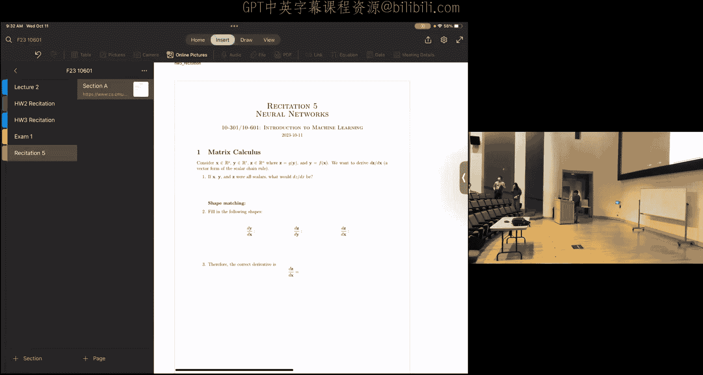
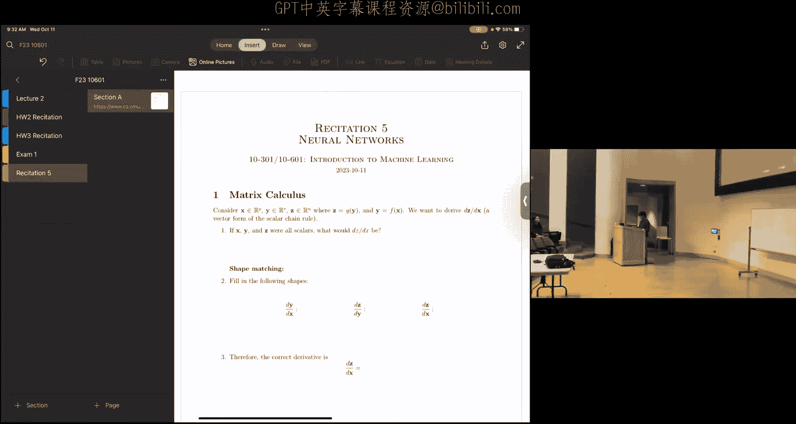
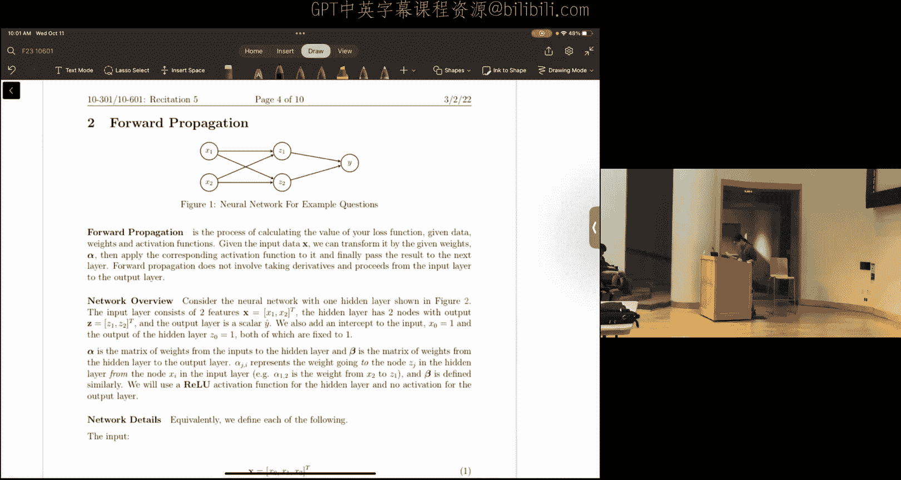
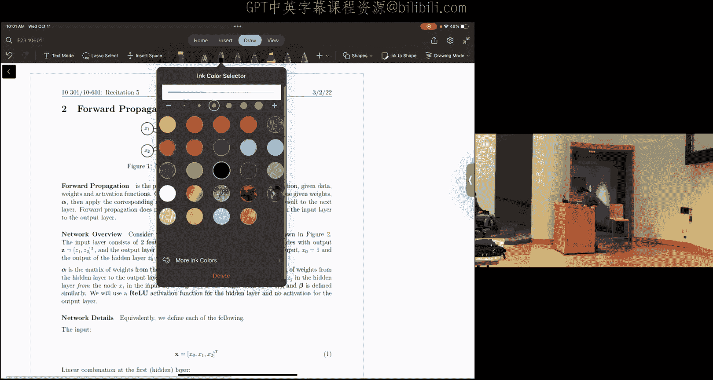
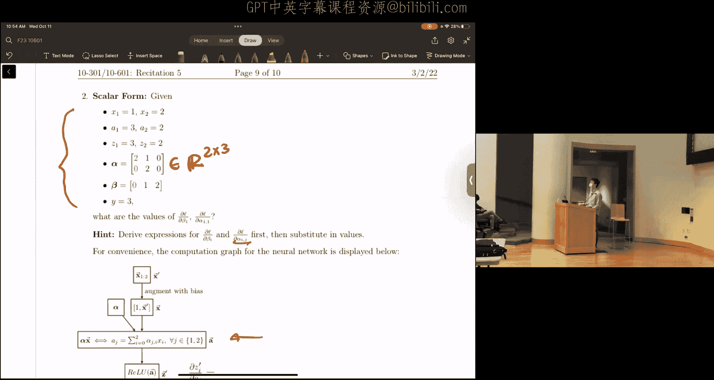

# CMU《机器学习导论｜Fall 2023 10-301⧸601 Introduction to Machine Learning》中英字幕教程

## 1. 矩阵微积分

在本节中，我们将学习矩阵微积分，这是机器学习中一个重要的概念。

### 1.1 符号约定

矩阵微积分中常用的符号约定有两种：分子布局和分母布局。本课程使用的是分母布局。

**公式**：分母布局表示中，分母的形状先于分子的形状。

### 1.2 分子布局示例

以标量函数为例，假设有两个函数 G 和 F，其中 G(y) = G(F(x))。我们可以计算 Dz/Dx，其中 z = G(y)。

**公式**：Dz/Dx = Dz/Dy * Dy/Dx

### 1.3 分子布局与标量乘法

在标量乘法中，我们可以交换乘法顺序，但在矩阵微积分中，通常有一个正确的顺序。

**公式**：Dz/Dx = Dy/Dx * Dz/Dy

### 1.4 分子布局与矩阵乘法

在矩阵乘法中，我们需要确保乘积的形状与所需的形状相匹配。

**公式**：Dz/Dx = Dy/Dx * Dz/Dy

### 1.5 分子布局与矩阵求导

在分子布局中，我们需要确保乘积的形状与所需的形状相匹配。

**公式**：Dz/Dx = Dy/Dx * Dz/Dy

## 2. 矩阵求导

在本节中，我们将学习如何对矩阵进行求导。

### 2.1 矩阵求导示例

假设有一个矩阵 A，其中 A = [a_ij]，我们需要计算 D(A_ij)/Dx_i。

**公式**：D(A_ij)/Dx_i = D(A_ij)/Dx_j * Dx_j/Dx_i

### 2.2 矩阵求导与矩阵乘法

在矩阵求导中，我们需要确保乘积的形状与所需的形状相匹配。

**公式**：D(A_ij)/Dx_i = D(A_ij)/Dx_j * Dx_j/Dx_i

### 2.3 矩阵求导与矩阵求逆

在矩阵求导中，我们需要确保乘积的形状与所需的形状相匹配。

**公式**：D(A_ij)/Dx_i = D(A_ij)/Dx_j * Dx_j/Dx_i

## 3. 矩阵微积分与线性回归

在本节中，我们将学习如何使用矩阵微积分推导线性回归的闭式解。

### 3.1 线性回归损失函数

线性回归的损失函数为 L = (1/2) * ||y - Xθ||^2。

**公式**：L = (1/2) * ||y - Xθ||^2

### 3.2 线性回归损失函数的导数

我们需要计算 ∂L/∂θ。

**公式**：∂L/∂θ = -X^T * (Xθ - y)

### 3.3 线性回归的闭式解

线性回归的闭式解为 θ = (X^T * X)^(-1) * X^T * y。

**公式**：θ = (X^T * X)^(-1) * X^T * y

## 4. 前向传播

在本节中，我们将学习前向传播的概念。

### 4.1 前向传播的定义

前向传播是计算损失函数值的过程，给定数据、权重和激活函数。

### 4.2 前向传播的步骤

1. 将输入数据 X 通过权重 α 进行变换。
2. 对变换后的结果应用激活函数。
3. 将结果传递到下一层。

### 4.3 前向传播示例

以一个具有一个隐藏层的神经网络为例，输入层有两个特征 x1 和 x2，隐藏层有两个节点 z1 和 z2，输出层是一个标量 y^。

## 5. 计算图

在本节中，我们将学习计算图的概念。

### 5.1 计算图的定义

计算图是一种图形表示，用于表示一系列数学运算或数学表达式。

### 5.2 计算图的表示方法

在计算图中，每个基本运算或数学表达式都表示为一个节点，节点之间的连接表示运算之间的关系。

### 5.3 计算图的应用

计算图可以用于优化计算、可视化计算过程和进行反向传播。

## 6. 反向传播

在本节中，我们将学习反向传播的概念。

### 6.1 反向传播的定义

反向传播是一种计算梯度并更新权重的方法。