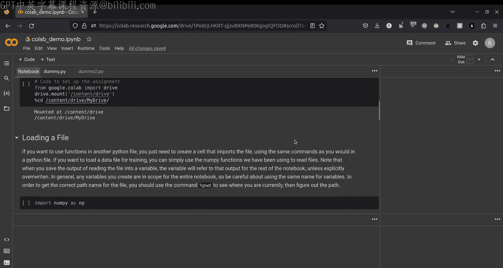

# CMU《机器学习导论｜Fall 2023 10-301⧸601 Introduction to Machine Learning》中英字幕（deepseek p44 Rectiation_HW6_Colab_Tutorial.zh_en -BV1Z2cUefE4A_p44-

Hi everyone in this tutorial I'm going to teach you guys how to set up Google Collab for homework 7 so for homework 7 you might have to use Google Collabab to run your code and so the goal is to sort of get your environment ready so that once homework 7 starts you're ready to code if you want to copy some of the stuff that I do later on in this tutorial please make a copy of this notebook to run the commands here yourselfsve to make a copy just go to file there should be like something like save a copy and try for something like that and then you can run the code on your own local computer。

So。What is Google coab so Google collab is an interactive environment for us to develop and run code it's not too different from running code on your laptop so you can still write your code in python files and use notebooks such as this to run and test our code so a notebook is just a file is just sort of like anything that ends in like IPy and B is a notebook and so we can use our notebooks to run code in python files just do any sort of unit testing any testing that we want。

It's just very simple to use these notebooks for that So Google coabab also has its own file system similar to your computer so your computer has like whatever file system it uses。

 but then Google coab has Google Drive as its file system so whenever we want to work in Google coab we need to connect Google Drive into Google coab and the process to do that is called mounting so every single time we sort of open Google coab or you know we take a break and come back or something like that we need to mount our Google Drive onto Google coab and so。

What mounting allows us to do is like basically then we have access to all the files in our Google drive where our projects are homeworks are and we can just start writing and running our code from there so yeah the other thing about Google coab is that it allows us to connect to GPs which are graphics processing units which will be very important for homework7 so GPUs just。

It's a hardware that has like ability to do a lot of fast computation and parallelize a lot of instructions so it's good for what you'll be doing in homework 7 so in order to select a runtime with the GPU click the runtime button in the menu then click change runtime type and switch to T4 GPU so we have CPUU and T4 GPU you'll probably use a combination of both whenever we're running our code we want to make sure that we're using the T4 GPU so I save it'll load the T4 GPU once I connect。

So right here this commit this cell here， a cell is just like this sort of block of code here what this is going to do is it's going to mount Google Drive into Google Colab so when you run it it'll first connect to the runtime as you can see on the right hand side nows T4 over there then I can click connect to Google Drive and then every single time you connect to Google Drive it's going to ask you to authenticate or allow it to so just。

Go through the instructions for that and then。It will not takes a little bit of time sometimes so just be patient but yeah I guess on the left hand side here we have sort of the outline of the file and then we also have our file system so you can see after we've mounted the drive has shown up and I have my drive available now so on homework6 one of the one of the screenshots that we're going to ask you to send is the output of sort of running this Google Drive mount command as well as showing that you have your my drive available and that you've connected to the GPU so just taking a screenshot of this screen on your computer is what we're looking for in homework 6 all right so with that the way we can talk about how to actually use Google coab。

So when you want to load a file into Google coab it depends on what you're using it for right so if you want to just use functions that are in another file you can just import the file as you would in a Python file so just like import blank as blank and then you can start using all the functions in that file if you want to import like a data file for training you can use the nuPy functions that we've been using in past homeworks to read the files so like the MP do load TxT that we've been using that'll allow you to load。

Training data things like that so a couple important things here it's important when you're loading files to know exactly where you are so when you want to know where you are use the pwD command and it'll tell you exactly what the pad is because the file paths might get a little confusing and drive and so you might want to know where exactly you are so this next line is going to load the data。

And the interesting thing about Google Coab is even though I've defined data here。

 I can use this variable data anywhere else in the notebook and it'll refer to this sort of whatever the result of this command is。

 unless I change what data is equal to。This a little bit different from Python because in Python the variable is usually the scope of the variable is limited to the function that it's in but in Google Collab when you create a variable the scope is the entire notebook so just to show you I'm going to open a different cell and I'm still able to print the data file so it's important that you like carefully name your variables when you're working in Google collab right so now I'll just also show how to run and modify code。

Thanks。Okay。So let's say， so in my drive， I have a couple demo files。Okay。

 so here I have a dummy dot Pi， which is printing hellello world and then another one that's just doing some math。

So let's do let's try and run dummy。p so there's two ways first let's CDd into that directory so right now we're in my drive so to CDd we just go into 10301 homework6 demo right so once I run this now I can see that i'm actually in homework6 demo and then from here I will。

Import dummy as star， so now I can use all the functions in dummy。So sorry。About this way problem。

So now if I call Maine， which it should print hellello world。Okay， and then。

If I wanted to run from the command line， I can just type Python D pi。

 and important thing you need to prepen all your command line commands with the exclamation mark so that it knows it's not like a Python code。

 it's something else。Okay so now i'm able to do print telebo so now let's say I want to sort of change what some some of the files do right so this is the output of dummy2 do high it's just adding a number to an array。

嗯。But now let's say that。I want to change the behavior here and then subtract right so initially it was like unsaved but then when I moved to the notebook it automatically saves the file so。

你啲视。Okay， so when I run it， now it should。Say yeah so now I changed the output because I changed the file so when you're editing your files you can very conveniently just like type in this python file and when you switch to your notebook to test your code it'll automatically save and as always you can also save from here just click save here Okay so now that we've gone through how to load and edit files in Google coab let's talk about。

Let's talk about how let's talk about a little bit about the GPU portion so in homework7 you're going to be working on a library called Pytororch Pytororch is a deep learning library and that's sort of the theme for homework7 and so when we're when we're creating deep learning models it sometimes it's very beneficial for us to use GPUs to help accelerate our training procedures so now i'll go through a couple of commands to make sure that。

You're able to see if you have a GPU available or not so the way to use Pytorrch it should already be installed in Google Colab is to do import torch so now torch is available for us to use for the rest of the notebook so we're going go through three commands which will tell us some very important information so the first one is Torch ka is available is basically telling us whether or not we have a device that supports kuda you don't need to know what kUa is just know that GPUs do support kuda so since we are connected to that t4 GPU it's going to return true。

OkayThe next one is Torch Kuda device count and this one is telling us sort of how many GPUs we have available to use so since we're only connected to one GPU which should save one and then lastly。

 we want to get the name of our GPU since we only have one GPU we pass in zero into this device name function so the device name expects an integer for which device since we only have one we pass in zero and we get the Tesla T4 which is the thing we're connected to。

Okay， so those are the three commands that you'll also have to screenshot as part of homework six so that we know that you know how to connect to a GPU。

So one last thing to talk about is so the GPUs that Google Collab provides us are often in very high demand and if you're not doing anything with your notebook Google will time you out of the GPU and kick you off of it and you won't get access to it for a decent amount of time right so this might be a problem when you're working close to the deadline and you need to use the GPU to sort of train your models or something so what we recommend is that。

If you're not actively testing your model or running your model。

 if you're just running like simple functions or unit tests where we ask that you don't use the T4 GPU and instead that you change your runtime type to the CPU。

And when you do that， it's going to disconnect and restart the runtime and you're going to have to rebound your drive。

 but it。It won't let you time out basically won't get kicked off because CPUU they're okay with you just connecting to it。

 but when you're ready to like sort of run your model from start to finish then I would suggest you change your runtime back to the GPU and then run your model just so that you guys are able to access the GPU when you need it so that's just a very important consideration to be made when you're doing a homework sum。

Okay so that's the end of the tutorial， hopefully you guys are able to set up Google Collab and good luck on homework work7。

