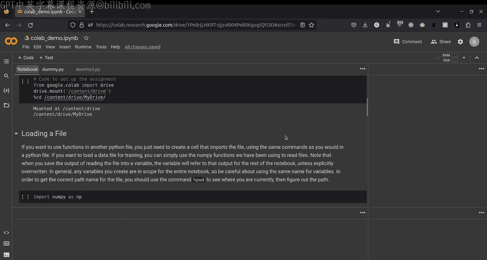

# CMU《机器学习导论｜Fall 2023 10-301⧸601 Introduction to Machine Learning》：如何设置 Google Colab 以运行作业 7


## 概述

在本教程中，我们将学习如何设置 Google Colab 以运行 CMU 机器学习课程作业 7。我们将介绍如何连接 Google Drive、使用 GPU 以及加载和编辑文件。

## 连接 Google Drive

1. **创建笔记本副本**：首先，请创建本教程中使用的笔记本的副本，以便在本地计算机上运行命令。
2. **连接 Google Drive**：在 Google Colab 中，点击“文件”>“保存副本”，然后按照提示操作。
3. **挂载 Google Drive**：在笔记本中运行以下命令以挂载 Google Drive：

```python
!mount -a
```

4. **验证挂载**：在左侧文件浏览器中，您应该能看到挂载的 Google Drive。

## 使用 GPU

1. **选择 GPU 运行时**：在菜单中点击“运行时”>“更改运行时类型”，然后选择“T4 GPU”。
2. **验证 GPU**：运行以下命令以验证 GPU 是否可用：

```python
import torch

print(torch.cuda.is_available())
print(torch.cuda.device_count())
print(torch.cuda.get_device_name(0))
```

## 加载和编辑文件

1. **导入文件**：要导入文件中的函数，请使用 `import` 语句，例如：

```python
import dummy as d
```

2. **使用变量**：在 Google Colab 中，变量的作用域是整个笔记本。例如：

```python
data = [1, 2, 3]
print(data)
```

3. **运行代码**：要运行代码，请将其放入单元格中并执行。

4. **编辑文件**：要编辑文件，请将其上传到 Google Drive，然后在笔记本中打开并修改。

## 总结




本节课中，我们学习了如何设置 Google Colab 以运行 CMU 机器学习课程作业 7。我们介绍了如何连接 Google Drive、使用 GPU 以及加载和编辑文件。希望这些信息能帮助您顺利完成作业 7。