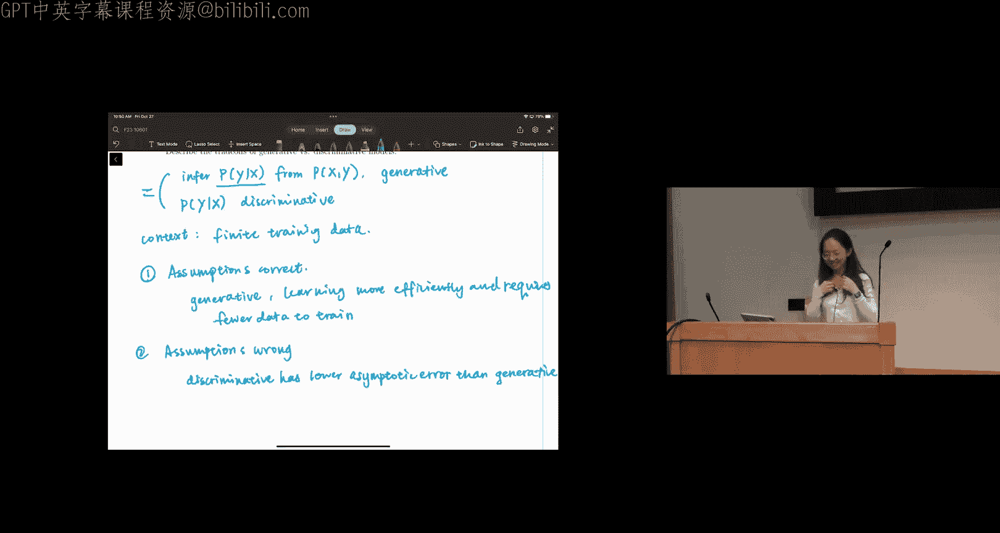

# CMU《机器学习导论｜Fall 2023 10-301⧸601 Introduction to Machine Learning》中英字幕（deepseek p45 Recitation_HW6.zh_en -BV1Z2cUefE4A_p45-

Hello everyone， welcome to Reation6 today we're going to be talking about probabilistic learning。

 not CNNs and learning theory that should not be there at oops。Okay。

 so probabilistic learning is a sort of learning framework where instead of trying to learn some sort of function like like Mx+ B or something。

 we're trying to learn a probability distribution and so like a probability distribution is is's just like like you know like maybe we're trying to learn a normal distribution or a Bnoulli or something something else right we're just trying to learn some sort of probability expression instead of a function。

😊，So the two main methods we have for learning probabilistic classifiers are MLE。

MLE and map like these are the two ways that we kind of learn the parameters of our probabilistic classifier right so when in like the normal setting like when we were trying to learn to function our parameters are like the weights。

😊，But here the parameters are the like things that you put into the probability distribution。

 so like for a normal distribution， you might want to estimate the mean or the variance and for the Bernolia distribution you might want to estimate the probability of success。

 so something like that。😊，RightOkay， so in MLE what what we're trying to do is solve the following expression。

 So it's arg max of the probability of the data given this parameter， right。

 we're trying to find the data that maximizes the probability of our data showing up。😊。

It's pretty intuitive， it's just saying like， all right。

 what value of data makes it makes it so that my data show up shows up with the highest likelihood。

And to simplify， we like to use like。Log probabilities。

 but like this these two statements are equivalent。

 So like arg max of Pd theta is the same as a min of negative log Pd theta or D given theta， sorry。

 So those two are the same expression or because of the negative sign Okay so for map the idea behind map is like instead of just looking at our the or data What if we also incorporate like whatever prior beliefs that we have about this model already right like so maybe like like if I'm flipping a coin you might want to assume that it's fair right because you usually see fair coins in the world。

 So if you want to incorporate something like that， then you would use a map sort of estimation。

 So what map is trying to。😊，Do is like。It's doing the arg max of P of theta given D So when we use a bayes rule to like rewrite that we get p of d given datata times P of theta divided by P of D which is the normalizing constantta here and we don't really care about P of D it'll go away so we just care about argms of P of d given theta times P of theta and we're trying to optimize that for theta again right so in both cases we're trying to find the parameter that makes some expression the highest likelihood in the MLE case it's our data and in this case it's our data times our prior beliefs so that's the only difference between map and MLE。

All right， yeah， I got a question about that so after like one iteration， would we update P of theta？

So if your data doesn't change， then like I guess you don't need to update anything， right。

 then if it does change。Yeah， if you change your data set that you might want to learn a new mapap parametermeter or something like that're oh。

Oh yeah， so when you're training these models usually you don't update your parameters。

 you learn them once and then you use them because like of the optimization techniques that we use it's just like taking the derivative and setting it equal to zero we're like not doing any sort of like disscent or any like we're not doing gradient descent we're just like taking the derivative and setting it to zero so whatever values we get that's what we're going to use。

Yeah。Okay， any other questions before we move on to the first question？Okay。

 so imagine you are a data scientist working for an advertising company and you want to run an ad and estimate its performance so we showed the ad to like some amount of people and we're going to have our label Y be one if they saw the ad and zero they didn't right so let's say that like some K amount of people decided to click on the ad and and like we're going to assume that the probability that someone clicks on the ad is equal to theta and the probability that someone does not click on the ad is one minus theta right because they have to add up to one and so what we want to do is figure out like。

😊，What is the value of data that makes it the most likely that K people viewed our advertisement？

So they're asking for the MLE estimate of theta， but what that means is like what value of theta makes it most likely that exactly K people viewed this advertisement。

Okay， so we'll go ahead and derive that。Okay， so okay， it's still working okay。

So we're going to use the expression from earlier， we're going to use the log version of it because I like working with logs。

And then so once we have PD given theta， you can just plug in that。Expression at the top right。

 so we get minus log theta to the K1 minus theta to the n minus k。ok。😊。

And so then if we simplify this， we get。Like this is carrying on， by the way， the argument。

 so I'm just not going to write it every single time， so we get minus K log。

Data minus N minus K log 1 minus theta。 Okay， so this is the expression that we're trying to minimize right。

 So from here， we use like calculus。 So we just take the derivative with respect to theta and set it equal to 0。

 So we get like， when we take the derivative， we get like。

K minus k over theta and then plus n minus k over one minus theta， right so we get。D。

Data Pat MoE or no， I guess。Let's just write， D D theta equals。K minus K over theta。

Plus n minus k over 1 minus theta， and this has to be equal to 0。Okay。

 so you can solve for this pretty quickly and you will get that。Data at M， L E。Equals K over M。

like from here， it's just algebra， I trust you guys can do that， but yeah。

 any questions about what just happened？So what we're saying is that if the probability that someone clicks on the ad is k over n。

 then the like the likelihood that K people click on our ad is like maximized and that makes sense right because like。

Just like intuitively， without thinking about the math。

 it should make sense that if like we have like some proportion out of the total number be the probability that sees the ad。

 that when we pull that total number of people， then we should have the numerator like about the about around the numerator and amount of people see the ad。

Is there any questions before I go to the next one？So the next one is like。Yeah。

 would it be right to say？Yeah， sure， yeah， that's probably what it is sorry， yeah。Okay。

 so now let's suppose n is equal to 100 and k equals 10 great we already have the expression。

 so it's just。😊，10 over 100， which is one10。こ。All right。

 so now let's say that instead of like data following whatever this distribution is。

 we say that like we we hear from our coworker that like oh。

 I actually think that data follows this distribution called data right so this this is this is what they're saying that the probability of someone clicking an ad is actually actually looks like is what they're climbing right？

😊，And so now what we want to do is find like data hat map data data map right that we want to find the map estimate given that our coworker said all of this right so what we would do and I'm not going to do the work because it's a terrible derivative。

 but like what you would do is you would write it as like log of。😊。

P of D given theta plus log of P of theta。 And you have this from the earlier part。

 So you plug in this， and then you would plug in this into P of theta。

And then you would take the derivative of this expression and set it equal to zero and solveulfur theta it's very annoying。

 but what you do end up getting is this so we're going to use that for free。

 but does everyone understand like what this like how to get this like if you were to do it？😊，Okay。U。

Cool， so now let's suppose that n is still 100 and k is 10。

 but you believe in that you believe that in general people click on ads about 6% of the time so you figure out that your alpha and beta are 7 and 95 respectfully now to calculate it we just plug in the numbers again so we get。

😊，呃。Sorry。😔，Okay。So this is like our new estimate for data Ha mapap So earlier we say that about like 10% of people will click on ads。

 but now with this like， you know， prior distribution。

 we see that like 8% of people might click on an ad。😊。

So like that's we see that like it changed because we incorporated like our prior beliefs about like how often people click ads。

Okay。So that answers half of that question。Like one of them is lower than the other。

 but both are pretty reasonable， right？Like it's okay to use the MLE and not care about what you think generally because like maybe you don't know too much about like how often people click on ads right and you just want to use the data that's given to you but also map is also pretty reasonable estimate right you're like taking some prior knowledge that you might have if you don't trust the model if you don't trust the data alone you want to incorporate your beliefs you might want to use map so both estimates are pretty pretty reasonable but specific to this problem if you believe that like the advertisement rate is like really close to 6% like like they said earlier。

 then you'd want to use your map estimate right because it's closer to 6% but if you don't believe that then you might want to use your MLE estimate。

So it's it's really like not like one is better than the other。

 it's just different ways to estimate the parameters based on what your beliefs or not the absence of your beliefs are。

All right， so does anyone have any questions？Yeah。Where's the plus one？对的。

Are you saying it should be minus1 or plus one or？Oh， why it's K plus alpha minus1？U so。

Like if you take the derivative， it just becomes that， but like intuitively。

 the reason that this alpha minus1 is there is because we don't want like zero to have。

 we don't want the numerator to ever be zero。Because as you'll see later on and when we talk about naive Bay。

 like like map is really good when like there's certain things that zero out in your data set and like this kind of helps with that but like don't read too much into it just like you can just like have the formula for now。

But if you derive it， you'll get this exact same thing。是。Oh this， oh okay， okay。

 so if you if you look up what like the beta distribution is。

 there is like a general meaning to it about like what alpha and beta mean。

 I don't have them off the top of my head， but I believe like alpha is like sort of related to the probability of success and like beta is related to the failure probability。

 I just don't remember exactly how that happens。Yeah， any other questions？Yeah。Yeah。

 we'll actually get into that a little bit later on in the recitation。O。Okay。Okay。

 another question about math， all right， this time we'll actually derive a map estimate I think and won't be too bad hopefully。

Okay， so let's say that you're monitoring the Instagram account。

 by the way you guys should follow it if you haven't already。

 suppose you wish to find the probability that Neural or Markov will post at any time of the day over three days you look on Instagram and find the following number of new posts so you see three posts。

 four posts and then one post。RightAnd someone tells you that the data is from a Poisson distribution if you don't know what it is don't worry about it。

 it just like some distribution that tells you like how many events will have or like how many events will happen in X amount of time or something like that and then you're also given some prior information about this data which is like oh it comes from a gamma to2 I don't know what that is it's just some random distribution so let's go with it and then they give you the PDF of that distribution and they want you to calculate the map estimate okay so what we're going to do is we're going to write out。

嗯。Okay， first， let's write out this part so as we know for the map estimate， like for map estimate。

 we are going to be estimating。Or， sorry。Native log。😔，so this is the expression for math。

 we already have this P of theta but what we don't have is P of D given theta right because in the previous example we had one observation we had like one observation right whereas here we have like three observations from our distribution right so the way that we write like Pd given theta because all of these are like independent of each other like this X this one is independent from this one from this one we can rewrite it as like negative log of P of X。

😊，On given theta P of x2， given theta P of x3 given theta a then。😔。

So we can just like factorize the likelihood of our data into like each one。

 and then we know all three of these because of this thing here。

so we can plug that in with like the value of x that we saw， if that makes sense。Okay。

 so what I'm going to do now is a little bit of like。I'm going to do like a couple steps at a time。

 but if you get stuck like raise your hand and stop me So first i'm going to break this product into a sum so i'm going to have four terms in the next part and then i'm going to plug in the pdf for each one of these terms so the first term is going to be。

😊，Actually， you know I won't break it into this sum I'll just substitute everything。

 so it'll be e to the negative theta times theta to the power of three because x is three over three factorial times E to the negative theta theta to the power of four over four factorial。

Times e to the negative theta， theta to the power of1 over one factorial times， oh my God， sorry。

 times1 over4 theta to the e to the negative theta over2。Okay。Now this looks like a mess。

 but it does simplify rather nicely。And I won't go through the simplification， but if you。

 if you get stuck， I come to be after。 So multiplying the product in this gives you E to the。

Negative 3 theta minus theta over 2。Times theta to the power of9。 And I mean。

 it should makes sense right，3 plus 4 plus  one plus one that's 9。 And then in the exponent。

 we have three negative thetas and one negative theta over two。 So we just combine those two terms。

 and then the denominator is just。The denominator is three factorial times four factorial。Okay。Um。

From here， what we do is like take the derivative because now we have our expression。

I don't think is the denominator is right， I think。Like you should be like two times four factorial。

 right， okay？There we go。 Okay， this makes a lot more sense。 Okay， cool。

 now we can take the derivative of this with respect to the。 So we do D of D theta。OhActually。

 I can simplify this even more because we have a login exponent。Instead， we get。Here we go。Minus。

And then okay， we get negative three theta minus theta over two。And then we get。我s。9ine log。

 theta minus。Log。Two times four factor。Okay。哦嗯这 this is啊。😊，Oh， I'm so sorry， yes， I came to do math。

Okay。嗯。Okay， so now， this is all in the log expert， oh yeah。Can't we just do negativeify2？Yes。

 we can， that is good idea。Wait， would it be negative seven over two theta Yeah， Okay。

 but yeah yeah I'll simplify everything I just got a little like clustered with the math Okay。

 but you're right， we get three， we get seven theta over two because of the negative minus nine log theta。

😊，Plus whatever log four factorial squared I mean， when we take the derivative。

 so when we take the derivative， we get seven over2。Minus9 over the theta。

 and we set that equal to zero。And then we。Solve for this so we get theta equals。9 over2 over 7。

And then that gives us two point。5，7，1。b bOkay， yeah， so that becomes our theta hat map estimate。

 soum the theta in this like Poisson distribution。That will maximize like your data showing up multiplied by this prior is like 2。

571 dot dot dot or whatever。Okay， any questions？Might have been a bit confusing because of the simplification。

 but I guess that's a good warning for the homework to like make sure that you're like not not doing silly things like me and like actually simplifying these expressions correctly。

Yes。Yeah。😊，做我说的。你到辩可。You from here to here。Or like from this expression to this expression。

So once you have that expression you can plug in the PDF of the so x given data is like one of these and then P of the is this。

 so you just plug it in except for the P of x given data you actually plug in x like the values of x that you saw so that's where the three。

 four and one come from。Yeah， that's just the likelihood of your data showing up yeah I a question why don't we do this three？

Maybe because you want to estimate given all your data， right？

But this way we can update our private weeks after。U。

 how would you update the parameters though because I'm not sure？Yeah yeah。

 so in like a gradient descent framework， yes， like you want to like。Go through your data。

 you go in to say you go through your data multiple times， right？

Whereas here it's a little bit different because we have the closed form solution。

Right so we're just like getting the we're just getting the close form solution of using it。

 there's like no need to sort of like update our parameters。RightBecause in the neural network。

 if you try and think about the equation that it represents， it's too big， right。

 you can't like get a closed form solution for that。But here。

 like it's just a probability expression and we know how to like， you know。

 take the derivative and set it to zero。So in this case。

 you can like just get the parameters that maximize it。

And like that the key thing here though is like we want to maximize the probability of our data showing up right so we want to maximize the probability of all our observations。

 not just one at a time， right we want all of them combined。just saying you update your beliefs。

 I see。I am sure what I'm not sure about that， maybe you can like make a piazza post or something and someone will follow up on with you about it。

Well that's a good idea。是的。Okay， there's no other questions I'll move on to the next， oh yeah。啊。2。

If you're done the first example， you can expanded。Oh are you talking about this？Yeah。

 so here this P of D given theta is like。What's the probability that our data set shows up， right？

And so our data set is just three observations。And so we just like break D P of D given data into like each observation showing up multiplied by the next one。

Yeah。Yeah， I guess like to answer the second part， like if there were different websites or whatever。

 it would just be like in the data set as like a row vector right so you would just like multiply it that many times。

Yeah。Good question。Okay interest of time I will move to the next section Okay so the reason that we're learning Emily and map is because there is a model that uses those ideas to learn some parameters and that's called naive Bay right so you might have learned this on Wednesday so naive B sort of models this distribution P of y given X so that's the distribution we want to model and it uses bays rule to sort of。

😊，Model it via like a bunch of probability distributions that we can estimate so remember from base's rule that we have p of y given x equals p of y p of x given y divided by p of x right but this thing of the denominator is just like。

A proportionality constant is' like to make sure that everything like is between zero and one so we can actually just say it's proportional to the numerator。

And you'll see why later on about the denominator stuff。

 but don't worry about that too much so what we start off with the naive Bay model is by saying that it's proportional to this。

And then what from here we have to break down this thing further right because in our data X here is like the number of features Y is the label right in our data we might have like a lot of features right and so trying to estimate a distribution with like 10 variables can get very。

 very， very complicated really fast right so instead what we do is we say that our features are conditionally independent of each other given the label So if we know our value of y then x1 and x2 and x3 and x4 all the way to x 10 they're all independent of each other so what that allows us to do is to write it as。

😊，So we're able to break up that however many long big distribution into just a multiplication of a bunch of Univariate distributions is what this is getting at。

So we can just take this big joint distribution， not joint distribution。

 but like big multivariate distribution， and then we can write it as a product of one variable distributions。

 which is nice because we can estimate one variable distributions a lot easier than we can when you have a lot more variables。

Okay。So once we get to this stage here it really depends on sort of the data set that you have right so XD is just one of the features so for to move on from here we need to consider what types of features we have right？

So if we have Bernoulli features， then we say that XD given y is a Bernoulli distribution。

 so if we have like a binary feature if all our features are0 or1。

 then we can estimate this column using a Bnoulli distribution。😊。

If our features take on like finitely many values that we can count them all。

 then we say that that like distribution is a multinoial distribution so we can estimate that feature using a multinoial distribution so if you don't know what a multinoial distribution is it's just like think about it as a trial with like multiple outcomes so not just success or failure you can have like as many outcomes as you want。

😊，And then lastly， if we have continuous features， then it's a Gaussian。

 then we say that like it's a Gaussian distribution。

 so we model XD given Y as a Gausian distribution。😊，Okay。

 the key thing here is to note that it's dependent on the specific value of y。

Right so if y can take on multiple values then we're going to have a different distribution for each value of y and like that's very important to keep in mind because sometimes you might like forget like how many parameters am I estimating and you need to remember that for every value of y is like where these distributions are coming from okay so let's go through an example so that it becomes abundantly clear so let's say that we're learning a naive base。

😊，Classifier August data set， our label is if you're not whether or not you're interested and we're going to label this as like X1。

 x2， x3。Okay。So what we're saying the the what we're trying to learn is like ultimately this and we're saying that this is proportional to。

Right， but then using Benive Bays assumption， we're saying that it's equal to。Okay。😊。

Yeah if the features are different maybe one of the binary one oh use that's outside the scope of this class。

 but I I don't have the answer off the top of my head either。

 you might want to ask on the outsides sake， sorry。Yeah。

But I imagine you can combine different distributions， it shouldn't cause a problem。

 might be harder to estimate the parameters when you have like combinations of these distributions。

But I'm sure it's possible， yeah， okay。So does so now when we have it like this right we can think about like how many parameters do we need so why itself is a why itself is zero or one right so what type of distribution can we use to estimate it。

Bernnoulli， right， okay？So this is Bernooli。Okay。And then now we get into like estimating like these distributions。

 so the thing here is we need to have a distribution for x1 when y equals zero and x1 when y equals1。

😊，And similarly， we need to have one for one x2 equals y equal x2 given y equals0 x2 given y equals1。

 and that's why I was saying like you need to like make sure that you're conditioning on y because this is a conditional distribution at the end of the day。

So。All of these are also if you look at it， all these features are just zero ones。

 so all of these are also like bernouloli distributions。Right and so。

Can someone tell me how many parameters are there in a Brnoulli distribution？

In one Brnoulli distribution there's only one parameter right it's the probability of success because the probability of failure is just one minus the probability of success right so for each one of these I'm going to have one parameters so that's one。

2，3，4 for x3 I didn't write it but p six and then7 so you're going to have seven parameters。😊，Okay。

Does that make sense for everyone？Where we got the seven from。Yeah。

Each one of these distributions follows a Bernoulli right and each one of each Bernoulli distribution has one parameter so we have one。

 two， three， four and then for x3 given y that's also Bernoulli， so that's five， six。

 and then P of y is the last one that's one and more so seven yeah。Okay。

 so now let's estimate the parameters via MLE。Okay。

 I'm not going to spend too much time doing all of the parameters。

 so I'm just going to write down most of them and we'll do one of them。Just to see what happens。到。

Okay， so let's do， let's estimate this parameter here。Okay。

 so the M so remember which so what distribution is this。

 this is going to be x1 given y equals one So this we're saying follows a Bernoulli。

What' some parameter？And this is what we're trying to estimate via MLLE。Okay。

 so you guys already know the MLE for the Bernooli distribution， right？

From like the Emily map lecture， but even if you don't have it memorized that's okay can someone tell me what this state phi is supposed to represent I said it represents some probability but what probability is that it's。

Success， right， in this case we're going to say success is equal to one。

 So what data actually are I don't know what symbol that is， but that is actually。

But that's what this is representing right， and we're going to estimate this from our data set。So。

 if I use。If I use like conditional probability rules， you get。Oh， sorry。

So this one is just the conditional probability rule。

 so how do we calculate the numerator from our data， what should we look for？Yeah。

 so we need to look for all how many rows have both x1 equal to1 and y1 equal to one， so that's one。

2，3。All right， so the numerator is going to be three。And then the denominator。

 so what do we need to count for the denominator？Okay。

 how many rows are there where y equals one oh there's one more okay。

 so it's out of the rows where y equals one， three of them have it where x is equal to one so our estimate is going to be three over four。

😊，Does that make sense to everyone？So you do the exact same strategy。

You would do the exact same strategy for the rest of these parameters。

So you would write down what probability distribution is it representing what does the parameter mean。

 in this case it's the probability of success， and then you just count it from the data set。

 or if you have the MLE for the Bernoulli memorized you can also just plug that in。

 but this is like a more intuitive way if you like forget about like the MLE for the Bernoulli。Okay。

Any questions？Okay， so now let's get into predictions， so if I see a car that's red。

 not affordable and fuel efficient， would the classifier predict that I would be interested in it？😊。

So let's break down what this question is really asking， right， So it's given that。X1 equals 1。

X2 equals 0。And x3 equals one。 What is the what is the like what is the value of y grade to be right So it's so what we want to know is like。

So this is what we want to know， right？Given our data， which value of y is more likely zero or1？

And so what we do here is we just break it down into， we use the naive base。Like formula again。

Instead， this is going to be proportional to probability of x1 equals。One， given why。

And then probability x2 equals0， given y probability x3 equals 1。

Given y probabilityability of y and then we we so once we have it like this。

 we have all of our estimates for each of these numbers， correct？Oh， I guess in this one。

 what is the ML estimate for y so probability of y is just one， two， three， four divided by one，2。

Three， four， five， four over nine。Because there's four rows where there's one。So once we have this。

For each value of y we plug it in， we get our like approximate probability and we see which one is the largest right so whichever one is the largest that's the class it's going to predict。

So probability that y equals one given dot dot going is a proportional two。

So what is so we basically plug in y equals1 here， so x1 given y equals1。

 we just derived it it's three over4， so that's three over four。哦哦。Times。So x2 equals0 given y。

Remember we're still considering the case where y equals1 so x2 y equals1 is1 half。

 but this is like x2 equals1 given y equals one if we want x2 equals0 given y equals  one。

 we have to do one minus this but one minus1 half is one half so it's one half and then the last one is x3 equals one given y so x3 equals one given y is this so we plug that in。

And then the last term is probability of y， which I just said y equals one is four overnight。

So if I simplify this， I get one over eight because a lot of things cancel。

So this is the probability that approximate probability that it will give y equals to one now let's calculate the probability that y equals zero。

Give him dot do dot。 So instead we look at this column now。 So probability of x1 equals 1。

 given y equals0。 Well， that's just， oh， that's 0。 Okay， I I， I guess I can stop here， right。

 Do I even need to calculate the rest of the probabilities。No， right。

 because no matter what it's going to end up being zero。Okay。So you have one of them is equal to 18。

 the other one is equal to  zero， so which one is it going to predict？😊，One。

 right it's going to predict y equals one because it has a higher probability。

 it's not really a probability， but it's a probability so。The classifier would predict。Yes。Okay。

 does anyone have any questions before we do like the last question， yeah？Both support。W book。

So this is proportional to this， but this is equal to that right， oh。

 I meant to say proportional I'm so sorry， yeah， yeah。Yeah， so this。

 so but but if you want the actual probability， you can just like。Well。

 the actual probability is like one over eight divided by one over8 plus zero and the other one is。

Zero over one over eight plus zero， which gives you zero and one， right？

So like like the actual probability is like one m zero， but like。

Because we don't care about the denominator like I was saying。

 like it doesn't matter right the like the denominator doesn't matter like if the numerator is larger。

 then we're good。Yeah， okay。So any other questions？Okay， cool， so in the last in the last part。

 we saw that like when we encounter a zero， like the probability that it assigns is going to be zero no matter what。

RightSo that is like a pretty big problem with naive B when we train via MLE right because we have the possibility to encounter zero as one of the estimates and if we encounter zero as one of the estimates。

 then like when we do that multiplication， everything is going to be zero。

So how can we fix it because they wouldn't have any ideas and it like it doesn't even need to be like concrete or anything。

Yeah。By what？Yeah yeah yeah like that idea is good and that's basically what map estimation does so if you look at like the map estimation formula。

😊，It's basically like adding fake observations to the numerator and the denominator。

And so that's like generally why we use and that's why like using map in my EveBaase is like a good idea because it it like helps you avoid。

It helps you avoid like these cases of zero， you'll have a very small number。

 but at least it won't be zero right we don't want we don't like zero right it's that okay。

But然 that was这 good idea。Um。Yeah， any other questions？Cool， so in the next four minutes， hopefully。

I will try and improve this question okay so now we're shifting gears to Gaussian naive Bay so like instead of like having benouloli distributions we're having Gaussian distributions so now we will derive the decision boundary of a 2D Gaussian naive base we need to show that decision boundary is quadratic so what is the decision boundary so a decision boundary in the probabilistic sense is where all the probabilities are equal to each other right so the probability where y equals one and the probability where y equals zero where they're equal is the decision boundary。

😊，UmSo we want to show that this can be writtened as a polynoial function of x1 and x2。

 where the degree of each variable is at most two。😊，And we can like remove some。

 we can like fold constants that we。Encounter into those。Letters， okay。Cool。

 so let's start and when you guys can stop me if anything gets confusing。

 so we're going to write down the decision boundary。😊，And then this is equal to using Bays rule。

So I'm just expanding out the base rule。Okay。So here the denominators don't matter once again， right？

Like they can slot out so we're just left with the numerators and what I'm going to do is I'm going to divide the left hand side to the right hand or like the right hand side to the left hand side right so I'm going to divide this onto here。

And the and like I guess one thing as we just saw， we might encounter zero， right so like。

What makes the the reason that i'm allowed to do this is because at the decision boundary right both the probabilities have to be equal which means that neither of these expressions can be zero right they both have to be exactly one half so I am allowed to divide here and I don't run into the like division by zero possibility so when I do that I get。

Okay， everyone's still with me what I just did and this is equal to one。Okay， this next step。

 you're just going to have to like believe me somewhat， okay。

 so I'm going to plug in the normal distribution PDF。And okay， first of all， no， how do I undo this？

Okay。So I'm going to plug in the normal distribution PDF， but before that these two， right。

 they don't depend on x1 and x2 right， so I can already write that as a constant C。

So I can remove that from like this fraction as just like some constant because they don't depend on x1 and x2。

Okay， the more interesting part is。These four guys， right， So when I plug in the normal distribution。

 it's going to be like just a bunch of E to the powers of some things， right。

 because that's what the normal distribution。 If you don't recall。

 the normal distribution is like one over。What do you guys remember what it was。

 it's something like this right， E to like negative one half？

Okay this is like the PDF of the normal distribution。

 so when I plug it into all of these like none of these terms are just constant write this like outside fraction。

 the only term that we care about that has x in it is the exponent and so when I multiply two expressions with E in it you just add them right and when you divide by two when you divide by expressions with E you subtract it do you guys remember those rules？

Okay， cool， so then with some like magic and hand waving， we get c times。Yeah。

I'm going to write X because it's very long。Okay。So I will just explain some of the subscripts here。

 so11 is like x1 when y equals 121 is x2 when y equals110 is one is x1 when y equals0 and then。

20 is x2 when y equals zero right so that's just how I'm like in subscripting it Okay。

 does every does this make sense though it's just like differences of like。

 you know the the exponent terms。Okay， the last step here is to take the log of both sides。

 so the log of one is0 and then this is just like whatever is here gets put here。

 I'm not going to write it again。But if you look at this， right。

 this is just like x1 squared plus x2 squared minus x1 squared minus x2 squared plus some cross terms and whatever。

 right？So you can believe me when I say that like this is at most a polynomial of degree too， right？

Like there's no cubic terms or like anything higher， right。

 so we've proven then that like this decision boundary is quadratic。

And what that means is does anyone， can anyone think of like a quadratic function right now like what's atic example of a quadratic function？

Yeah， no but like a shape， shape， I'm talking about shape。

Yeah parabola right so that's what what this is all saying is like my decision boundary can look like this or like this or like this because the circle is also quadratic right or like what's the other one called ellipse。

 yeah ellipse sorry by drawing sucks but what this is also saying and pretty important is that it could also be linear right it could also be a line because a line is just a parabola with the like coefficient on the x squared term to be zero。

So it can also be like a straight line， so these are all like the possible decision boundaries that you might be able to see。

Um， so in the homework， one of the questions is like， under what conditions will you get out？

It's like one question in the homework is like to figure out what conditions will you get like this straight line as a decision boundary as opposed to some of these。

 okay？In the interest of time， I'm going to go to the next section。你。Oh yeah， yeah， yeah。 I got you。

Oh okay， yeah， yeah， yeah， okay， but I can take questions while she sets that up。

 I know we went through a lot。

But yeah， if you have any questions， like ask now。

Okay， so in this section， we're going to go over learning theory or more specifically PAC learning。

 which stands for probably approximately correct。Okay， so some basic definitions。

 so we have a probability distribution that we're trying to like model that's unknown to us so this is like the true probability distribution and then we have a true function that maps like examples to like predictions so this function C star is also unknown to us。

 but we have a hypothesis space and hypothesis function that's that we're trying to like train that。

Maps training examples to predictions， and then we have a training data set with let's say like capital N number of training examples。

So we have this true error， which is like the expected risk defined。Like in this expression here。

 so it's basically the probability that the true function is not equal to our hypothesis like the true label that we predict was the true function is not equal to the one that we predict with our hypothesis function and then we have a training error。

 which is basically。🤢，This expression where we're counting the number of times where for in our training data set the trained prediction is not equal to the true label so oh yeah。

 and before we move on just want to mention here that like for this section only we're only like for this section we're only concerned with like binary classification problems for the context of this course。

Okay， so the PA criterion is that we want to produce a high accuracy hypothesis with high probability。

 so more formally writing it。Down here， it's that the probability that for all hypothesis in the hypothesis space。

 the absolute value of the true error minus。🤢，你。Training error。So。死去。😔。

Being less than or equal to epsilon is greater than or equal to one minus delta。 Okay。

 there's a lot of variables in this formula。 So intuitively。

 this is basically saying that like with confidence level one minus delta we want our。

Absolute value of our true error， like the absolute difference between our true error and our training error to be within some tolerance level tolerance level epsilon。

And then we have sample complexity， which is the minimum number of training examples such that the PA criterion is satisfied for given epsilon and delta and you've probably seen this like。

Picture in lecture where we where we get like different values of n based on the four cases of what our hypothesis space could be so our hypothesis space could be either realizable or agnostic and realizable means that we know for sure that the true function lies in our hypothesis space and agnostic means that like we don't know that so it may or may not be in a hypothesis space and then finite and infinite is pretty selfexplanatory like whether or not your hypothesis space contains an。

Finite number of hypothesis functions or an infinite number。Okay。

 then the VCD dimension of a hypothesis space H is the maximum number of points。 So okay。

 this definition can get a little confusing so just bear with me it's the maximum number of points such that there exists at least one arrangement of these points and a hypothesis function H that is consistent with any labeling of this arrangement of points and bys and by consistent。

Os。I meant to highlight that and by consistent， we just mean that like perfectly classifying so making like zero mistakes in that classification。

And。A。So following this definition， if we want to show that the VC dimension of a hypothesis space is some number n。

 then we first need to show that there exists。A set of points。Of size。That。H can shatter。

And by shatter， I just mean that like。Basically the part that I'm highlighting right here。

Is the definition of shattering so if age can shatter like a set of points of size in it means that there's at least one arrangement of these points and a hypothesis that is like consistent with this arrangement of points。

So in addition to showing that H can shatter a set of points of size n。

 we also need to show that n plus one is not possible， so this one。

 the first bullet point we need to show that n is possible and then the second bullet point we need to show that。

And post one is not possible， so age cannot。Shatter。Any set of points。Of size。N plus one。Okay。

 I went through a lot of definitions here， anyone have any questions？Okay。

 if not we're going to go through some practice questions so for the following examples right whether or not there existed data set was the given properties that could be shaed by a linear classifier so we're concerned with like a linear classifier here so first two points in one d so  one d that's just essentially a number line right let's say we have two points。

And according to our definition of shatter， we need to consider all possible arrangements of。

These two points and show that a linear classifier can like perfectly classify them in any case right so so here we just have four different possible combinations。

 So let's say like both of them are positive Then we can like this is trivial right like our decision boundary could be here or like anywhere。

The interesting case is when like。One is positive and one is negative and it was case we just divide like the linear classifier would just split the two in the middle So that's also fine。

 then you can show that like see that without loss of generality if you have9 minus or plus here or minus and minus on both sides like a linear classifier can perfectly classify these points no matter what so。

This is yes。No。If we have three points， though。I'm going to claim that we can't actually shatter three points here because consider the labeling like this can a linear classifier like correctly classify something like this？

No， so that's why this one is no。 And now let's go into two dimensions。 So in two dimensions。

 if we have three points。I'm going to claim to like no matter what arrangement of or sorry。

 what labeling of these points are， you can。Use a linear classifier to correct and classify these points。

Like if they're all the same， then this is like kind of like trivial。

 but if we have one that's labeled differently， we can always do something like this that perfectly classifies both。

However， if we add。A fourth point we need to consider like。

Arrangements of four point like we need to consider all。嗯。Arrangements of four points。

 if we want to prove that like four points can be shattered by a linear classifier in 2D， but。

Consider the case where we have something like this and the point in the middle is classified differently as the points on the outside then。

You can see that like it's not possible to just draw one linear like line and correctly classify all of these points in here so。

Four points in 2D is a no。So in general， for D dimensions。

 we can correctly classify d plus one points with a linear boundary。

 assuming that there's a bias term and we see that like this is kind of like a pattern that we observed through these examples here。

Okay。So now in the following table， state which of the complexity。

 a sample complexity of hypothesis falls under， so we're basically trying to see if our hypothesis space is realizable。

 agnostic or fine or infinite。So。A problem in the first one is a binary classification problem where the data are linearly separable。

 so we know for sure that it's like given in the problem that we know the data is linearly separable and our hypothesis space is all linear classifiers。

So we can just tell by the description that it's realizable， right。

 because we know like we already know the data is linearly separable and we're dealing with linear classifiers。

 so this is realizable。And the set of all possible linear classifiers is infinite because you can have like an infinite number of。

Vinar classifiers。Okay， now predict whether we'll rain or not based on the following data here and our hypothesis space is a decision tree was max steps two where each node can only split on one feature and the features cannot be repeated all on the branch。

 so basically a typical decision tree that we've dealt with in this class except for its max steps two and by looking at this data。

I'm not going to go go through building a decision tree here just for the sake of time。

 but like you can just trust me on this that it is realizable because this data set here on the left。

 we know that we can split the data using a depth two decision tree you can just do this as an exercise on your own this is a pretty small data set like you can build a decision tree that perfectly classifies this data set and with a depth of two。

And the set of all decision trees was max steps two that follows like this constraint here is finite。

Okay， classifying a of real valued points where the underlying the of distribution is unknown so like this point here is just screaming that you that like this this hypothesis space is agnostic。

Because if the underlying data distribution is unknown。

 you you wouldn't be able to know if you're if the。True function is in your hypothesis space or not。

And again， the set of old linear classifiers weve already。Went through this， it's infinite。

And finally， a binary binary classification problem on a given set of data points where the data is not linearly separable。

ISo this is also important。Data the hypothesis space that we're dealing with is a K andN classified with Euclidean distance as a metric。

 so this is also agnostic。And it's finite。It's finite because the hypothesis space of like the set of all k in classifiers or like the set of all possible partitions of the space into K nearest regions is finite for like a fixed value of k。

Okay。Any questions？ Yeah。Well， because we know that the data is not linearly separable。

 so like the canon classifier may may not be able to like perfectly classify each point。

 but what have we just said。But we don't know that the K is necessarily one， right？

Even if it' even if K was1。Like you don't， you also don't know for sure that。Okay。

 like a nearest neighbor。Would be able to perfectly classify。These points。Because you know。

 like yeah， the data is not linearly acceptablesparible， so you're not given or like in other words。

 you're not given enough information to know that like the true function is actually in the hypo parts of the space。

Yeah。Okay， now we're going to consider a rectangle classifier。

 which is something that you haven't seen before， but it's pretty easy to understand it's basically like a rectangle。

 but like everything inside the rectangle needs to be labeled one and everything outside is negative one。

Okay， so which of the four configurations can a rectangle shatter so？

I'm just going to for the interest of time were running a little short on time。

 I'm going to give you the answer。And。Tell you first I'll go over why C is no because if this was labeled negative one everything outside was positive one then you can see why we can't physically like draw like if you want to classify this you would probably want to draw rectangle here but like the point in the middle contradicts the fact that like everything inside the rectangle needs to be positive but for the first two like you can consider all possible label labelings of all of like these four points and let's just go through like one of them let's say all of these through your positive one and this is negative one then you can draw the rectangle like this right。

And then another interesting one would be， let's say this one。Was also a negative one。

 Then you can draw the。Then you can draw the rectangle like this。

And it would still be fine and I'll leave it up to you guys to try out B。

Now what about the configuration of five points， so here I'm going to claim that like neither of these。

Could be shattered by a rectangle and this one is like pretty。

obbvious based on like what we've observed in the past， like if you have an interior point。

 like then like you can't physicallyly draw any rectangle that like has a positive one in in it and like outside of the rectangle being negative one。

Then for this one， the counter example is sort of like plus one plus one minus one minus one plus one because we need all the points inside of the rectangle to be positive one。

 everything outside to be negative one， like you can't really draw a rectangle here if you draw the rectangle like this。

Then sure， like。Inside of it， everything is positive one。

 but we have this point out here that doesn't satisfy the rule。Hey， any questions about this？okay。

 and we're going to go through the last question here， so let X1。

 x2 up to xn be n v variables that represent binary literals and let the hypothesis space denote the conjunctions of no more than n litals in which each of the variables occur at most once and we can assume that the true function is actually in our hypothesis space so we know that this is realistic。

And find the minimum number of examples required to learn a hypothesis function in H of 10。

 which guarantees at least 99% accuracy and at least 98% confidence。

 So these numbers tell you that epsilon is equal to。0。01 and delta is equal to 0。

02 because we call from our equation like。Up here the deelta is our confidence level and well sorry1 minus delta is our confidence level and epsilon is our tolerance。

 so here 99% accuracy means your tolerance is 1% and 98% confidence means your delta is 2%。And。

I'm going to claim that the size of H of n， this is a finite hypothesis phase is equal to3 to the power of n。

 and this is because for each X， you have three possibilities right so first you can choose to not include it。

In the conjunction， and then second， you can choose to include it。

And it's included in the form of let's just X then the third possibility is that you include it in the form of not X。

 so that's why for each of the like n literals you have three possibilities。

 that's why the size of the hypothesis space is three to the power of n。

So then putting this into the context of this question， we know that the size of H of 10。

 which is the hypothesis space that we're dealing with， is three to the power of 10。

And we're just going to plug in the formula from。Over here， we're dealing with this case， right。

 So we're going to have that the number required for H of 10 epsilon and Delta be greater than or equal to。

Oh。One minus epsilon。Law of the size of H of 10。Plus， line of one over Delta。

I take the ceiling of that so you guys can do the math later。

 but i'm just going to give you this the solution it's 1401489。81， which is equal to 1490。Okay。

 any questions？Okay， if not， we're going to move on to the next section。

Now we are moving on to the last section of today's recitation。

We haven't you haven't covered this yet in your lecture。

 but youre going to see it on Monday so this is kind of like a preview for a difference between generative versus discriminative models so first question what is the difference between a discriminative model versus a generative model？

So I'm going to tell you what the difference is for discriminative model。😊。

The goal for for the model is to maximize the conditional likelihood of seeing probability of y given x。

 so discriminative model。Maximizes the conditional likelihood， probability of Y given X。However。

 on the other hand， generative model maximizes the joint likelihood of x and Y。😊。

What that means is we're not doing any conditional likelihood。

 but we're saying we want to maximize the probability of seeing X and Y happening together。

So that's what I meant by joint likelihood。And then for the second question。

 we want to classify the logistic regression and naive bias as thisriminative versus generative model。

😊，So if you， if you recall from lectures before fall break， you talk about the logistic regression。

 So for logistic regression。What you do is to directly ask estimates of parameters for y a probability of y given x。

 which is the conditional probability right， so logistic regression。Assimateimates。The parameters。

or the conditional likelihood probability of y given x， so because of that logistic regression。

 according to our definition here， class it is defined to be a discriminative model。

So I'm going to write it here。Drimininated。However， on the other hand， for naive bees。

 you just covered it， remembers that you are directly estimating the parameters of the joint distribution probability of x and y。

From the parameters for probability of y and probability of y given x given y yeah x given y。

 so let me write it down。Ornaive Bees。It estimates。

Probability of x and y is a joint probability via the parameters。

Or probability of y and probability of y。Given X， no， the other way around， so it's X。Given why。

So from the Bay rule right， so because of the definition that we discussed in the first question。

 this naive Bay model is defined to be a generative model。Cool。

 and then finally for the last question， we say that we want to kind of find the trade off between a generative model versus a discriminative model and how can we pick one from the other。

😊，sWe first define that two models form a generative and a discriminative pair if the conditional distribution probability of y given x inferred from the joint distribution probability of x and y of the generative model is equivalent to the probability of y given x of the discriminative it's really complicated。

 but what it means is that if we infer，The probability of y given x。From probability of x and y。

 so this is the counterpart in the generative model right， so we can infer probability of y given x。

From the generative model， and then we also have the probability of y given x itself from the discriminative model。

If these two are equivalent， then we say that these two models form a generative and discriminative pair。

So in our case， the Gausian naive base and the logistic regression is forms such a pair。

And now we want to discuss what is a tradeoff between choosing a generative model against a discriminative model。

 so there are two possibilities first our context is that we are learning from from a finite training data set。

So is we're learning from finite training data？And now we have two situations。

 the first is the assumptions is correct for our models。Then in this case。

 if all the model assumptions are correct， the generative model is a more efficient learner。😊。

So in our case， the naive Ba model will be a more efficient learner。

And requires model fewer examples to train。m learningning。More。😔，Efficiently。

And requires fewer models， fewer data point to train。

And the second situation is that we might have the model assumptions are incorrect。

If the assumptions are wrong， right？So if it's in this case。

 then a discriminative model has lower a synmptotic error。

What I mean by that is as a training size grows， the the error that we get from using the discriminative model is actually lower than the generative model。

 so let me write it down。Disriminative model。Has。More。A sympatheticotic error。Then generative model。

So can someone think of an example for when the assumptions for the generative model naive Bay may fail in real life？

Okay， for the sake of timem just gonna tell you， so since we assume that all the features are independent given why for naive bias。

 this is actually very rare in real life situation so this assumption could necessarily fail in most cases in real life so that's why sometimes you see that as training size get bigger the discriminative model performs better than the generative counterpart。

So that concludes the recitation for today。😊，Thanks for coming。And。And look good okay。

