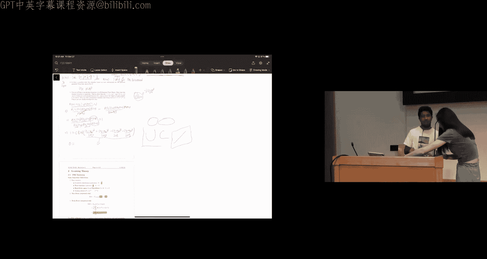
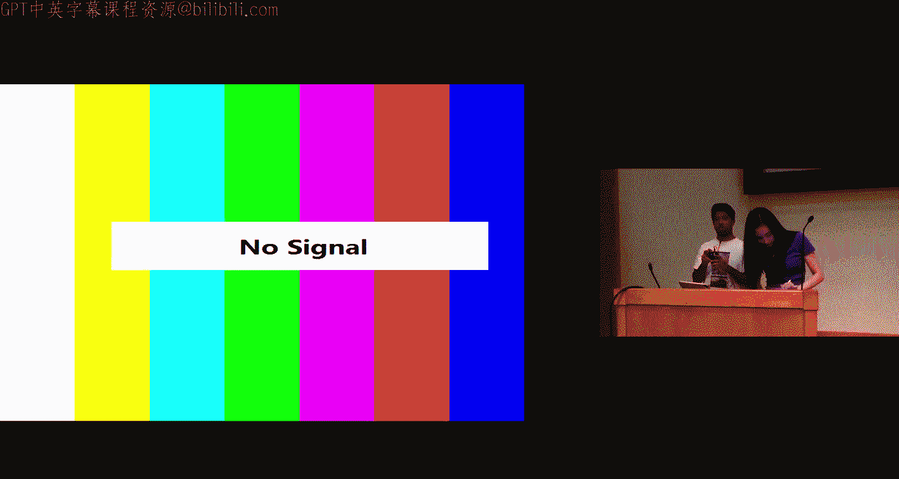
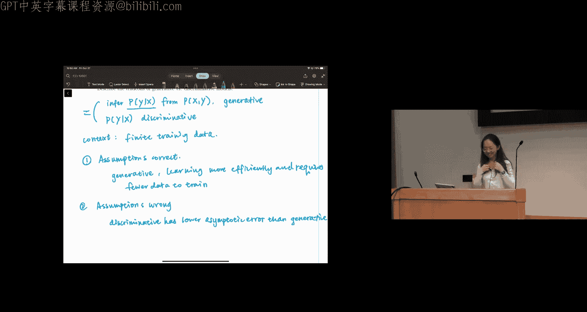

# CMU《机器学习导论｜Fall 2023 10-301⧸601 Introduction to Machine Learning》中英字幕（deepseek p45 Recitation_HW6.zh_en -BV1Z2cUefE4A_p45-

## 1. 概率学习

概率学习是一种学习框架，它试图学习概率分布而不是函数，例如正态分布或伯努利分布。

### 1.1 最大似然估计 (MLE)

最大似然估计 (MLE) 通过最大化给定参数的数据概率来学习概率分布的参数。

**公式**：

```
arg max P(D | θ)
```

### 1.2 贝叶斯估计 (MAP)

贝叶斯估计 (MAP) 通过结合先验知识和数据来学习概率分布的参数。

**公式**：

```
arg max P(θ | D) = arg max P(D | θ) * P(θ)
```

## 2. 概率分类器

概率分类器使用概率分布来预测类别。

### 2.1 MLE 和 MAP

MLE 和 MAP 是学习概率分类器参数的两种主要方法。

### 2.2 参数

对于正态分布，参数可能包括均值和方差；对于伯努利分布，参数可能是成功概率。

## 3. 例子

### 3.1 广告点击率

假设有 K 个人点击了广告，总共有 N 个人看到了广告。我们需要找到使 K 个人点击广告最有可能发生的 θ 值。

**公式**：

```
θ = K / N
```

### 3.2 贝叶斯估计

假设我们相信大约 6% 的人会点击广告。我们可以使用贝叶斯估计来更新 θ 值。

**公式**：

```
θ = (α + K) / (α + N)
```

## 4. 简单朴素贝叶斯

简单朴素贝叶斯假设特征之间条件独立。

### 4.1 参数

对于每个特征，我们需要估计其条件概率分布。

### 4.2 预测

给定特征，我们可以使用贝叶斯公式来计算每个类别的概率，并选择概率最高的类别。





## 5. 高斯朴素贝叶斯

高斯朴素贝叶斯假设特征服从高斯分布。

### 5.1 决策边界

高斯朴素贝叶斯决策边界是二次的，可以是线性的、抛物线或椭圆。

## 6. 学习理论

学习理论研究学习算法的性能。

### 6.1 PAC 学习

PAC 学习是学习理论的一个概念，它要求学习算法在有限的数据集上以高概率达到高精度。

### 6.2 VC 维度

VC 维度是衡量假设空间复杂性的一个指标。

## 7. 生成模型与判别模型

生成模型和判别模型是两种不同的机器学习模型。

### 7.1 生成模型

生成模型试图学习数据分布。

### 7.2 判别模型

判别模型试图学习数据到标签的映射。

## 8. 总结



本节课中我们一起学习了概率学习、概率分类器、朴素贝叶斯、学习理论和生成模型与判别模型。