# CMU《机器学习导论｜Fall 2023 10-301⧸601 Introduction to Machine Learning》中英字幕（deepseek p46 Recitation_HW7.zh_en -BV1Z2cUefE4A_p46-

Alright， I guess I'll get started。 So everyone good job on completing midterm yesterday。

 So today we'll be going over a recitation on deep learning where we'll have two parts First we'll talk about combinationvolutional neural networks and recurrent neural networks。

 then we'll go ahead and talk about Pytorch So on the website we'll have the recitation handout as a normal PDFf and we also have uploaded slides for the Pytorch part of the recitation So that is called like supplemental materials or something So you can click on both of the links Look at the notes for today。

So we'll just first get started off with convolutional neural networks so we have a couple of concepts so first of all like filters so if you recall from lecture filters they also called like kernels so if you hear things like either filters or kernels they basically mean the same thing so they are essentially feature extractors so they are in the form of like a small matrix that will be used in convolutional neural net layers so they will usually have a width height depth strip padding and channels associated with them so you'll get to see an example of this in a later part。

And also closely related to that。 we also have like convolution。

 so that's where like the name convolutional neural networkss comes from。

 So basically what we do is that we sweep the filter that we have around the input tensor and then we take elementwise product sums based on the factors such as like the filter size stripe padding。

 and then this output product sums will form like a new tensor and that this will be the output of our convolutional layer。

 So this will become clear when we do an example。 So before that one of the most important formulas for you to know is like the output shape of a convolution。

 So given like this input with。 So this could be like the starting image that we have or an output from a previous convolutional layer will have a with and also a kernel with。

 So this is the kernel current kernel that we have and we also have a padding as well as a stripe。

And the output width from this layer would have this equation over here。

 which is like the input width minus the kernel width plus two times the padding and we divide it by the stripe size。

 and then we add one。And an output height is calculated similarly。

 except that we just change w to height of the input height and then instead of kernel width。

 we change it to kernel height so most of the time if we're working with square images。

 they should be of the same dimensions。And then one benefit。

 some benefits of like CNNs over normal like fully connected layers is that they are good for image related machine learning because they have like kernels that will do like feature extraction and future engineering。

 So the kernels will learn like different extraction different features to extract from the image。😊。

And also， we have pseudotransal invariance。 So what translational invariance means is that。

 for example， you have this image here and then you have like this mighty face over here， right。

 So if this is your training set， yourre。Your image classifier will。

 your commvolutional neural network will learn to classify this as a smiley face。

 But what happens if like in your test set， you have maybe the smiley face over here。

Or maybe somewhere like over here right， so it's like in different parts of the image so because we have kernels that will sweep across like the entire image during training。

😊，We will be able to extract the same like smiley face no matter like where it is located in the image。

 So that's why we have like pseudo like translational invaris in a sense。

 So no matter where your object is， your image classifier。

 your CNN will still be able to identify the smiley face correctly。😊。

And also it is parameter efficient， meaning that we have to learn a lot less parameters for each layer。

 as we'll see later in an example。😊，So， and then for the last part before we get into an example is look at like how we can calculate like the number of channels。

Through convolutional networks。 So usually we have image， if it's gray scale。

 we only have one channel， right， which just represents like how dark it is， how the pixel value。

 And if we have color images will have three channels。 So red， green and blue。

 So that is typically our image input。 And then true convolutional networks。

 our number of channels will change。 So for the convolution filter。

 we will have as many channels as the input。And there'll be as many filters as their output channels。

 So we'll see this example later。 and pulling and activation will often just maintain the number。

Of channels。Right so this will all become clear later when we walk through an example。

 so here we have an example of this image here， so four by four image with four pixels by four pixels and we also have a two times two filter so or a kernel right so our first question is that assume that we have no padding and we have a strip of one。

😊，So what would be the dimensions of the output and what is the value in the bottom right corner of the output image。

Alright， so first of all， the dimensions of the output。

 what we can do is that we can plug in this equation we have over here where we get the output will be equals to the input which is4 minus the the kernel lift which is two and then we say that there is。

😊，No padding。 So padding is0， So we will have plus two times 0。And then a strike is one。

And then we flaw this， and we add one， right， So in this case。

 what we have is that well have an output。Wve of tree。So the dimensions of the output。

 since we have the same number of width and height。

 the dimensions of the output will be three by three。

So another way of looking at this is that you have this filter of size2 by two， right。

 So you can imagine that we are going through this by， first of all， going。First， here。

And then sliding it over to here and then sliding it over to here。

Right so you can see that we have three of these brackets here， so the output will have a dimension。

 a width of three and then similarly for the height component so first of all。

 this this cur arrow here break bracket and this one corresponds to the first convolution and then we'll go down so this one will correspond with this one and then we' also have this one。

Here， so this is also gonna be a height of three as the output。

 So if we want to calculate the value in the bottom right corner of the output image。

 this will correspond to our filter here。Going over this patch here。Right。

 because this is the bottom right corner。Of our output。 So if we do this point wise。

Here we have that we do this element wise product sums。 What we get is。We will have。

Negative 9 times 1 plus 0 times 2。Plus three times negative 2 plus 7 times negative1。Right。

 so we have this。 Well go with this one。 And then this value will be multiplied with this one。

 This value with this one。 and this is this。So this is what we get here。

 And the result of that would just be equals to -22。So this is for the first quest， first part。

 And then for the second part， if we assume that we have a padding of one。

 So what this means is that we would extend this， this image that we have over here to be something like this where we have a padding of one on all sides。

 So our image effectively would have。Dimenssion of like 5 by 5 in this case。 Right。

 So when we are sliding over the。This convolution。 So if you want to know like。

 what are the new dimensions of the output。 So since we have。This image over here。

 the bottom right corner would correspond to this filter going over this part here。Right。

 because we are padding this input image by one。 So this means that we are extending by one block at every site。

Left， top， right and bottom， right， So if we similarly plug this into this formula over here。

 we have almost the same thing except that P would be equals to one。

 So this will give us that the output size would be equals to。Two times one over one plus one， right。

 So in this case， what we have is that our input size would have a dimension of 5 by 5， right。

 So you realize that in this case， we are actually increasing the size of the image。

 So in since we started off with a 4 by 4。 So if we didn't have a padding。

 our output image would have a dimension of 3 by 3。 But if we include padding。

 now our output image would have a larger dimension of 5 by 5。

And then the new value in the bottom right corner would just be convolving this one。

 This area with this。 So typically， when we add padding。

 we just have zero values assigned to the padding cells。

 So this will just be equals to 7 times 1 plus0 times all of the two。The rest of the values。

 So this just gives us a value of 7。And then after that。

 we have another example of an image classification task。 So we have like 10 possible classes， Cat。

 dog， bird and so on。 So these images come in RGB format。 So the input number of channels would be 3。

😊，Since we have one channel for each color， red， green and blue， and they。

 we currently start off with a dimension of hundred and 28 by  hundred 28。

So the shape of our input would be 3 at hundred28 by 128。

 So what this means is just the number of channels。Number of channels。And then， at。Height by width。

Are with by height。So this is the convention well use for determining the shape。

 So in order to do this classification， we set up this convolutional neural network with a structure of having the input。

 We first max pull it with a filter。 And then this filter would have a stride of two。

 and three output channels。😊，And then we send these results to a convolutional neural layer that uses a 17 by 17 filter with striptri 1 and 12 output channels。

And then we pass these values through a max pool with a three by three filter。

And this following stridee and output channels。Then we flatten the result and pass it through a fully connected layer with  hundred28 hidden units followed by a fully connected layer with 10 hidden units。

 So if we look at this， first of all， we have max pooling with two by two filter。

 So this corresponds to max pool here right， And then next we have we send the results to a comm layer。

 So this is step3 here。 And then we max pull it again。😊，So this is a fourth layer。

And then after that， we say that we flatten the result。 So that is number 5 here， step 5。

 And then we pass it through a fully connected layer。So this is that layer 6。

And then we have value activation。 So this will be the step 7。 And then we then。

Pass it again through a fully connected layer。 So this is step 8。 And then finally。

 we do a softm activation。😊，Which will say a step 9。

 So the idea of this is that the output of our soft map activation with there will be 10 hidden units。

 So the reason why we have 10 is that as we recall here。

 we want to classify images that could belong to 10 possible classes。

 So the output of our soft maps will tell us the probabilities for each of these classes。

 So it will be a length of 10。😊，Right so。And then with enough labeled data。

 we can use an optimizer like S GD， as if've covered in class to train this model using back propagation。

So now we just have to determine the channels and dimensions of the tensor before and after every neural operation。

So here， the formula that we covered above here would be very useful to calculate the number。

 the dimensions， right， So first of all， the first step is going through a max pool layer。

 So we see that the max pool says that we first mix pull it with a two by two filter and we have a stride of two and three output channels。

 So since we notice that we have three output channels。

 So the number of output channels doesn't change usually through max pool layers。

 So we just leave it as three。😊，And。Then we have to calculate the dimensions of the output。

 So it's a two by two filter with a stride of two and with a stride of two， right， So if we recall。

 the formula is the output will be equals to the input。

inus the filter or kernel width plus two times the padding divided by the strip。 and then floor it。

 And then we add one to it。 So in this case， our input will be hundred and28。

 And then our kernel width is2 is 2。 So well-2。 and then our padding if no padding is。

 if the question doesn't mention padding， it just means that we set padding to be 0。

 So we have two times 0。 and the strip over here would be 2。 So。We divide it by 2。

 and then we add one to this。 So this will give us 64。So。The same thing。

 because the height is the same as the width。 we will have that the output would be just 64 by 64。

So then we move on to the convolution layer where it has a 17 by 17 filter with strike 1 and 12 output channels。

 So here you notice that the number of output channels changes through the convolution layer。

 So since we said that theres 12 output channels。 We will change the  tree in front to a 12。

 So this is the number of channels now。 And then we want to calculate the dimensions of the output。

 So that would be the input would be 64。And then we said that the kernel width is 17。Right。

17 by 17 filter。 And then we have a strip of one and 0 padding again since there's no mention of that。

 So this would give us 648。So。Then。We will have 48 by 48。So this is the the shape of the comb layer。

 Next， well have our max pool layer， which has 12 output channels again。

 So you notice that the channel doesn't change and then。

We will have a tree by tree filter with a strip of tree。 So this is just going to give us。

Our input is 48， And then we have3 by3， and then no padding again。And then the stripe is3。So。

 this will give us。16。So we will have 12 at 16 by 16。And then we say that the result is flattened。

 So when the flattening happens， it just means that we flatten it into one single dimension。

 So how we calculate the dimensions， then is that since we have 12 channels。

 and we have image dimension of 16 by 16。 We calculate the flatten by just multiplying all the values together。

 So you can think of this， like having a multidimensional input and then we flatten it to one single dimension。

 So this would come out to be。😊，3，0，7，2。Then we pass it through a fully connected layer with 12 hidden units。

 So in this case， this means that our shape will just be  hundred and 28。

And then we pass it through the activation function。

 So the activation function doesn't change the number of parameters or the shape that we have。

 So usually any activation function would have accept like the same shape as the previous layers output。

 So this will be hundred28。 And then we follow it with a fully connected layer。😊，So， that would be。

And it says that there are 10 hidden units， so the shape will just be 10 here。 And similarly， softm。

 we don't change the shape。 So the output will have a shape of 10。So any questions at this point？

Okay， cool。So now we want to just draw a diagram that illustrates this table that we have over here。

 So how it will look like is that we have an input with three channels so we can model this by just drawing three layers。

Here。So this is tree。At 1，28。By 1，28。 So this is our starting size。

 And then we go through the first max pool， which preserves the number of channels。

 So we will still draw three。😊，Boxes， but in this case， we will make them small， slightly smaller。

 right， because the shape is now 64 by 64。 as opposed to previously， it was hundred28 by 1 28。

 So this boxes would be slightly smaller than the previous layer。Next。

 we go through a convolutional layer， which produces 12 output channels。

 So now we'll have to draw 12 boxes。Corresding to each of the channels。And then。

This will also be smaller because we have a shape of 16 48 by 48。 So this will be 12 at 48 by 48。

Then we pass through the next layer to become。We will still have 12 layers。

 But now it's even smaller，16 by 16。 So it will look something like this。

And then there will be 12 of these layers。 And then we pass it through a flatten layer。

 So this is just gonna be a one dimensional input。With a length of。30，3072。

Then we pass it through a fully connected layer。 So this will be 928。 And then Reou。

 which will preserve this。leength。And then we'll finally go to 10。And10。

So then the 10 would just correspond to the probabilities for each of the 10 classes。So in this。

 so this is how the network will look like and how we connect like the different layers is that we will have。

We will be sweeping like our filters over these images。 So， for example。

 like maybe this square over here that we sweep our filter through will correspond to maybe like this location。

In the next layer。And then we could have a filter that。For example。

 a filter going over this location could correspond to a location。In the next layer here。And so on。

 We'll just do this。So this could correspond to something over here。

 And then we'll have all of this to be flattened to。This entire one dimensional layer。

 And then we will。Reduce the size by。1，28， and then the 1，28 persist。

 and then we will further reduce it down to 10， and then 10。

So this is how the diagram will look like for this conventionalvolutional neural network。

And then the next part is。Counting the number of parameters in this network。

So here there's a important formula to know to calculate the number of parameters。 So we have that。

So， for the input layer。The number of parameters would just be0 because we are just reading in the input image。

 There isn't any parameters for us to learn。So it's only in the convolutional layer。

That will have the number of parameters would be equals to the width of the kernel multiplied by the height of the kernel。

 multiplied by the number of input channels。Multiped by the number of output channels。

 And then this is considering just the weights without the bias term。

 So we have to add the bias term。 So the bias term would just correspond to one times the number of output channels。

 So this is the formula to calculate the parameters for the convolutional layer。And then。

 for pooling layers。We will also have a pair number of parameters to be 0。

 So the reason is that if you think about like max pooling， right。

 what we' are doing is that we are just taking the maximum value in that patch。

 So there is no parameters for us to learn。 since we're just taking the maximum out from all of the numbers in the previous layer。

😊，And then lastly， for fully connected layers。The number。

 So all of the input units we have in our fully connected layer will have a separate weight for each of our output units。

 So this means that for。😊，And inputs。And M outputs。Since we need。Each unit to have a separate weight。

 This is going to give us n times， n parameters。Plus， the bias term。

 So the bias term is always like associated with the output。

 So we are going to add M for the bias term plus times 1。 So similarly for the convolutional layer。

 our bias term just corresponds to the output channels。

 So this is like the formula for the different， how to calculate the number of parameters for all of the components。

 So the first question is to calculate the parameters for the convolutional components。

 So this would just be this one over here， this con layer， number 3。😊，Right， so we have 12 channels。

 and then。We have 12 input channels， and we also have to know the output channels。

 So since the next layer has a channel of 12， the output channels。Would okay， sorry。

 the input channels will be from the previous layer。 So the input channels would be3。

And then the output channels that this convolutional layer gives out would be 12。

So if we just plug in the numbers here， our kernel width， as we mentioned previously。

 it has a 17 by 17 filter。 So this means that the kernel width is 17。

 and the kernel height is 17 as well。 And then the number of channels is 3。😊，Right。

 and then our number of output channels will be 12。And then we just add another 12 for the bias term。

 So this means that the number of parameters for this network would be。This number over here。10416。

So this is the number of parameters we have for this convolutional layer。

And then for us to calculate the parameters for the fully connected layer。

So this would just be equals to over here， right。 So we have 3，0，7，2。 And then if you recall。

 we said that for n inputs and M outputs， the number of parameters is n times n plus n plus 1 M times 1。

 So here we have number of inputs will be 3，0，7，2。 and number of outputs is 128。

 So this means that we will have 3，0，7，2 times  hundred28。 And since the output is 128。

 we will add 128 for the bias term。 And this is for our first fully connected layer。

 And then for our second fully connected layer。 we will just add the same thing。

 So the number of inputs will be hundred28。😊，Right1 28 here。

 and then well multiply it by a number of output， which is 10。

 And then well add another 10 for the buyers。 So this will give us。This number here。Right。

 so you can begin to see that there's like a huge disparity between the number of parameters for the fully connected layers。

 as opposed to convolutional components。 So this is where you can see like the parameter efficiency coming in for a convolutional neural networks。

 since we just have a kernel that can slide through the entire image。

 as opposed to having one single， like corresponding unit in the input layer to the output layer。

 which will grow very fast， very quickly。😊，Right。For this parameter calculations， like。

 what can you say about them in terms of like parameter efficiency。

 So a simple way to see is that our total number of parameters would just be equals to the sum of these two numbers that we've derived from above。

 So 100，4，1，6。Well added up with this number of parameters for the fully connected layers。

 So this is gonna give us like this number here。So， if you notice that。

The number of parameters for the con layer， right， is gonna be。

The percentage that it takes up from the total would just going is just going to be this number over our total。

Right， and then if you calculate， this is just gonna turn out to be like 2。57%。

 as opposed to we have this fully connected layer。If we divide it by n total。

Is going to be much larger， right？ So is this value is actually going to be just  hundred minus this value。

 So this gives us 97。43%。 So what these numbers mean is that。

For all of the parameters we have to learn in our network。

 the majority of the parameters actually comes from this fully connected layer。

 as opposed to our convolutional layer。 So you can see like the parameter efficiency between these two。

 And so that's like the motivation why we want to use like convolutional neural networks。

 especially for like image applications。😊，Alright， so anyone has any questions。Okay， cool。

 Now we'll just go on to a short part on recurrent neural networks。 So here we have this。

Sample R and end here。So we have this layer corresponding to like the hidden states， H 0， H1， H 2。

 H3。 And this would be our input sequence， X 1， x 2 x 3。 So you can think of it as maybe。

 for example， this could be like a text sentence， right， So it could be a sentencing， like。

 I am happy。 So I would be X 1。😊，M would be x 2。And then。Happy will be X3。Right， so since like。

 so this is how you can see like the temporal nature of recurrent neural networks。

 So before we go on， I'm just gonna just briefly go over like what recurrent neural networks。

 So they are characterized by connections between nodes creating a cycle and so the output from some node can affect subsequent computations。

 right， you can see in this image over here。 So the output from this node here。

 the hidden layer would affect the computation of the subsequent layer over here。

 because it doesn't only take in the input。😊，Wor at this point in time。

 But it also takes in the output from the previous layer。

 So this is where the recurrent nature comes in because you keep taking in the outputs from the previous layer。

Right， so， and so this recurrent nature will make it useful when the input is like sequential or temporal。

 So sequential， youll just be like， for example， language， right。

 we have sequential words and also temporal that spends over time。😊。

So how do like these hidden notes， like， make use of like inputs and previous outputs。

 So we see that the hidden node will have two sets of weights。

1 to process the input from the current time step。And another one to process like their own outputs from the previous time step。

 right， So current time step is this arrow here。 And then from the previous output from the previous time set is this arrow here。

 So they will have two different weights。 So this corresponds to the weight matrix W H X。

 So this is the what the matrix for the input。😊，To process， like， the input X。

And then this H H over here。Right， iss the process， the input from the previous hidden layer。So。

Then how we optimize R Ns would be similar to just the regular feed forward neural network。

 if we just unroll our R N in this case。Right， and then we can just use back propagation to update our networks。

 and this will be just called back propagation through time。

Because of the sequential and temporal nature of these networks。

So here we have this sample R and N here， and we want to redr this diagram as a compact form， right。

 so we don't have to unroll it across several time steps。So if you look at this image。

 you will notice that there are inputs that are always like repeated。 So at each time step。

 the hidden state， the hidden state would take in the state from the the hidden state from the previous layer as well as X。

 right， And this keeps going on continuously until we end at go to the end of the sequence。

 So how we can draw this is actually very simple。 We will just have X as input。 This will always。

 we will always require the input。 So we will feed this into the hidden layer。😊。

Which will then produce the output prediction。So this is。

 this still looks similar to what we have above。But then to account for the hidden layer going from the previous layer to the next hidden layer。

 what we're going to do is that we're actually just going to add this。Errow back to itself， right。

 because you can see this essentially what it's doing。 So at this step， we're taking in。

This hidden layer output from the previous layer， right。

 So you can think of this as just like it like fitting itself back with the information that from the previous layer。

 And as similarly for this layer， we're getting from H1。 So again。

 we'll just go through this loop here。 So this is how you can just draw it as a very compact form。

 And this is the representation for the neural network。

 recurren neural network without any unfolding。😊，Yeah。

 so that is all for this part of the recitation on CNNNs and RNs。 Does anyone have any questions。😊。

Okay， awesome。 So now we'll just go over Pytch， which will very useful for your homework programming assignment this week。

😊。

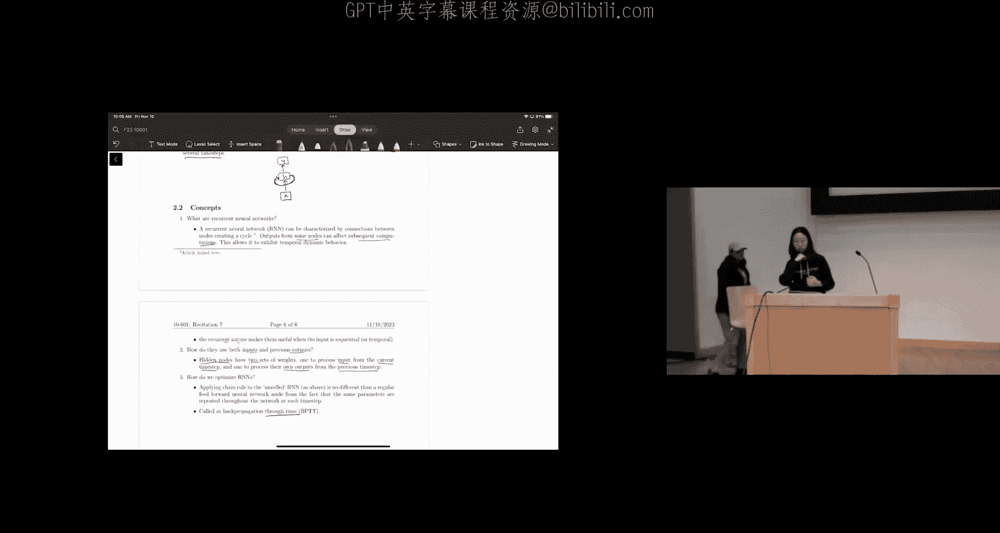

Okay， so now we will be talking about Pytch。 I'm going to give you a basic introduction of all the functions and probably。

All functions that you can use and it'll be very useful in your homework so let's get started the first thing I would like to talk about is all of you would have set up your collab with Pytoch if not please go review recitation 6 we would have walked you through how to set up Pytch on your collab。

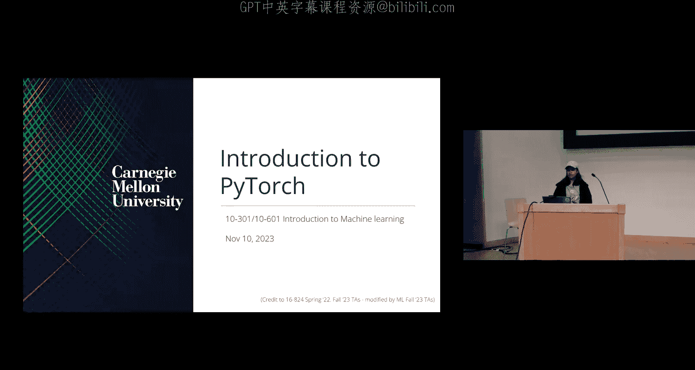

This is the basic step for your homework7。

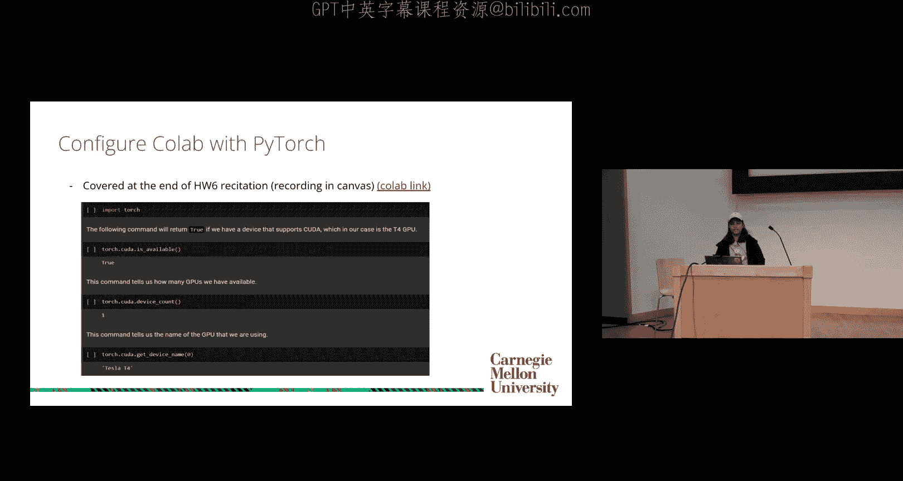

In what we would be， this is a short sniet of what we would be covering today。

 So moving on to what we would be covering today is first what Py toch。

 So Pytoch is just a machine learning framework with a lot of modules functions and。

Losses optimizers that's already inbuil， which makes it easy for us to implement deep learning models。

So， the first basic。A thing of Pytch is its tensors， it's very similar to arrays。

 multidional arrays its just the biggest difference between the normal arrays that we would encounter in Python is just that you can use tensors on CPU as well as GPU which just transfer the tensor to the GPU and you can perform all your operations on the GPU as well。

So here we can see that this is a 1D tensor which is very similar to a Ny array and then we have a 2D we have a 3D and a subsequent ones and if you want to find or if you want to convert a Ny array to a tensor you would be using this function from Ny and then just pass the Numpy array。

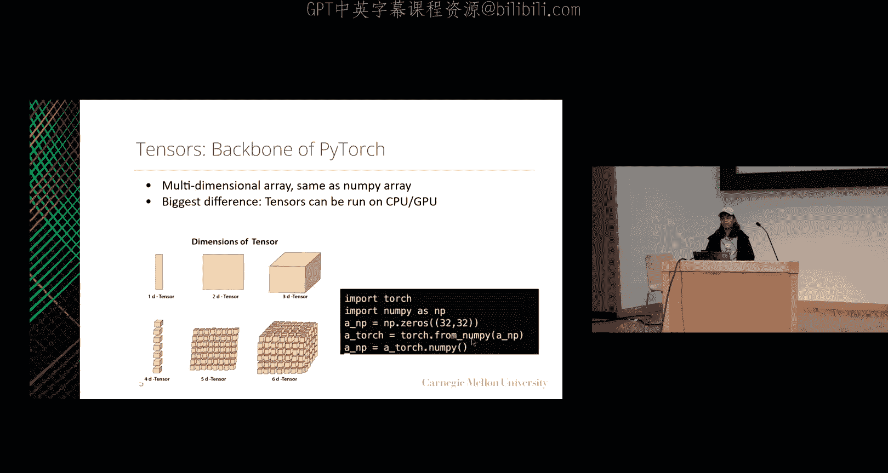

So the basic elements of tensor we have we have lists in Python and we have nu arrays in Python so how can I convert them into tensors so we just have a function called toch dot tensor that would convert a list to a tensor and we like I discussed before we have from array which would convert a nuier array to a tensor。

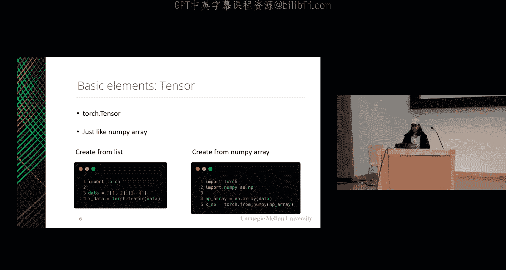

So over here we do have similar functions in Python right ones and zeros and random so torch also has the same to create tensors。

 so torch dot1s would look something like this， zeros would look like this and random is just random initialization of numbers。

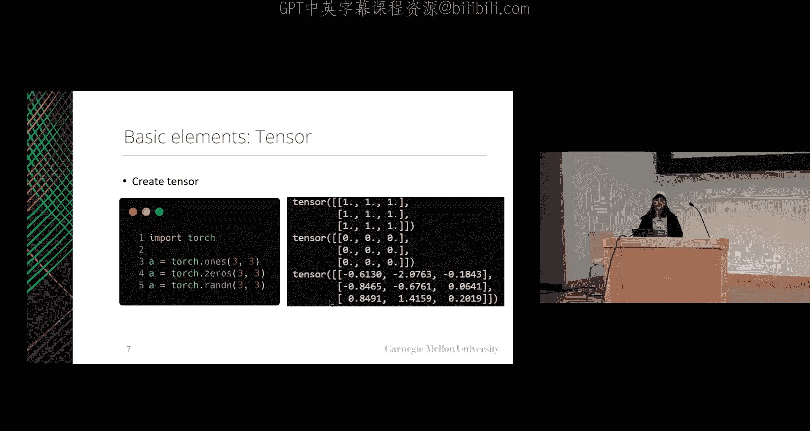

So you can also perform slicing in using tensors， so。If you want to set all the columns。

 if you want to set the first column to all zeros， you can use this one and if you want to set a specific set of rows and specific set columns。

 you should probably use slicing。

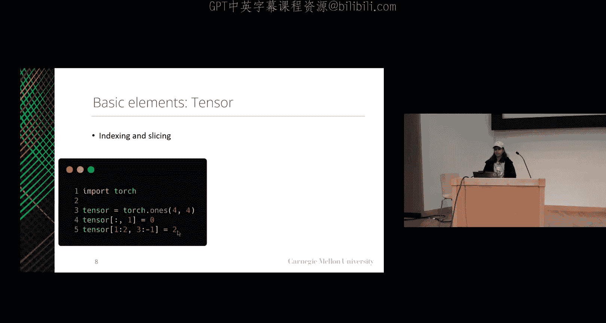

Okay， next， we will talk about the device and types。Intenss。 So let's say we have a。Tsor of all ones。

 which is a dimension 3 cross 3。 And if you want to find which device it is on。

 this is probably one of the key things that you should remember because when youre performing Home 7 you would want to have all your operations done on one device if it's not on that device you should probably transfer it from your CPU to GPO GP to CPU wherever you would like to perform your operation So8 or device would。

Like you know like where your tensor sits， does it sit in CPU or is it in GPU and data type is the data type of your tensor。

 is it just floats or is it in teacher and。Tosha once like， what does that do is it creates。呃。

Tenssor of all ones in the dimension of a。 so here a is a three cross 3 so you would so B would just be another tensor of all ones。

 but in the dimension three cross3 so it will be a three cross3 of all ones so it's kind of same as if you initialize a sorry if you initialize B with the input dimension sorry if you initialize a B with the dimensions of a you can just do to dot ones of a。

The dimension0 and the the dimension  one。 So it'll just be the same。

And then if you want to transfer a tensor from one device to another。

 and here probably we're trying to do transfer。B to ka。 So kuda is your GPU。

 So if you want to transfer it from CPU to GPU， youll have to do B dot2 Ka。 But this。

 you probably wouldn't be using in the homework。 I'll give you another。

Way to transfer that is probably what youd be using which is more easier。

 And then if you want to just convert the data type of B B to torch。

And then here we're converting into Ndija。So the line 9 and 10 would be the would be probably the ones that you'll be using in your homework because you would want to transfer your tensor to the device where the other tensor you're performing the operation on exists right So if I want to if I do not you can probably find out where a resides but。

You don't have to do it for every probably every layer or every operation so you can just transfer B to A ort device so whichever device a resides in B would also be there which makes your work much more easier and its the same with B to A ort D type so it would just convert B to the data type A is in so it makes all of your operations simpler。

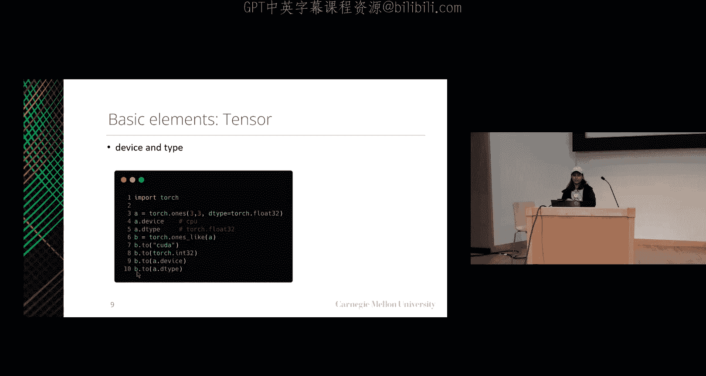

The next thing we'll be talking about is the basic operations using tensors， so we have a。

 which is just touchrch of ones with dimension  two cross three cross one so。

And then we have B which is initialized into two multiplied with the same。

 so now if were performing addition we would have something like this。

 so we have the outer dimension to be2 the inner dimension to be3 and then we have one so that's how the tensorors created and then we perform the basic operations and then it's very。

 very similar to what we do in Python。And we have transpose， which is also very similar to。

What we do in Python but here were transposing1 and 2 so the dimensions of1 and 2 are only transposed so if you see this is of dimension two cross 3 cross1 so if you are transposing only one and2 only3 and1 would be transpose so we would end up with a tensor of2 cross  one cross 3 and then B at E is just matrix multiplication。

And expand。 So what expand does is it expands your tansor range。

 So so if you give a do expand of -1 commma -1 comma 3。All the first dimension， the second dimension。

 which is remain the same。 and only the diamond， if you give -1。

 it means that you' are not going to change the dimension of that particular。嗯。Intex， so over here。

 -1。And-1， it resides in like 0 and 1。 So I'm just not going to change dimensions 2 and 3。

 and I'm going to only expand the last dimension。 So I would So G would be of the dimension 2 cross 3。

 cross 3。

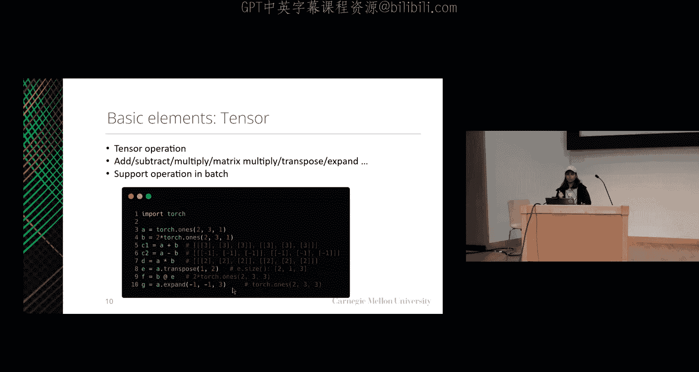

And then now we're gonna to see some manipulation， so。

Now we have an array of con values of like one to 12 and then we're reshaping it to three cross four。

 So this is how that array would look。 And then now we now on this side I have the array dot transpose so basically just flip。

The X and Y axis。So what is array dot conigs us， It just flattens the array。So。Over here。

 I would have。 it's basically arranging。Deflating your array into a 1 D array。

So these are the respective ones as to how it would look。

I'm just going to stop to ask if you guys have any questions。 otherwise， I'll move forward。

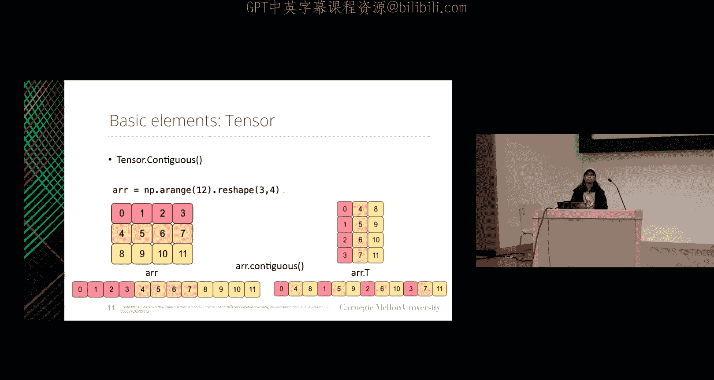

Okay， moving forward。So now we will step into how we're going to define model so if you I mean when the homework 7 is released today you would probably see a lot of modules defined because you're going to be implementing a portion of transformers so。

Let's start from the basics。So， now we have a。We have a clause donet which implements module and then we have an initialization function。

 we have a forward function， so the forward initialization function what it does is just initializes and defines the layers that you want over here we have like three layers that's defined and tying it back to the recitation it would be probably the convolutional layers that you're implementing and the forward pass is nothing but how you would stack the layers or arrange it and in which order you would do a forward pass。

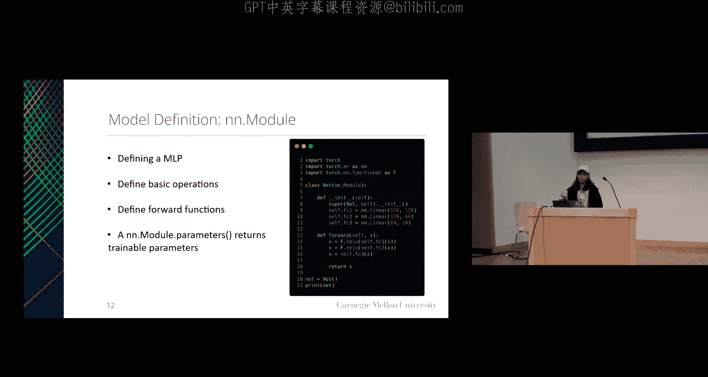

So over here we're just going to look into a little more detailed view of the implementation of a linear layer so here n and dot parameters is nothing but it would initialize your parameters and whenever youre doing a update it so essentially youre initializing trainable parameters over here were。

Initializing W and B， which is used in performing your like gradients。 So if you give required grad。

 it means that。Every time you there is a function that I will be talking about later。

 so that' is used to update your gradients when that is called all the trainable parameters that has required grad through。

 only those would be updated based on your optimization function。

So that's just initialization of parameters and。We have a forward past that we already discussed about。

 So in terms of。Your。Ws that we generally talk about its just nothing but x is equal to w trans plus x plus B right so thats this is just the implementation of that。

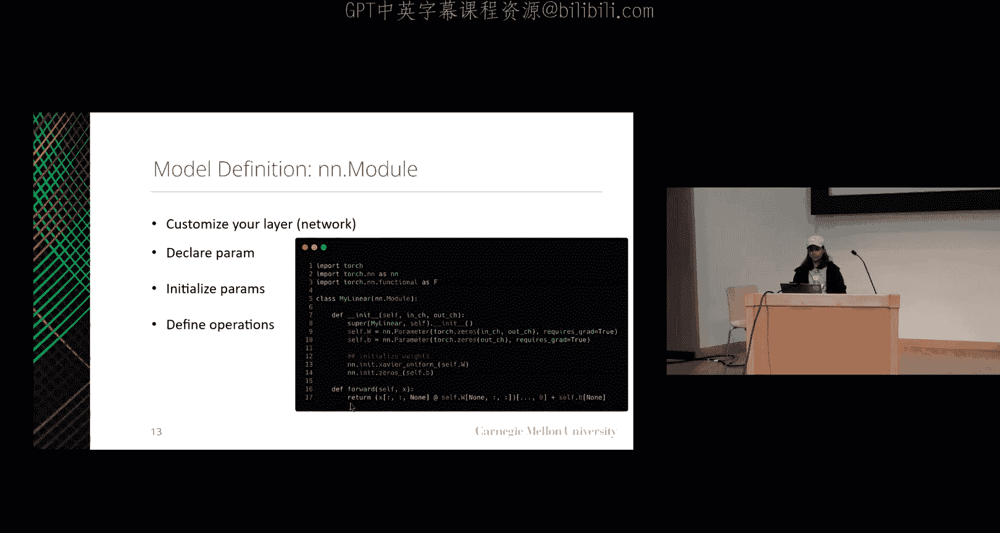

So now we will be talking more about how you would once you have your module implemented and you have a model ready with all the forward pass and all the layers implemented。

 we will have to train it so the way we' are going to train it is for the number of epochs。

And we will also have to pass in the data， right。 So we have a data loader function called the train loader that would take in the data and also。

the next step， we would be extracting the input and the labels from the data and then optimizer do0 grad is nothing but this concept and。

Optimization， it will help you accumulate your gradients， so。

Essentially weve not covered accumulation of gradients as of now。

 so we're going to stick to having it optimizer having it reset every time you're updating your gradients so essentially what this would do is your gradients would be zero and then you would compute the back back propagation and then update your weights and biases based on that and every time it would be reset so that you do not have any sort of accumulation。

And。Your loss is just the criteria criterion。 So based on what you would be implementing in Home7。

 mostly cross entropy binary cross entropy so it would just compute。

Cros entropy based on the outputs and labels you have and lost that backward is nothing but just the back。

 And optimizer dot step is performing your。

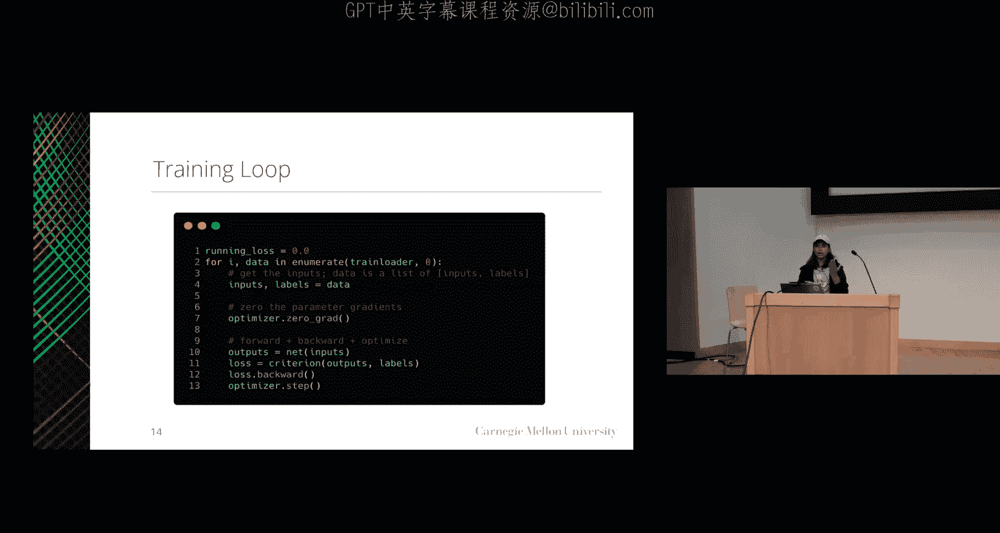

Graient update。So嗯。In homework 7 you would be likely running inference or you would just be testing your data so for that you don't have to do any kind of updates through your gradients right only in the training time you would be making some updates to your gradients otherwise you do not have to make any updates so that happens in like validation and as well as your test time so how do not update gradient so you can just use at To do no grad what that does is it helps you run inference or do some kind of testing without updating gradients。

So it would just deactate all the layers from updating or all your trainable parameters from updating。

And these are the key metrics to track for your Home 7 implementation。

 keep an eye out for training loss， validation loss acuracies。

 so that is what you're going to optimize on and it's always good to follow this general rule of thumb so if your training loss is low and your validation loss is low。

 things are going fine， you can just go ahead and run inference or see how your model performs。

But the training loss is low and the validation loss is high we must have all learned about overfitting that's what's happening so you should probably look into why your model is overfitting and how you can probably rectify that when your training loss is high and your validation loss is high it means that your model is not learning anything so basically it's underfitting so probably should see why it's not learning are the updates not happening probably tweaking the model should be helpful and if your training loss is high and your validation loss is low which essentially should never happen there's some bug in your evaluation so if your training loss is high it means that the model is not learning anything but how can it perform well on the validation set if it has not learned anything so that would be。

The reasoning behind it， and。So basically， this is the summary of how you would train neural network just so we can。

For this homework7， you would only be making tweaks in the forward。Of the attention layer， so。

You do not have to worry about implementing the remaining。

 but it's always good to know for your future assignments。

So the first process is loading the data so you will have certain types of data loaders which would perform batching or shuffling。

The X is the forward layer so you will have to implement your modules and your layers and the encodeder layer and the decoder layers。

So next is defining a loss function so what loss function are you going to optimize on and then performing the backward pass so PyToch automatically has an Nbel function that would do it and we just saw that and then optimizing based on your given parameters using the optimizer and then tracking the key metrics that youve already redefined。

And that brings us to the end of the recitation， Thank you。

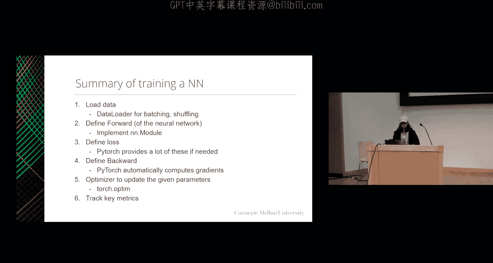