# CMU《机器学习导论｜Fall 2023 10-301⧸601 Introduction to Machine Learning》中英字幕（deepseek p46 Recitation_HW7.zh_en -BV1Z2cUefE4A_p46-

## 🧠 机器学习导论：第 10 节：卷积神经网络和循环神经网络

### 概述

在本节课中，我们将学习卷积神经网络（CNN）和循环神经网络（RNN）的基本概念，并了解它们在图像识别和序列数据处理中的应用。

### 卷积神经网络（CNN）

#### 滤波器

*   **概念**： 滤波器（也称为内核）是卷积神经网络中的基本组件，用于提取图像特征。
*   **形式**： 滤波器是一个小型矩阵，用于卷积层中。
*   **属性**： 滤波器具有宽度、高度、深度、填充和通道等属性。

#### 卷积

*   **概念**： 卷积是将滤波器在输入张量上滑动，并根据滤波器大小、填充和步长进行元素级乘积和。
*   **输出**： 卷积操作的结果是一个新的张量，它是卷积层的输出。

#### 卷积输出形状

*   **公式**： 输出宽度 = 输入宽度 - 核宽度 + 2 × 填充 + 步长
*   **输出高度** = 输入高度 - 核高度 + 2 × 填充 + 步长

#### CNN 的优势

*   **图像识别**： CNN 适用于图像相关机器学习，因为它具有进行特征提取和特征工程的内核。
*   **平移不变性**： CNN 可以识别图像中不同位置的同一对象。
*   **参数高效**： CNN 的参数数量比全连接层少得多。

#### 卷积网络中的通道数

*   **灰度图像**： 1 个通道。
*   **彩色图像**： 3 个通道（红、绿、蓝）。
*   **卷积滤波器**： 与输入通道数相同，输出通道数与输出通道数相同。

### 循环神经网络（RNN）

#### RNN 的特点

*   **循环连接**： RNN 的节点之间具有循环连接，输出可以影响后续计算。
*   **序列或时间数据**： RNN 适用于序列或时间数据，例如语言和视频。

#### RNN 的隐藏节点

*   **权重**： RNN 的隐藏节点具有两个权重集，一个用于处理当前时间步的输入，另一个用于处理先前时间步的输出。
*   **优化**： RNN 的优化类似于前馈神经网络，但需要使用时间反向传播。

#### RNN 的紧凑表示

*   **图示**： RNN 可以通过将隐藏层输出连接到自身来紧凑地表示，从而避免展开。

### PyTorch

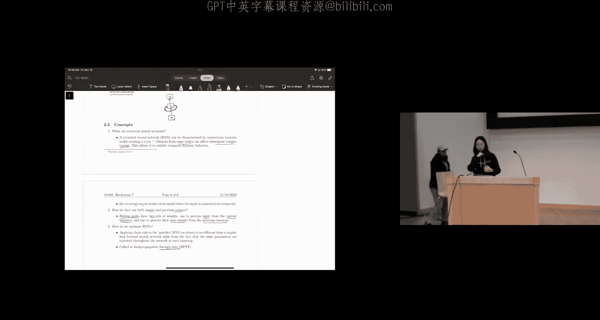

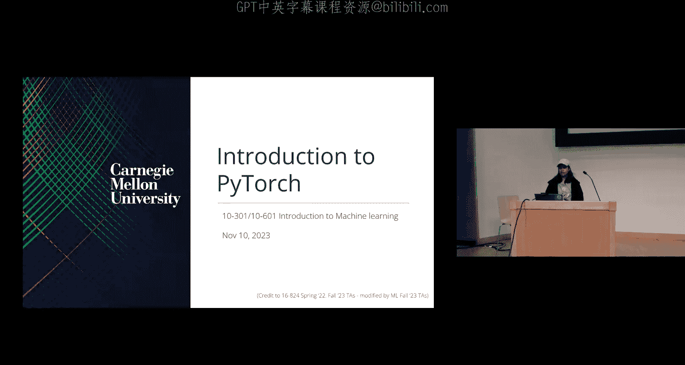

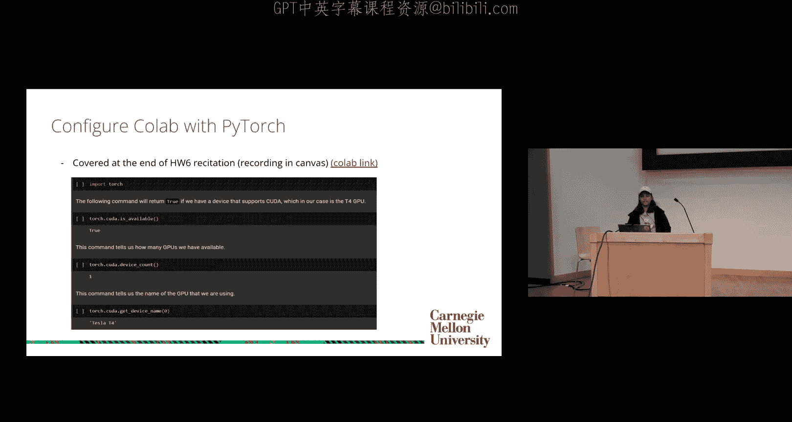

#### 张量

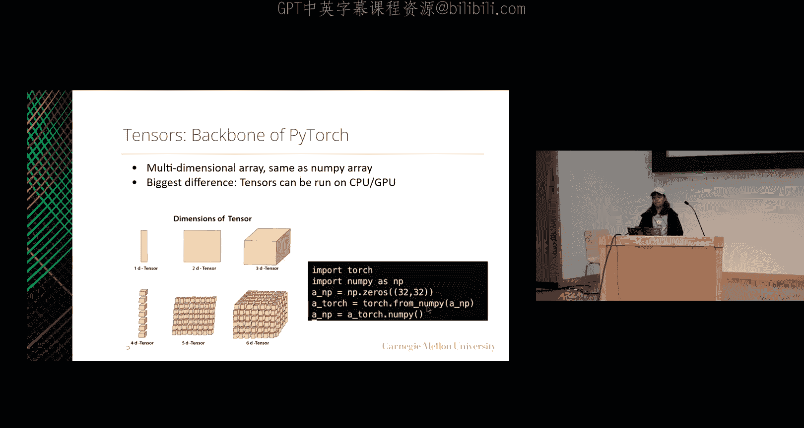

*   **概念**： 张量是 PyTorch 中的多维数组，类似于 NumPy 数组。
*   **创建**： 使用 `torch.tensor()` 函数创建张量。
*   **操作**： 张量支持切片、索引、加法、减法、乘法、除法等操作。

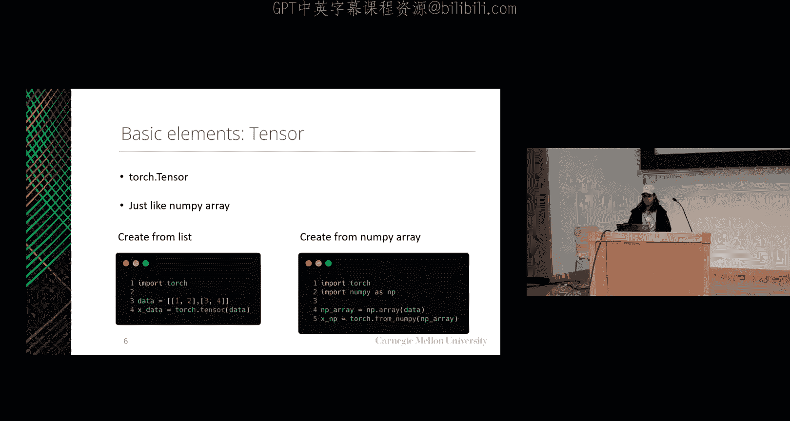

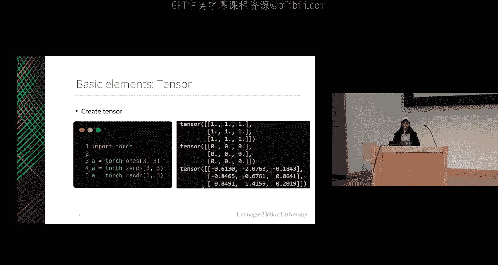

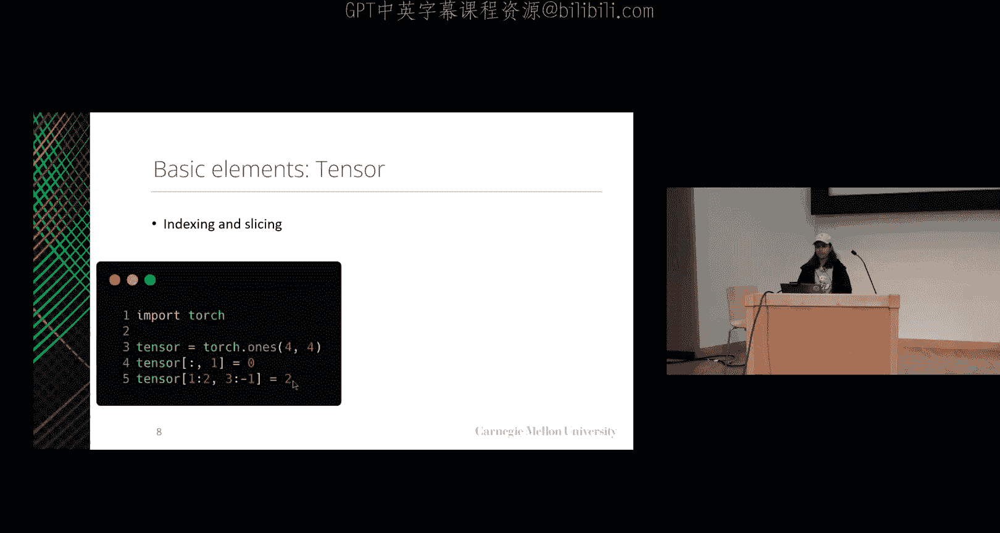

#### 设备和类型

*   **设备**： 张量可以存储在 CPU 或 GPU 上。
*   **类型**： 张量具有数据类型，例如浮点数或整数。

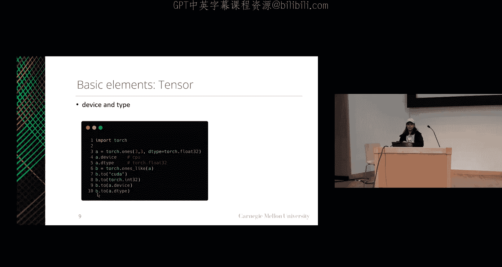

#### 基本操作

*   **切片**： 使用索引或切片操作符访问张量的子集。
*   **转置**： 使用 `torch.transpose()` 函数转置张量。
*   **矩阵乘法**： 使用 `torch.matmul()` 函数执行矩阵乘法。

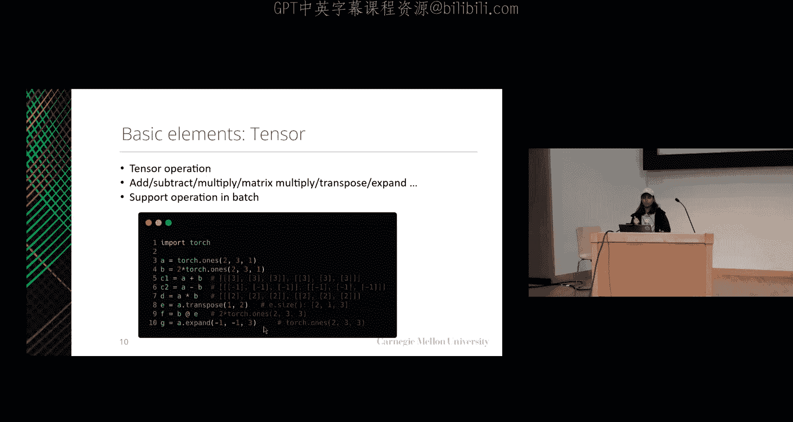

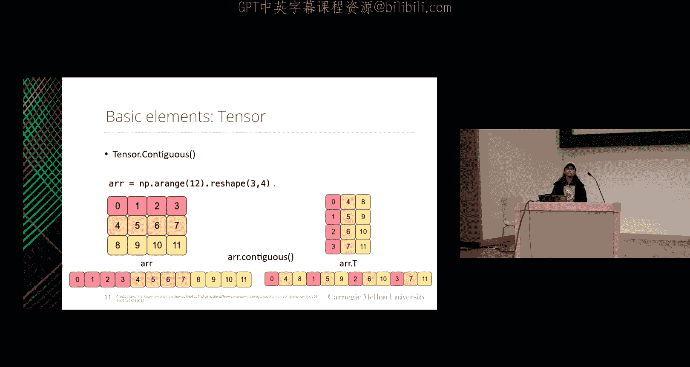

#### 模型定义

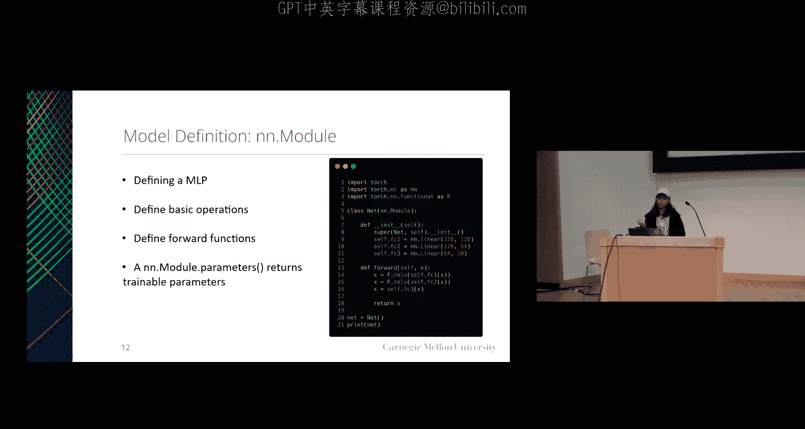

*   **模块**： 使用 `torch.nn.Module` 类定义模型。
*   **初始化函数**： 初始化模型参数。
*   **前向函数**： 定义前向传播过程。

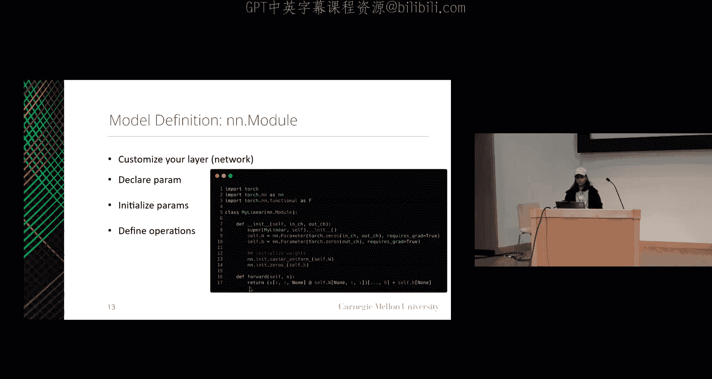

#### 训练模型

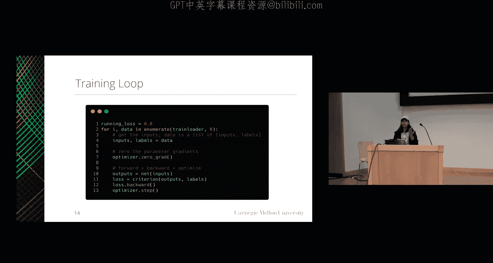

*   **数据加载器**： 加载数据。
*   **优化器**： 更新模型参数。
*   **损失函数**： 评估模型性能。
*   **反向传播**： 计算梯度并更新参数。

### 总结

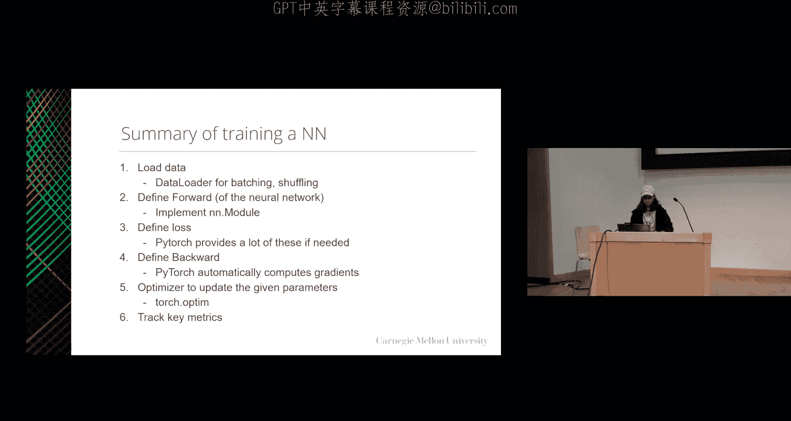

在本节课中，我们学习了卷积神经网络和循环神经网络的基本概念，并了解了它们在图像识别和序列数据处理中的应用。我们还学习了 PyTorch 的基本操作和模型定义。