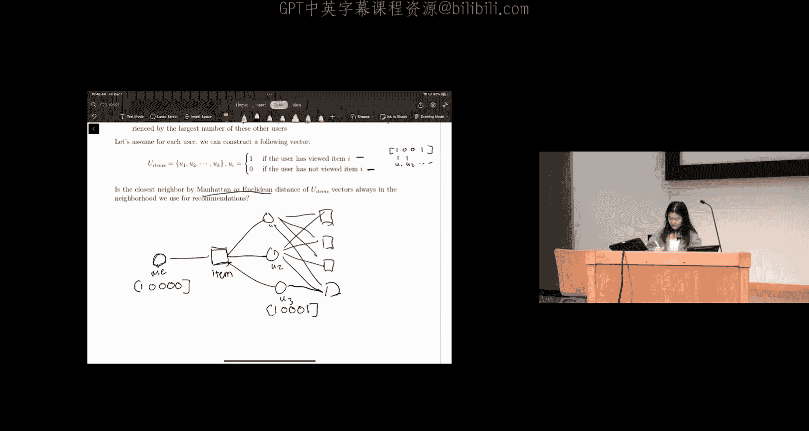
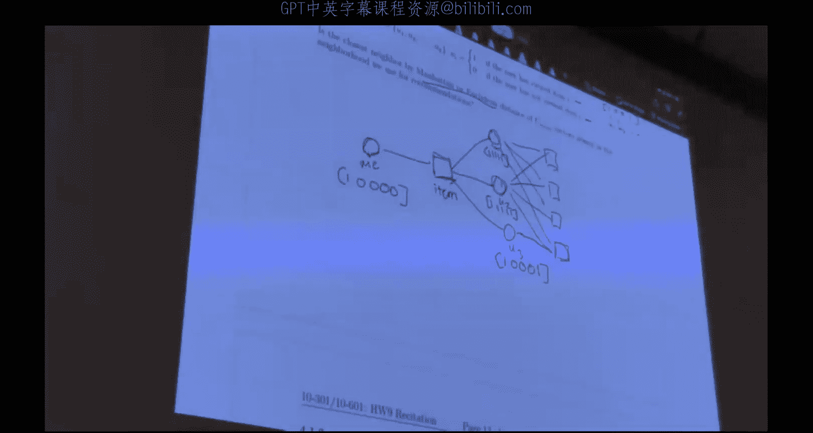
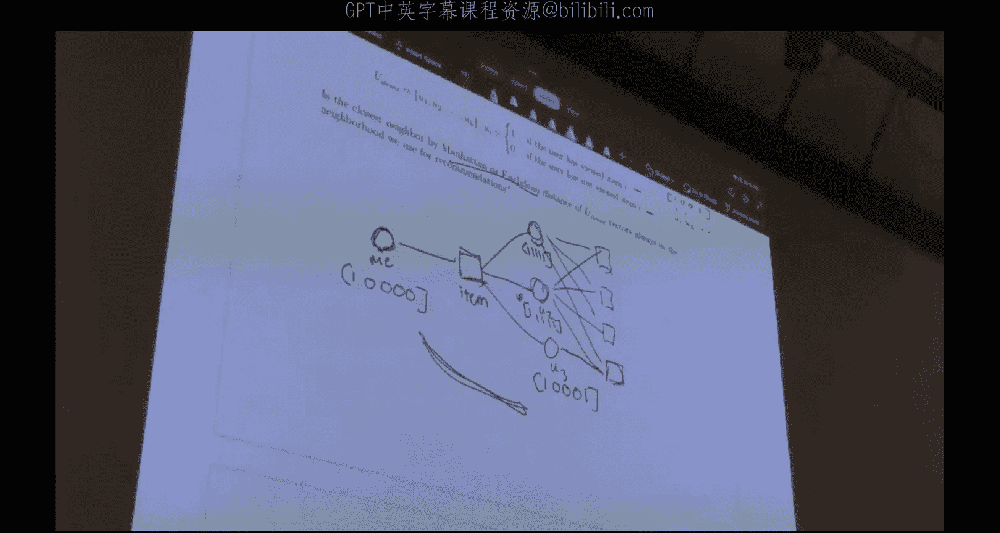

# CMU《机器学习导论｜Fall 2023 10-301⧸601 Introduction to Machine Learning》中英字幕（deepseek p47 Recitation_HW9.zh_en -BV1Z2cUefE4A_p47-

All right good morning everyone welcome to recitation for homework nine today what we'll be doing is we'll be going over some of the concepts that you guys saw in lecture this week and last week and this will hopefully help you get started on homework  nine which is going to be released sometime later today okay。

😊，Let's go ahead get started。So。All right okay there we go homework anation is on learning paradigms for a section being principal component analysis so recall that principal component analysis aims to project data into a lower dimension while preserving as much information as possible that's sort of like the guiding idea behind principal component analysis right so how do we do this so we do this by first finding an orthogonal basis which is a new coordinate system of the data and then pruning the less important dimensions such that the Iranian dimensions minimize the squared error and reconstructing the original data。

😊，So in low dimensions such as the one that's such as the one that's illustrated here。

 we really have two dimensions finding that principal components can be done visually。

 we can just sort of take a look at the。Directions in which we're maximizing the variance of the data。

 but in higher dimensions， we need to approach the problem mathematically because it becomes difficult to visualize in higher dimensions like three。

 four or even higher。😊，We find orthogonal unit vectors U1 to UM such that the reconstructioncon error given here is minimized where x I is this formula here。

😊，Which represents the constructed vectors。得好。If we have M new vectorctors and d original vectors with m equals D。

 then we can reconstruct the original data exactly with zero error。

 but if m is less than d or in other words we're projecting it to a lower dimension。

 it's usually not possible to reconstruct the original data without losing some type of error In other words。

 all the reconstruction error comes from these M minus D missing components that we lose out on this error can be expressed in terms of the covariance matrix of the original data and is minimized when the principal component vectorctors are the top M eigenvectors of the covariance matrix in terms of eigenvalues so the higher the eigenvalues for these eigenvectors are the more information they store and the lower the reconstruction error will be does anyone have any questions on the high levelvel approach I believe they should have been covered in lecture so I just want to make sure everyone understands the at high level。

😊，过。All right， so for the following questions， we also give you a collab notebook that you can click the link on in the handout to go to you don't need to run the collab notebook。

 but it's sort of like a good visualization of what we're going to be doing here okay。All right。

 so let's assume that we perform PCA on the data set that's given below and we will paint the following principal components。

 which also correspond to the following eigenvalues， so 3。265 corresponds to principal component 1，0。

99 corresponds to principal component 2 and Sona。All right， so first question。

 why are there only four principal components so does anyone have any idea why there might be only four principal components as opposed opposed as to maybe five。

 six7， eight？😊，Yeah， yeah， exactly， we only have four feet。呃。Yeah。

 so notice that we only have four features in our data to begin with。

 so's not we can't by definition have more than four principal components because we can't project something up by definition of PCA。

 we can only project it down to some subspace of that contains lower number of dimensions on our regional data set。

 right？嗯。是。Right question two how much of the variance in the data is preserved by the first two principal components does anyone have an idea of how we should start this question？

😊，As a hint， it has to do with the corresponding ionigenvalue with each principal component that we give you here。

这个。Could you expand a little bit on that？So maybe with respect to this question。

 so how much variance of the data is reserved by the first two principal components。

 so could you expand more on what you mean by proportion？

I the eigenvalues the first two eenvalue proportion that yeah exactly that's exactly right so what we can do is what we can compute this as a formula as the first the eigenvalues of the first two principal components 3。

265 plus 0。999 over the sum of all the eigenvalues right and this will represent roughly the proportion of the variance that's captured by the first two principal components equal so this is going to be 3。

265。😊，Plus 0。999 plus 0。043 plus 0。014。And this is going to be roughly equal to 4。264。Over。4。321。

Which is going to be roughly equal to 0。987 or 98。7% of the variance in the original data set。

Does anyone have any questions asked how we did this？But by the。拜拜。对对。いや。Yeah。

 so basically what the eigenvalues here represent is the sort of relative proportion of the variance that each one of those so each eigenvalue corresponds to a different eigenvector or principal component right so the eigenvalue we can sort of interpret as a relative proportion of the amount of variance that's being captured by that specific eigenvector and we're going to scale it by all the total amount of variance for all of our principal components So how that manifests here is that we're going to be adding together the variance that's captured by the first two principal components So that's going to be 3。

265 and 0。999 and then we're going to scale that by the we're going to scale that by the total amount of variance that all four principal components capture。

 which is just the sum of the vector here， Does that make sense。对。

That's just sort of by definition with how we're calculating the principal components， I believe。

The details were also covered in lecture， so you can go ahead and refer back to that。

 but it's basically a linear algebra trick with regards to I decomposition。😊。

Does anyone else oh sorry， does that answer your question Okay， cool。

 does anyone else have any questions？Yeah， okay， cool so let's move on number three same thing how much of the variance in the data is preserved by the first and third principle components So how would we go about doing this portion of the question right so we know that we want to scale it by the total amount of。

😊，Okay。Hello。So we know that we still want to scale by the total amount of variance that is captured by the eigenvector which is just a sum of all the eigenvalues。

 but now we want to capture the we compute the variance in the data preserved by the first and third principal components。

 so which eigenvalues here would we be summing together。😊，Yeah， exactly。3。

625 plus what was it like 0。 yeah， 0。043 right and numerically that works out to be 0。766。Or 76。6。

Percent of the variance in the。In the data set right and intuitively if we look at this this definitely makes sense right the first two principal components will preserve more variance than the first and third principal component right because the principal components and the eigenvalues themselves are ordered in the amount of variances that each one of them captures right and's it's ordered in descending order。

😊，はい。All right， let's move on， so step four， perform a dimensionality reduction on the point such that we project them onto the first two principal components。

 then inverse， transform it back to four dimensions。😊。

because we do not have a lot of space for this one do we okay so in the interest of time and because I don't think I don't want to belaor the point you guys know how to do linear algebra recall that the general algorithm for computing the PCA data and then reconstructing a data is to multiply the matrix。

That this data set represents by the principal components of interest in this case。

 it would just be the first two principal components， right？

That is how we project our that's how we project our original data set down to a lower dimensional space and if we would like to project it back up we would just multiply it with the we would multi take that product。

 the projected data set and multiply that with the principal components once again to project it back to the same space right and that's also captured by this formula here right so if you represents the principal components where this component is where we're projecting it down and this component represents when we're projecting it back okay。

😊，So。I believe you guys walked through an example in lecture and I also once again want to be conscious of your guys's time。

 so I would just go ahead and give you the answer for this section when we multiply the principal components with the original data we get。

Something that looks like this。Negative 00。36， negative 1。1。Okay。801。1， there we go。I negative 1。6。

唔请你啊。😔，哦。45 negative 0。4， negative 1。1 of 1。06。系。And so this is our projected data set right and again。

 once again， we want to inverse transform it back to four dimensions so all we need to do is multiply this by the principal components once again and what that gives us is。

See， I think I should have enough space to write this out so negative 0。36 negative 6。5 oh sorry 0。

5 ahead。Negative 0。06， and negative 0。1。Yep。71，1，6。你这は社不。我可你啲。唔唔可以发光啊。😔，Not。嗯太 cool。0。64 and 0。83。82。

362。0。😔，最系你这问这个啥。来，这后你终于有我。全本 want作明しました。And this is just what we get when we multiply the projected it set here with the principal comment once again。

ep。挺好把别婚这的全都是。Al like cloud you transpo that and we multi highlight that by like the two column vectors x1X2。

Okay， quick correction。 So where so you represents the principal componentss not the original data set right。

 so in this specific exam， we be transposing the。Andspoing the principal components， right。

 but recall call that this formula is for one data point， right。

 we need to do this for all the data points。 So this is just sort of a specific formula that you can use to compute each one of the rows one by one。

 but in a more generalized form what you can just do is you can just basically take the。

Like for example， this data set is6 by4 right and you can and the principal component matrix is 4 by2 right and so you can just do basic matrix manipulation in order to get it to match the dimensions you want and then benchs we want in this case is going to be6 by2 because there's six data points and two dimensions that we want to be mapping to right the formula we give you are just sort of like a means is that it's like a little more mathematically rigorous and you can sort of trace each one of the row computations but and I believe this is also in the coab notebook in reality you could just do something like data at PCS where data is just data matrix and PCS represents the principal component matrix here。

😊，是错了。は。Same principles you can just manipulate the。

You can just manipulate the principal component matrix。So in this case。

 I think we just transpose it because it's 4 by two right。

 so 6 by2 multipied by 2 by4 goes to a 6 by4 matrix， which is our original data set。😊。

I think that's the way that colog notebook does it at least。好。But。Well we want okay。

 so let's dive back we want a 6 by4 data set right like the reconstructionconstructed data and right now we're working our this here。

 this in our subspace is6 by two， right？And our principal component matrix is four by2， yeah。

So you could just like you could just do。Projected。Like PCS transpose or something。

 I think I think that's the way the Coab notebook does it。Yeah， I think yeah。

 I would worry a little bit less about dimension hacking because we're not going to ask you to program this。

 but more someone like the over ideaa where you multiply the data with the principal components to project down and the project up。

 you multiply with the principal components once again， okay。😊。

So also does that answer your original question？Yeah佢佢设啊设置如果个废例我管。just possibility。Yeah。

 because if we were to multiply by all four principal components。

 we wouldn't really be like we're not that's not really dimensionality reduction right。

 we would still end up with a6 by4 matrix。😊，Yeah the whole point of dimensionality reduction algorithms like PCA is to reduce the number of features that data that we're working within our data set so in this case suppose in this scenario that we have four features here and apparently that's too many and we want to reduce that so instead of six by4 we want6 by three or6 by2 so in those cases we would multiply by three principal components or two principal components or maybe even one。

😊，Does that make sense？Okay， Perf， does anyone else have any questions？All right， awesome。

 let's keep going。Right， okay， so what is the reconstruction error for the sample。

 And we can reference the reconstruction error formula that we give you here。 Once again。

 I'm not going walk through the specifics because you guys know how to do algebra。

 And I do want to try to get you guys out on time。 So basically。

 what we can just do is we can just sort of compute the the square differences between the。

Reconstructed data set here and the original，ll take the average of that and then just of them all together。

😊，And so what that ends up being is it's 0。5 or something， yeah。嗯。0。54 or2。😔，Yeah。

 and that's pretty good right on average our differences is only going to be 0。

5 away from the original data set， so we're not losing all that much very or we're not losing all that much information from original here。

😊， so for number five， perform a dimensionality reductions such that we project the points onto the first and third principal components then inverse transform it back to four dimensions and what is the reconstruction error of this new data set and we have even less space。

 but that's okay， we're going to make it work。😊，Okay， so。

Let's see first and third principle components okay， so can somebody sort of explain to me。

 let's say I don't really know how to do dimensionality reduction can someone explain to me how we're going to project it the points onto the first and third principle components like let's just assume I just forgot everything what we did in the previous question could someone explain this to me please。

😊，错吧。Yeah， so you basically form the matrix of everything in the first cable。

 and then you form a new fixed which of the first column the the first and third column in the second table。

 you multiply those two in order to reduce it to the first and third one just。

 So one of them is going to be 6 by4， the other one's going to get 4 by2 of be6 by2。 Then after that。

 you multiply once again。 But this time by a transpose the like the4 by2 is going be 2 by4。

 So then you have a 6 by2 becomes a2 by4。You since。

that's exactly right yeah so once again just in in a little more simple terms。

 all we need to do is multiply the original data set by the matrix form by the first and principal components to project it down and to project it backdo we just multiply it again by those principal components okay。

😊，All right， so once again， I am just going to give you the numbers， but it ends up being 0。

52 and I get 0。17。my one。你想关咗 a。O their point。嗯。This is the projected。Mattrix and then reconstructed。

Is this going to be。你个四切弯。😔，And are equal3 two。你哋烧办神。😔，这么大。唔该食食啦。😔，嗯。54， okay。

Okay that's a lot and finally compute the reconstruction error of the fourth row in particular is it lower we using the first and second principle opponent or using the first and third why might this be the case Okay so once again we can just do this thing in the exact same way that we did it before。

😊，So we want to consider the reconstruction area of the fourth row in particular。

 so what this is going to look like。😊，For。The first and second second P。

This is going to look something like， okay， so 0。92。啊。-1。1 squared。Plus 1。31 minus1。1 squared plus 0。

31。Plus 0。64 squared plus 1。19 minus0。83 squared。oex on乜嘢。Wite this portion here。0。31 minus 0。

64 squares right and so we're just following the same equation for reconstruction error here that we gave you above。

 which is just the difference between the specific values at the each feature in the fourth row and we're just going to be scoring that okay。

And so this is going to end up being 0。28。I'm not going to do this again because you guys already know the formula for the first and third so I'll just give it to you the error for the first and third is just going to be easier to 017。

😊，But let's stop and like think about this carefully。

 we have already stated that the first and second principle components should capture more variance in the original data set than the first and third。

 so by that we should expect the reconstruction error of the first and second principal components to be on average lower than the reconstruction error for the first and third but here we see the opposite case can anyone think of why this might be the case。

😊，Okay that's fine this is tricky so basically recall that because PCA minimizes the mean reconstruction error that means it's going to be minimizing the reconstruction error over all the data points。

 but here all we're doing is reconing the or sorry we're cculating the reconstruction error for a specific data point the fourth data point here right so in this case the specific error for this fourth data point might not necessarily for the first two principal components be lower than the error for the first and third but on average the first and second principal components that we use to project it for the original data set on average that error is going to be lower than the first and third the key point is here is average versus specifically the fourth point okay。

😊，So。It seeks to minimize。Average。Reconstruction error。Yeah over all rows。So we may。Have。Oh。Okay。

 does anyone have any questions on the process behind this， yeah？Oh， that is just。1。

1 remember that we are calculating it for the fourth data point here so this is the reconstructionconstructed data set for the first and second principle component process and we're subtracting that by the corresponding points in the original data matrix so with respect to original question this is 0。

92。This is 1。1 and we just do that element wise， and then we square them and add them all together。

Did you have your head up？Oh okay， sorry， does that answer your question， by the way？Perth， yeah。关。

今天。Yes， well technically here's a matrix， but yeah yeah。Yeah。

 I would highly recommend going into the Coab notebook that we guys link here because I personally for me。

 it made a lot more sense the first time around when I was going through this。Yeah。

 any other questions？😊，All right， let's keep going then， all right， let's move on to section two。

 K means。😊，Okay， so clustering is an example of unsupervisized machine learning algorithm because it serves to partition on labelbeled data。

 there are many different types of clustering algorithms。

 but the one that is used most frequently and is introduced in classes K means so in K meansan we aim to minimize this objective function here where it actually represents the data points and see what the cluster under K。

😊，So and we give you the Ka means algorithm below here for reference right hopefully this is all to you guys that have seen this in class so let's。

😊。

Does anyone know the basket？Okay， but yeah， so since you guys have already seen the algorithm class。

 we'll just focus on walking through an application of this in practice okay， thanks。😊。

Allright， so let's go ahead and walk through an example of k means with k equals 3 using the following data set for the first iteration right K equals3 just being the number of clusters。

 so let the cluster centers be initialized to see equal the first cluster center equals02， second1。

52 and third one equals 61 as depicted below in orange。😊，Right， so we have cluster one。

 cluster two and cluster three。一。All right， let's perform one iteration of a can means algorithm and we want to and we're breaking this up for you。

 So what first， what are the cluster assignments So you can compute this on your own and you can also sort of eyeball it。

 But the general idea is that we're going to be assigning the clusters based on the distance from the cluster center right So once again。

 for example， let's take a look this cluster center that's cluster one right So all the points data points that are going to belong So that cluster are the ones that have the that are the closest based on this objective function here right and that's just going to be the。

😊，Euclidean distance squared， yeah。Right， so if we run through that。

 what we're going to find is that the cluster assignments for cluster one are going to be。Zero。

 negative one，1。嗯。0ero， one， zero two。小妇。😔，2，6。Right and these points here that are in the in this set that just represents the data set or the data points。

In the graph here， that correspond to that particular cluster center， okay？嗯。Cool。

 does I anyone have any questions on like sort of like the intuition behind this first and or this first part of the problem that we just did？

RightOkay， good， because we're going to do the exact same thing for the second and third clusters。

It's just we're just going to find the proportion of data points that are closest to those centers right。

 so for the second center it was going to be three，4，3，5 and  five，2。

And for the third is going to be5，0。6，1，6 negative one。1 get chicken三 million three。Co right。

 it's just the same thing that we're doing for each one of the different cluster centers， okay？

All right now what are the recomputed cluster centers right so recall that in K means algorithm we're going to need to recompute these cluster centers after each iteration so what we're going to do here is we're just going to in order to recompute the cluster centers we're just going to take the mean of each one of the we're going to take the mean of all the points in each cluster right so for this first one what that's going to look like。

😊，See how do we notate it in the oh we don't make difference， Okay。

 so let's just say like C prime one， the new center for one is just going to be 0。5。And 2。33。

RightAnd we get these numbers just by taking the average of all the x components on the first cluster so0 negative 10022 taking the average of that and then we're going to do that for the y component as well and that what ends but that ends up being is 0。

5 and 2。33 does that make sense to everyone Does anyone have any questions on that。😊，also。

 because all we need to do once again is just do that for all three of the cluster centers right and we're going to end up with the new centers being 3。

67 and 3。67 for the second one。😊，And 6。2 and negative one for the third。够。All right。

Now let's draw the O this was a mistake that was not caught before。

 but the third question draw the cluster assignments after the first iteration on the graph below。

 okay so this is basically I think we already I guess we already give it to you but basically we have these cluster assignments here right and so basically what this question three here is just circling the associated points with each cluster so it's just for cluster one for example here we're just circling all the points that we said would belong there。

😊，And we do that for each one of the clusters。Does anyone have any questions on how we drew these boundaries？

If it will clustered like。If不说 pass okay。TheFirst。Here。Yeah， sorry， I guess it's kind of hard to see。

 but these are orange。And everything else is blue。那好啊。There any other questions？All right， awesome。

 so let's go ahead and。Wrap up with the final section in ks so let's think about the importance of initialization in the Ka means algorithm so given the points in the graph below and let's assume we again once we once again have k equals three cluster centers number one give an example of a set of initialization points such just the kine algorithm will converge to a global minimum in other words we're going to find an optimal solution right。

😊，So for this one， all we can just at observe that because there are three super well defined cluster centers here。

 any set of initialization points that lies in。All three of these cluster centers will give us that global minimum right because the whole point of the K means algorithm is we want to minimize the distances of the clusters to the or minimize the distances of each one of the data points and their associated cluster center we want to be minimizing that total distance right and so graphically what that'll look like is just we have three cluster centers here and we just want to pick a point that lies in each one of these clusters okay。

😊，So you can explain it。Any other points？That lie in。Different。Weussterters。はい。But for number two。

 let's about let's think about an example of a set of initialization points that would such that the Ka meanss algorithm would converge to a local minimum instead of the global minimum right so based on what I just said。

 can you guys think of like an example of a set of points that would give us a local minimum instead of a global minimum。

😊，不。Yeah， exactly anything where we don't have like these like really good separation between the three clusters so that could be like。

One in like upper left corner。And then two in bottom right。

So that would look like we have like one here and then two here， right， or like you said。

 which is a good point， we could also just have like three of them in this cluster here and that would also converge to a local minimum not local minimum。

 right？😊，Does anyone have any questions on the initialization portion。

 this is a definitely important concept to understand and came in。

 so I want to make sure you guys understand that。Yeah。我是。嗯，还是个。系い我哋可。没。对然时。这是80。What。scared的。

Let's start to another。我 the话。对。我的辩 was。不行。高 whats around。Yeah。这个有在。I mean。

 I suppose mathematically you could try to go about it using the specific data points that are in your data set。

 but I think it's enough for the purposes of this class to understand that with initialization what's basically going to happen like for example。

 if like we have to if we actually go on。Like if we have。

Two cluster centers here and then like one over here or something like that right so what's going to end up happening is that the cluster Simons are going to look something like this。

Just because that's just sort of how the Cans algorithm sort of generally works because we're just trying to classify each one of the data points to the closest cluster center。

But don't you keep on mind itating not automatic， keep updating the topic。Yes。

 but you can only iterate and update those based on the current values in that assignment。

So this initial assignment， the new cluster center is going to look like this。

 this and like this or something like that， but then it's not going to move very much。我是。Approve。O。

我把。It for some7 examples。I think what I just said is probably enough were that even though we're recomputing the cluster centers in a case like especially in a concrete case like this。

 the cluster centers can only move so much because their computer has an average of the current points in that assignment which is what we walked through earlier does that make sense does anyone have any other questions on initialization otherwise I will go ahead and hand it off？

What means， all right， I will go ahead and hand it off for ensemble methods。that's okay， all right。

So today we'll be talking about ensemble methods， the idea of ensemble methods is to build a model for prediction by combining the strengths of a group of simpler models we'll cover two examples of ensemble methods。

 random forests and add boost。So about random forests。

 so what are some downsides of decision trees and how can we explain this in the context of the bias where in straight off？

Does anyone have any ideas？What are some downsides of having just decision trees？

Or like a single decision tree。 And how can that。Affect the bias， the variance and that tradeoff is。

这是别的。Yeah， so essentially decision trees are learned just a second。Allright。They learned。Greedily。

 the first time we learn them， we simply essentially just take our parameters and base off on the features we split it and it can easily overfi。

If the depth isn't controlled。Since you might just end up like making this entry on all the parameters around the features。

 and this will end up causing what you had suggested low bias and a very high variance。All right。

 I hope that makes sense。啊。What is sample bagging since now we say that random forest is essentially sample bagging plus split feature randomization。

 so what is sample bagging？Any ideas？What would sample bagging mean in the context of random forests？

嗯哼。😊，Essentially， essentially some sort of like what you're suggesting so bagging stands for。

Pgging stands for Boottap Aggregating。Poo strap and cricketing。 let me just write the down。😔。

So bootsottrap data set is essentially the same number of rows as the urgent data set。

But its rows are drawn now from the urgent data set with replacement models are trained。

On each individual data set， but since the training data sets are not similar to each other。

 the learned models are now tend to be different and more variable。

Aggregating models to the model aggregating refers to the model predictions being combined to form the final predictions at the end。

 so basically you want to have like different models working on different types of data different data sets。

 different subsets of the original data which allows us to ensure that like the models have different high variances between not essentially high variance but they have higher bias and essentially lower variance when you aggregate all the results。

We will not talk about the random success method since that was not discussed in the class。

 whereas we now rather talk about split feature randomization does anyone have any idea what split feature randomization refers to。

So split feature randomization is the other part of creating random forests where essentially instead of always picking the best feature。

 the algorithm randomly selects。😊，Randomly。Select。A subset of features and then picks the best feature from that subset so at each step of theeration keep on picking a different feature which is called a split feature randomization so each time you split you would pick a different feature randomly and that allow us to have a much more variable data set rather than trying to overfit on a specific method so randomly split features。

Let。So how do these techniques affect the bias and variance of an individual tree？Any ideas？是嗯。

Increases the bias and decreases the variance。Yeah。

 that is correct that is correct so essentially for an individual tree itll。😊。

Increase the bias and decrease the variance and why so that's because it it limits the information available to train on compared to a decision tree train on the full origin data set。

 whereas you now have a smaller data set so the variance itself is lower how so about limiting。

The data张。😔，😔，快点。And how do these techniques affect the bias and variant of an ensemble of trees or something like a random forest？

Any ideas？Yeah， so essentially the increase in bias， however， carries over from the individual trees。

 the ensemble also has lower variances because we are aggregating predictions over a set of trees that are not fully correlated。

So to think about it this way， I'll write the down it's easier。

 so it still has increase in bias and lower variance。

And why says the ensemble essentially aggregates all our smaller trees。

 so it has a lower variance because we are now aggregating， we are now anchorgregating。I think。

Prelictions。Over a set of trees。Which are not fully correlated。

That allows us to lower our variance if that makes sense。Yeah。

 so both techniques are designed to essentially make the trees less correlated to each other and as reducing covariance between the trees reduces variance of the average over the trees。

😊，So。If there is less space available， however。I could do the math for you。Just a second。So。

 all right。Essentially， I'll try to do a little bit of math over here so it makes sense as to what。

You're talking about over here， so consider two random variables x1 and x2 each with a variance of sigma square the variance of their average right the variance of their average is given as the variance of the average will just be half of x1 plus half of x2。

Which is， again， equal to variance of x 1 by 2 plus the variance of。X2 by 2 and there's another term。

 can I even tell me what the other term is third term over here when we break down the variance？Yeah。

 it's the covariance， so then we just have two times the covariance of x1 by2 and x2 by 2。

So this again， if you break it down further， if you remember like if you take out variance of ax。

 that's just a square variance of x， so this this then ends up becoming variance of x1 by  four plus variance of。

X2 by 4。And then you same with the covariance so covariance will just simply come out so it just becomes ends up become1 by2 covariance x1 x2 now if you just end up putting the since we know that the variances of x1 and x are both sigma squared。

 so this would then end up looking something like this。

 so we'll have sigma squared by4 plus sigma squared by4。Plus half sigma squared covariance， x1， x2。

Divided by the sigma term sigma or like sigma square essentially。This would， I mean。

The interest of space， I'm going to write the final answer where essentially they're just in the beginning Sigma square。

1 by two。One plus， sorry。😔，1 plus row。And。With as the covariance， so rh is the correlation。

Between x1 and x2。So if rh equals1， that's for fully correlated trees and。

Then we achieve no variance predict but no variance reduction。

 the average has a variance of sigma square in general reducing row makes the trees less correlated and then reduces our variance inherently。

So。These techniques do not fully cover generally are not extreme enough to generate anti correlatedrelated trees where tree predictions would generally oppose each other。

 however the more anticord predictions are the closer our model gets to always predicting zero。

 which does reduce variance， but at the cost of performance and correctness。嗯。

Now let's look at this so for each data point X we now define t minus I to be the set of decision trees that X was not used to train again was not used to train so。

Use each tree in T t minus I to make a prediction for X I and then we'll use these predictions to make an aggregated prediction T of a minus I X I that is the classification takes the majority vote and then we can define the out of back error as essentially one by n summation of whenever the。

3 predicts does not predict the correct label and the whole idea of using this is that the out of bag error would essentially mean that you are trying to predict predict it on the data points which it was not trained on。

Does that make sense？Because that's what we would want out of bagar to be rather than simply testing it on the points it was trained on。

So。Why can't we use EOB for hyperparameter optimization。

 even though it was calculated using training points we used to learn the decision trees with？

Any ideas？I just gave the answer away when I told the definition of OOB。

So while every point was used to train a certain set of decision trees。

 the calculation for EOB takes advantage of the fact that the nature of Botrarap data sets means that there will generally be a reasonably large population that does not contain that particular point。

Because remember how I said that like the EobB technically defines like those data points which it was not used to get trained on。

Therefore， for the decision trees that were trained on the data set。

 the turning point is equivalentval to a simple test point as a tree has never seen it before。

 since each tree strain independently， there will never be a scenario in which a tree is both trained on a data point and is also validd on it。

😊，TheE O OB， I guess in a single line， we can see that inss。That。No。3 is。Drad。And。Dested。On the same。

Data point。Directly by the definition of how we are calculating EOB and how we are training our trees in ensemble。

So now let's do an example， this would I guess end up making a lot more sense somebody just simply theoretically talking about it so suppose we train a random forest with two decision trees again generally you would have a lot more decision trees but for now for our math example we can just use two on the following data set over here。

😊，Using the provided boost of examples， assume that for ties we predict y equals1。😊，Yes是。All right。

 so now this is the data set we have the data points over here， one， two， three。

 four and five over here and then。You have the points and then the label。

So we have a sample one over here which contains points one4 and5 and we have sample two which contains points34 and5 suppose we train our first tree on sample one。

 so essentially we are training it only on points only on data points14 and5 and the split feature randomization chooses x1。

R x2。For the feature candidates at the root， what feature will we split on at the root， any ideas？

Any ideas？It should be try looking at the data points， or the values in these Xon and X2。

 and what information are they giving us？Which feature would you want to choose between these two because again it says you're splitting on sample1。

 so we use this sample and x1 and x2， so these two data points。Yeah， exactly， and why would that be？

😊，Basically， yeah， since x2 is just all zeros， so x2 does not。Does not help。With。Fraing。

So we'll choose x1。修身。All right， now suppose we then recur on the left child with the feature value of zero。

 so essentially it will look like something like this so you chose x1 with either a zero or one and then based on those like you would then end up choosing like what your next。

Prection is going be so you have this you have this Ro either the 0 or1 and now let's say that we recur on the left child with a feature value of0 over here of the root and split feature randomization now chooses x0 or x2 for the feature indices so what feature would we then split on。

If you are now using x0 and x2。Exactly， again， similar reason that x0 is chosen because x2 does not end up telling us anything。

Allright。Makes sense。X1 and x2。Okay， so if you had a predict between x0 and x1。

 it would simply then just like see which feature is like the sample matching with and if even if they're equal into the simply randomly predict。

Either one of those。not exactly。 So the whole idea is that like if you have like a simple。

Aggregation method like if you like a split feature randomization over here essentially refers to the technique which we use in decision tree based algorithms such as random forest。

 however like in a decision tree at each node the algorithm must decide which feature to use for splitting the data into the subsets right and then traditional decision trees choose the best feature at each node based on some criterion such as like the G impurity or like mutual information or information gain however plate feature randomization introduces an element of randomness into the feature selection process and instead of always choosing the best feature the algorithm randomly selects a subset of features and then picks the best feature from that subset and again if it cannot then just split the random one。

😊，Yes。Yeah， yeah， yeah。Essential， essentially the。Yeah， you can again。

 it depends on like what metric is given to you in the problem， but if not you can assume it's cross。

 you can always ask for further clarifyarification。Yeah。

 but over over here because the problem essentially doesn't ask you to use a metric currently。

 you don't need to use a metric， but yeah。😊，So now suppose we train our secondary on sample two。

And the split feature randomization chooses x2 and x3 for the feature candidates at the root so what feature will we split on this time we are now using sample two so let me just you know clear this out。

😊，We are using sample2 over here and we are using x2 and x3 right here。The issue two。So again。

 what feature would you predict on， I hope this should be pretty clear based in the past two examples。

Exactly， yeah， because again x2 does not help us with anything， so x3 is chosen。

 I hope that makes sense。So now what is the training error of the ensemble so to calculate that we should first find out what the trees give out as their outputs and then based on that what do we choose so let's calculate that over here。

Essentially。Let's say we have31， we have 32， and we have the training error。Okay。

 or not just training error， we can say we have the。Ensemble prediction， I'm sorry。

I just call it as EP， which is the ensemble prediction。

So what would 31 give us for data sets for each data essentially at this point， so for 0。1 so for 。

1 we have this with 100 and 0。1 was trained so 31 predicts 1 for 。

1 all right if that is visible over here so 31 will give us a1 and32 since it was not trained on it it will simply end up giving us 0。

Okay， so it'll give us a zero and then。Since we have like a tie。

 so for ties we predicted y is equaling one。That's like the basic vanilla question so itll predict as one so then for 0。

2 since for。2 you can see that none of the trees will train on it。

 so both the trees will then simply predict zero and the prediction is going to be zero。Next for 0。3。

 we see that。in3 was trade for sample 2 but not for sample one， so sample1，31 will present predict 0。

 but32 will predict 1 again， for ties， we take it as one。嗯。Then for sample。

4 sample both of them got okay so four and five are a little tricky because essentially over here both of them got trained on both the trees so we cannot end up using them because if you think about it the whole idea was like you choose those points to which are not being trained on but over here since it was like that essentially。

34 and 35 so 34。4 right we okay for simple training error we can see that for34 for data。

431 will predict as 0 and32 also pixel is 0 so that gives us a prediction as 0 and then for。34。5。

 we see that31 predicts a1 and 32 also predicts a one giving us a prediction of1 okay。

Now if we compare our predictions with the labels that were given to us one and one match0 and one do not match。

 so we have one over here， one and one match0 and zero match one and one match。

 so our training error essentially just ends up becoming one out of five。ok。

So now what is the out of back error of the ensemble， so for the out of back error。

 let's again calculate that over here。Yeah now we'll just remove this column because we now want the out of back error。

 so the out of back error essentially now requires you to。Sorry， give me just a second。嗯。Yeah。

 so for now out of back error， so for 0。1 so for 。1 only32 will ever be involved because 31 was trained on 0。

1 so we wouldn't use it to predict so simply we just look at what332 predicted since32 predicted as0 so the prediction is going to be a 0。

All right， then for point2， we see that neither of them were。Train on。

2 so both of the trees can now be used and we see the predictions is 00 from both of the trees so the out of the prediction will be a 0 for 0。

3 we see that 03 was trained by sample 2 so we'll only use 31。To give us a prediction for 0。

3 and that lender is becoming 0 so we'll get 0 for 0。

4 and 5 so this is what I was saying I guess it told a bit earlier but this is where it gets a little interesting because both points4 and 5 were trained on sample1 and sample 2 so like both the trees were trained on 。

4 and5 so essentially we cannot use both the trees so we are as testing on like an empty subset but again it's going to be a tie essentially so and we still know that for ties we predict y as being1 so we just take it as being one。

Allright now out of this out of bag results let's see how our prediction looks like based on the correct labelings。

 so 00 do not match 01 do not match01 do not match01 do not match0001 again does not match10 again does not match and only one one matches so we see that our out of back error essentially is for out of five so the model is overfit the data by a lot that is what we can see over here。

I hope this made sense and now I'll pass it on over for Addda boostt。All right。

 in the interest of time， we're going to go a little bit quickly on the Edbu section。

 so if you have any questions feel free to hop by here at the end。So， the。

First thing we're going to talk about with Add a boost is the two different weighting schemes that are involved。

So as you may recall from the algorithm， we both have weights on the individual。

Week learners in the ensemble as well as weights on the points。

And these two schemes serve kind of very different purposes。

 so we're going to go over the motivation for each one by looking at。

Some specific examples of what might happen。For the waiting scheme on the weak learners。

 we define our weights according to this formula right here， so at time T we train a classifier HT。嗯。

Okay。At time T， we train a class for our HT， we compute its error， which is this epsilon T。

And then we define the weight alpha T that gets associated with H and the ensemble。

 so you'll see something like the overall decision function。

It's produced using a sum over all those like alpha T，HTx terms。

Now in order to compute these weights。We specifically plug in the error value as a function to this because the kind of the goodness of that individual weak learner is determined by that error value at the given time。

So the idea is that if a weak learner is better at predicting that current training distribution。

 then we're going to put more emphasis on it in the final predictor。

 but what happens if a weak learner is really really bad so we're in a binary classification setting but our weak learner is worse than random it has error epsil T greater than 0。

5。In this case we'll see that our weight scheme has a nice property that lets us kind of automatically handle this。

 you could also intuitively think about this as in the case where you had some training algorithm that created a weak learner with error greater than 0。

5 the natural thing you would do is flip its outputs if you're predicting either plus or minus1 and you're predicting wrong more than 50% of the time flipping your output from plus1 to minus1 to minus1 to plus1 should give you an error of less than 50%。

We'll see that addbu does actually that same thing right here， so if epsilon t is greater than 0。5。

 that means one minus epsilon t is less than 0。5， which means that this ratio term in here。

Is less than one and the log of something that is less than one is negative。

 so it turns out that this component right here is less than  zero。

 which means that we have alpha t less than zero。So the weight is negative。

And this gives us exactly that flip behavior we just discussed。So predictions of HT get flipped。

And then the new error， let's just say， let's call it like epsilon prime is less than 0。5。

So this weight scheme kind of very naturally is handling that behavior and it gives us a bit of intuition on。

What happens in the extreme case of our epsilon T values？

And then you'll note that our worst case now is not， oh， epsilon t equals1。

 because that's equivalent to epsilon t equals zero。Our worst case is epsilon T equals 0。5 exactly。

 because for anything else， we can always find something that is less than 0。5。

And it actually turns out that if we can find epsilon Ts or HTs with epsilon Ts strictly less than 0。

5 at every time step， we can exponentially decrease our train year so that worst case really is that 0。

5 case and you'll note that in that 0。5 case if you plug this into the update you get。Ellen。对。

Ln of 1 minus 0。5 over 0。5。And then this is equal to1 half a zero。

 which is equal to or sorry1 half a 1， which is equal to zero。Because the log of one is zero。So。

What we kind of notice here is that the worst case gives us no weight on our weak learner and the weak learner becomes effectively useless to us。

 but anything that is like extremely bad here is actually not bad because we can just flip those outputs。

So the next weighting scheme we're going to be discussing is the weighting scheme on the points。

The general idea here is that at the beginning of training we put uniform weight on all of our samples。

 but every time we get a sample wrong during training we want to kind of correct that in the next step。

 so this is kind of similar to algorithms like perceptron where every time we get a point wrong。

 we immediately correct our classifier so that it's like kind of updated towards getting that point right。

But this time， instead of immediately changing existing classifier。

 we update our weight distribution so that at the next time step， we get it right。

Or we're more likely to get it right， we put more emphasis on training with that point being incurred。

In this case， our update rule is defined as DTI is proportional to DT minus1 I。

 so the weight on the previous time step times the exponent of negative alpha T Y I H。Txii。

So this is a lot of things。嗯。But the general idea here is that we want to take the prediction we make and assume this is with like the flipped version of the classifier if necessary。

 where Al Ts signs is already incorporated in。And then we take our y value and we multiply these together。

 so if we get the prediction right， then this is plus1 times plus1 or minus1 times minus1 in both cases equals plus1。

If we get the prediction wrong， we get minus times plus or plus times minus。

 which in both case give us a minus。So if we're getting a point correct。

 we're going to get our weight is multiplied by each the negative alpha t and if our point is incorrect。

 we multiplyied by each to the alpha T and if we already assume that we've incorporated the signine of the alpha T into that weight update with the HT。

 then what this tells us is that we are down weighting。

 we're making a relatively smaller weight here for correct point and up for incorrect points。

The proportionality sign here is there just because we need to normalize our distribution so that it sums to one。

And we can easily do that just by summing all the weights when we compute them or by explicitly calculating that normalization factor。

So going on to the next section of this。TheOne of the biggest questions we get when we teach at a boost or anything that involves a term weak learners is why we have to use weak learners like decision stumps or like very simple algorithms instead of maybe stronger models like full versions of classified as you learned before。

 like decision trees or neural networks。This turns out to be actually a desirable property to have weak learners in your algorithm。

And we're going to see that by looking at two bounds on the test area of At boost。

So this is fixing like some number of input samples N fixing some number of training steps T。

 We can actually write down two types of bounds on the weak learners and attributes。

 The first one is our traditional p learnings type bound， where we see a。

Generalization error term here， and we upper bounded by a training error term plus big of something The second bound comes from something called margin analysis。

 which is。I guess like right now' on the scope of this recitation but。

The general idea is that we pick some kind of threshold data and we say as long as this quantity known as the margin is。

Like we take the probability that this quantity notice the margin is less when it go to the and then we also have a bound factoring in that one over data here。

 so the idea is that this is actually a family of bounds parameterized by the value of data and you can write down any of these bounds by picking some value of data and computing this term and then plugging one over data into this。

So without going to too much detail how this works。

 we're going to be focusing on a different component。

 specifically the VC dimension of the hypothesis class。

So intuitively a weak learner is one that's not very expressive。

 so it should probably be one that has a low V dimension and a stronger learner is something that is more expressive or has more ability to kind of classify different things maybe。

 so it'll have a higher V dimension。So the idea here is that if we have a square root D term in both of our bounds。

What happens for our bounds on true error if we increase Vc dimension？Yeah， the bounds go up。

So I'm just going to do this so since the bounds go up。

 that means we're getting looser bounds on our error and our actual generalization might be worse even if our training is better。

And then what concept does this？Kind of represent that you might have seen many times before in this class。

We're having a more complex learner results in higher generalization error。Yeah， it's overfitting。

Okay， and I know that was really quick， but if you have any questions about this。

 feel free to come to us after we need to cover a couple extra things just to make sure you're able to do homework nine。

嗯。So we're going to cover recommender systems quickly and then a new section that you haven't been taught in lecture yet。

 but we'll see on Monday。Okay， cool。Can everyone hear me all right？So yeah。

 let's just really quickly go over recommender systems so in lecture so you first learned that there's like collaborative filtering and content filtering so let's talk about collaborative filtering first。

😊，So collaborative tro recommends items to users based on similar users' preferences meaning that it depends on the ratings to an item from other users so we've covered two types of collaborative filtering methods in lecture so there's neighborhood methods or kind of like plotting everything on a graph and seeing like who you connect to and what items you connect to on the graph and then there's also latent factor methods that try to characterize the user item into some sort of vector and seeing how close they are so yeah neighborhood methods。

They extract neighborhood given the user data and recommend the items offered by this neighborhood to the user so the approach is observe the items the target user has experienced find other users or users who have experienced both of these items and then recommend the set of items not experienced by the target user。

To be a。To the other people so let's assume for each user we can construct this sort of vector。

 so one if the user has viewed item I or zero if the user has not viewed item I so like something like that for like each item。

And then so our first question is， is the closest neighbor by Manhattan or Euclidean this a new item sector always in the neighborhood we use for recommendations？

So I guess we can like draw something out kind of like。But let's say this is me。

 I'm a user and then I viewed like this item。And then let's say some other people have viewed this item。

 so we have like you1。U two and then user three and then let's say there's like a lot of items here。

So let's say U3 has only viewed this one， but then like U1 and U2。mHave viewed like。Everything。

So basically going by like Manhattan or Elian distance because I'm kind of like my matrix would kind of be like this because I've only viewed one thing so far。

 this guy's matrix would be kind of like。That because he's viewed this item and the one on the bottom。

 but then these guyss matrixes。

嗯。They'd be kind of like this。But observe that like we still do want to use these two people to give us recommendations oh。

Okay， I'll go over this super quickly， but yeah， since like。These guys are pretty。

Oh， this pencils not。Okay。These two guys are pretty close to each other。

 but like I'm pretty far from this person， so therefore since we do want to like treat all these people and like get recommendations for them and they're all in our neighborhood so like whether we should use this distance metrics the answer would be no because we don't want to like exclude these people who viewed more items。

嗯。And then yeah， for matrix factorization when doing PCA。

 we often use SVD to find the matrix decomposition， but this question is asking like。

Can we use this SVD to find like the user in item matrix when we're doing collaborative filtering？

So that would be no， just because。R has like sparse R is considered a sparse matrix and we can't really compute SVD with like null values like if we're using like a null value to compute with SVD。

 we wouldn't really know what to put in the row and column for that。嗯。

And then this next question deals with alternating least squares。

 so both you and VR unknowns when we're doing this collaborative filtering。

 but sometimes you can use objective functions so one of them is alternating lease squares so recall that the formula for alternating lease squares it's kind of like this。

So what。Half。The sum for like。Everything that's like notinal and then we have like the rating minus the prediction。

So it looks like this， but we can kind of just view this as like it has similarities because this we can think of like as our y and then this we can kind of think of as like theta transpose x or like x transpo theta and then when you re look at this again then this just turns into like linear regression like。

😊，Like minimizing the。Like the error squared， they're minimizing the mean squared error。嗯。

And then for the block coordinate descent pseudocode。

 one thing that we can so for alLS since this function， once we like fix one of the values。

 it becomes quadratic and like it can be directly solved and it's complex。

 then we don't have to do any sort of like gradient descent stepping。

 we can actually just directly like。Like soul for this argument and then。

While just fixing one of the values。And then this is like because。JUV is。嗯。I was like。Closed form。

Solution， easy to solve。Okay。Okay yeah okay we have another section after this section。

 which is the new content that you'll see on Monday。

 but we'll cover in detail here for the homework it's going to be on the recording so feel free to leave now if you have another class to get you。

Yeah， okay。Okay， let's move on a little bit so with。

Yeah that this will also be if you want to see this I think some of this is also recorded so we can release this too but yeah next part is talking about content based filtering so suppose they' trying to recommend movies to a user we given a feature factor for each movie with content info such as your release genre。

In movies the user has watched so these are things that we kind of like these features we kind of like define ourselves and then we're given labels of whether they liked or did not like the movies so what learning paradigm is best suited for this so some learning paradigms we learning in class include like supervised learning。

Unsupervised。There's also like reinforcement。and got to do there's a lot of different things on the slides。

 but in our case， so supervise it has like you train on like features and labels unsupervised you have like labels only。

And then reinforcement deals with like state。Taking an action and having a reward。嗯。But in this case。

 since we do have like。Oh yeah， oh sorry， this is features only。

Since we do have labels and also all of these are like features。

 then supervise would be the best choice here。And then what's one advantage of content based filtering over collaborative so recall call that content based filtering。

This one you kind of like like label the。Features yourselves。Versus collaborative。This one。

 like when you run the。The the sort of。Learning algorithm， it will kind of like learn。

The user slash item。Features。And kind of put them in this sort of like latent space。

So one advantage of content based filtering is since we're labeling it ourselves。One， you don't need。

Any like。Previous。Users or user ratings to be able to make。嗯。

A prediction because you can just ask a new user like oh or no， you can have a new item and be like。

 oh， this this thing has these sort of features and then automatically just start recommending it to other people。

And two， since we're labeling the features ourselves。

 it's just much more explainable because we know like how each portion like factors into the prediction。

And then one advantage of using collaborative filtering over content based filtering is basically。

In in content based filtering， you have to like hand pickick these features yourself in like。

Like you self have to decide that， but sometimes it's hard to know like which features to actually pick so instead collaborative features they'll kind of learn these like kind of like。

😊，嗯。Not very explainable， but like effective features to use in the prediction so you don't have to like pick them out yourself so one ran is。

😊，嗯。And then this can be like。嗯。More accurate。mSlash like less time。consuming。Okay。

 and then that's it for recommendation systems。And yeah。

 I'm not sure if we have enough time to go over precision。Do it。Yeah。

 so as I mentioned this is going to be on the recording it's kind of a completely new content section that we will talk about in some detail as part of。

 I think Henry's lecture on Monday， but it is not it's not going to be covered in as much detail related to homework things as it is going to be covered now。

So given that we don't want to cut too much into the next recitations time。

I'm just going to wait like two minutes for the official start of that recitation and do that section once and it'll be on this recording so if you want to watch that you can if you need to go now you can watch it。

 then otherwise you can feel free to stick around for the beginning of the next recitation。

So since we have a couple of extra minutes， if there are any questions on the section that I sped through before or just like anything previously。

 feel free to ask them now。This one or this one。Okay， yeah。

 so the idea is that we have this weighting scheme on all the points right。

 and we need to update that weighting scheme in successive iterations so that our next week learner is focused on correcting the errors of the previous ones。

So the intuition is that every time we get a point wrong。

 we make it more important relative to the other points until eventually it's so important that the we learn it we learn has to get it right。

So we want to upgrade it by some amount every time it's wrong and down every time it's right the specific amount is scaled based on how we choose the value of。

Or sorry based on the error of the weak learner because the idea is that it's worse to get a point wrong if the weak learner is otherwise really。

 really good than to get a point wrong if the weak learner is bad anyway。

 because if the weak learner is really bad anyway， then even though it got that point wrong。

 it has a low weight in the final ensemble so it doesn't really contribute to a lot of error on that point but as the weak learner is really really good otherwise so it's alpha is really really high。

 then it's going to be a large component to the final ensemble so the fact that it gets some point wrong is worrying and we should uppoint that point a lot to make sure we correct the error that's kind of introduced by that weak learner into the ensemble。

Does that make sense？Yeah， so we could also just not have a weight here。Sorry。

 I accidently missed that we could also just like not have this weight and then only have this weight and then normalize it turns out that we get some nice properties by having both the downweight and the update up。

 but intuitively， even if we only uped incorrect points and then normalize。

 we would end up with something where the correct points get down weighted just because the normalization in the distribution。

Right， but we do both the up and downweight both because of。

I guess computational elegance and because it gives you some properties。That are appreciated。Okay。

 so now that it's past 11 is's the start time of the second recitation。

 I'm going to cover the precision recall section and then we'll。

 I guess end the zoom or the recording and then recap the previous sections for people who are just coming in now。

So precision and recall are part of a broader family of categories called I guess like no we could call like alternative metrics。

 there are ways of evaluating machine learning models that are beyond accuracy which is what we've been using or error rate which is kind of a counterpart accuracy which we've been using for most of the course so this is notably different from like changing a loss function。

 a loss function is that thing we're trying to optimize to make our model do。

 this is kind of like after we do the optimization of the model we try to evaluate how well our model does on some data and usually we do that by computing some kind of error rate and say oh how many mistakes did it make on the training data。

 how many mistakes that to make on some out of sample validation data。In this case。

 we're going to talk about some alternative metrics， why you might want to use them。

 how they're defined， and in general， and kind of how to construct your own or think about using these metrics。

So to arguably the two most common alternative metrics to accuracy are precision and recall。

 and they can be broadly explained by this diagram。

 which comes straight from the Wikipedia article called precisioncision and recall。

The idea is that in the space of all of my points or' say all of my。Items in my data。

 I can make four categories。First， I can think of items that I've classified as positive。

 so it predicted positives， that's everything inside this circle right here。

So everything inside the circle is what appreciate positive， everything outside of that is negative。

So that's one axis of classification， whether I predicted plus or minus。

The other axis is whether they were actually truly like labeled plus or minus。

 so this category is like things that were truly labeled plus or what we might call relevant items in a retrieval setting。

And this is items that are truly labeled minus。So the idea is I have these two axes where this is like predicted plus or minus and this is。

Actual。Plus or minus。And that gives me these four categories that you see here。

 this true positives category is when I both predict positive and the thing is actually positive。

False positive is when I predict positive， but the actual label is minus。

True negative is when I predict minus and the actual label is minus。

And false negative is when I predict minus， but the actual label is positive。

So the names of these categories are kind of drawing from the fact that you predict either positive or negative and you're either correct or incorrect about that prediction。

Given these concepts， are there any questions on how we define these four categories？

And they also have this written in text on the next page if you have the handout download。Okay。

 so given these， we then define our two metrics。Our first one is called precision and precision is kind of a。

I don't want to use the word accuracy accuracy here， but it's kind of like an accuracy like mentally。

 it's saying that we selected this number of things。

 how many of the things we selected were correct so we chose a set of items and how many of those items were actually positive。

If you look at this pictorially， we take the entire circle of things we chose and then on the numerator we put in the number of true positives so mathematically this gives us。

Actually we'll save that for later， but just visually on。

We're saying out of this circle how many things are actually positive。

 so it's kind of like a almost like an accuracy measure， but only for inside that circle。Then。

Recall is the。Kind of counterparts of this， we're still going to look at how well we did on the true positives。

 but rather than comparing that to how many things are in the circle。

 we're going to compare this to how many things are in this positive category。

 so this is saying that there are this many positive items in the data how many of them did you successfully pick up。

And。This pictorially looks like we take this entire left side， the actual positives。

 and our numerator is still that true positives there。Do those somewhat make sense graphically there？

And just as an exercise， what would my accuracy look like on this graph？Yeah。Yeah。

 so it'd be this true positives area and this true negatives area divided by the kind of entire square。

So you can kind of tell already that precision and recall are almost like a different family of metrics because they're only looking at true positives and not looking at true negatives。

 whereas what we look at if for accuracy also considers true negatives。

So here's like a text description of these。But if you see these in like maybe the output of some machine learning packages or in some other forms。

 you'll often see them represented in this chart format， which is called a confusion matrix。

So in a confusion matrix， you take your data set and you just write down the number or percentage of samples in each of these and TP。

FP， FNTN categories。If you had more than two classes。

 you can make a big chart and just say like predicted classes1，2，34， two classes  one， two，3。

4 and fill out that matrix， but in general this is a great way of understanding what your classifier is doing beyond looking at a single number because it kind of summarizes what errors are made and what types of errors are made。

So given this confusion matrix， if we're looking at a fully mathematical representation， no pictures。

 we can write down the precision and recall formulas in terms of。These four elements。

So can anyone tell me what these formulas are？So it's Star Wars precision。

 how would I write down precision if I had these four values？什么。Yeah that's correct。

 so two positives plus false positives gives us that circle from before and then two positives is that numerator。

How about recall？Yeah。So it's TP over TP plus FN that's a little bit harder to see without looking at the charts。

 but like while looking at the chart， you can kind of just say， oh， actual positives is this column。

 so that's TP plus FN right here。And then just going back to that accuracy discussion。

 what is accuracy？Yeah， two positive plus2 negative over everything in the graph。Or in the chart。

Okay， so then like I said before， the key difference that we were already starting to see again is that we don't care about true negatives。

And this is a really nice property for tasks where we have kind of an asymmetric goal。

 where our goal is not just make the model that solves this task the best for some definition of solve。

 but rather make a model where we're going to use like the positive predictions in some way。

So one example might be say cancer diagnoses where we make a model and we're trying to say catch every instance of possible cancer right then we don't care as much about optimizing anything except for recall。

 we're trying to catch every instance in the data。Um， however， this， I guess we could say。

 is trivially optimizable because if we just label everything positive， then true positives。

Is definitely going to be maximized because we've just caught every true positive by default。

So you'll often see that recall by itself is not a great thing to optimize for。

 because the easiest way to optimize recall is to just select everything。On the other hand。

 we might say that we don't have a lot of money， so if we want to do something like cancer diagnosis and we only have money to investigate a few cases。

 we probably need to focus our money onto things that we have。

Kind of a strong certainty are actually cancer cases。In that case。

 we might use something like precision where we care about maximizing true positives within that set of predicted things。

 but we don't care about like true negatives or anything outside that set of predicted things。

So these metrics are really good， again， for asymmetric tasks where we're not just looking at like positive or negative as just like two labels。

 but we're looking at positive as the thing we want and negative as the thing we don't want。Okay， so。

We're going to define one more concept here just to。

 I guess keep going and that's going to be the idea of a base rate。

So the base rate is also sometimes called a prevalence and is the number or proportion of items in our data that have the true label positive already。

 so if we talked about class imbalance in the past or if we talked about a prior distribution for example。

 a naive base， the base rate is just another way of talking about that prior where we say in our data。

 what proportion of things have this label already。

So can anyone tell me from the confusion matrix how I can write out the base rate？行。F found express。

啊， boss language。Yeah， so。The base rate is actual ones divided by everything。

 and we saw before that when we did the recall that actual ones is TP plus FN。

So the base rates is a useful concept to keep in mind when you're doing pretty much any task。

 but especially when you're working with precision and recall。

 just because it can serve as a comparison point， like I said a lot of time if you're using precision。

 you have this idea of inside my positive class， how well am I doing。

 like what proportion of these are positive？If you think about what a completely random classifier would do。

 then you might think， okay， if I randomly sample some number of points。

 what's my precision there and it turns out that that can just be compared directly to the base rate because the base rate is telling you what proportion of things is。

In that positive class， and if you random a sample。

 you should expect to see about that proportion in your sample。

So it's always good to think about your metrics relative to things like the base rate。

If I am doing a precision task and my precision is 80%。But my base rate is 90%。

 then I would probably be better off not doing ML for this task at all。

Yeah another thing to keep in mind when we're talking about precision recall is the concept of thresholdholding so we talked before about trivially optimizing recall by selecting everything to be positive this gets to the idea that when we're computing precision and recall we're computing them with respect to some definition of the positive class and what we've talked about before is for concepts like the base optimal classifier or having a。

Dshhold value that separates kind of a positive or negative class and a probabilistic classifier。

 and this becomes very important for precision recall because。

With these concepts were basically saying given some definition of predicted positive。

 we're going to computesymmetric， so precision and recall have no meaning if you don't specify some kind of threshold or some kind of way of saying I'm doing precision and recall。

 given that I'm selecting 10% of the data or given themm selecting every sample with over a 。

7 score or something like that。If I change that threshold， I change my precision recall。

Now let's suppose we set that threshold to the like maximum possible value or a minimum possible value。

 perhaps we say the threshold is that anything。Like everything is going to be positive。Then。

What might our precision recall be， what' start with recall， what would our recall be？Okay。

 so I didn't mention this one， but the recall would be one。So if we label everything positive。

 then we've naturally captured all of the actual positives in our data。

And since we don't penalize anything about capturing like false positives when we're doing recall。

 then。It just optimizes that metric towards its highest possible value。Now how about my precision。

 this one's a little bit harder。So given these formulas from before。

 if I classify absolutely everything in my data as positive， what can I say in my position is？唔。

It's not one because if I'm doing precision， I classify everything as positive。

 I probably have a ton of false positives， right？So in fact。

 every positive thing in my data would be a true positive and every negative thing in my data would be a false positive because I never classified anything as negative。

So。I end up getting the base rate。So these are some things to keep in mind。

 this is kind of what your metrics converge to as you reduce that threshold so that everything becomes selected positive。

Okay， and the last component of the section we're going to talk about is F1 square。

So the F1 score is defined as this harmonic mean of precision recall harmonic mean is that we take the reciprocals of everything。

 add them up and put that in the denominator and then our numerators。

 the number of things we're doing the specific formulation here is not that important if you want to look up F1 score or generalize F score you can see that formula for yourself。

But the idea is that we are using it as a way to not really optimize or but like measure both precision and recall at the same time。

 assuming we care equally about both of them， so because it's an unweighted mean in some sense。

 it means that we're saying we put equal weight on having a good precision and a good recall the generalized F score the F beta score have different weighting schemes that let you focus on one or the other。

 but for now we're just going to talk about F1 the most common。

So the idea behind doing our harmonic mean is a little unintuitive。

 but it basically forces us to go to trade offs that are more in this region。

Then having kind of equivalences so for example， if we had a line。

So I'll just draw these curves out in the interest of time since we're running out of time for this section。

 but suppose we wanted to make a better classifier than the one shown。

 this is what's known as a precision recall curve， so precisions on one axis and recalls on another axis and each point represents one of those thresholds we talked about before。

The best possible model I could draw would be one that always has perfect precision and perfect recall。

Right， so。Let's say no matter how many things I'm recalling or no matter what my threshold is。

 I have perfect precision。So that might be my best possible month。In this case。

 my best F1 score would be this point right here。Which has an F1 score of1。

And that's because I do my harmronic mean a precision and recall。

 and then I like mathematically turns out to be one。

The idea now is that rather than looking at these two curves， which we could do。

 we could look at the difference between these two curves like here and say that oh this curve is better because it's like always above this curve。

 we can look at these curves just by looking at these like F1 score points and comparing the scores at those points as kind of the quote unquote best points on those curves for some metric and then comparing those to see which classifiers better and this might help if I have a precision recall curve that kind of like zigzags around and I can't really tell if like is better in some reasons worse than the other regions which one is actually the better one。

The other type of career I could draw， the one that's definitely worse than this one is maybe say the straight diagonal line right here。

Right now we notice that the harmonic mean has a nicer interpretation than the arithmetic mean。

 the arithmetic mean here anywhere along this line is going to be the same。

 so we can't really say here's like a best point， but intuitively we might not want to go all the way to like zero point value precision or all the way to。

One recall so we could get I' not actually sure if that is the mean because this axis is n of 0。5。

 but if this axis ended at like0 or something very near  zero。

 then the harmonic mean would be at this point right here and we would get some kind of unique point as opposed to an arithmetic mean giving us some kind of。

Large curve of equivalence points。So F1 score is not going to be used in like， let's say。

 applied machine learning very often， so if you say I have this task。

 I want to solve this problem for some stakeholder for some person。

 that person is not going to care about what's the harmonic mean of this metric in this metric that person is going to say I want to do this thing with the results and that's probably going to end up being precision might end up being recallor accuracy in some cases。

So F1 score is more of a measure of I've trained this model not for specific tasks。

 but I want to evaluate it against other models and see whether I did this thing better。

 this modeling approach。Okay， are there any questions on this section？

