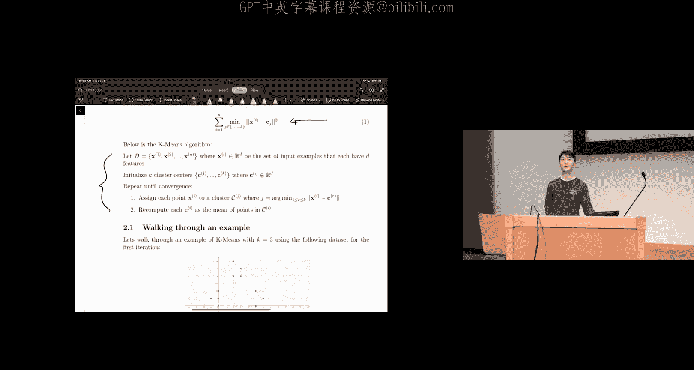
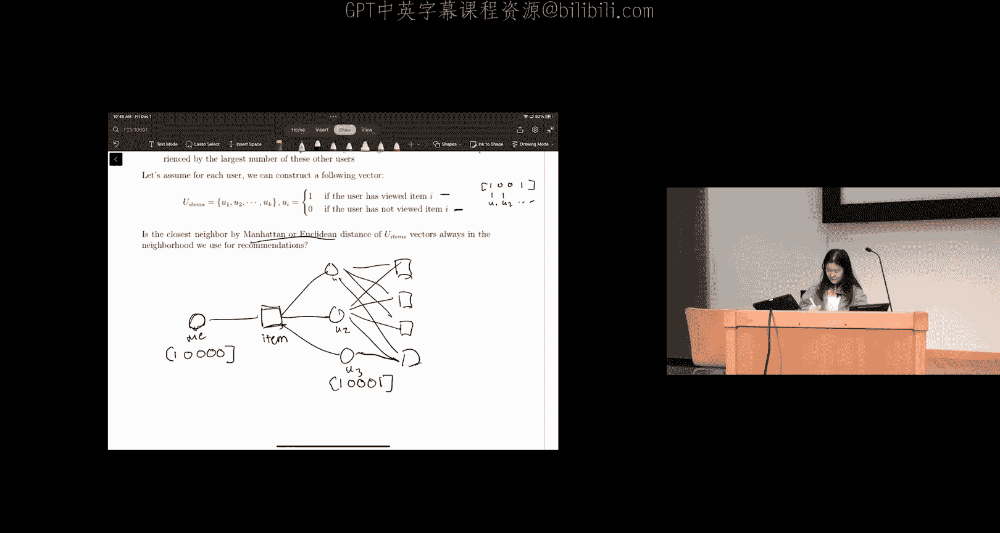
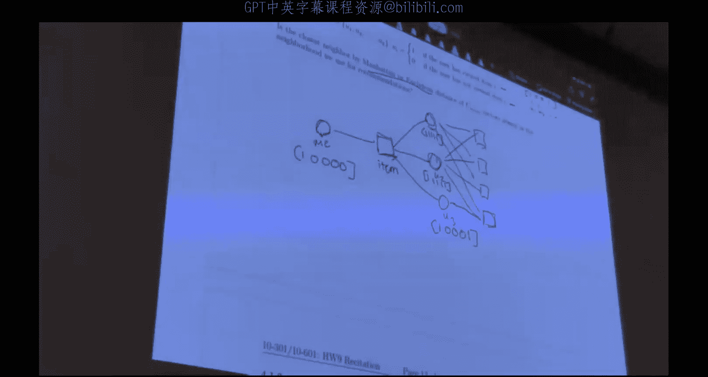
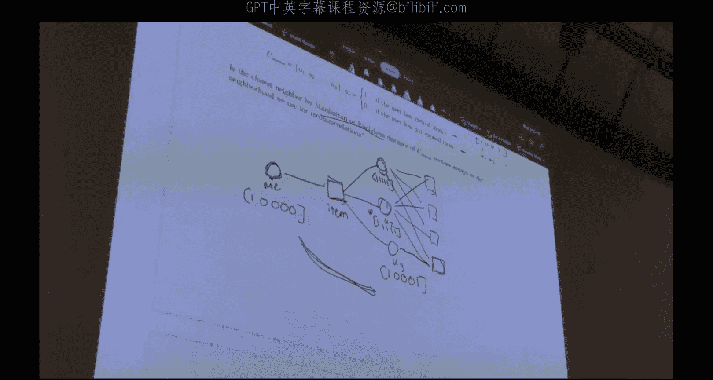
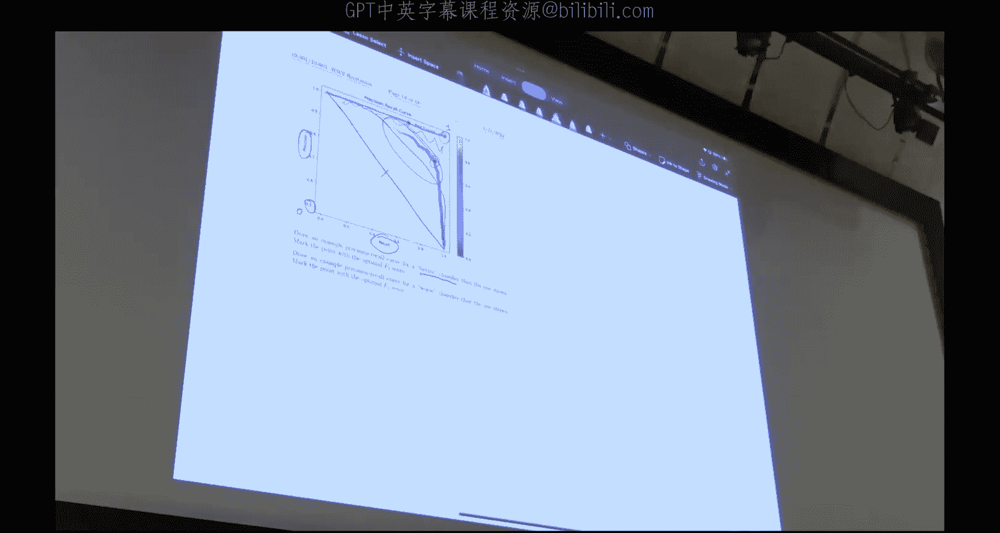

# CMU《机器学习导论｜Fall 2023 10-301⧸601 Introduction to Machine Learning》中英字幕（deepseek p47 Recitation_HW9.zh_en -BV1Z2cUefE4A_p47-

## 1. 主成分分析 (PCA)

**概述**： 本节介绍了主成分分析 (PCA) 的概念，它旨在将数据投影到更低维度，同时保留尽可能多的信息。

**核心概念**：

* **目标**： 将数据投影到更低维度，同时保留尽可能多的信息。
* **方法**： 
    * 找到一个正交基，即数据的新坐标系。
    * 删除不重要的维度，使得保留的维度最小化平方误差。
    * 重建原始数据。

**示例**：

* 在低维空间（例如二维）中，可以通过可视化找到主成分。
* 在高维空间（例如三维或更高）中，需要使用数学方法来解决问题。

## 2. K-means 聚类

**概述**： 本节介绍了 K-means 聚类算法，它是一种无监督机器学习算法，用于将数据点划分为 K 个簇。

**核心概念**：

* **目标**： 将数据点划分为 K 个簇。
* **方法**：
    * 初始化 K 个簇中心。
    * 将每个数据点分配到最近的簇中心。
    * 重新计算簇中心。
    * 重复步骤 2 和 3，直到簇中心不再变化。

**示例**：

* 使用 K-means 算法将数据点划分为 3 个簇。
* 初始化簇中心，例如将第一个簇中心初始化为 (0,0)，第二个簇中心初始化为 (1,1)，第三个簇中心初始化为 (2,2)。
* 将每个数据点分配到最近的簇中心。
* 重新计算簇中心，例如取每个簇中所有数据点的平均值。
* 重复步骤 2 和 3，直到簇中心不再变化。

## 3. 随机森林 (Random Forest)

**概述**： 本节介绍了随机森林，它是一种集成学习方法，通过组合多个决策树来提高预测性能。

**核心概念**：

* **目标**： 通过组合多个决策树来提高预测性能。
* **方法**：
    * 使用随机抽样和特征随机化来训练多个决策树。
    * 将每个决策树的预测结果进行聚合，以获得最终的预测结果。

**示例**：

* 使用随机森林对数据集进行分类或回归。
* 使用随机抽样和特征随机化来训练多个决策树。
* 将每个决策树的预测结果进行聚合，以获得最终的预测结果。

## 4. AdaBoost

**概述**： 本节介绍了 AdaBoost，它是一种集成学习方法，通过迭代地训练多个弱学习器来提高预测性能。

**核心概念**：

* **目标**： 通过迭代地训练多个弱学习器来提高预测性能。
* **方法**：
    * 使用权重方案来调整每个弱学习器的重要性。
    * 使用权重方案来更新数据点的权重。
    * 重复训练多个弱学习器，并更新权重方案。

**示例**：

* 使用 AdaBoost 对数据集进行分类或回归。
* 使用权重方案来调整每个弱学习器的重要性。
* 使用权重方案来更新数据点的权重。
* 重复训练多个弱学习器，并更新权重方案。

## 5. 推荐系统

**概述**： 本节介绍了推荐系统，它是一种用于向用户推荐相关项目的系统。

**核心概念**：

* **协同过滤**： 基于用户和项目的相似性来推荐项目。
* **基于内容的过滤**： 基于用户和项目的特征来推荐项目。

**示例**：

* 使用协同过滤推荐电影。
* 使用基于内容的过滤推荐新闻。

## 6. 精确率、召回率和 F1 分数

**概述**： 本节介绍了精确率、召回率和 F1 分数，它们是评估机器学习模型性能的指标。

**核心概念**：

* **精确率**： 预测为正类的样本中，实际为正类的比例。
* **召回率**： 实际为正类的样本中，预测为正类的比例。
* **F1 分数**： 精确率和召回率的调和平均。

**示例**：

* 使用精确率、召回率和 F1 分数来评估分类模型的性能。

## 总结

本节课中，我们学习了主成分分析、K-means 聚类、随机森林、AdaBoost、推荐系统和精确率、召回率和 F1 分数等机器学习概念。这些概念在机器学习中非常重要，可以帮助我们更好地理解和处理数据。