# 机器学习导论：1：机器学习问题定义与符号 🧠

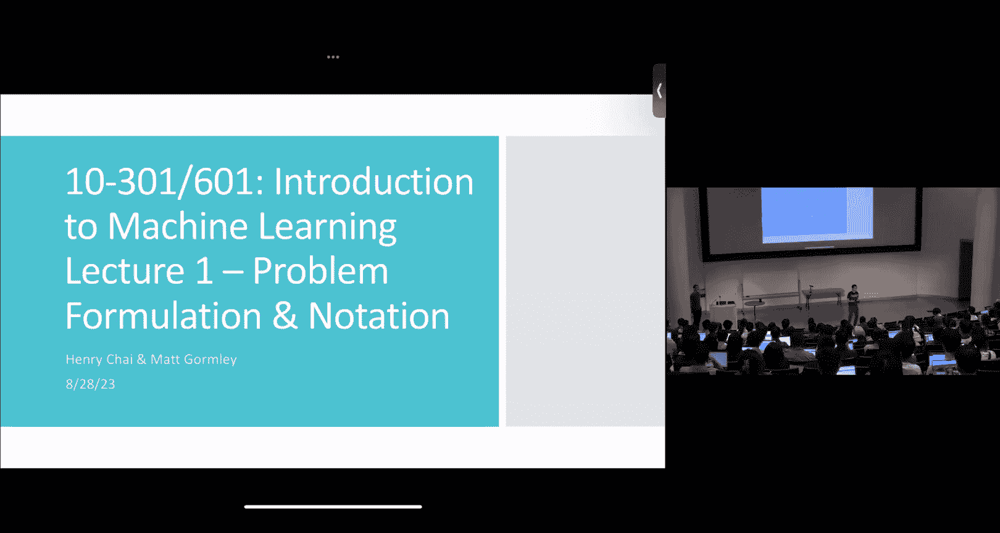

## 概述

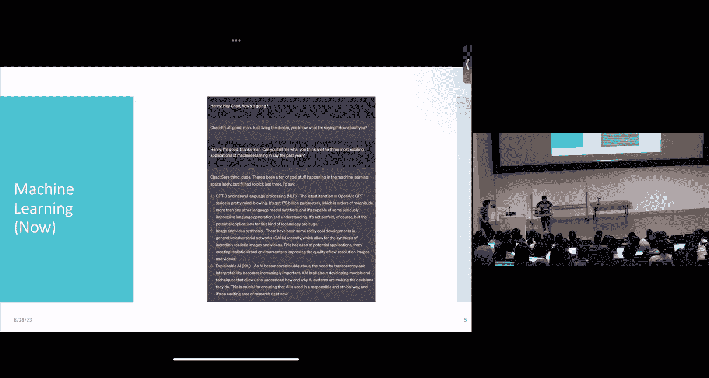

在本节课中，我们将学习如何定义机器学习问题，并了解相关的符号和概念。

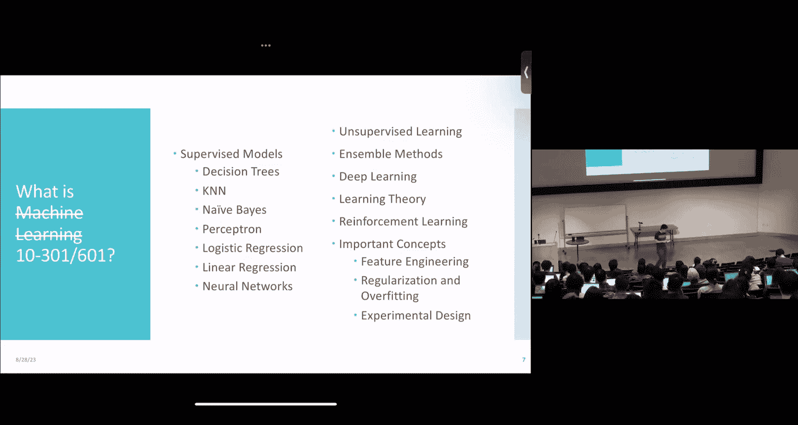

## 核心概念

**机器学习问题定义**：
一个计算机程序学习，如果它在任务 T 上的性能，通过性能度量 P 或指标来衡量，随着经验 E 的增加而提高。

**符号**：
*   **T**：任务
*   **P**：性能度量
*   **E**：经验

## 例子

以下是两个将实际问题转化为机器学习问题的例子。

**学习下棋**：
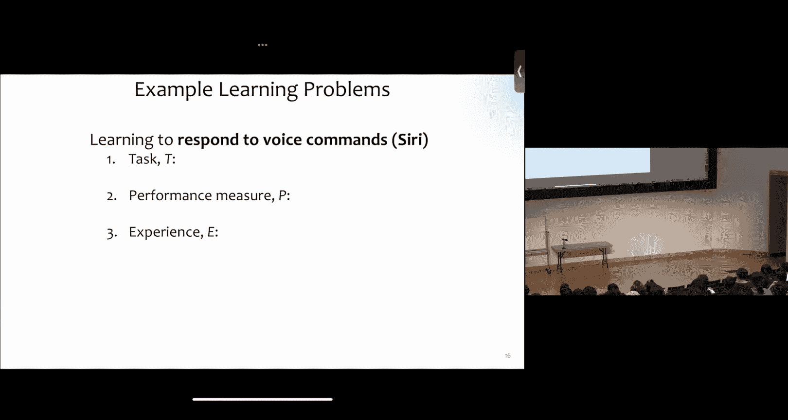
*   **任务 T**：下棋
*   **性能度量 P**：赢得比赛的比例
*   **经验 E**：玩棋盘游戏的数量和对手

**响应语音命令**：
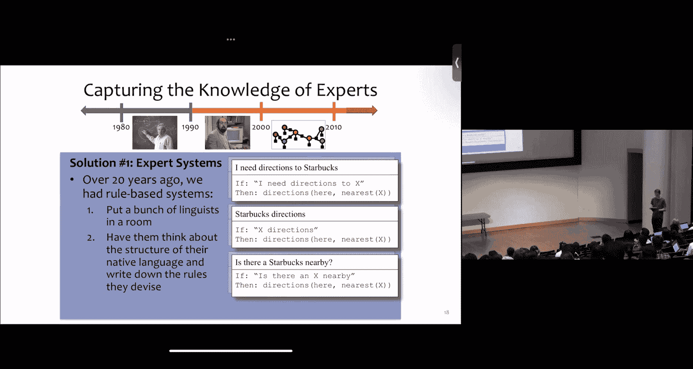
*   **任务 T**：预测手机应采取的操作
*   **性能度量 P**：在用户试点研究中采取的正确操作的比例
*   **经验 E**：语音动作对示例

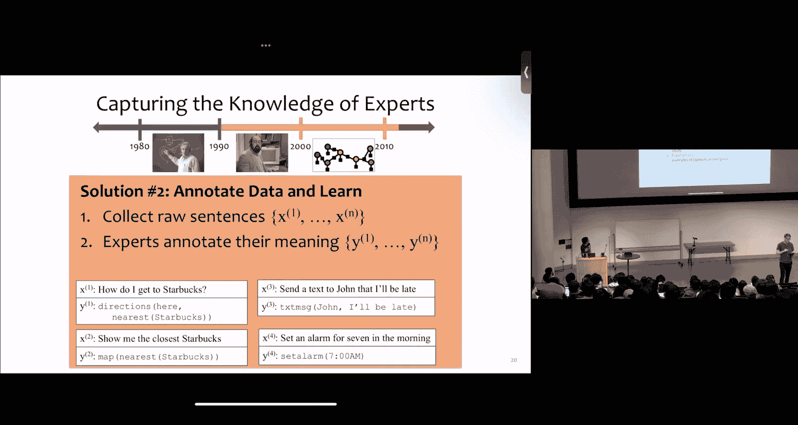

## 总结

本节课中，我们一起学习了机器学习问题的定义和核心符号。我们了解到，一个机器学习问题可以形式化地定义为程序在任务 **T** 上的性能 **P** 随着经验 **E** 的增加而提高。通过下棋和语音命令的例子，我们看到了如何将现实世界的问题映射到这个定义框架中。

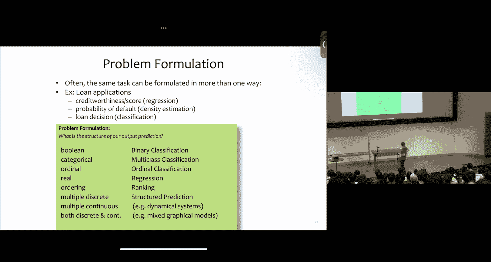

---

# 机器学习导论：2：机器学习分类器 📊

## 概述

上一节我们介绍了如何定义机器学习问题，本节中我们来看看机器学习中的一个核心组件：分类器。我们将学习如何构建机器学习分类器，并了解相关的概念和算法。

## 核心概念

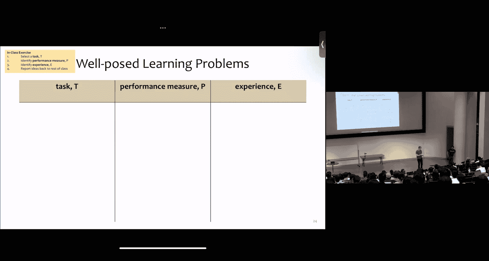

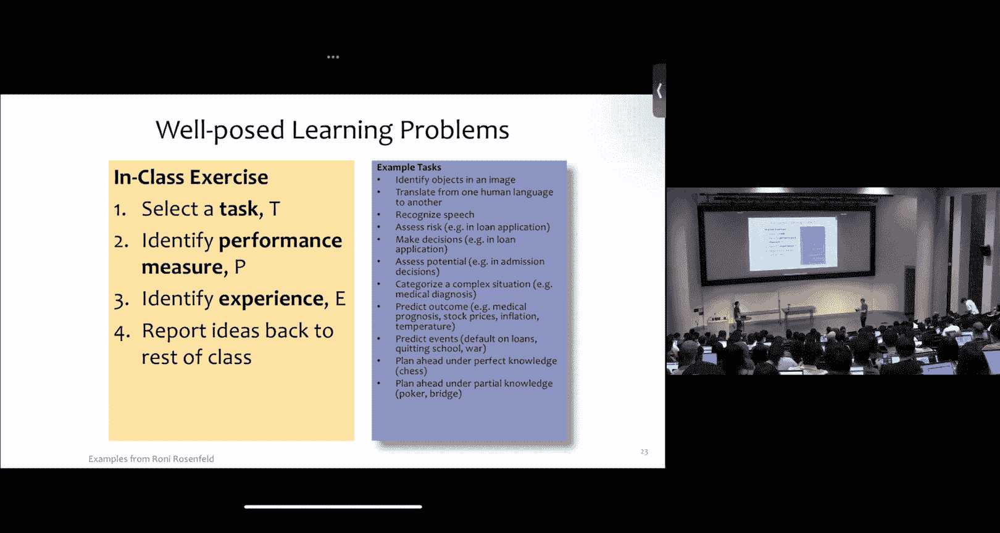

**分类器**：
任何将特征值作为输入并返回一个可能标签的函数。可以用公式表示为：
`y = f(x)`
其中 `x` 是输入特征，`y` 是预测的标签。

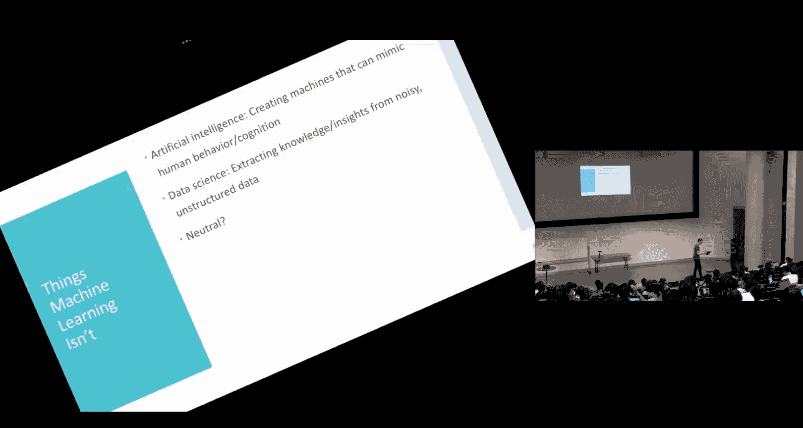

**分类器类型**：
以下是两种简单的分类器示例：
*   **多数投票分类器**：总是预测数据集中最常见的标签。
*   **记忆分类器**：如果训练数据中存在特定特征集，则预测相应的标签。

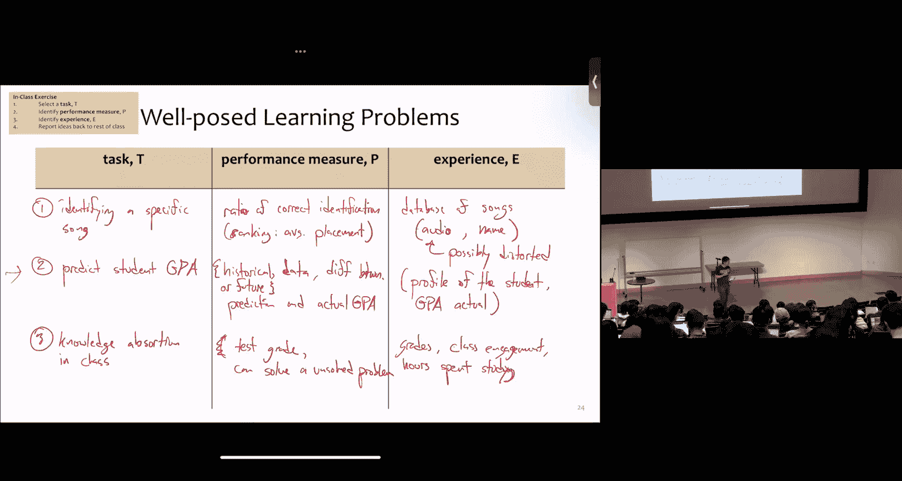

## 例子

**诊断心脏病**：
*   **特征**：是否有心脏病家族史、静息血压、胆固醇水平
*   **标签**：是否有心脏病
一个分类器可以接收这些特征作为输入，并输出“有心脏病”或“无心脏病”的预测标签。

## 总结

本节课中，我们一起学习了机器学习分类器的基本概念。我们了解到分类器是一个函数，它将特征映射到标签。我们还介绍了两种简单的分类器类型：多数投票分类器和记忆分类器。通过心脏病诊断的例子，我们看到了分类器在实际问题中的应用。

---

# 机器学习导论：3：课程大纲 📚

## 概述

在了解了机器学习的基本概念后，本节我们将介绍本课程的整体安排，包括评估方式、作业、考试和参与度要求。

## 评估方式

本课程的最终成绩由以下几个部分组成：
*   **作业**：定期提交
*   **考试**：三次考试
*   **参与度**：课堂参与和讨论

## 作业

以下是关于作业的具体说明：
*   定期提交
*   晚交政策：有限次数的宽限期
*   合作：鼓励合作，但最终评估个人

## 考试

以下是关于考试的具体说明：
*   三次考试
*   考试日期：请提前安排行程
*   考试形式：闭卷

## 总结

本节课中，我们一起学习了本课程的大纲。我们明确了课程的评估方式，包括作业、考试和课堂参与度。了解这些信息有助于你规划好整个学期的学习。

---

# 机器学习导论：4：总结 🤔

在本节课中，我们一起学习了机器学习导论的开篇内容。我们首先学习了如何用任务 **T**、性能度量 **P** 和经验 **E** 来定义机器学习问题。接着，我们探讨了机器学习分类器的概念，它作为一个函数将输入特征映射到预测标签。最后，我们了解了本课程的大纲和评估方式。这些基础知识为我们后续深入学习更复杂的机器学习算法和模型奠定了坚实的基础。