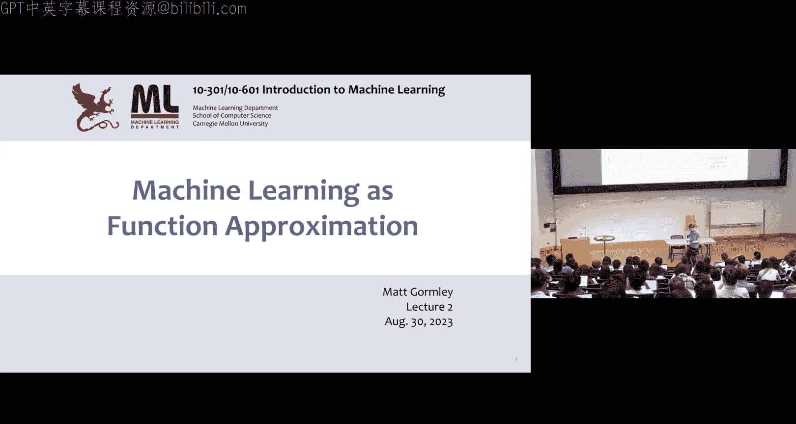
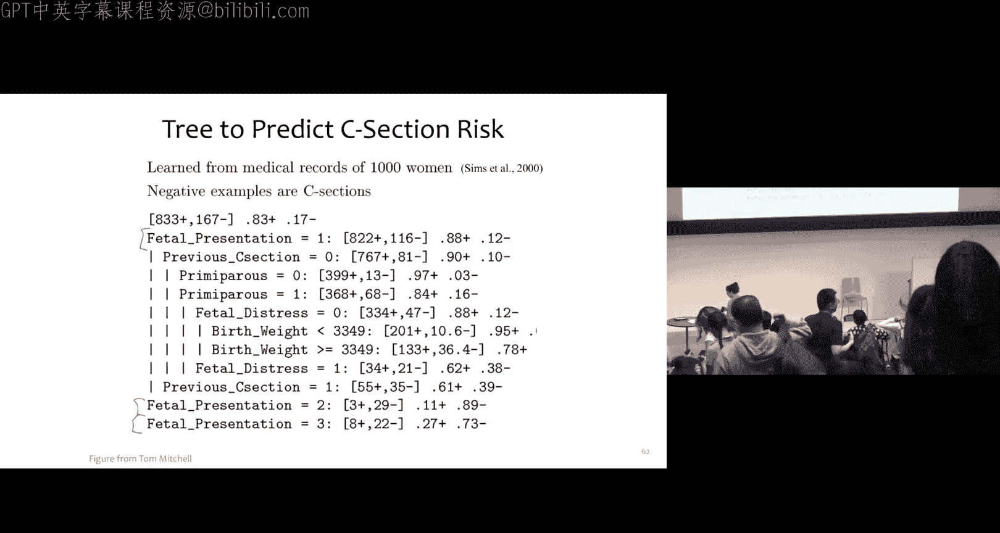

# 机器学习导论：2：机器学习作为函数逼近 🧠

## 概述

在本节课中，我们将探讨机器学习的核心思想——将其视为一种函数逼近问题。我们将学习如何形式化一个学习问题，了解几种基础的学习算法，并讨论评估模型性能的关键概念。

**在本节课中，我们将学习以下内容：**

*   如何形式化学习问题。
*   如何学习专家系统（例如决策树）。
*   归纳偏置对泛化的重要性。
*   过拟合的概念。

## 核心概念：函数逼近

机器学习的本质是**函数逼近**。我们试图通过数据学习一个函数，这个函数能够逼近我们未知的真实目标函数。目标函数通常隐藏在数据背后，但我们可以通过观察输入和输出的对应关系来学习它。

**公式**：
*   `C*`： 代表未知的**目标函数**，它将特征向量 `x` 映射到标签 `y`。
*   `H`： 代表我们学到的**假设函数**，它从我们选择的假设集 `C` 中选取，目标是尽可能逼近 `C*`。

## 函数逼近的例子

为了理解函数逼近，我们先看一个数学例子。

**问题**： 实现一个函数，该函数返回 `X` 的负正弦值（`-sin(x)`），但不得直接使用正弦函数。

**解决方案**：
以下是几种逼近该函数的方法：
*   **泰勒级数逼近**： 在特定点（如 `x=0`）附近，使用泰勒展开式来逼近函数。
*   **分段线性逼近**： 使用一系列连接的直线段来逼近曲线。
*   **随机点逼近**： 在随机选择的点上计算函数值，然后连接这些点来形成逼近。

## 机器学习的实际例子：医疗诊断

现在，我们将函数逼近的思想应用到一个实际的机器学习问题中。

**问题**： 医生需要根据患者的症状（如打喷嚏、眼睛发痒）判断患者是否患有过敏症。

**解决方案**：
1.  **形式化**： 这是一个**监督二分类**任务。
2.  **数据表示**： 每个患者用一个**特征向量**表示（例如，`[打喷嚏=是， 眼睛发痒=是]`），标签是“过敏”或“不过敏”。
3.  **学习目标**： 使用学习算法从已有的诊断数据（训练数据）中学习一个假设函数 `H`。这个函数能够根据新的患者的特征向量，预测其是否患有过敏症。

## 另一个例子：回归问题

回归是函数逼近的另一种形式，目标是预测连续值。

**问题**： 预测 `X` 的负正弦值（`-sin(x)`），这是一个连续值输出。

**解决方案**：
*   我们可以使用**分段线性函数**来逼近这个连续的曲线。
*   算法会利用数据点 `(x, -sin(x))` 来训练，找到一个假设函数 `H`，使得对于新的 `x`，`H(x)` 能尽可能接近真实的 `-sin(x)`。

## 如何评估机器学习模型

学习了假设函数后，我们需要评估它的好坏。这通过定义**损失**来实现。

**损失函数**： 用于量化模型预测 `H(x)` 与真实标签 `y` 之间的差异。对于分类任务，一个简单的损失函数是“0-1损失”：如果预测错误，损失为1；正确则为0。

**误差率**： 在**测试数据**（模型未见过的数据）上计算的平均损失，用于估计模型在现实世界中的性能。

**真误差**： 模型在所有可能数据（总体）上的期望损失。这是我们真正关心的，但通常无法直接计算，只能用测试误差来近似。

## 几种基础的学习算法

上一节我们介绍了评估标准，本节我们来看看如何从数据中学习得到假设函数 `H`。以下是几种简单的学习算法：

**以下是几种基础的学习算法：**

*   **多数投票分类器**： 这是一个非常简单的模型。它忽略输入特征 `x`，总是预测训练数据集中出现次数最多的那个标签。
*   **记忆化器**： 这个模型会记住所有训练数据。当遇到一个在训练集中出现过的 `x` 时，它就输出对应的 `y`；如果遇到全新的 `x`，则随机猜测一个标签。
*   **决策树**： 这是一种更结构化的方法。它通过一系列基于特征值的“是/否”问题（决策）来对数据进行分类，最终到达一个叶节点，该节点会预测一个标签（通常是该节点中样本最多的类别）。

## 总结

在本节课中，我们一起学习了将机器学习视为函数逼近的核心视角。

**本节课中我们一起学习了以下内容：**

*   **机器学习作为函数逼近**： 目标是学习一个假设函数 `H` 来逼近未知的目标函数 `C*`。
*   **形式化学习问题**： 将现实问题转化为包含特征、标签、假设集和监督学习的框架。
*   **学习算法示例**： 了解了多数投票、记忆化器和决策树等基础算法的思想。
*   **归纳偏置**： 学习算法对假设形式的偏好（如决策树偏好轴对齐的边界）对于其泛化能力至关重要。
*   **过拟合**： 模型在训练数据上表现完美，但在新数据上表现很差的现象（记忆化器是典型例子）。
*   **评估指标**： 使用损失函数和（测试）误差率来衡量模型的性能。
*   **算法与评估的关系**： 不同的学习算法会产生不同的假设函数 `H`，我们需要用统一的评估标准来判断孰优孰劣。