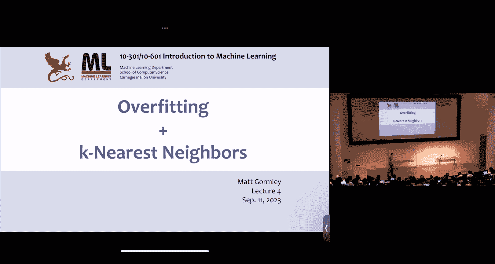
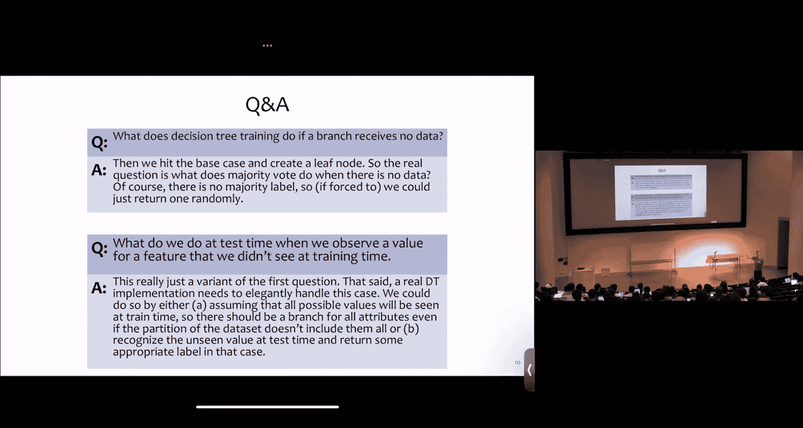
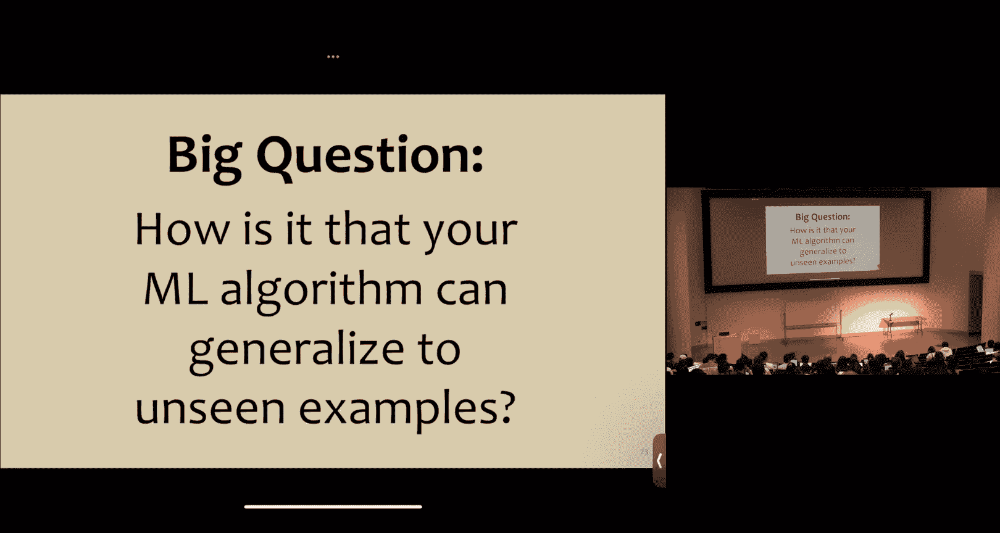
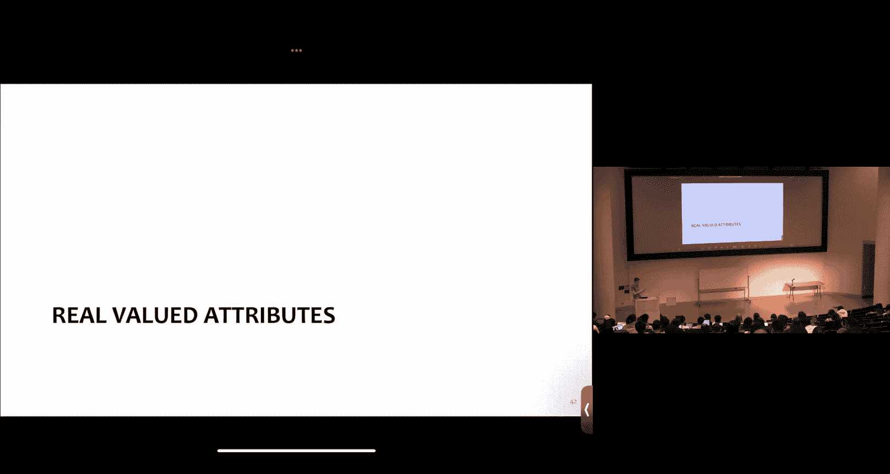
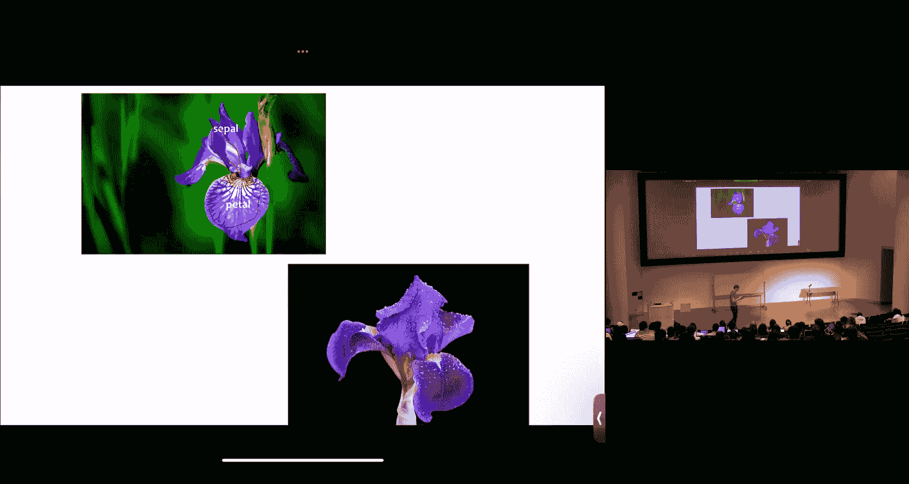
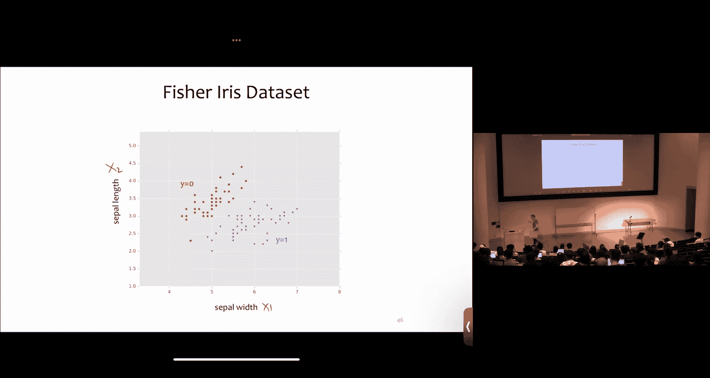
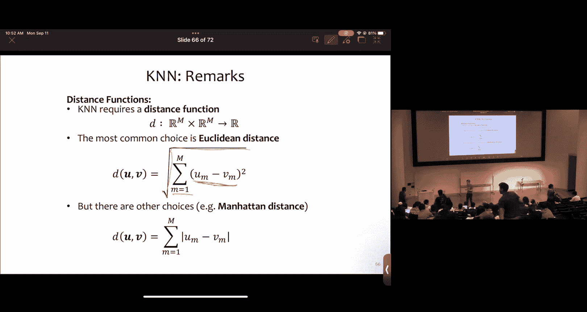

# 机器学习导论：第4讲：过拟合与k-最近邻算法 🧠

在本节课中，我们将学习决策树和k-最近邻（k-NN）这两种基础机器学习算法。我们将探讨决策树如何做出泛化决策、它可能遇到的过拟合问题，以及解决该问题的剪枝技术。随后，我们将转向k-最近邻算法，了解其工作原理和距离度量方式。

## 决策树 🌳

上一节我们介绍了决策树的基本构建过程。本节中，我们来看看决策树背后的泛化原则以及一个常见挑战。

### 归纳偏差

决策树的归纳偏差指的是算法从训练数据泛化到新数据时所遵循的内在偏好或原则。决策树学习算法主要依据以下两点进行泛化：

以下是决策树泛化的核心原则：
*   **属性重要性**：算法会评估所有属性，选择那些与训练数据标签具有高**互信息**的属性进行分裂。互信息公式衡量了知道一个属性值能减少多少关于标签的不确定性。
*   **贪婪搜索**：算法采用**贪婪搜索**策略，在每一步都选择当前能带来最大信息增益（或类似标准）的属性进行分裂，并在满足停止条件（如所有样本属于同一类）时终止树的生长。

### 过拟合

当模型过于复杂，开始学习训练数据中的噪声和随机波动，而非潜在的真实规律时，就会发生过拟合。这会导致模型在训练集上表现很好，但在未见过的测试数据上表现很差。

以下是识别过拟合的几个迹象：
*   **训练误差远低于测试误差**：这是过拟合的典型特征。
*   **模型复杂度异常增加**：对于决策树，表现为树变得非常深、枝叶繁多，为个别噪声样本创建了特定的分支。

### 剪枝

为了解决过拟合问题，我们可以对决策树进行**剪枝**，即简化模型，移除对泛化能力贡献不大或可能由噪声引起的部分。

以下是几种常见的剪枝方法：
*   **预剪枝**：在树完全生长之前就提前停止。例如，设置**最大深度**或规定**最小信息增益阈值**，低于该阈值则不再分裂。
*   **后剪枝**：先让树充分生长，然后自底向上地考察节点。如果一个节点被替换为叶节点（即**剪枝**）能在**验证集**上降低误差或不增加太多误差，则进行剪枝。

## k-最近邻算法 👥

了解了基于规则学习的决策树后，我们来看一种完全不同的、基于实例的学习方法——k-最近邻算法。

k-最近邻是一种惰性学习算法。它并不从训练数据中提炼出一个明确的模型，而是将所有训练样本存储起来。当需要对一个新样本进行预测时，它会在训练集中找到与该样本最“相似”的k个邻居，然后根据这些邻居的标签来做出决策。

### 距离度量

k-NN算法的核心在于如何定义“相似”或“最近”。这需要通过**距离度量**来实现，用于计算两个数据点之间的差异。

以下是两种最常用的距离度量公式：
*   **欧几里得距离**：即我们常说的“直线距离”。对于两个n维向量 `x = (x1, x2, ..., xn)` 和 `y = (y1, y2, ..., yn)`，其计算公式为：
    `distance = sqrt((x1 - y1)^2 + (x2 - y2)^2 + ... + (xn - yn)^2)`
*   **曼哈顿距离**：也称为“城市街区距离”，计算的是各维度绝对差之和。公式为：
    `distance = |x1 - y1| + |x2 - y2| + ... + |xn - yn|`

### 预测

确定了距离度量并找到k个最近邻后，就可以进行预测了。

对于分类任务，通常采用**多数投票**原则：新样本的预测标签就是其k个邻居中出现次数最多的那个标签。
对于回归任务，则可以取k个邻居目标值的**平均值**作为预测值。

## 总结 📚

本节课中我们一起学习了决策树和k-最近邻算法。我们首先探讨了决策树的归纳偏差，理解了它如何通过选择信息增益高的属性进行贪婪分裂来构建模型。接着，我们分析了决策树容易产生的过拟合问题，并介绍了通过预剪枝和后剪枝来缓解该问题的方法。最后，我们学习了k-最近邻这一基于实例的算法，了解了其依赖距离度量寻找邻居，并通过投票或平均进行预测的工作原理。这两种算法为我们提供了理解机器学习中“模型学习”与“基于记忆的学习”两种范式的经典案例。