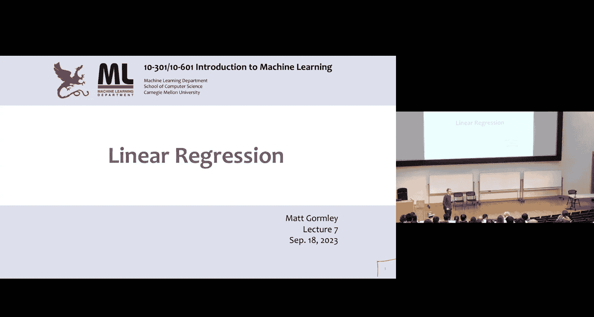
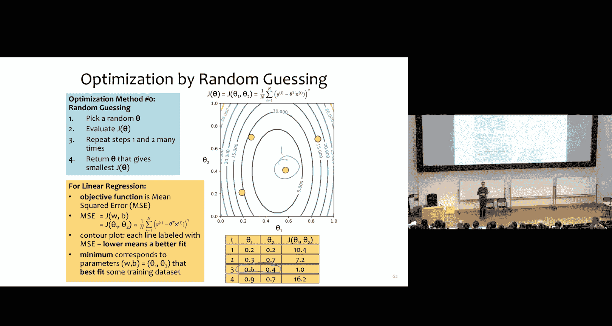
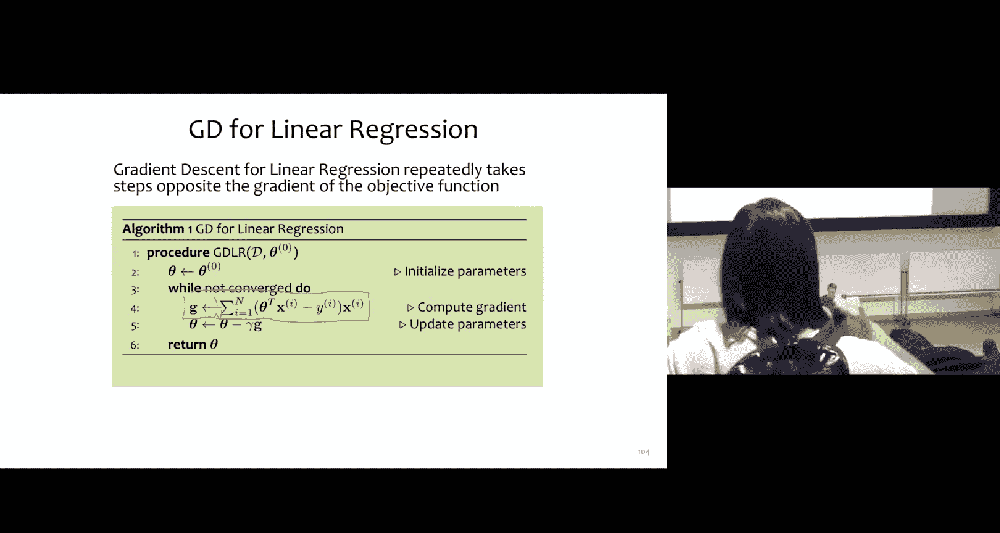

# 机器学习导论：07：线性回归 📈

## 概述
在本节课中，我们将要学习机器学习中的回归问题，并重点介绍一种基础且重要的方法——线性回归。我们将了解它的定义、模型形式、优化目标以及如何通过梯度下降算法进行求解。

---

## 1. 回归问题概述 🔍
上一节我们讨论了分类问题，本节中我们来看看另一类核心的机器学习任务：回归。回归问题的目标是预测一个**连续值**的输出。这与分类问题不同，分类预测的是离散的类别标签。

## 2. 回归问题示例 📊
以下是回归问题在现实世界中的几个典型应用场景：
*   预测股票价格
*   预测流行病发展趋势
*   语音合成（生成连续的音频波形）
*   图像生成（生成连续的像素值）

## 3. 线性回归模型 🧱
线性回归是解决回归问题最简单直接的方法。它假设输出值（目标）和输入特征之间存在**线性关系**。该模型可以用一个公式清晰地表示：

**`y = W^T x + b`**

在这个公式中：
*   **`y`** 是我们要预测的输出值（一个标量）。
*   **`x`** 是输入特征向量。
*   **`W`** 是权重向量，表示每个特征对输出的重要程度。
*   **`b`** 是偏置项，代表当所有特征为0时的基础输出值。

这个模型非常直观：预测结果是所有输入特征的加权和，再加上一个常数偏置。

## 4. 线性回归的目标 🎯
我们的目标是找到一组最佳的参数（**`W`** 和 **`b`**），使得模型的预测值尽可能接近真实的观测值。衡量这种接近程度的常用指标是**均方误差**。

**`MSE = (1/n) * Σ(y_i - ŷ_i)^2`**

其中：
*   **`n`** 是训练数据集中样本的总数。
*   **`y_i`** 是第 `i` 个样本的真实值。
*   **`ŷ_i`** 是模型对第 `i` 个样本的预测值，即 **`ŷ_i = W^T x_i + b`**。

因此，线性回归的优化目标就是找到能使 **MSE** 最小化的 **`W`** 和 **`b`**。

## 5. 优化：梯度下降法 ⬇️
为了找到最小化 MSE 的参数，我们使用**梯度下降**算法。这是一种迭代优化方法，通过沿着目标函数（这里是MSE）梯度的反方向逐步更新参数。

以下是梯度下降算法的基本步骤：
1.  **初始化**：随机选择一组初始的权重 **`W`** 和偏置 **`b`**。
2.  **计算梯度**：计算损失函数（MSE）关于当前参数 **`θ`**（代表 **`W`** 和 **`b`**）的梯度 **`∇J(θ)`**。梯度指明了损失函数上升最快的方向。
3.  **更新参数**：沿着梯度的反方向（即下降方向）更新参数。更新公式为：**`θ = θ - α * ∇J(θ)`**。其中 **`α`** 是学习率，控制每次更新的步长。
4.  **重复迭代**：重复步骤2和步骤3，直到损失函数收敛到最小值或达到预设的迭代次数。

## 6. 线性回归的局限性 ⚠️
尽管线性回归简单有效，但它也有明显的局限性。最主要的限制在于其**线性假设**。它强制要求输出与输入特征呈线性关系，而现实世界中的许多关系要复杂得多（如曲线关系）。此外，线性模型对数据中的异常值（噪声）比较敏感。

## 总结
本节课中，我们一起学习了回归问题的基本概念，并深入探讨了**线性回归**这一核心模型。我们掌握了其数学表达形式 **`y = W^T x + b`**，明确了以最小化**均方误差（MSE）** 为目标的优化思想，并了解了如何使用**梯度下降法**来求解最优参数。最后，我们也认识了线性回归模型的适用前提和局限性，为后续学习更复杂的模型奠定了基础。