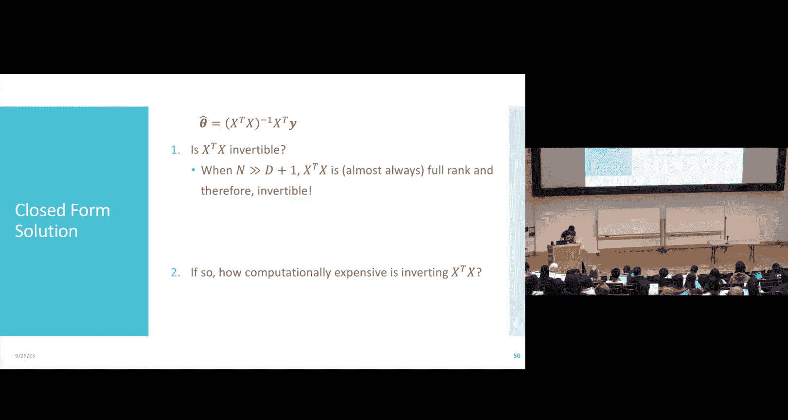
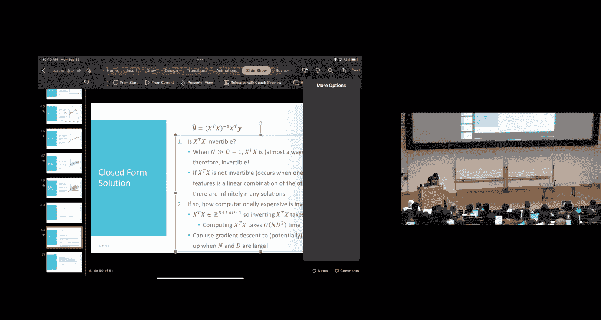
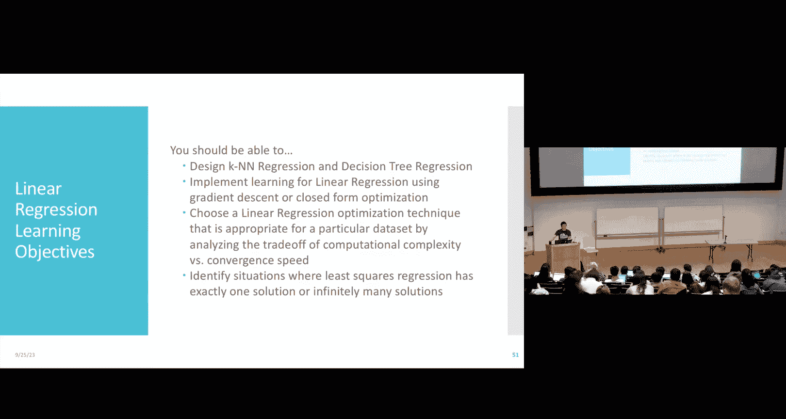

# 机器学习导论：第8讲：机器学习优化

## 📝 概述
在本节课中，我们将继续探讨机器学习作为优化的问题，并深入探讨线性回归目标函数的优化方法。

## 📝 课程信息与考试安排
上一节我们介绍了机器学习优化的基本概念，本节中我们来看看与课程相关的具体安排。

以下是关于作业和考试的重要信息：

*   作业三已于周六截止。
*   如果忘记提交，可以使用最多两个宽限日。
*   可以在今天晚上11:59之前提交。

关于第一次考试，请注意以下细节：

*   考试将于周四进行，时间为6:30至8:30。
*   请注意，考试座位图已发布在Piazza上，请确保您有指定的座位。
*   如果您通过残疾资源办公室获得考试安排，他们将代表我们监考您的考试，您必须与他们安排考试时间。
*   考试将涵盖前七次讲座的内容。
*   考试不需要计算器、手机或笔记本电脑等电子设备。
*   您可以携带一张纸，可以在纸的任何一边写下任何内容。

## 📝 考试准备与技巧
了解了考试安排后，接下来我们看看如何有效地准备考试。

以下是准备考试的建议：

*   参加讲座，我们将花时间准备考试。
*   复习考试练习题。
*   完成作业，特别是作业中的问题。
*   准备笔记或复习资料。

除了准备内容，掌握一些考试技巧也很重要：

*   不要将所有简单问题都放在前面，所有困难问题都放在后面。
*   先解决容易的问题。
*   如果感觉遗漏了某些内容或信息不足，请将您做出的任何假设写在试卷的边角或实际框中，并从这些假设开始工作。

## 📝 练习题示例
为了帮助理解考试可能涵盖的内容，以下是几个练习题示例：

1.  **决策树**：假设您有一个二元数据集，其中要预测的标签是大学是否会在某一天关闭。请描述周末属性对标签的影响。
2.  **最近邻**：给定一个包含5个蓝色加号和3个红色减号的数据集，如何使用欧几里得距离计算最近邻模型的留一法交叉验证误差？
3.  **线性回归**：考虑两个数据集，一个包含N1个点，另一个包含N2个点。假设N1 > N2，并且第一个数据集的维度D1大于第二个数据集的维度D2。请判断以下陈述是否正确：增加数据点的数量或改变维度本身会影响感知器错误界限保证。

## 📝 线性回归优化：梯度下降与凸性
现在，让我们回到本节课的核心主题——优化。上周，Matt介绍了用于线性回归问题的梯度下降算法。为什么我们应该认为梯度下降是解决此问题的合理方法？

为了回答这个问题，我需要向您介绍一些数学概念。我们将进行一些偏离，但请放心，这将在几分钟后与线性回归联系起来。

一个关键概念是**凸函数**。一个函数F是凸的，如果它满足以下不等式：
`F(c * x1 + (1 - c) * x2) ≤ c * F(x1) + (1 - c) * F(x2)`
其中 `0 ≤ c ≤ 1`。

如果可以去掉这些讨厌的等式，则函数是**严格凸的**。

凸函数的一个重要性质是：对于凸函数，每个局部最小值实际上都是全局最小值。

梯度下降是一种局部算法，它在每次迭代中只查看其当前位置并计算函数的梯度。幸运的是，线性回归的目标函数是凸的（但不是严格凸的），这保证了梯度下降能找到全局最优解。

## 📝 线性回归优化：闭式解
除了迭代的梯度下降法，线性回归还有一个更直接的解法，称为闭式解。

给定训练数据集，我们可以将所有特征向量堆叠到一个大矩阵中，称为**设计矩阵** `X`。同时，将目标值堆叠到一个列向量 `y` 中，称为**目标向量**。

使用设计矩阵和目标向量，我们可以重写目标函数。线性回归的目标是最小化残差平方和（RSS），其矩阵形式为：
`RSS(w) = ||y - Xw||²`

接下来，我们计算目标函数的梯度，并找到其临界点（即梯度为零的点）。通过求解方程，我们可以找到最优解，即最小化目标函数的权重向量 `w*`。

求解过程最终得到著名的**正规方程**：
`w* = (XᵀX)⁻¹ Xᵀy`

## 📝 矩阵可逆性与解的唯一性
在得到闭式解后，我们需要考虑解的存在性和唯一性，这取决于矩阵 `XᵀX` 的性质。

如果矩阵 `XᵀX` 是可逆的，则线性回归问题有唯一解，即 `w* = (XᵀX)⁻¹ Xᵀy`。

然而，如果矩阵 `XᵀX` 不可逆，则线性回归问题有无限多解。这种情况通常发生在特征之间存在线性依赖关系（即特征不是线性独立）或数据点数量少于特征数量时。

## 📝 总结
本节课中我们一起学习了机器学习中的优化问题，特别是针对线性回归的优化方法。我们回顾了课程作业与考试安排，并通过练习题巩固了对前期知识的理解。核心部分，我们探讨了梯度下降法适用于线性回归的原因——目标函数的凸性，并推导了线性回归的闭式解（正规方程）。最后，我们分析了矩阵 `XᵀX` 的可逆性如何影响解的唯一性。理解这些优化原理是构建和训练有效机器学习模型的基础。