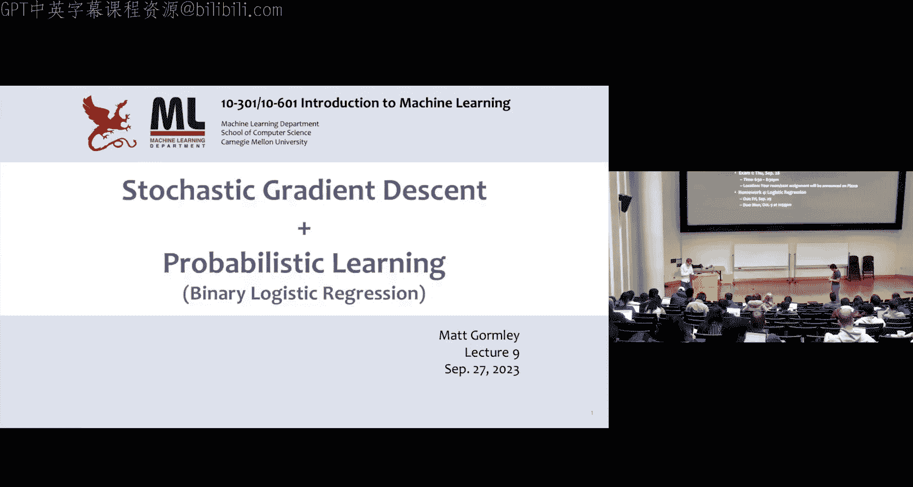
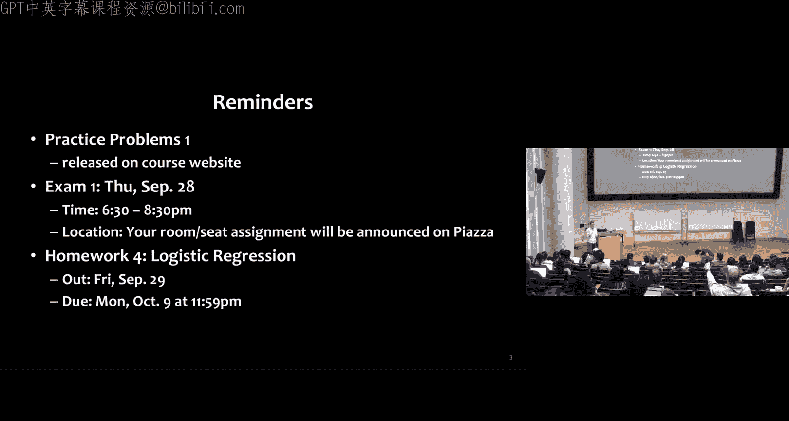
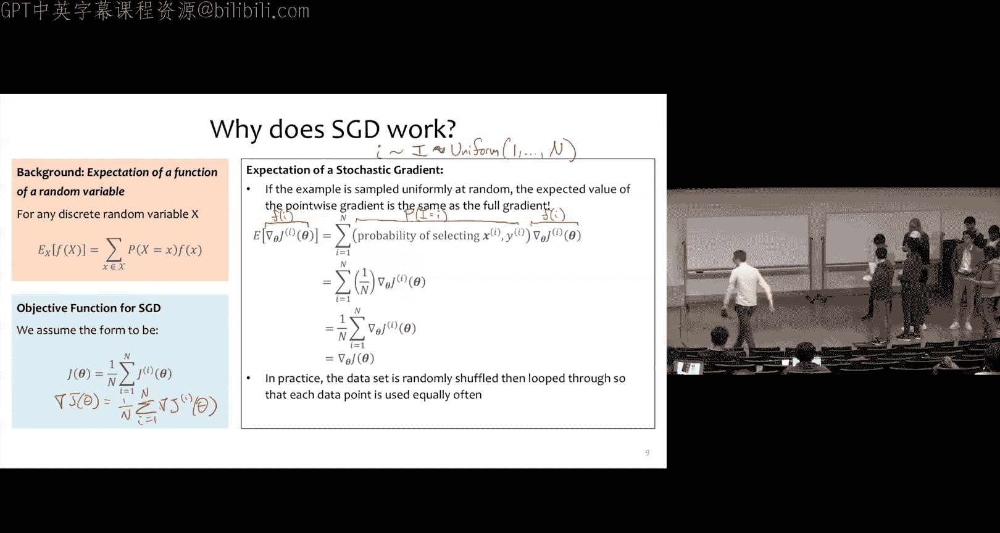
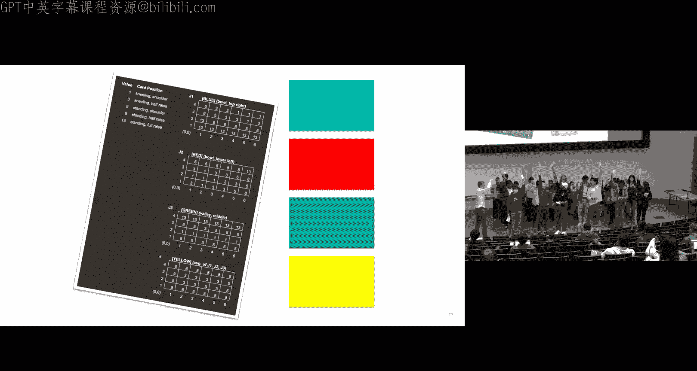
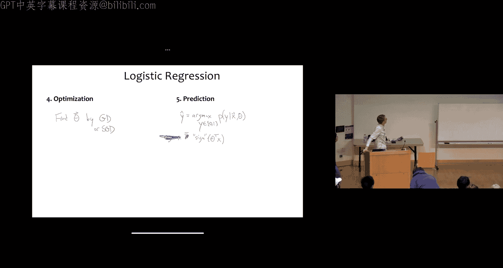

# 机器学习导论：第9讲：随机梯度下降与逻辑回归 🎯

在本节课中，我们将学习两种重要的机器学习概念：**随机梯度下降** 和 **逻辑回归**。我们将从优化算法开始，然后深入探讨逻辑回归的原理和应用。

---

## 1. 引言与课程安排 📅

在本节课中，我们将讨论随机梯度下降和逻辑回归。

### 课程与作业提醒

以下是近期的课程安排和作业信息：

- 实践问题已发布，考试将于周四进行。
- 请查看Piazza以获取您所在教室和座位的具体信息。
- 作业4将于周五发布，截止日期为10月9日（周一）。
- 在作业4中，您将实际实现用于逻辑回归的随机梯度下降，并进行其他相关练习。

---

## 2. 随机梯度下降 🔄

上一节我们回顾了多种优化技术。本节中，我们来看看一种新的优化算法——随机梯度下降。

### 2.1 优化算法概述

到目前为止，我们已经学习了多种优化方法，例如随机猜测、梯度下降和闭式优化。现在，我们将重点介绍随机梯度下降。

### 2.2 与梯度下降的关系

随机梯度下降可以看作是标准梯度下降的一种变体。在标准梯度下降中，我们初始化参数 `θ` 为 `θ0`，然后在未收敛时，沿着整个目标函数的梯度方向更新参数。随机梯度下降的关键区别在于，它每次只使用一个训练样本来计算梯度并更新参数。

具体来说，在每一步中，算法会随机选择一个索引 `i`（范围从1到n，n是训练样本的总数），然后仅基于第 `i` 个样本的梯度来更新参数 `θ`。

### 2.3 算法步骤

以下是随机梯度下降的基本算法步骤：

1.  初始化参数 `θ`。
2.  当未达到收敛条件时，重复以下步骤：
    a. 随机选择一个训练样本索引 `i`（从1到n中均匀随机选择）。
    b. 计算该单个样本的损失函数关于参数 `θ` 的梯度。
    c. 沿着该梯度的反方向更新参数：`θ = θ - η * ∇J_i(θ)`，其中 `η` 是学习率。

### 2.4 优缺点分析

以下是随机梯度下降的主要优缺点：

-   **优点**：计算速度快，内存需求低，特别适合大规模数据集，并且能在训练早期快速取得进展。
-   **缺点**：由于更新方向基于单个样本，噪声较大，导致收敛路径不稳定，最终可能只在最优解附近震荡，而非精确收敛。

---

## 3. 逻辑回归 🧠

了解了优化算法后，我们接下来看看逻辑回归，这是一种广泛使用的分类算法。

### 3.1 基本概念

逻辑回归是一种用于二分类问题的机器学习算法。它假设输入 `X` 是连续特征向量，输出 `Y` 是离散的类别标签（通常是0或1）。

### 3.2 目标函数

逻辑回归通过最大化条件似然来学习参数。通常，我们最小化其负对数形式，即**负条件对数似然**，作为目标函数 `J(θ)`。

目标函数的公式如下：

`J(θ) = - (1/n) * Σ [ Y_i * log(P(Y_i=1|X_i, θ)) + (1 - Y_i) * log(1 - P(Y_i=1|X_i, θ)) ]`

其中，`P(Y_i=1|X_i, θ)` 是模型预测样本 `i` 为正类（Y=1）的概率。

### 3.3 模型与梯度

逻辑回归使用 **sigmoid函数** 将线性组合 `θ^T X` 映射到 `(0, 1)` 区间，作为概率估计。

sigmoid函数公式为：
`σ(z) = 1 / (1 + e^{-z})`

因此，预测概率为：
`P(Y=1|X, θ) = σ(θ^T X) = 1 / (1 + e^{-θ^T X})`

目标函数 `J(θ)` 关于参数 `θ` 的梯度可以通过求导得到，其公式为：

`∇J(θ) = (1/n) * Σ [ (σ(θ^T X_i) - Y_i) * X_i ]`

这个梯度表达式形式简洁，是进行梯度下降更新的核心。

### 3.4 预测

在测试阶段，对于一个新样本 `X`，逻辑回归计算其属于正类的概率 `P(Y=1|X, θ)`。然后通过设定一个阈值（通常为0.5）来进行类别预测：

如果 `P(Y=1|X, θ) >= 0.5`，则预测 `Ŷ = 1`；否则预测 `Ŷ = 0`。

---

## 4. 总结 📝

本节课中，我们一起学习了两个核心内容。

首先，我们介绍了**随机梯度下降**，它是一种高效的优化算法，通过每次迭代仅使用一个样本来更新模型参数，从而在大规模数据上实现快速训练，尽管其收敛过程存在一定的波动性。

其次，我们深入探讨了**逻辑回归**，这是一种经典的概率型分类模型。我们学习了它的目标函数（负对数似然）、如何使用sigmoid函数进行概率预测，以及其梯度的计算方法。逻辑回归为理解更复杂的分类模型奠定了重要基础。

在接下来的课程和作业中，你将有机会亲手实现这些算法，并加深对它们的理解。