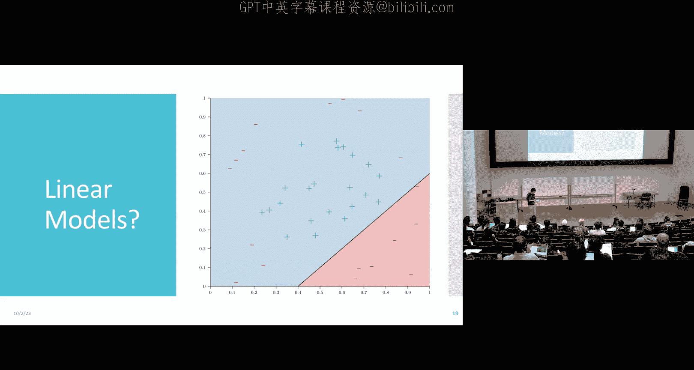
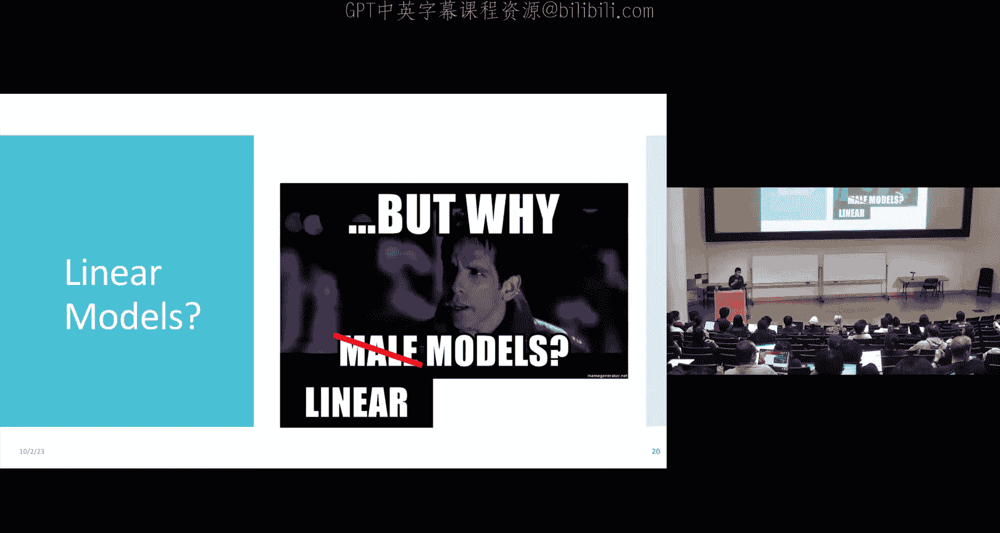
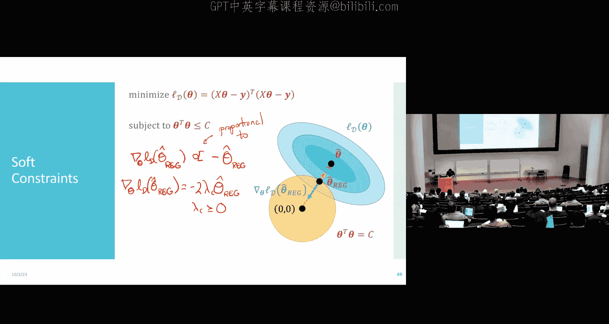
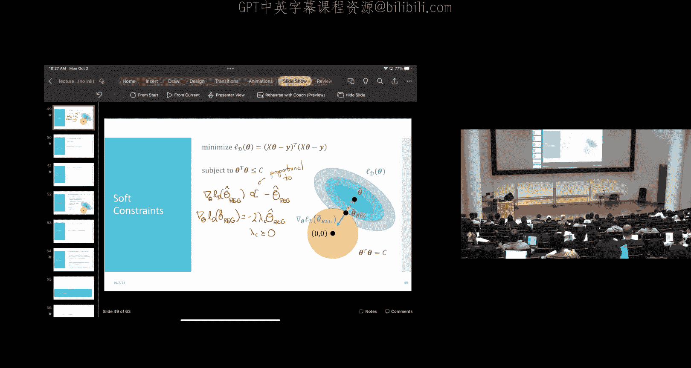
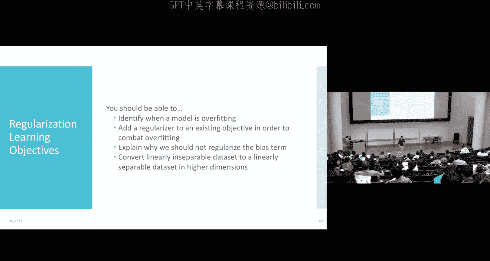

# 机器学习导论：10：正则化 📚

在本节课中，我们将学习逻辑回归模型，并重点探讨一个防止模型过拟合的关键技术——正则化。我们将从回顾逻辑回归的基础开始，然后深入理解过拟合问题，最后介绍两种主要的正则化方法及其数学原理。

---

## 1. 逻辑回归回顾 🔄

上一节我们介绍了线性回归，本节中我们来看看用于分类问题的逻辑回归模型。

### 1.1 逻辑回归模型

逻辑回归模型通过一个称为sigmoid的函数，将特征的线性组合映射到0到1之间的概率值。

**公式**：
$$
\sigma(\theta^T x) = \frac{1}{1 + e^{-(\theta^T x)}}
$$

### 1.2 逻辑回归的决策边界

该模型的决策边界是一条直线（或在更高维度中是超平面），用于将数据点划分为两个类别，例如红色圆圈和蓝色三角形。

### 1.3 逻辑回归的优势

逻辑回归模型结构简单、计算高效，是解决二分类问题的常用基础模型。

---

## 2. 正则化方法 🛡️

理解了基础模型后，我们面临一个新问题：模型可能过于复杂而“记住”了训练数据，导致在新数据上表现不佳。这就是过拟合。为了解决它，我们引入正则化方法。

### 2.1 过拟合问题

当模型参数过多或模型过于复杂时，它可能在训练数据上取得近乎完美的拟合效果，但在未见过的测试数据上预测能力会显著下降，这种现象称为过拟合。

### 2.2 正则化方法

正则化的核心思想是在模型的损失函数中添加一个额外的“惩罚项”，用以约束模型参数的大小，从而鼓励模型更简单、更平滑。

**公式**：
$$
J(\theta) = \frac{1}{2m} \sum_{i=1}^{m} (h_\theta(x^{(i)}) - y^{(i)})^2 + \lambda \sum_{j=1}^{n} \theta_j^2
$$
其中，$h_\theta(x)$ 是模型的预测输出，$\lambda$ 是控制正则化强度的超参数。

以下是两种最常见的正则化形式：

### 2.3 L2正则化

L2正则化，也称为岭回归，它对模型参数的平方和进行惩罚。

**公式**：
$$
R(\theta) = \sum_{j=1}^{n} \theta_j^2
$$

### 2.4 L1正则化

L1正则化，也称为Lasso回归，它对模型参数的绝对值之和进行惩罚。L1正则化有一个特性，它倾向于产生稀疏的权重矩阵，即让一些参数直接变为0，从而实现特征选择。

**公式**：
$$
R(\theta) = \sum_{j=1}^{n} |\theta_j|
$$

---

## 3. 正则化方法的求解 ⚙️

我们已经知道了正则化的目标函数，那么如何求解这个带约束的优化问题呢？一个标准的方法是使用拉格朗日乘数法。

### 3.1 拉格朗日乘数法

该方法通过引入拉格朗日乘子，将有约束的优化问题转化为一个无约束的优化问题来求解。

**公式**：
$$
L(\theta, \alpha) = J(\theta) + \alpha R(\theta)
$$
其中，$\alpha$ 是拉格朗日乘数，它与正则化参数 $\lambda$ 的作用类似。

### 3.2 求解过程

求解带正则化的模型参数通常遵循以下步骤：
1.  构建包含原损失函数和正则化项的拉格朗日函数。
2.  对拉格朗日函数关于模型参数 $\theta$ 求梯度（导数）。
3.  令梯度等于零，建立方程组。
4.  求解该方程组，得到最优的参数 $\theta$。

---

## 4. 总结 🎯

本节课中我们一起学习了逻辑回归模型以及防止其过拟合的正则化技术。

**核心内容回顾**：
*   **逻辑回归模型**：使用sigmoid函数进行概率预测的二分类模型。
*   **过拟合问题**：模型在训练集上表现太好，而泛化能力差的问题。
*   **正则化方法**：通过向损失函数添加惩罚项来约束模型复杂度。
*   **L2与L1正则化**：L2惩罚参数平方和，使参数更小、更分散；L1惩罚参数绝对值之和，可能产生稀疏解。
*   **求解方法**：通常使用拉格朗日乘数法将约束优化问题转化为无约束问题求解。

通过应用正则化，我们可以构建出更稳健、泛化能力更强的机器学习模型。