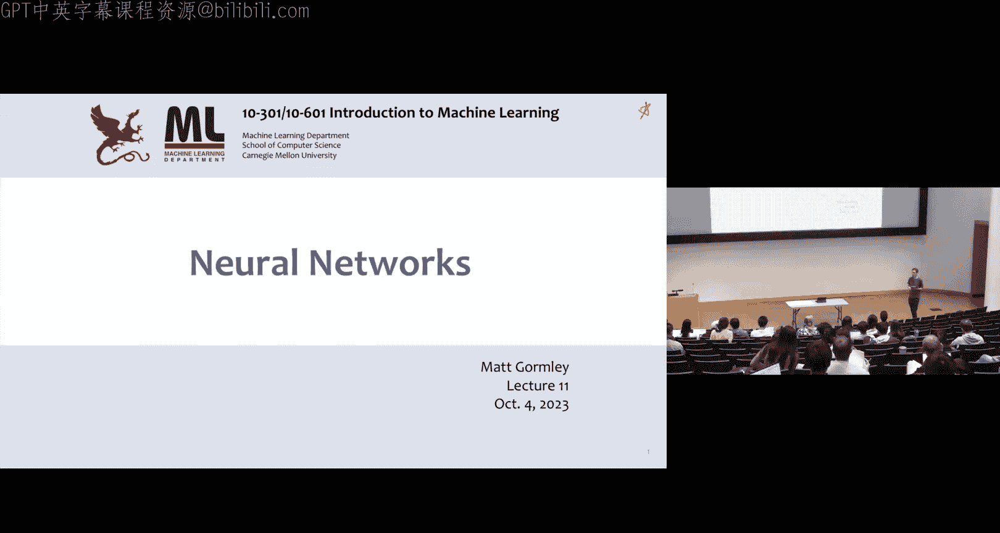
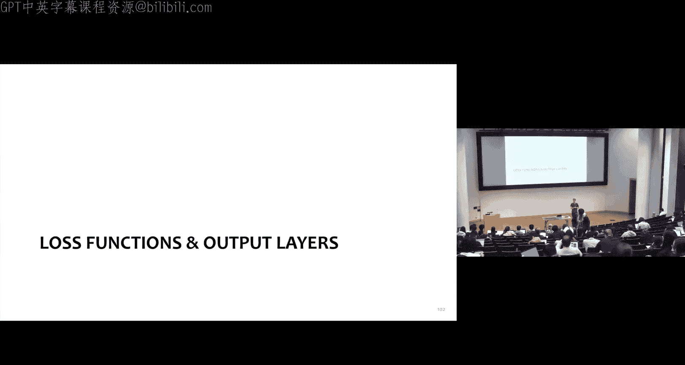

# 机器学习导论：11：神经网络 🧠

## 概述
在本节课中，我们将学习神经网络。神经网络是深度学习的核心，也是当前生成式AI革命的关键。我们将探讨如何使用神经网络建立新的决策边界和决策规则。




## 神经网络简介
上一节我们介绍了机器学习的基本概念，本节中我们来看看一种强大的模型——神经网络。神经网络是深度学习的核心，它们在所有当前的生成式AI革命中扮演着重要角色。

### 神经网络与深度学习
以下是神经网络与深度学习关系的核心要点：
*   神经网络是深度学习的核心。
*   神经网络是当前生成式AI革命的关键。

### 神经网络与决策边界
以下是神经网络在决策方面的能力：
*   神经网络可以建立新的决策边界和决策规则。
*   神经网络可以学习复杂的非线性关系。

## 神经网络结构
了解了神经网络的重要性后，我们来看看它的基本结构。神经网络由多个层组成，包括输入层、隐藏层和输出层。

### 输入层
以下是输入层的作用：
*   输入层接收原始数据。
*   输入层将数据传递到隐藏层。

### 隐藏层
以下是隐藏层的作用：
*   隐藏层包含多个神经元。
*   隐藏层对数据进行处理和转换。

### 输出层
以下是输出层的作用：
*   输出层生成最终预测。
*   输出层将预测结果传递给用户。

## 神经网络计算
理解了结构之后，我们来看看神经网络是如何进行计算的。神经网络通过以下步骤进行计算：

1.  **前向传播**：将输入数据传递到网络，并计算每个神经元的输出。
2.  **激活函数**：对每个神经元的输出应用激活函数，例如Sigmoid或ReLU。
3.  **损失函数**：计算预测值与真实值之间的差异。
4.  **反向传播**：根据损失函数计算梯度，并更新网络参数。

## 神经网络示例
理论需要结合实践，下面我们来看一个简单的神经网络示例，用于二分类任务：

```
输入层 -> 隐藏层 -> 输出层
```

### 输入层
以下是该示例输入层的设定：
*   输入层包含两个特征：`x1`和`x2`。

### 隐藏层
以下是该示例隐藏层的设定：
*   隐藏层包含一个神经元，其权重为`w1`和`w2`。
*   隐藏层使用Sigmoid激活函数，公式为 **σ(z) = 1 / (1 + e^{-z})**。

### 输出层
以下是该示例输出层的设定：
*   输出层包含一个神经元，其权重为`b1`和`b2`。
*   输出层使用Sigmoid激活函数。



## 神经网络应用
掌握了基本原理后，我们来看看神经网络可以应用于哪些任务：
*   图像识别
*   自然语言处理
*   语音识别
*   推荐系统

## 总结
在本节课中，我们一起学习了神经网络的基本概念、结构和计算方法。神经网络是深度学习的核心，可以应用于各种任务，是理解现代人工智能的重要基础。