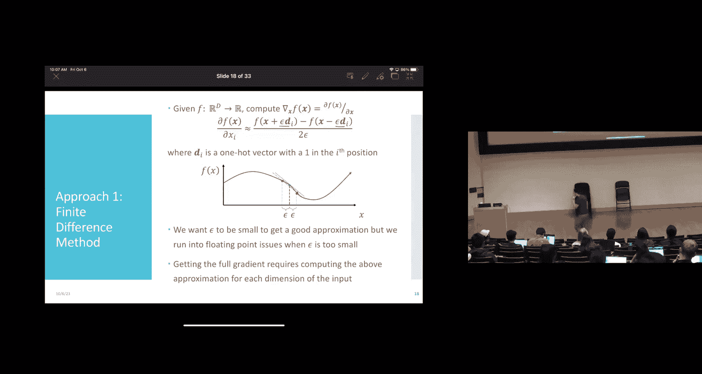
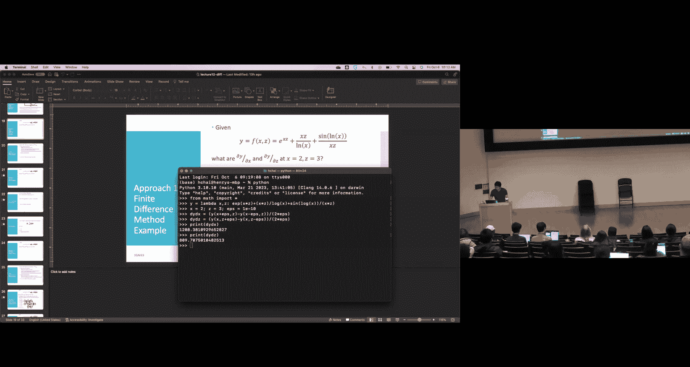
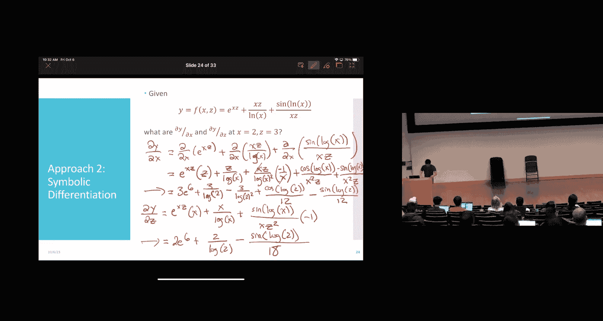
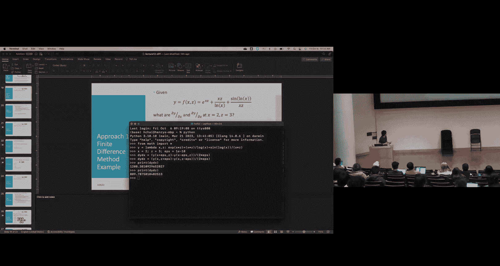
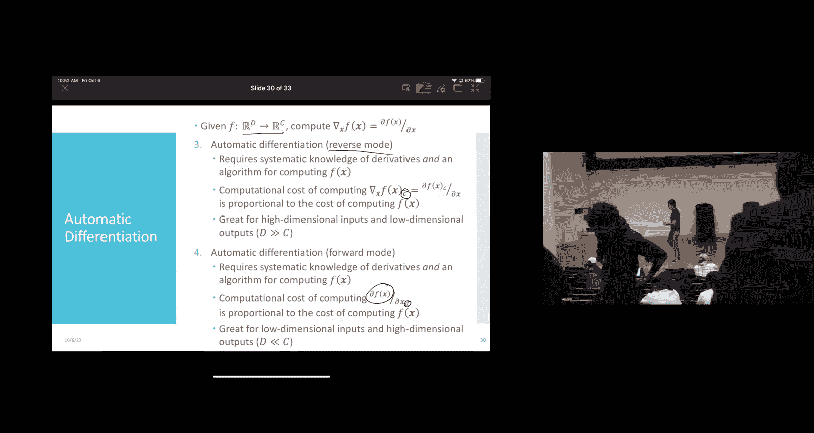

# 机器学习导论：12：反向传播 I 🧠

## 概述

在本节课中，我们将学习神经网络的基本概念，包括前向传播、损失函数和自动微分。这些是理解神经网络如何工作的基石。

## 神经网络模型 🧱

神经网络是一种由多个神经元组成的层次结构，用于模拟人脑处理信息的方式。每个神经元接收来自前一个层的输入，并产生输出，该输出传递到下一个层。神经网络的参数包括权重和偏置。

上一节我们介绍了神经网络的基本结构，本节中我们来看看神经网络是如何进行计算的。

### 前向传播

前向传播是指将输入数据通过神经网络，并计算输出预测的过程。在前向传播过程中，每个神经元都会计算其输出，并将其传递到下一个层。最终，输出层的输出是神经网络的预测。

一个神经元的基本计算过程可以表示为以下公式：
`z = w·x + b`
其中 `w` 是权重，`x` 是输入，`b` 是偏置。然后，`z` 会通过一个非线性激活函数（如 Sigmoid 或 ReLU）得到最终输出 `a`。

## 损失函数与评估 📉

损失函数用于衡量神经网络的预测与真实值之间的差异。选择合适的损失函数对于训练有效的模型至关重要。

以下是几种常用的损失函数：
*   **均方误差 (MSE)**: 用于回归任务，计算预测值与真实值之差的平方的平均值。公式为：`MSE = (1/n) * Σ(y_pred - y_true)²`
*   **交叉熵损失**: 用于分类任务，特别适用于输出为概率分布的情况。
*   **Softmax**: 通常与交叉熵损失结合使用，用于多分类任务，它将神经网络的原始输出转换为概率分布。

## 自动微分与反向传播 ⚙️

理解了前向传播和损失函数后，我们需要知道如何优化网络参数。这依赖于计算梯度，而自动微分是实现这一点的关键工具。

### 自动微分



自动微分是一种用于计算函数梯度的方法，无需手动计算导数。它通过记录计算图中的操作来实现，可以高效地用于神经网络的前向传播和反向传播。


*（图示：计算图示例，展示了变量与操作之间的依赖关系）*


*（图示：自动微分在计算图中的前向与反向过程）*



### 反向传播

反向传播是一种用于训练神经网络的算法。在反向传播过程中，损失函数的梯度被计算，并用于更新神经网络的权重和偏置。反向传播算法基于微积分中的链式法则。


*（图示：反向传播算法中梯度从输出层向输入层逐层传递的过程）*

简单来说，反向传播的步骤是：
1.  进行前向传播，计算预测值和损失。
2.  从输出层开始，反向计算损失函数对于每一层参数的梯度。
3.  使用计算出的梯度，通过优化算法（如梯度下降）更新网络参数。

## 代码示例 💻

以下是一个使用Python和NumPy实现的简单神经网络前向传播的示例，它展示了如何计算加权和并使用Sigmoid激活函数：



```python
import numpy as np

# 定义神经网络参数（权重和偏置）
weights = np.array([[0.5, 0.5], [0.5, 0.5]]) # 2x2 权重矩阵
bias = np.array([0.5, 0.5]) # 偏置向量



# 定义Sigmoid激活函数
def sigmoid(x):
    return 1 / (1 + np.exp(-x))

# 定义前向传播函数
def forward(x):
    # 计算加权和： z = x * w + b
    z = np.dot(x, weights) + bias
    # 应用激活函数
    return sigmoid(z)

# 输入数据
x = np.array([1, 0])

# 计算预测输出
y_pred = forward(x)
print(“神经网络预测输出:”, y_pred)
```


*（图示：可能与代码对应的计算图或网络结构示意图）*


*（图示：Sigmoid激活函数的图形化表示）*

## 总结

本节课中我们一起学习了神经网络的核心基础。我们了解了神经网络模型和前向传播过程，认识了用于评估模型性能的损失函数，并初步探讨了自动微分与反向传播的概念，后者是神经网络能够从数据中学习的关键机制。



## 下节课预告 🔮

下节课我们将深入探讨神经网络的训练过程，详细讲解如何结合损失函数、梯度下降和反向传播算法来优化模型参数。


*（图示：可能展示梯度下降优化或更复杂网络训练的示意图）*