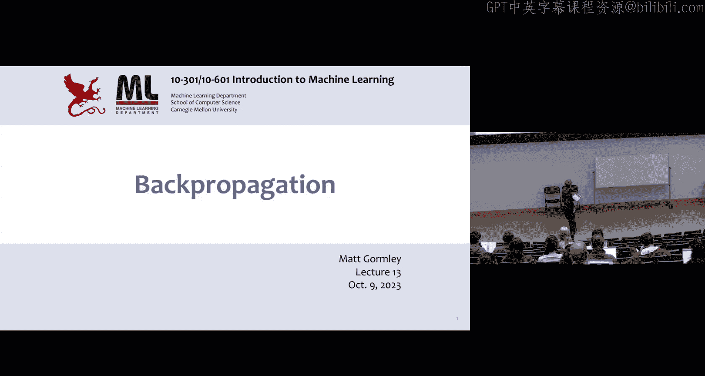
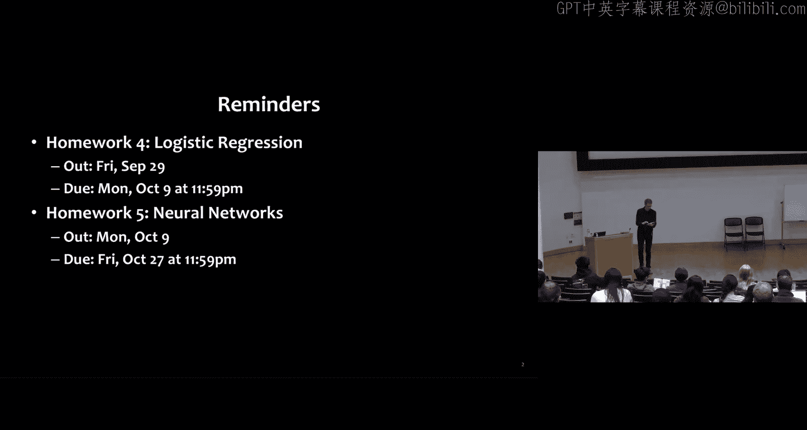
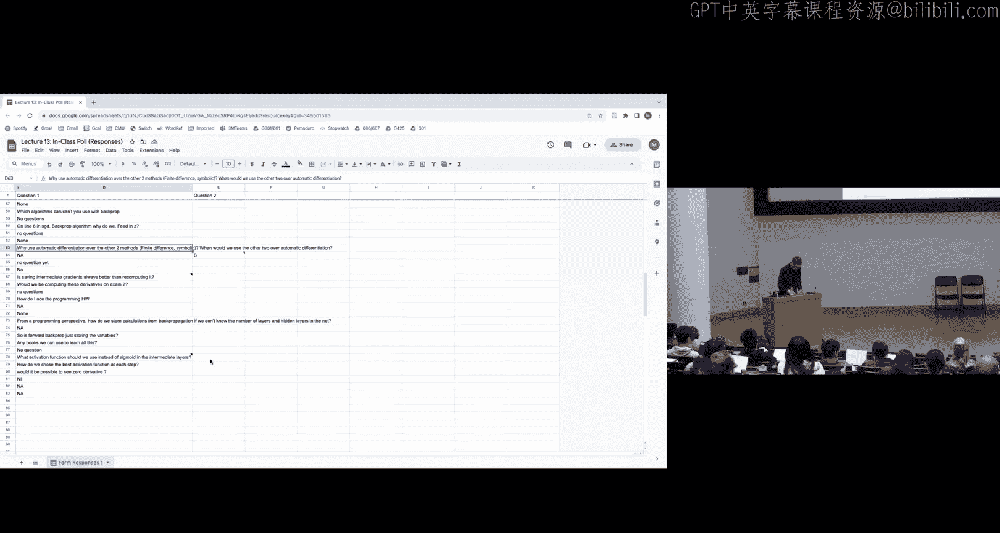
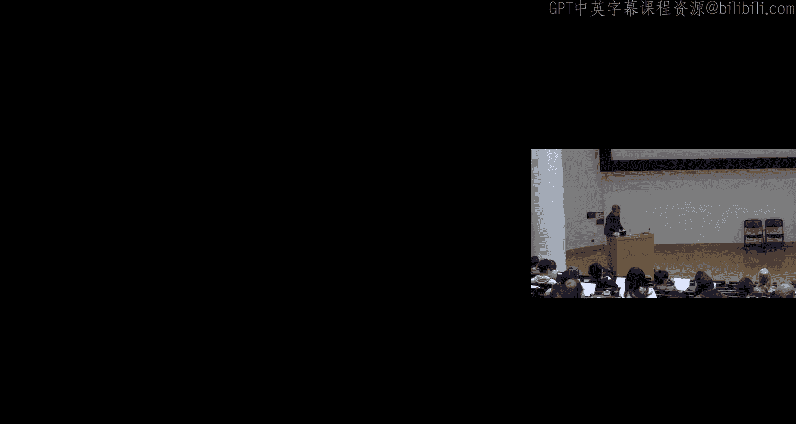
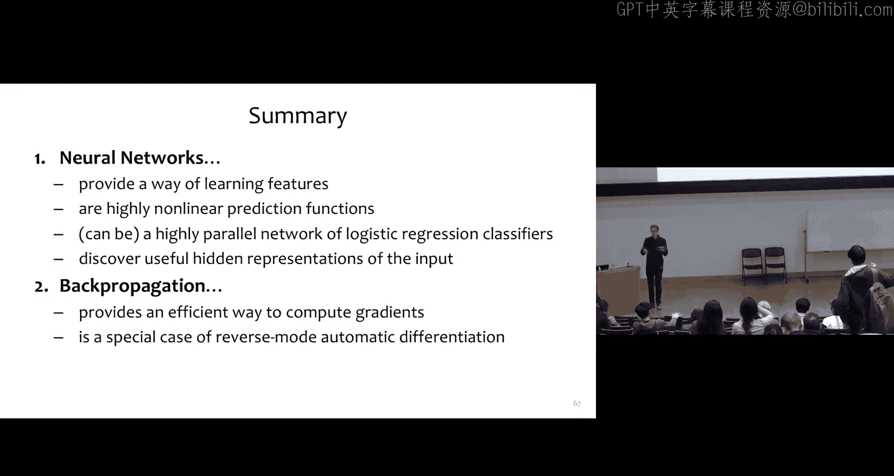

# 机器学习导论：13：反向传播 II 🧠

在本节课中，我们将更深入地探讨反向传播算法。我们将通过一系列示例，学习如何高效地计算可微函数的梯度，特别是当你已经拥有计算函数本身的算法时。课程将引导你理解如何逐行实现一个具有两个隐藏层的神经网络，为后续的实践作业打下基础。

## 回顾与概述

今天我们将更深入地探讨反向传播。

我们将利用这次讲座来继续探讨亨利上次开始的内容，探索一种多项式时间算法，用于高效地计算可微函数的梯度，而对于这些函数，您已经有了计算函数本身的算法。

我们将查看一些不同的示例。

我们将几乎展示如何高效地逐行实现一个具有两个隐藏层的神经网络，但然后我们将停止，因为我们必须留一些东西供你在作业中完成，所以我们将带你走到那里的大部分，然后你将有机会自己探索最后一步。

## 作业与课程安排

在我们进一步深入之前，让我们看看，我们有作业四。

今天做作业四，然后今天发布作业五，其中你需要实际实现一个神经网络。关于作业五的注意事项：作业五的时间安排是希望你在秋季假期期间不要工作，这意味着我们希望你在本周开始工作，所以我们强烈建议你尽早开始，这是一项具有挑战性的作业，但许多人已经在你之前完成了它，但重要的是你不要等到秋季假期之后才开始。

## 原住民人民日

好的，也祝原住民人民节快乐。所以，我想我可能应该在这里切换到Sakarri。

让我们看看lette Hobel。😊，你们大家说cheerie，好的，准备好了，让我们再试一次。

你们喜欢tick Oval。😊，非常好，你们在学习基切哦，好的，所以我的家人会为我感到骄傲，那么原住民人民对人工智能和机器学习有什么看法。

事实上，确实有一个关于这个主题的工作组，你可以阅读这份AI和原住民批判性立场论文，很多人在思考面对像这些能够保存艺术的生成模型时，如何保存原住民艺术。

白人长期以来一直有误归因原住民艺术风格或直接窃取他们的风格而不归因于他们的历史，所以我认为我们现在已经在AI中面临了一种文艺复兴，即未经归因就被窃取的艺术作品，所以我认为有很多机会可以从原住民在这个空间中经历数百年的挑战中学习。

有很多机会可以从原住民在这个空间中经历数百年的挑战中学习，所以现在我认为这已经成为公众话语的一部分，无论如何。

祝原住民人民节快乐。好的，让我们开始吧。

---

本节课中我们一起学习了反向传播算法的进一步应用，并了解了相关的课程安排与社会议题。我们强调了动手实践的重要性，并为你完成具有挑战性的神经网络实现作业做好了准备。