# 机器学习导论：14：PAC学习理论 🧠

## 概述

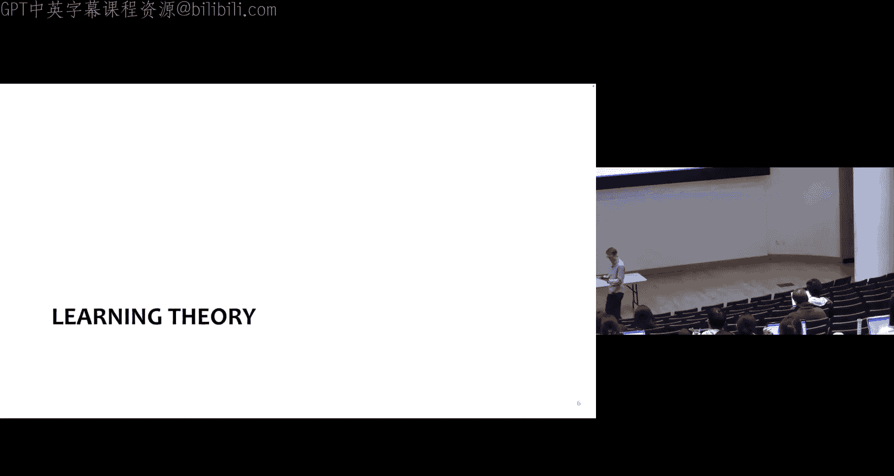

在本节课中，我们将学习PAC学习理论，这是一种用于评估机器学习算法性能的理论框架。我们将探讨如何使用训练误差来估计真实误差，并了解PAC学习如何帮助我们构建具有良好泛化能力的机器学习模型。

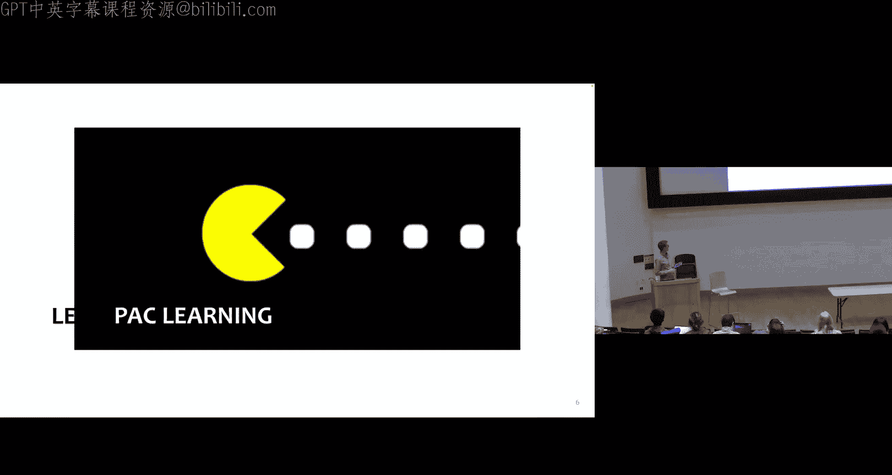

---

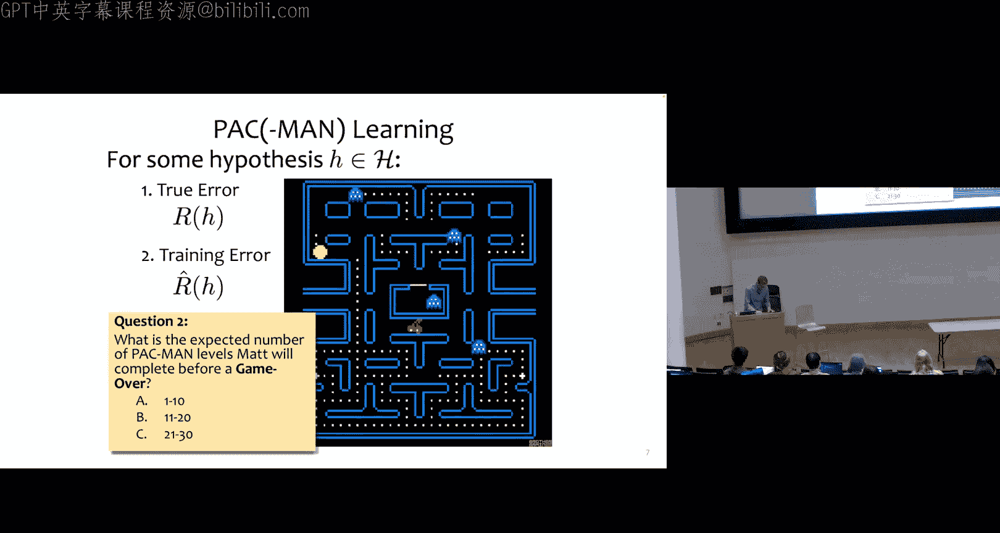

## 偏差 🤔

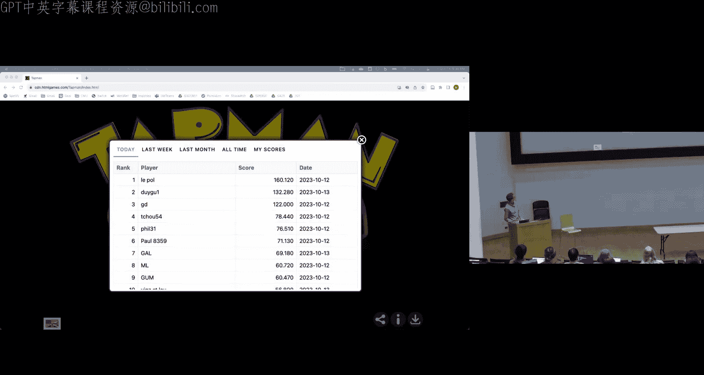

在机器学习中，“偏差”一词被广泛使用。以下是几种常见的定义：

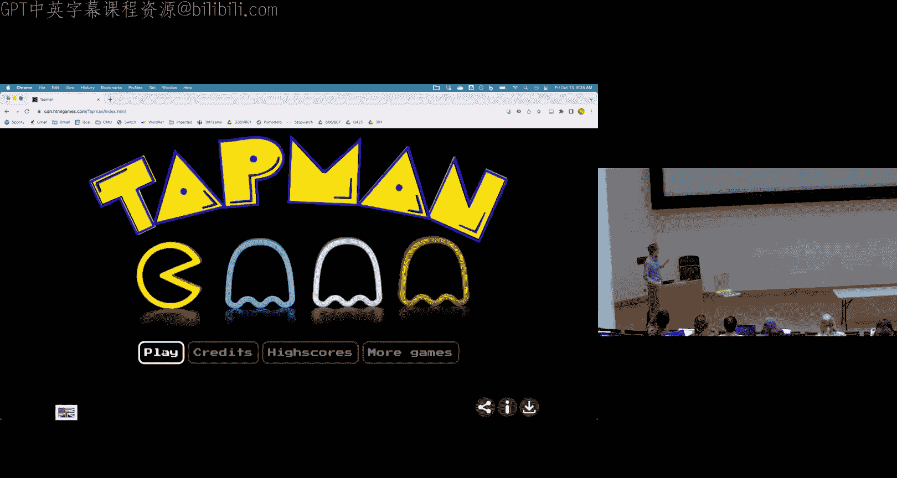

*   **线性模型中的加性项**：例如，在公式 `y = W^T * X + B` 中，`B` 是截距项。
*   **归纳偏差**：学习算法泛化到未见示例的原则。
*   **社会偏差**：当模型进行预测时存在的种族、社会经济或性别偏差。
*   **偏差-方差权衡**：模型预测的期望值与真实值之间的差异。

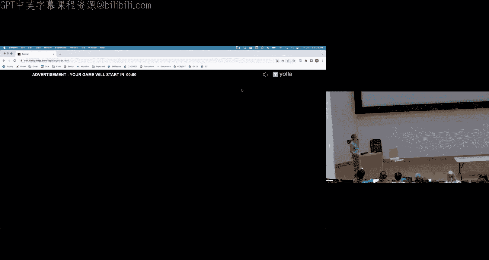

---

## PAC学习 🎯


上一节我们介绍了机器学习中“偏差”的多种含义。本节中，我们来看看PAC学习理论。


PAC学习（概率近似正确学习）是一种用于评估机器学习算法性能的理论框架。它回答了以下问题：
*   给定一个具有零训练误差的分类器，我们可以对真实误差说些什么？
*   给定一个具有低训练误差的分类器，我们可以对真实误差说些什么？


PAC学习模型假设我们有一些从某个分布中采样的 `x`，然后由真实概念 `C*` 进行标记以获得 `y`。关键变化是我们明确表示这些 `x` 是从某个分布中采样的。


---

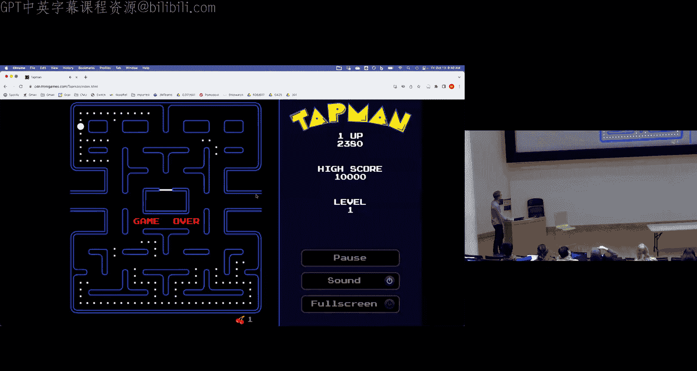

## 误差类型 ⚖️

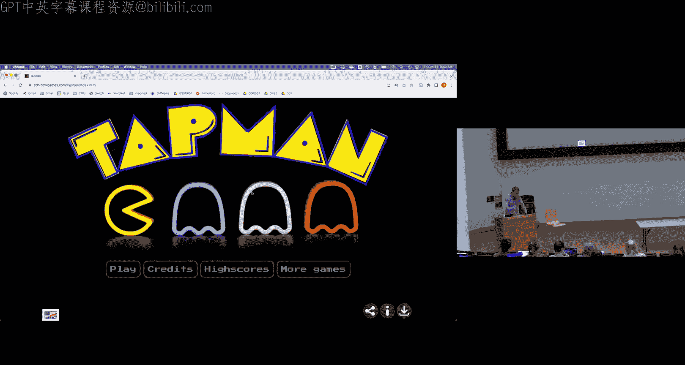

为了理解PAC学习，我们首先需要区分两种误差：


*   **训练误差**：在训练数据上评估模型的误差。
*   **真实误差**：在未知数据上评估模型的误差。


---


## PAC准则 📏

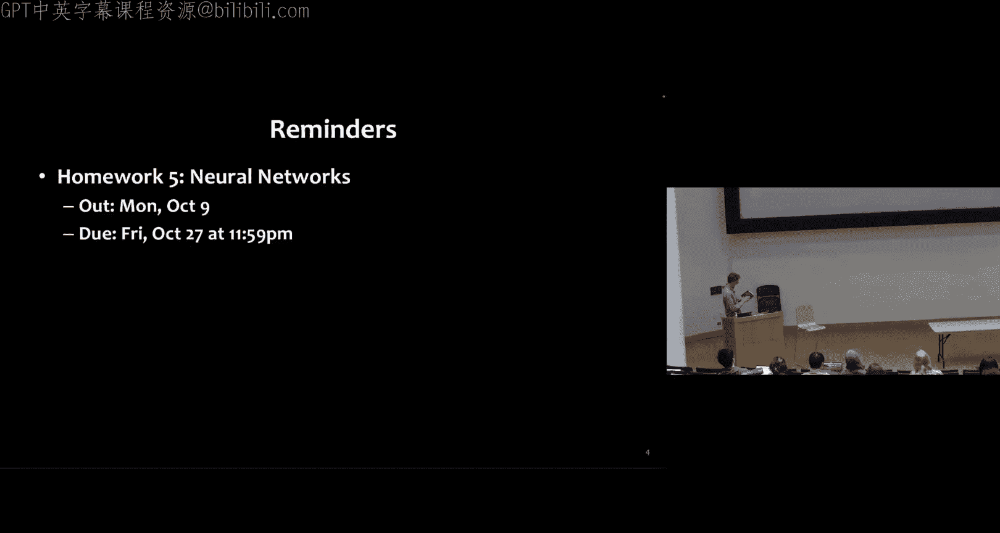

了解了误差类型后，我们来看看PAC学习的核心准则。

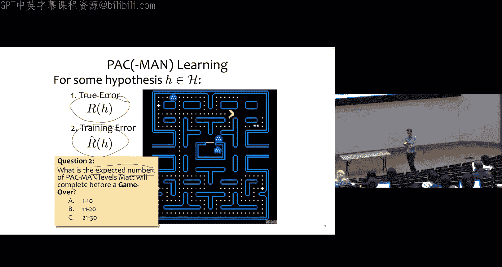

PAC准则是一种用于评估机器学习算法性能的通用准则。它假设我们想要找到一个假设 `h`，使得对于所有假设，真实误差和训练误差之间的绝对值小于 `ε`，并且概率大于或等于 `1 - δ`。

---

## 样本复杂度 📊

为了满足PAC准则，我们需要足够的训练数据。样本复杂度是指满足PAC准则所需的最小训练样本数量。

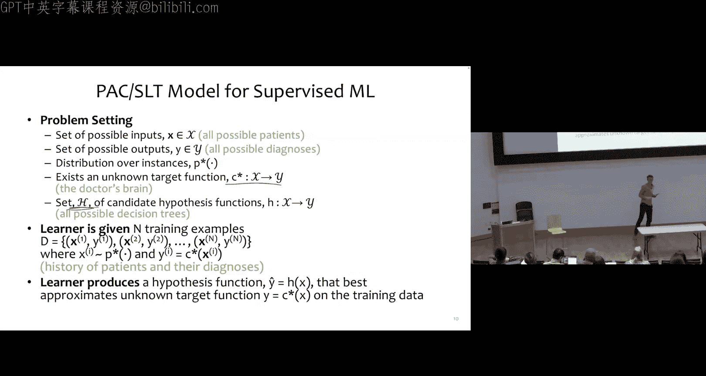

---

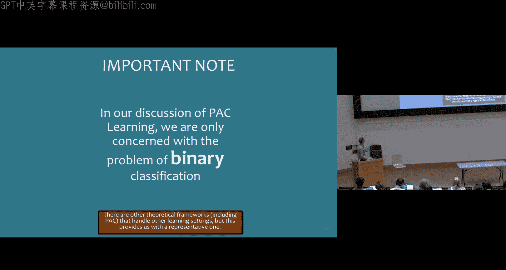

## 一致性 ✅

如果一个假设 `h` 在训练集上的误差为0，则称该假设与训练数据一致。

---

## 可行性案例和不可知案例 🔍

根据真实概念 `C*` 与我们的假设空间 `H` 的关系，我们可以将学习问题分为两类：

*   **可行性案例**：`C*` 在假设类 `H` 中。
*   **不可知案例**：`C*` 不在 `H` 中，或者 `C*` 在 `H` 中，但我们不确定。

---

## 样本复杂度界限 🧮

对于有限假设空间，我们可以使用以下公式来计算样本复杂度：

```
N ≥ (1/ε) * (log(|H|) + log(1/δ))
```

其中 `N` 是训练样本数量，`|H|` 是假设空间的大小，`ε` 是误差，`δ` 是置信度。

---

## VC维度 📐

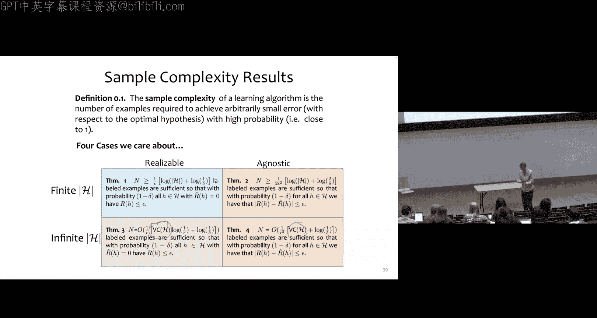

上面的界限只适用于有限假设空间。VC维度是衡量假设空间复杂性的另一种方法。它将允许我们为无限假设空间的情况提供复杂性界限。

---

## 总结

在本节课中，我们一起学习了PAC学习理论，这是一种用于评估机器学习算法性能的理论框架。我们探讨了如何使用训练误差来估计真实误差，并了解了PAC学习如何帮助我们构建具有良好泛化能力的机器学习模型。在下一节课中，我们将继续探讨VC维度和复杂性界限。