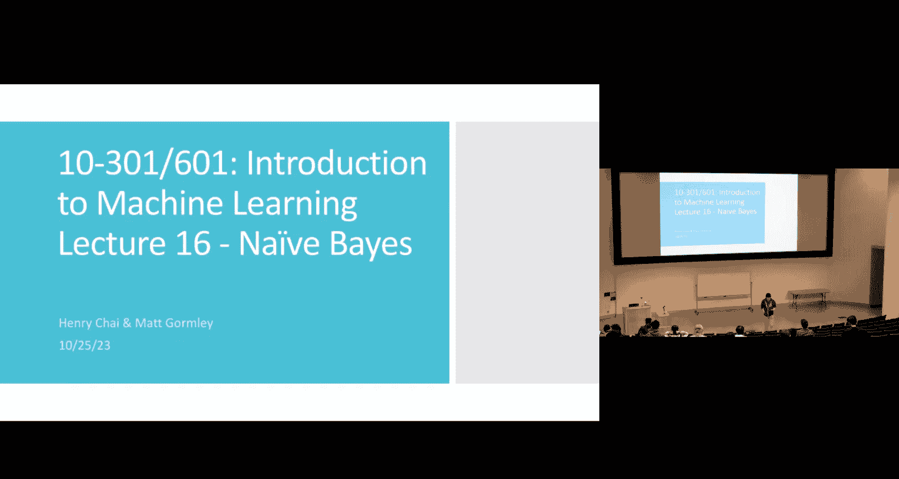
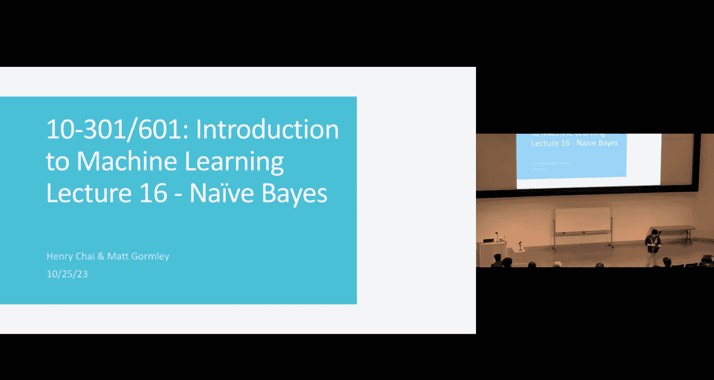
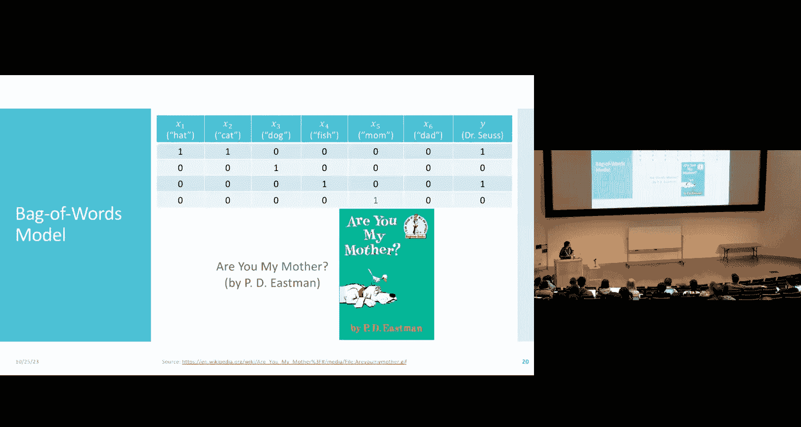
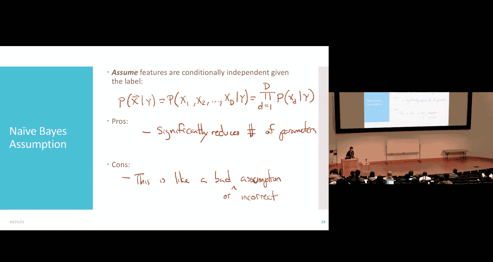
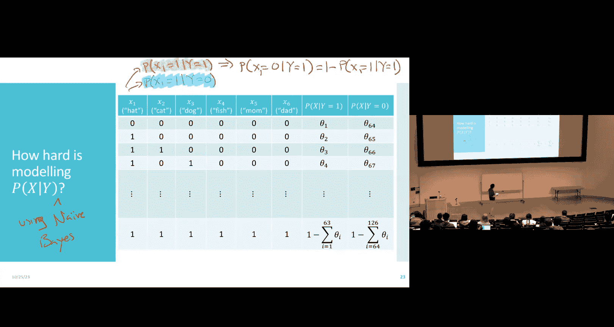
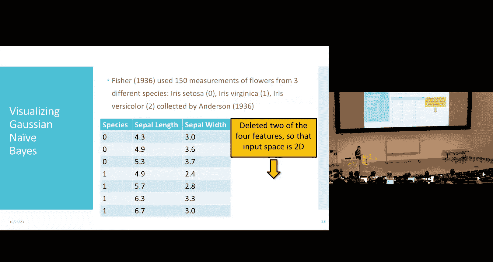
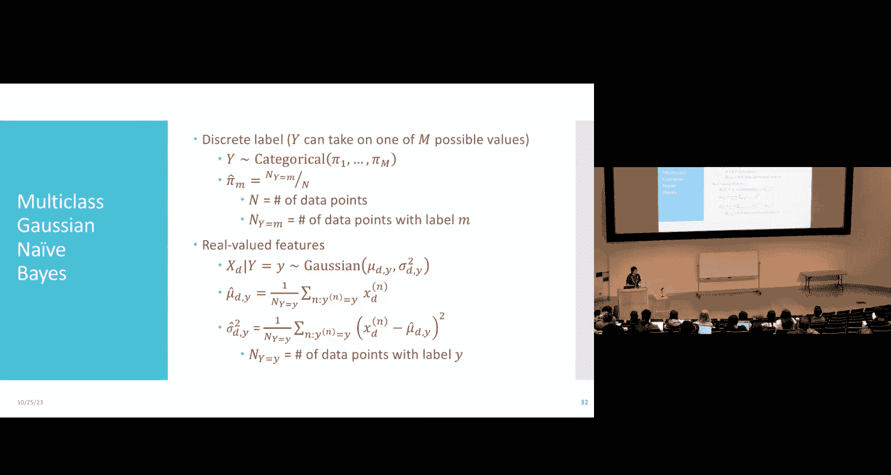
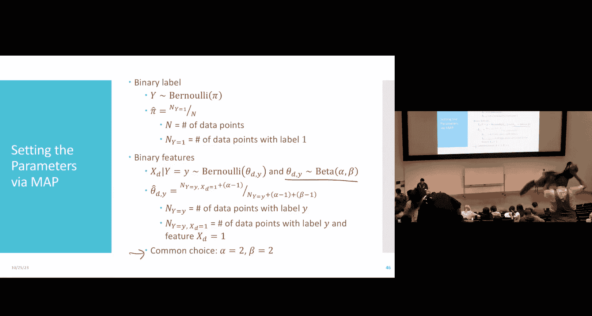

# 机器学习导论：16：朴素贝叶斯分类器 🧠



在本节课中，我们将继续学习机器学习中的贝叶斯方法，重点关注**朴素贝叶斯分类器**。我们将从最大似然估计和最大后验估计的回顾开始，然后深入探讨朴素贝叶斯的核心思想、公式推导及其实现。



## 最大后验估计（MAP）回顾 🔄

上一节我们介绍了最大似然估计，它假设参数的先验分布是均匀的。然而，在现实问题中，我们通常对参数有一定的先验知识。**最大后验估计** 则考虑了这种先验分布，旨在找到使**似然函数**与**先验分布**乘积最大的参数值。

**公式**：
$$
\theta_{MAP} = \arg\max_{\theta} P(D|\theta)P(\theta)
$$
其中，$P(D|\theta)$ 是似然函数，$P(\theta)$ 是先验分布。


## 贝塔先验分布 📊


为了在MAP估计中融入先验知识，我们常使用**贝塔分布**作为先验。贝塔分布由两个参数 $\alpha$ 和 $\beta$ 控制，能灵活地表达我们对参数 $\theta$ 的初始信念。

**公式**：

$$
P(\theta|\alpha, \beta) = \frac{\Gamma(\alpha + \beta)}{\Gamma(\alpha)\Gamma(\beta)}\theta^{\alpha-1}(1-\theta)^{\beta-1}
$$
其中，$\Gamma(\cdot)$ 是伽马函数。当 $\alpha=\beta=1$ 时，贝塔分布退化为均匀分布。


## 朴素贝叶斯分类器 🎯

理解了MAP估计后，我们来看一个重要的应用——**朴素贝叶斯分类器**。它是一种基于贝叶斯定理的简单而强大的分类方法，其核心假设是：在给定类别标签的条件下，所有特征都是**条件独立**的。

**公式**：
$$
P(y|x) = \frac{P(x|y)P(y)}{P(x)}
$$
其中：
*   $P(y|x)$ 是给定特征 $x$ 后类别 $y$ 的**后验概率**。
*   $P(x|y)$ 是给定类别 $y$ 时特征 $x$ 的**似然**。
*   $P(y)$ 是类别 $y$ 的**先验概率**。
*   $P(x)$ 是特征的**证据**，在比较不同类别时可以作为常数忽略。






由于“朴素”地假设特征条件独立，联合似然 $P(x|y)$ 可以分解为每个特征似然的乘积：
$$
P(x|y) = P(x_1|y) \cdot P(x_2|y) \cdot ... \cdot P(x_d|y)
$$
这使得模型非常易于训练和预测。


## 朴素贝叶斯分类器的实现 💻

朴素贝叶斯分类器的训练过程就是基于训练数据估计先验概率 $P(y)$ 和每个特征的条件概率 $P(x_i|y)$。预测时，计算每个类别的后验概率并选择最大的。

以下是一个概念性的实现步骤描述：

1.  **计算先验概率**：统计每个类别在训练集中的出现频率。
    ```python
    # 伪代码示例
    prior[y] = count(y) / total_samples
    ```

2.  **计算条件概率**：对于每个特征和每个类别，统计该特征取特定值的频率。
    ```python
    # 伪代码示例 (以离散特征为例)
    conditional_prob[feature][value][class] = count(feature=value AND class) / count(class)
    ```

3.  **进行预测**：对于新样本，利用贝叶斯公式和条件独立假设计算每个类别的后验概率，取最大值对应的类别。
    ```python
    # 伪代码示例
    for each class c:
        posterior[c] = prior[c]
        for each feature i:
            posterior[c] *= conditional_prob[i][x_i][c]
    predicted_class = argmax(posterior)
    ```






## 总结 📝


本节课中我们一起学习了贝叶斯方法在分类中的一个经典应用——朴素贝叶斯分类器。

**核心要点包括**：
*   **最大后验估计（MAP）**：在估计参数时，不仅考虑数据本身的似然性，还结合了参数的先验知识。
*   **贝塔先验分布**：一种常用于表示概率参数先验知识的连续概率分布。
*   **朴素贝叶斯原理**：基于贝叶斯定理，并假设特征条件独立，从而简化计算。
*   **模型实现**：其训练本质是统计频率（先验概率和条件概率），预测则是计算后验概率并取最大。



朴素贝叶斯因其简单、高效且易于实现，被广泛应用于文本分类、垃圾邮件过滤等领域。尽管其“特征条件独立”的假设在现实中往往不严格成立，但它仍然在许多问题上表现出色。

