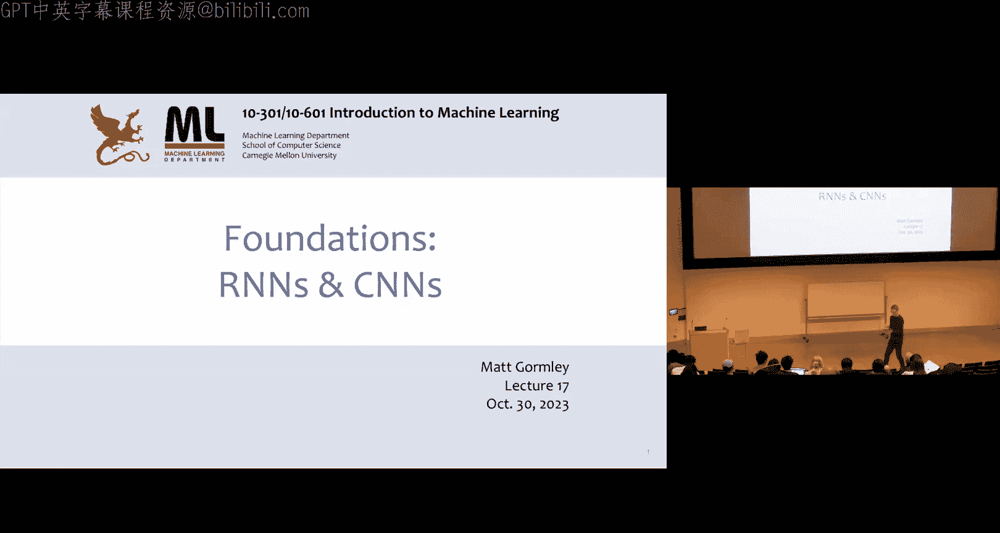
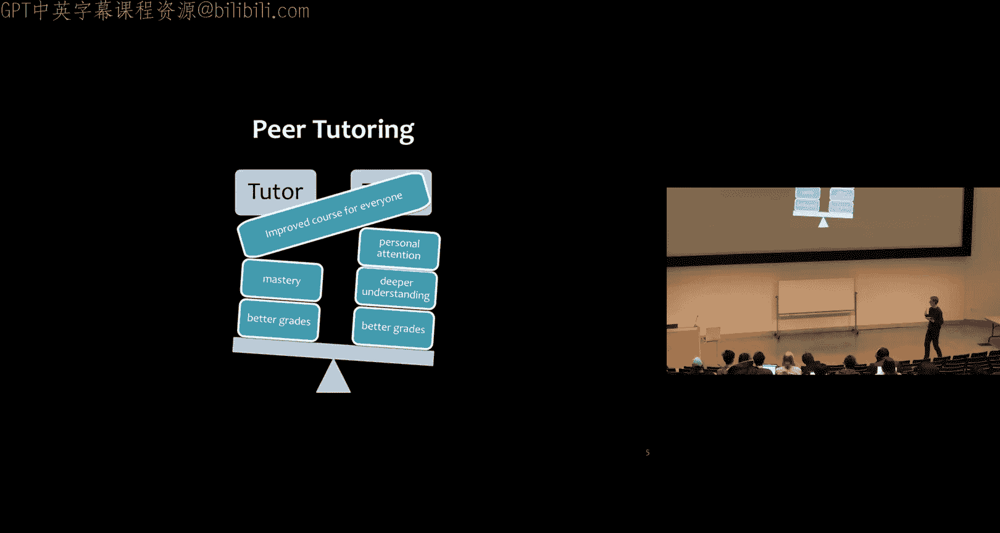
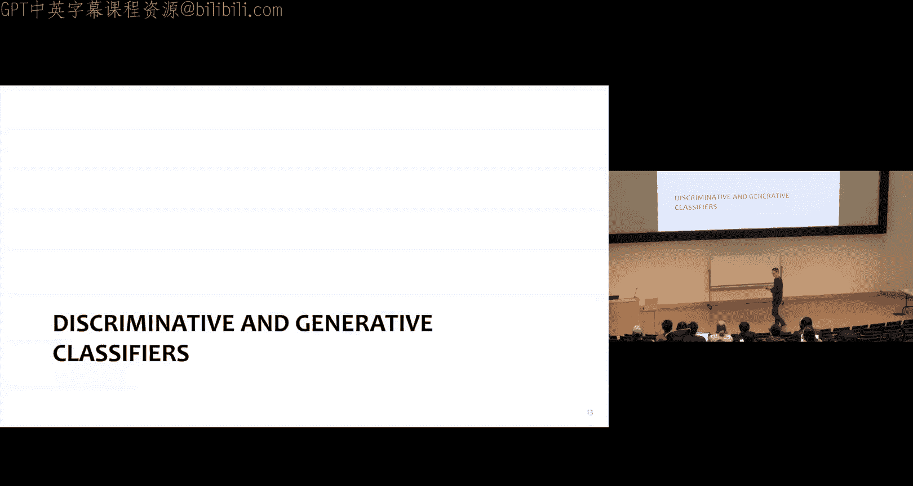
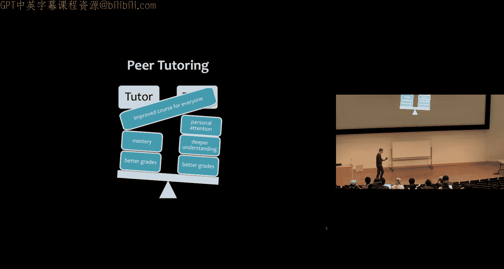
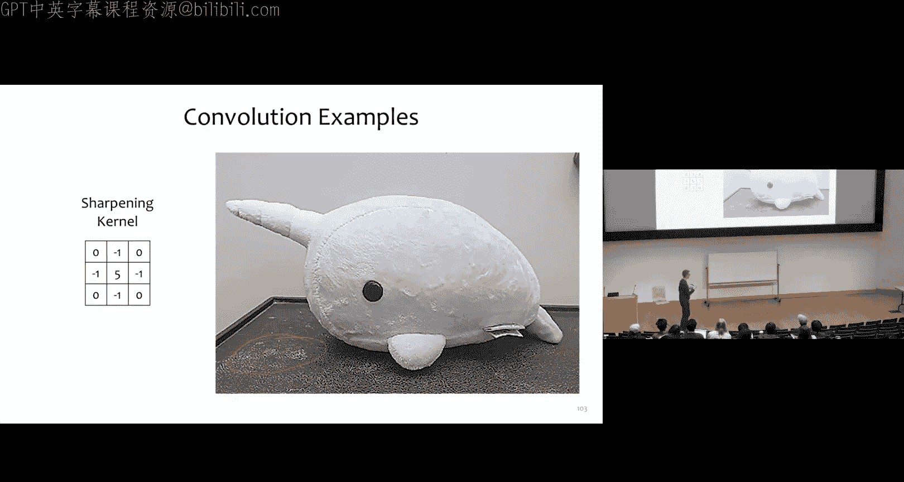
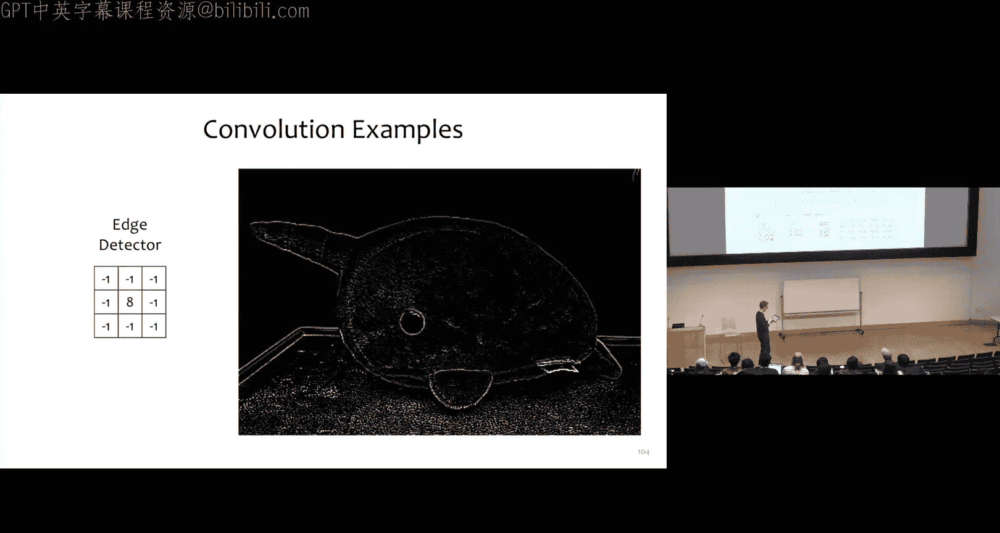
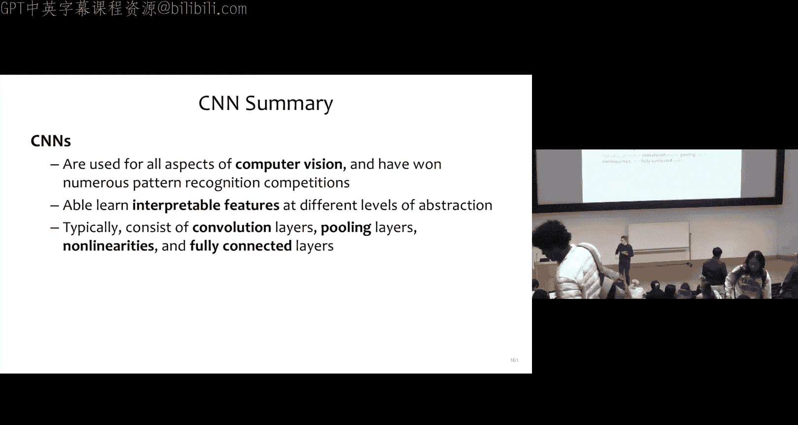

# 机器学习导论：第3章：生成模型与判别模型 🧠

## 概述

在本节课中，我们将学习机器学习中两种核心建模方法：生成模型与判别模型。我们将探讨它们的核心区别、工作原理、学习方式以及典型应用场景。

## 生成模型与判别模型

理解生成模型与判别模型是掌握许多机器学习算法的基础。它们代表了两种不同的建模思路。

### 生成模型

生成模型旨在对数据的完整生成过程进行建模。它通过学习输入数据 `x` 和输出标签 `y` 的联合概率分布 `P(x, y)` 来工作。

一个典型的生成模型例子是**朴素贝叶斯分类器**。在训练阶段，生成模型的目标通常是最大化训练数据中所有 `(x, y)` 数据对的联合似然度。

其核心公式可以表示为学习联合概率分布：
`P(x, y) = P(y) * P(x|y)`

### 判别模型

与生成模型不同，判别模型不关心数据是如何生成的，它只关注如何根据给定的输入 `x` 来区分或预测输出 `y`。因此，它直接对条件概率 `P(y|x)` 进行建模。

在训练时，判别模型的目标是最大化给定输入 `x` 时，其对应标签 `y` 的条件似然度。

### 生成模型与判别模型之间的区别

上一节我们分别介绍了两种模型的定义，现在我们来具体比较它们的核心区别。

以下是生成模型与判别模型的主要区别点：

*   **建模目标**：生成模型提供了关于数据来源的“完整故事”，即 `x` 和 `y` 是如何共同产生的；而判别模型只关心如何根据 `x` 来区分哪个 `y` 更合适。
*   **主要用途**：生成模型因其学习了数据的分布，通常可用于**生成新的数据样本**；判别模型则更专注于**分类或回归**等判别任务。

## 最大似然估计与正则化

无论是生成模型还是判别模型，其参数学习过程常常依赖于似然度最大化。最大似然估计（MLE）的核心思想是找到一组模型参数，使得观测到的数据在该参数下出现的概率（似然度）最大。

对于生成模型，我们最大化**联合似然度**；对于判别模型，我们最大化**条件似然度**。

最大后验概率（MAP）估计是MLE的一个扩展，它在最大化似然度的基础上，还加入了模型参数的先验概率 `P(θ)`。这相当于在目标函数中引入了正则化项 `F(θ)`，用于防止过拟合。

## 生成模型与判别模型的比较

为了更清晰地展示两种模型的特性，以下是一个对比表格：

| 特征 | 生成模型 | 判别模型 |
| :--- | :--- | :--- |
| **建模目标** | 联合分布 `P(x, y)` | 条件分布 `P(y\|x)` |
| **核心思想** | 模拟数据生成过程 | 学习决策边界 |
| **优点** | 可生成新数据；对缺失数据更鲁棒 | 通常分类准确率更高；所需假设更少 |
| **缺点** | 需要更多数据来估计分布；可能做出不必要假设 | 无法生成数据；对异常输入可能不鲁棒 |

## 生成模型与判别模型的应用

理解了原理和区别后，我们来看看它们在现实世界中的典型应用。

以下是两类模型常见的应用场景：

*   **生成模型的应用**：图像生成（如GAN）、文本生成、语音合成、数据增强、异常检测（学习正常数据分布）。
*   **判别模型的应用**：图像分类、垃圾邮件过滤、语音识别、客户流失预测、医疗诊断。

## 总结

在本节课中，我们一起学习了机器学习中生成模型与判别模型的核心知识。我们明确了生成模型通过建模 `P(x, y)` 来学习数据整体分布，可用于数据生成；而判别模型通过建模 `P(y|x)` 直接学习从输入到输出的映射，更专注于分类预测。两者在目标、方法和应用上各有侧重。在实际项目中，选择哪种模型取决于具体任务的需求、数据特点以及对模型能力的期望。