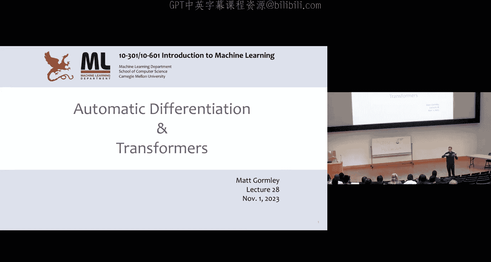
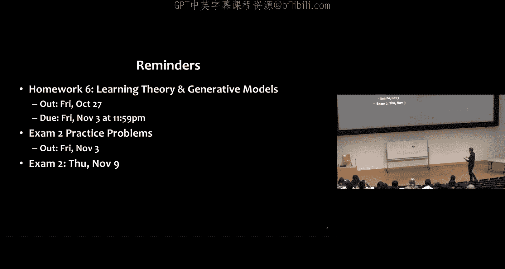
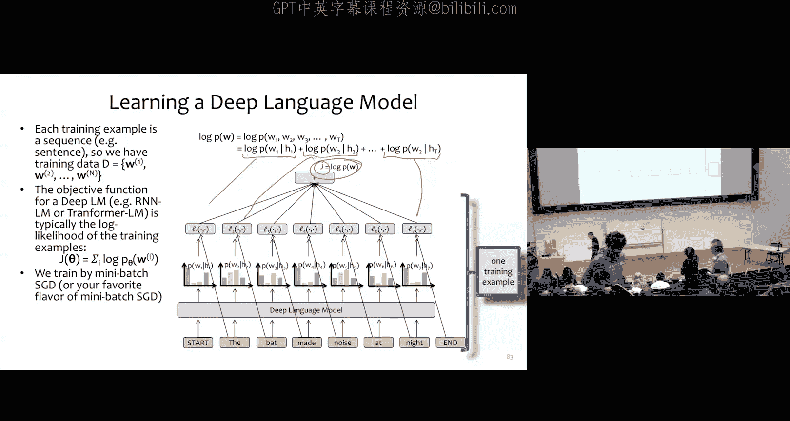

# CMU《机器学习导论｜Fall 2023 10-301/601 Introduction to Machine Learning》：2：自动微分与Transformer

## 概述 📋

在本节课中，我们将探讨深度学习的不同视角，特别是如何构建深度学习库，以及自动微分的概念。我们将深入了解模块化计算图，并以此为基础，探讨Transformer及其在深度学习中的应用。

## 模块化自动微分 🔧

上一节我们介绍了深度学习的基本框架，本节中我们来看看如何高效地计算梯度，这是训练神经网络的核心。

### 回顾反向传播算法

反向传播算法是一种自动微分技术，用于计算神经网络中每个参数的梯度。它有两种主要的实现视角。

以下是反向传播算法的两种版本：

*   **链式法则**：逐层计算梯度，从输出层开始，逐层向输入层传播。
*   **累积梯度**：在正向传播过程中，累积每个节点的梯度信息，然后在反向传播过程中一次性计算。

### 模块化自动微分

基于反向传播的思想，我们可以将神经网络的计算过程模块化。模块化自动微分是指将神经网络分解为多个独立的模块，每个模块负责计算自己的正向传播和反向传播（梯度）。

以下是模块化自动微分的优势：

*   **代码重用**：可以轻松地将模块（如线性层、激活函数）应用于不同的模型。
*   **代码效率**：可以针对每个模块的计算过程进行专门优化。
*   **代码可读性**：代码结构清晰，易于理解和调试。

## Transformer 🤖

理解了如何高效计算梯度后，我们来看一个革命性的深度学习模型架构——Transformer。它彻底改变了自然语言处理等领域。

### 注意力机制

Transformer的核心是注意力机制。它是一种用于捕捉序列中不同元素之间关系的机制，让模型能够“关注”输入中最重要的部分。

注意力计算涉及几个关键概念和步骤。以下是注意力计算的核心组件与公式：

*   **查询（Query）**：表示当前需要计算注意力的目标向量。
*   **键（Key）**：表示序列中所有元素的向量，用于与查询进行比较。
*   **值（Value）**：表示序列中所有元素的向量，是最终加权求和的对象。
*   **注意力权重**：表示每个元素对当前查询的重要性。
*   **注意力计算公式**：
    1.  **分数**：计算查询和每个键之间的点积，并除以键向量维度的平方根进行缩放，以防止梯度消失。公式为：`分数 = (Q * K^T) / sqrt(d_k)`。
    2.  **Softmax**：对分数应用softmax函数，将其转换为概率分布，即注意力权重。
    3.  **线性组合**：将值与对应的注意力权重相乘，然后求和，得到最终的注意力输出。公式为：`输出 = softmax(分数) * V`。

### 多头注意力

单一的注意力机制可能只关注到一种模式的信息。为了让模型能够同时关注来自不同表示子空间的信息，Transformer使用了多头注意力。

多头注意力计算过程如下：

*   **多个查询、键和值**：将原始的查询、键、值通过不同的线性投影矩阵，映射到多个子空间中。
*   **多个注意力权重**：在每个子空间内独立进行上述的注意力计算。
*   **拼接与线性变换**：将所有子空间的输出拼接起来，再通过一个线性层进行融合。

### Transformer层

一个标准的Transformer编码器层由多个子层堆叠而成。每个Transformer层的计算遵循一个清晰的流程。

以下是Transformer层的主要计算步骤：

1.  **多头自注意力**：输入序列自己作为查询、键和值，计算注意力。
2.  **残差连接与层归一化**：将多头注意力的输出与原始的输入相加（残差连接），然后进行层归一化。这有助于缓解梯度消失和模型训练。
3.  **前馈神经网络**：对归一化后的结果应用一个简单的全连接前馈网络（通常包含一个非线性激活函数）。
4.  **再次残差连接与层归一化**：将前馈网络的输出与步骤2的结果相加，再进行一次层归一化。

### Transformer语言模型

Transformer架构非常适合构建强大的语言模型，例如GPT系列。这类模型的目标是根据已有的上下文预测下一个词。

Transformer语言模型的训练主要涉及以下方面：

*   **目标函数**：通常使用**交叉熵损失**，计算模型预测的概率分布与真实下一个词（one-hot向量）之间的差异。公式可以简化为负对数似然。
*   **优化器**：使用基于梯度的优化算法（如Adam）来最小化损失函数，更新模型参数。

## 总结 🎯

在本节课中，我们一起学习了模块化自动微分和Transformer的核心概念。我们了解到，模块化自动微分通过将计算图分解为可重用的模块，提高了代码的效率和可维护性。而Transformer模型凭借其核心的注意力机制，特别是多头注意力，能够有效地处理序列数据，并已成为现代深度学习，尤其是自然语言处理领域的基石架构。