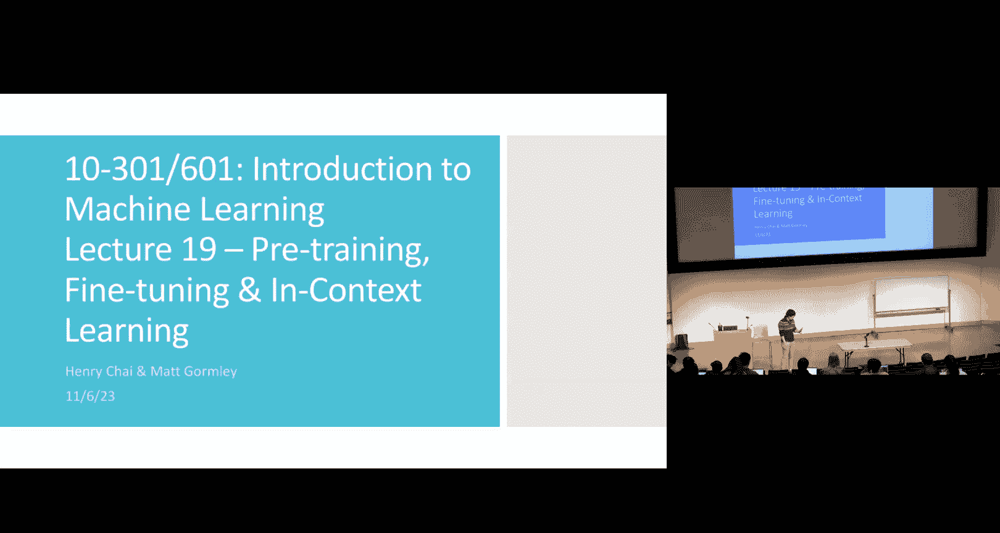
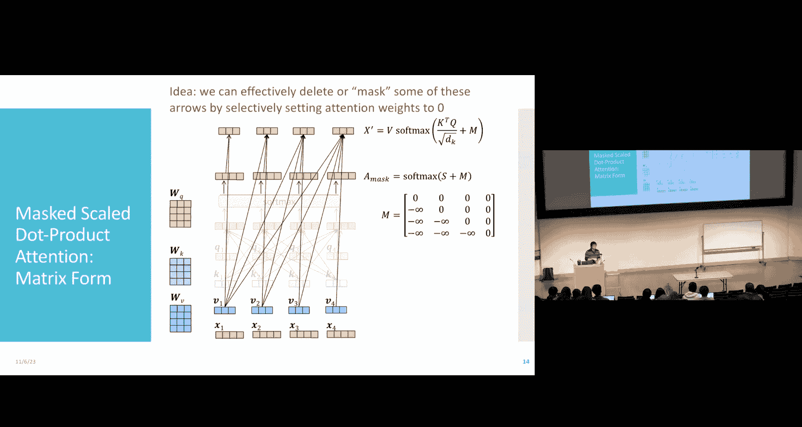
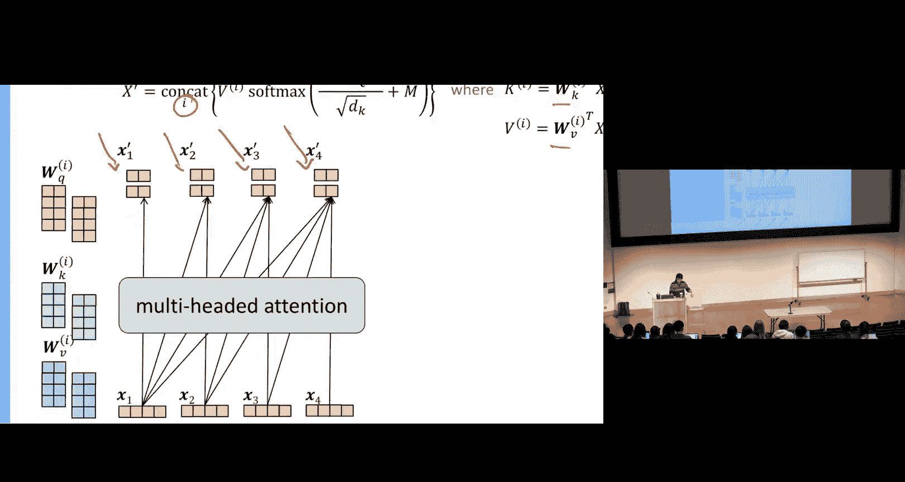
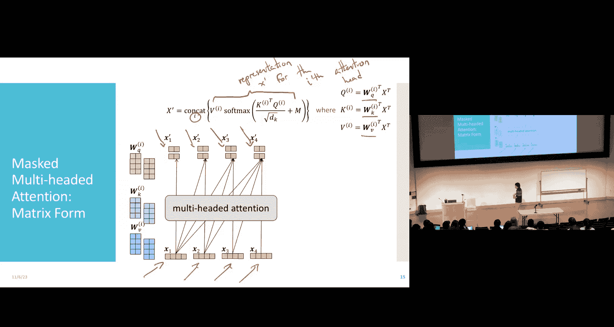
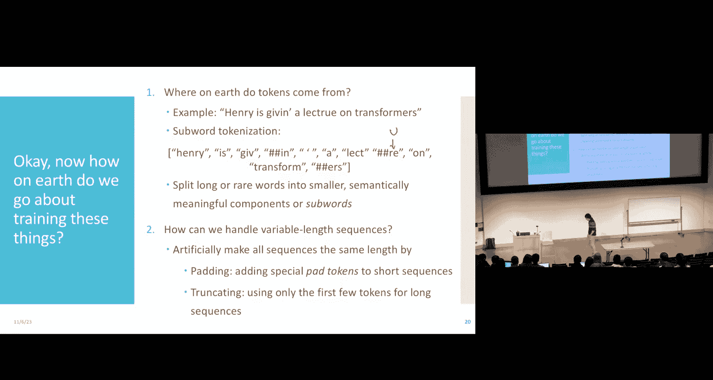
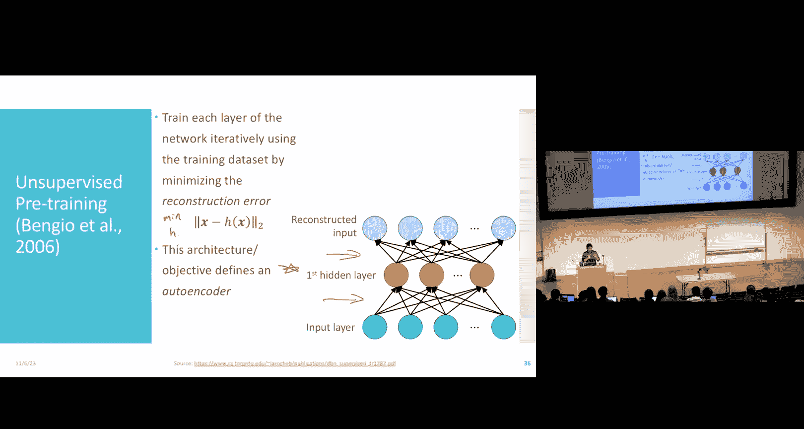
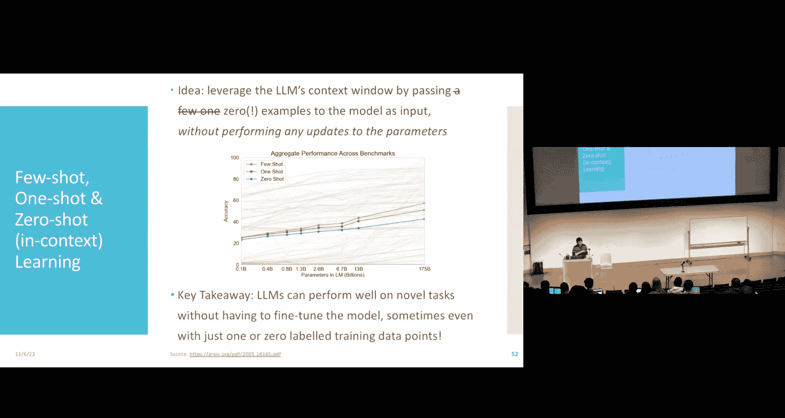
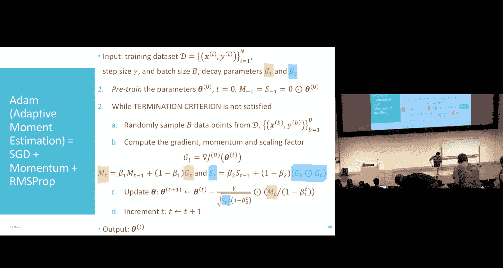
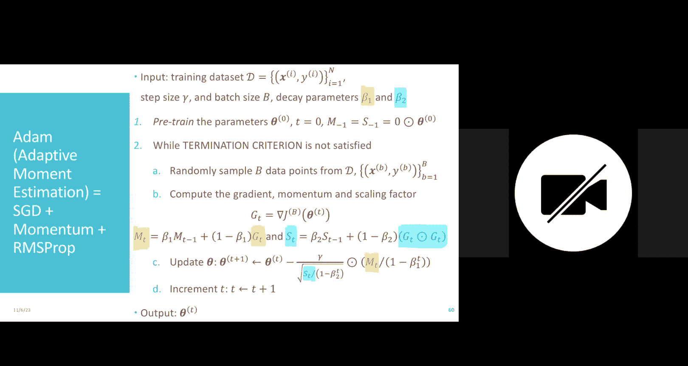

# 机器学习导论：19：预训练、微调与情境学习 🧠

在本节课中，我们将学习机器学习中的三个核心概念：**预训练**、**微调**和**情境学习**。这些是现代大型语言模型（如GPT系列）得以成功和应用的关键技术。我们将从注意力机制这一基础组件开始，逐步理解这些高级概念。

---

## 2. 注意力机制 🔍

上一节我们介绍了本课的主题。本节中，我们来看看Transformer模型的核心——注意力机制。它使模型能够专注于输入序列中最重要的部分。

### 2.1 注意力函数

注意力机制通过计算每个输入token与所有其他token之间的关联度来工作。其核心是一个数学函数。

**公式**：
$$
\text{Attention}(Q, K, V) = \text{softmax}(\frac{QK^T}{\sqrt{d_k}})V
$$
其中，$Q$ 是查询向量，$K$ 是键向量，$V$ 是值向量，$d_k$ 是键向量的维度。$\sqrt{d_k}$ 用于缩放点积，防止梯度过大或过小。

### 2.2 多头注意力

单一的注意力机制可能只捕捉到一种类型的依赖关系。为了学习更丰富的表示，我们可以使用多头注意力。

**公式**：
$$
\text{MultiHeadAttention}(Q, K, V) = \text{Concat}(\text{Head}_1, \text{Head}_2, ..., \text{Head}_h)W^O
$$
其中，$\text{Head}_i$ 是第 $i$ 个独立的注意力头，$W^O$ 是将拼接后的结果投影到最终维度的输出矩阵。这允许模型同时关注来自不同表示子空间的信息。

### 2.3 掩码

在序列生成任务（如机器翻译）中，模型在预测当前位置的token时，不应看到未来的信息。为此，我们使用掩码来屏蔽未来的注意力权重。

**公式**：
$$
M = \text{diag}(\text{ones}(n) \times -\infty)
$$
其中，$n$ 是token的数量。这个上三角矩阵（对角线及以下为0，以上为负无穷）与注意力分数相加后，经过softmax，未来的位置权重会变为0。

---

## 3. 预训练 🏋️

理解了模型的基础架构后，我们来看如何训练它。预训练是模型学习通用知识和表示的第一步。

预训练是一种在特定下游任务之前，使用大规模数据对模型进行训练的方法。其目标是让模型学习到对语言或世界通用的、有用的表示。

### 3.1 监督预训练

在监督预训练中，我们使用带有标签的大规模数据集（如图像分类数据集ImageNet）来训练模型。

**公式**：
$$
\text{Loss} = \text{CrossEntropy}(H(x), y)
$$
其中，$H(x)$ 是模型对输入 $x$ 的预测，$y$ 是真实标签。模型通过最小化预测与真实标签之间的交叉熵损失来学习。

### 3.2 无监督预训练

对于自然语言处理，更常见的是无监督预训练。模型从海量无标签文本中学习，例如通过预测被掩盖的单词（掩码语言建模）或预测下一个句子。

**公式**：
$$
\text{Loss} = \text{ReconstructionError}(H(x), x)
$$
其中，$H(x)$ 是模型对输入 $x$ 的重建或预测，$x$ 是原始输入或目标。例如在BERT中，损失是预测被掩盖的原始token。

---

## 4. 微调 ⚙️

模型通过预训练获得了通用能力后，我们需要让它适应具体的任务，这就是微调。

微调是在预训练模型的基础上，使用特定任务（如情感分析、问答）的、通常规模较小的数据集，对模型参数进行进一步调整的过程。

**公式**：
$$
\text{Loss} = \text{CrossEntropy}(H(x), y)
$$
形式上与监督预训练的损失函数相同，但这里的 $(x, y)$ 来自特定任务的数据集，并且模型参数是从预训练权重开始更新的，而不是随机初始化。

---

## 5. 情境学习 📖

对于超大型模型，微调可能成本高昂。情境学习提供了一种更轻量级的任务适应方式。

情境学习是一种无需更新模型内部参数的学习方法。它利用大型语言模型强大的上下文理解能力，将任务描述和/或少数示例（“情境”）直接放在输入中，模型通过分析这个上下文来生成符合要求的输出。

**公式**：
$$
\text{Output} = \text{Model}(x, \text{Context})
$$
其中，$x$ 是当前要处理的实际输入，$\text{Context}$ 是包含任务指令和示例的上下文文本。模型根据整个输入序列生成输出。

---

## 6. 总结 🎯

本节课我们一起学习了构建和应用现代大语言模型的三个关键阶段。

首先，我们回顾了**注意力机制**，它是Transformer模型理解序列关系的数学基础。接着，我们探讨了**预训练**，即模型在海量数据上学习通用知识的过程。然后，我们学习了**微调**，如何将通用模型适配到具体任务上。最后，我们介绍了**情境学习**，一种无需参数更新、仅通过提示就能让模型执行新任务的灵活方法。

这些概念构成了从基础模型构建到实际应用的核心路径，理解它们对于掌握当代机器学习至关重要。

