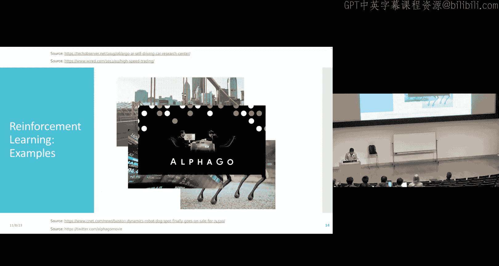
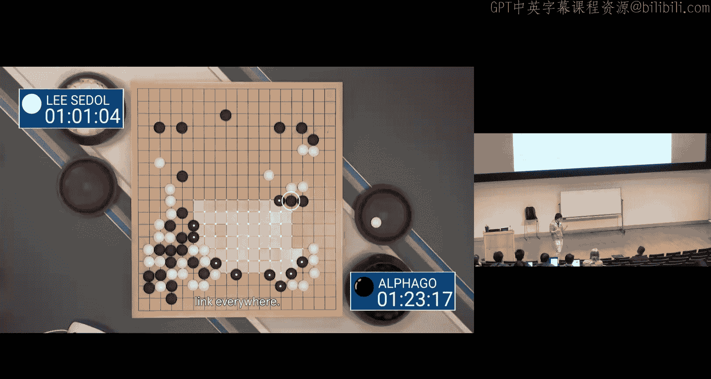
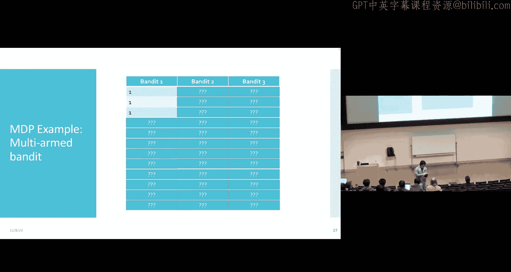
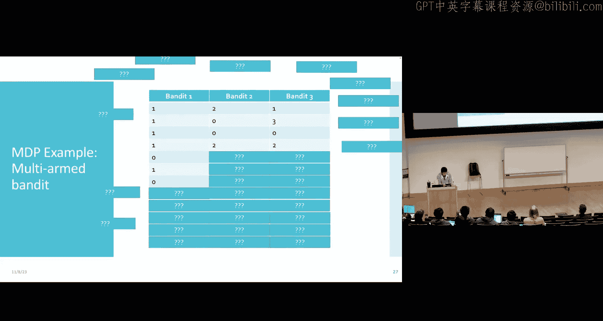
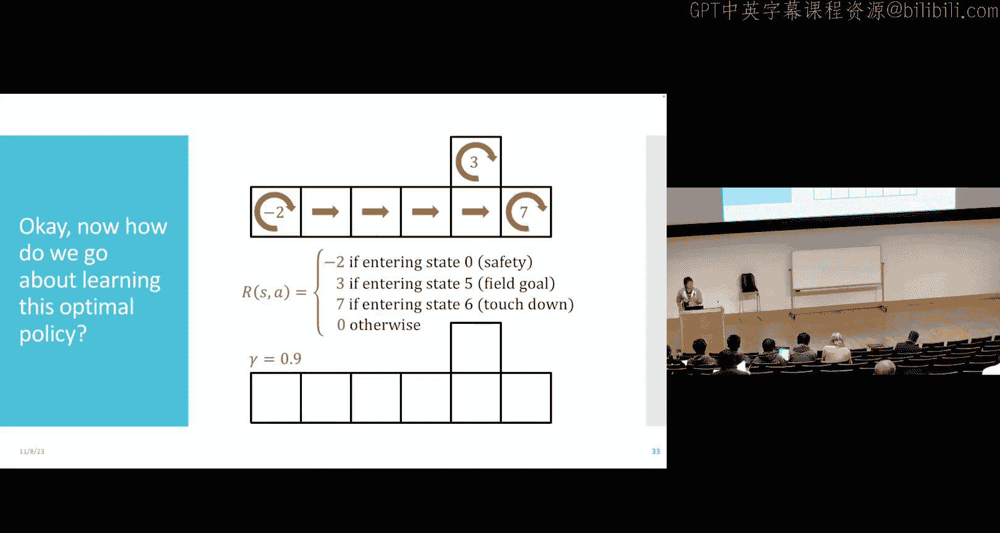

# 机器学习导论：第10章：强化学习与马尔可夫决策过程 🎮

## 概述

在本节课中，我们将探讨一种全新的机器学习范式——强化学习。我们将从强化学习的基本概念开始，并深入探讨其核心理论基础：马尔可夫决策过程。

## 强化学习简介

强化学习是一种机器学习方法，其核心思想是让一个智能体通过与环境的交互来学习如何采取行动，以最大化某种累积奖励。与监督学习不同，强化学习算法没有现成的“正确答案”数据集，而是需要通过试错来获取数据。

上一节我们介绍了强化学习的整体概念，本节中我们来看看构成一个强化学习问题的几个关键组件。

### 强化学习的关键组件

以下是定义强化学习问题的五个基本要素：

*   **状态空间**：描述环境所有可能状态的集合。
*   **动作空间**：智能体在给定状态下可以采取的所有可能动作的集合。
*   **奖励函数**：一个函数，它根据智能体采取的动作和所处的状态，给出一个即时奖励信号。
*   **策略**：一个将状态映射到动作的函数，它定义了智能体的行为方式。
*   **价值函数**：一个评估在特定状态下，遵循某个策略所能获得的长期预期回报的函数。

## 马尔可夫决策过程（MDP）

马尔可夫决策过程是描述顺序决策问题的标准数学模型，也是强化学习的理论基础。它形式化地定义了上述组件。

MDP 由以下五个核心组件组成：

*   **状态空间**：所有可能环境状态的集合，记为 `S`。
*   **动作空间**：所有可能动作的集合，记为 `A`。
*   **奖励函数**：`R(s, a)`，表示在状态 `s` 下采取动作 `a` 后获得的即时奖励。
*   **转移函数**：`P(s‘ | s, a)`，表示在状态 `s` 下采取动作 `a` 后，转移到状态 `s‘` 的概率。这体现了环境的动态特性。
*   **折扣因子**：`γ` (0 ≤ γ ≤ 1)，用于计算未来奖励的现值，平衡即时奖励和长期回报。

### MDP 的数学表示与目标

一个 MDP 可以形式化地表示为一个五元组：`(S, A, P, R, γ)`。

MDP 的目标是找到一个最优策略 `π*`，这个策略能够最大化从任何初始状态开始所获得的**预期累积折扣奖励**（也称为回报）。回报 `G_t` 的计算公式为：

\[
G_t = R_{t+1} + \gamma R_{t+2} + \gamma^2 R_{t+3} + ... = \sum_{k=0}^{\infty} \gamma^k R_{t+k+1}
\]

其中，`γ` 是折扣因子，确保无限序列的回报是有限的，并赋予近期奖励更高的权重。

## 探索与利用

在强化学习过程中，智能体面临一个根本性的权衡：是应该尝试新的动作来获取更多环境信息（探索），还是应该根据当前已知信息选择收益最大的动作（利用）。

以下是两种处理探索与利用权衡的经典策略：

*   **ε-贪婪策略**：智能体以一个小概率 `ε` 随机选择动作（探索），而以大概率 `1-ε` 选择当前认为最优的动作（利用）。
*   **UCB（置信度上界）策略**：为每个动作的估计价值加上一个不确定性度量，智能体选择置信上界最高的动作，从而在估计价值和探索潜力之间取得平衡。

## 价值函数

价值函数是评估策略好坏的核心工具。它量化了在特定状态（或状态-动作对）下，遵循特定策略所能获得的长期预期回报。

### 状态价值函数

状态价值函数 `V^π(s)` 表示从状态 `s` 开始，始终遵循策略 `π` 所能获得的预期回报。其贝尔曼方程（递归形式）为：

\[
V^\pi(s) = \mathbb{E}_\pi[G_t | S_t = s] = \mathbb{E}_\pi[R_{t+1} + \gamma V^\pi(S_{t+1}) | S_t = s]
\]

对于确定性环境，期望可以省略；对于随机环境，则需要考虑所有可能转移的期望值。

### 动作价值函数（Q函数）

动作价值函数 `Q^π(s, a)` 表示在状态 `s` 下采取动作 `a`，然后 thereafter 遵循策略 `π` 所能获得的预期回报。其贝尔曼方程为：

\[
Q^\pi(s, a) = \mathbb{E}_\pi[R_{t+1} + \gamma Q^\pi(S_{t+1}, A_{t+1}) | S_t = s, A_t = a]
\]

最优价值函数 `Q*(s, a)` 是所有可能策略中能获得的最大动作价值。一旦得到 `Q*`，最优策略就是简单地选择使 `Q*(s, a)` 最大的动作 `a`。

## 总结

在本节课中，我们一起学习了强化学习的基础知识及其形式化框架——马尔可夫决策过程。

**本节课中我们一起学习了**：

*   **强化学习的基本概念**：一种通过与环境交互来学习最优策略的机器学习方法。
*   **马尔可夫决策过程**：描述强化学习问题的标准数学模型，包含状态、动作、奖励、转移概率和折扣因子五个要素。
*   **探索与利用的权衡**：智能体在学习过程中面临的根本挑战，以及ε-贪婪、UCB等应对策略。
*   **价值函数的计算方法**：用于评估策略的长期收益，包括状态价值函数V和动作价值函数Q，并通过贝尔曼方程进行递归定义。

理解MDP和这些基本概念是学习后续更复杂强化学习算法（如动态规划、蒙特卡洛方法、时序差分学习等）的关键第一步。