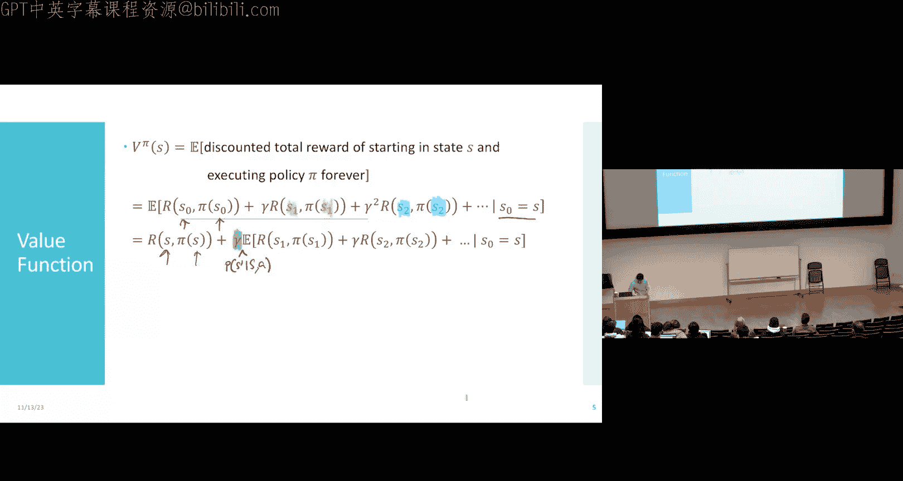
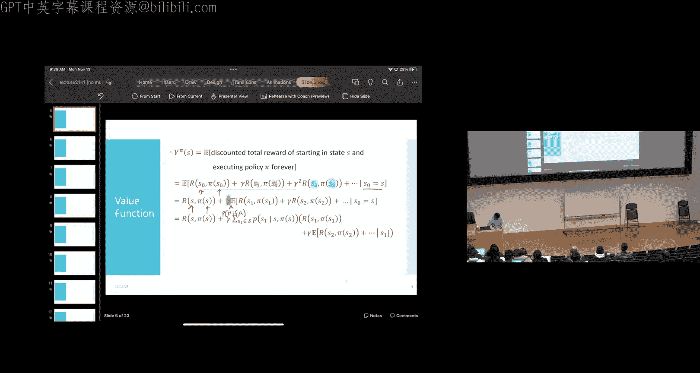
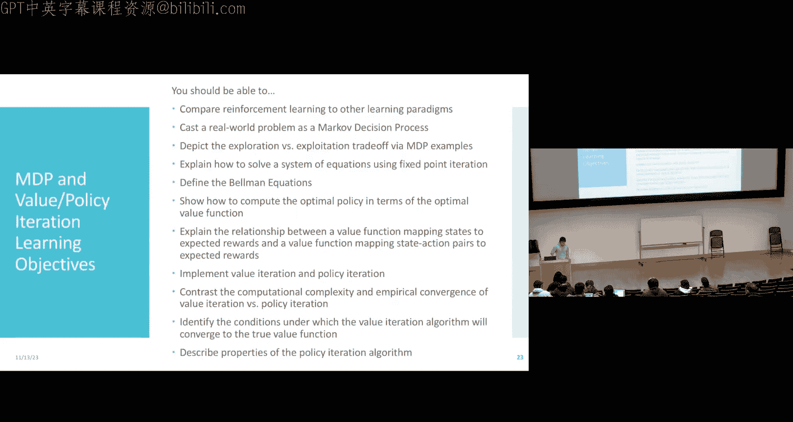

# 强化学习：第21讲：值函数与策略迭代 🧠

## 概述

在本节课中，我们将学习强化学习中的两个核心概念：**值函数**与**策略迭代**。我们将了解如何通过计算状态的价值来评估策略的好坏，并学习如何通过迭代的方法，逐步改进策略，最终找到最优策略。

---

## 值函数：评估状态的价值 💎

上一节我们介绍了强化学习的基本框架，本节中我们来看看如何量化一个状态的好坏。**值函数**就是用来衡量在某个状态下，遵循特定策略所能获得的**预期累积奖励**。

**定义**：值函数 \( V^{\pi}(s) \) 表示在策略 \( \pi \) 下，从状态 \( s \) 开始所能获得的预期累积奖励。

**公式**：
\[
V^{\pi}(s) = \mathbb{E}_{\pi} \left[ \sum_{t=0}^{\infty} \gamma^t R_{t+1} \mid S_t = s \right]
\]
其中：
* \( \gamma \) 是**折扣因子**（\( 0 \leq \gamma \leq 1 \)），用于权衡当前奖励与未来奖励的重要性。
* \( R_{t+1} \) 是在时间步 \( t+1 \) 获得的即时奖励。
* 期望 \( \mathbb{E}_{\pi} \) 是在策略 \( \pi \) 下，所有可能状态转移轨迹的平均。

这个公式告诉我们，一个状态的价值不仅取决于它带来的即时奖励，还取决于从它出发未来可能获得的所有奖励的总和（经过折扣）。

---

## 策略迭代：寻找最优策略的算法 🔄

理解了如何评估策略后，我们的目标就是找到那个能获得最大累积奖励的**最优策略**。策略迭代就是一种通过交替进行**策略评估**和**策略改进**来寻找最优策略的方法。

以下是策略迭代的主要步骤：

1.  **初始化**：随机选择一个初始策略 \( \pi_0 \)。
2.  **策略评估**：计算当前策略 \( \pi_k \) 下的值函数 \( V^{\pi_k} \)。
3.  **策略改进**：基于计算出的值函数，采用**贪婪**方式更新策略。即在每个状态 \( s \)，选择能使**动作价值** \( Q^{\pi_k}(s, a) \) 最大的动作 \( a \)。
    *   动作价值函数 \( Q^{\pi}(s, a) \) 定义为：在状态 \( s \) 下执行动作 \( a \)，然后遵循策略 \( \pi \) 所能获得的预期累积奖励。
    *   策略更新公式为：\( \pi_{k+1}(s) = \arg\max_{a} Q^{\pi_k}(s, a) \)。
4.  **重复**：重复步骤2和3，直到策略不再发生变化（即收敛到最优策略 \( \pi^* \)）。

策略迭代的核心思想是：先彻底评估当前策略的价值（策略评估），然后基于这个评估结果，毫无保留地改进策略（策略改进），如此循环，直至最优。

---

## 价值迭代：策略迭代的高效变体 ⚡

策略迭代中的策略评估步骤可能需要多次迭代才能精确收敛，这有时效率不高。**价值迭代**是策略迭代的一种高效变体，它将策略评估和策略改进的过程合并在一起，直接迭代更新值函数。

价值迭代的步骤如下：

1.  **初始化**：将所有状态的值函数 \( V(s) \) 初始化为0（或任意值）。
2.  **迭代更新**：对于每个状态 \( s \)，使用**贝尔曼最优方程**进行更新：
    \[
    V_{k+1}(s) = \max_{a} \left[ R(s, a) + \gamma \sum_{s'} P(s' \mid s, a) \cdot V_k(s') \right]
    \]
    其中：
    * \( R(s, a) \) 是在状态 \( s \) 下执行动作 \( a \) 的即时奖励。
    * \( P(s' \mid s, a) \) 是在状态 \( s \) 下执行动作 \( a \) 后转移到状态 \( s' \) 的概率。
    * 这个更新规则直接寻找当前状态下能带来最大未来价值的最优动作。
3.  **重复**：重复步骤2，直到值函数 \( V(s) \) 的变化非常小（即收敛）。
4.  **提取策略**：一旦值函数收敛，最优策略 \( \pi^* \) 可以通过对每个状态选择最大化动作价值的动作来提取：
    \[
    \pi^*(s) = \arg\max_{a} \left[ R(s, a) + \gamma \sum_{s'} P(s' \mid s, a) \cdot V^*(s') \right]
    \]

价值迭代的本质是不断应用贝尔曼最优算子，直到值函数稳定，它通常比标准的策略迭代收敛得更快。

---

## 总结

本节课中我们一起学习了强化学习中寻找最优策略的核心动态规划方法。

*   我们首先学习了**值函数** \( V^{\pi}(s) \) 的概念，它是评估在给定策略下状态好坏的标准。
*   接着，我们探讨了**策略迭代**算法，它通过“评估-改进”的循环，逐步将任意初始策略优化为最优策略。
*   最后，我们介绍了**价值迭代**，这是一种更高效的方法，它直接迭代值函数并隐含地进行策略改进，最终从中提取出最优策略。

这两种方法都基于一个关键假设：我们拥有对环境的完整知识，即知道状态转移概率 \( P(s' \mid s, a) \) 和奖励函数 \( R(s, a) \)。它们是解决已知模型强化学习问题的基石。