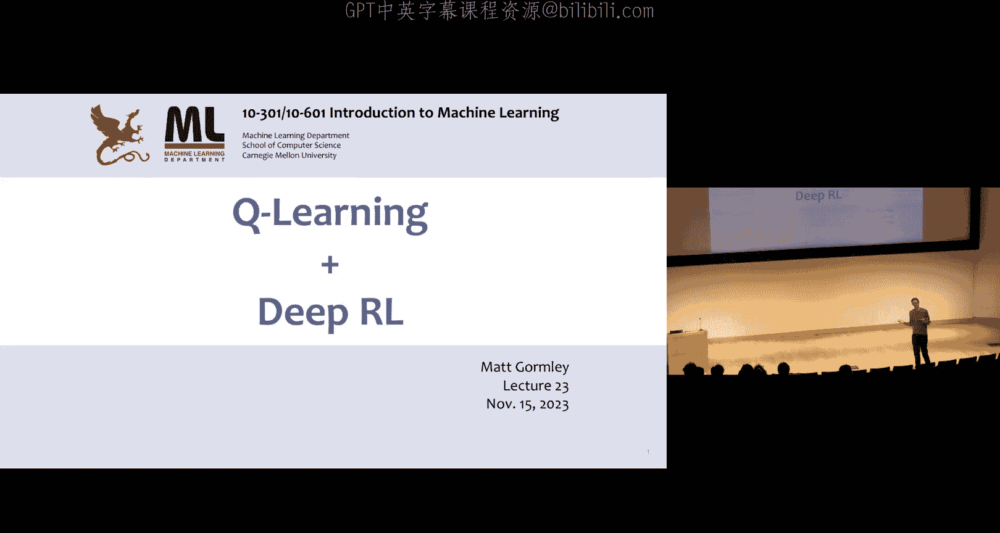
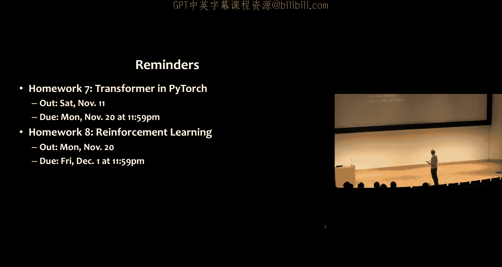
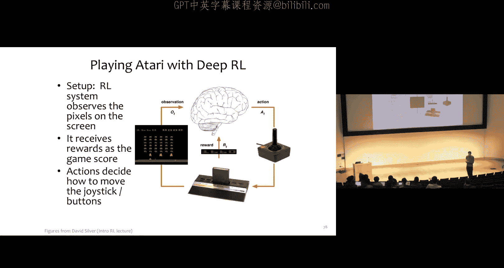
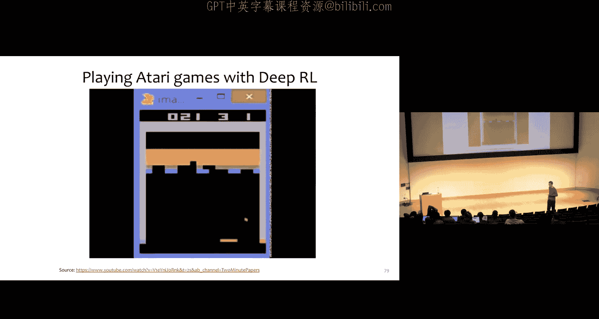
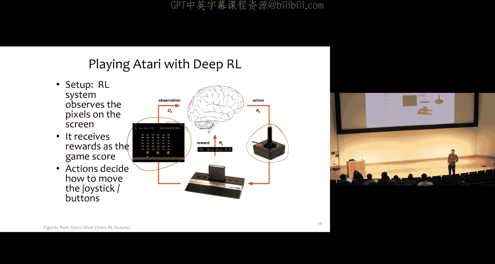

# CMU《机器学习导论｜Fall 2023 10-301/601 Introduction to Machine Learning》：强化学习之Q学习与深度强化学习

在本节课中，我们将要学习强化学习中的两种重要算法：Q学习和深度Q学习。我们将从回顾基础的价值迭代与策略迭代开始，然后引入处理随机奖励的概念，接着详细讲解Q学习算法，最后探讨如何利用深度神经网络来扩展Q学习，即深度Q学习。

## 课程名称：1：回顾价值迭代与策略迭代 🔄

上一节我们介绍了强化学习的基本框架，本节中我们来回顾两种经典的动态规划算法：价值迭代和策略迭代。它们是解决已知环境模型（即状态转移概率和奖励函数已知）的强化学习问题的基础方法。

**价值迭代**的核心思想是直接迭代计算状态的最优价值函数，直到收敛。以下是其步骤：

1.  初始化一个包含所有状态价值`V(s)`的表格。
2.  在每个步骤中，遍历所有状态，并使用贝尔曼最优方程更新每个状态的价值：
    $$
    V(S) \leftarrow \max_{a} \left[ R(S, a) + \gamma \sum_{s'} P(s'|s, a) V(s') \right]
    $$
3.  重复步骤2，直到价值函数`V(s)`的变化小于一个阈值，即表格“不再变化”。
4.  最终，最优策略`π*`可以通过对每个状态选择能最大化上述公式的动作来获得：`π*(s) = argmax_a [ ... ]`。

**策略迭代**则交替进行策略评估和策略改进。以下是其步骤：

1.  随机初始化一个策略`π`。
2.  **策略评估**：根据当前策略`π`，计算每个状态的价值函数`V^π(s)`（通常通过求解线性方程组或迭代法）。
3.  **策略改进**：基于上一步计算出的价值函数`V^π`，对每个状态更新策略，选择能带来更高期望回报的动作：`π’(s) = argmax_a [ R(s, a) + γ Σ P(s’|s,a) V^π(s’) ]`。
4.  将新策略`π’`设为当前策略，重复步骤2和3，直到策略不再发生变化。

## 课程名称：2：处理随机奖励 🎲

上一节我们回顾了在确定环境下的算法，本节中我们来看看当环境反馈的奖励本身也具有随机性时，应如何考虑。在更一般的强化学习设定中，不仅状态转移是随机的，即时奖励也可能是一个随机变量。

这意味着，即使给定相同的状态`s`和动作`a`，系统转移到下一个状态`s’`时获得的即时奖励`R`也可能不同。因此，我们在建模时需要将奖励的期望值纳入考量。

**价值迭代算法的更新规则**在形式上无需改变，但其中的`R(S, a)`应理解为**期望奖励**。更新规则依然是：
$$
V(S) \leftarrow \max_{a} \left[ \mathbb{E}[R|S, a] + \gamma \sum_{s'} P(s'|s, a) V(s') \right]
$$
在实际应用中，我们通常通过采样来估计这个期望值。算法流程与之前一致，只是对奖励的理解从固定值变为了随机变量的期望。

## 课程名称：3：Q学习算法 🧠

前面讨论的方法都需要知道环境的完整模型（状态转移概率`P`和奖励函数`R`）。本节我们将介绍一种**免模型**的强化学习算法——Q学习。它通过与环境交互来直接学习最优策略。

Q学习的核心是学习一个称为**Q函数**（或动作价值函数）的表格。`Q(s, a)`表示在状态`s`下执行动作`a`，并在此后遵循最优策略所能获得的期望总回报。

**Q学习算法**是一种时序差分学习算法，它通过不断更新Q表来逼近最优Q函数。以下是算法的主要步骤：

1.  初始化Q表`Q(s, a)`，通常设为全零或随机小值。
2.  对于每一个回合（episode）或每一步：
    1.  在当前状态`S`，根据某种策略（如ε-贪婪策略）选择一个动作`A`。
    2.  执行动作`A`，环境反馈奖励`R`并转移到新状态`S’`。
    3.  使用以下公式更新Q表中对应的`Q(S, A)`值：
        $$
        Q(S, A) \leftarrow Q(S, A) + \alpha \left[ R + \gamma \max_{a'} Q(S’, a’) - Q(S, A) \right]
        $$
        其中，`α`是学习率，`γ`是折扣因子。`R + γ max_a‘ Q(S‘, a‘)`被称为**时序差分目标**，`R + γ max_a‘ Q(S‘, a‘) - Q(S, A)`是**时序差分误差**。
    4.  将状态更新为`S’`，重复上述过程。

当状态和动作空间较小时，Q表是有效的。然而，对于大规模或连续的状态空间，维护一个巨大的表格是不现实的。

## 课程名称：4：深度Q学习 🧠➡️🌐

上一节我们介绍了基于表格的Q学习，本节我们来看看如何利用深度神经网络来解决状态空间巨大的问题，这就是**深度Q网络**。

深度Q学习的基本思想是，用一个参数为`θ`的神经网络来近似表示Q函数，即`Q(s, a; θ) ≈ Q*(s, a)`。网络以状态`s`（如图像像素）作为输入，输出每个可能动作`a`对应的Q值。

**深度Q学习算法**包含两个关键技术以稳定训练：

1.  **经验回放**：智能体将与环境交互的经历`(s, a, r, s’)`存储在一个回放缓冲区中。训练时，从缓冲区中随机采样一批经历（而不是使用连续的相关样本）来更新网络，这有助于打破数据间的相关性，使学习更稳定。
2.  **目标网络**：使用一个独立的、参数为`θ-`的目标网络来计算时序差分目标`r + γ max_a‘ Q(s‘, a‘; θ-)`。目标网络的参数定期（例如每C步）从主网络`θ`复制，而在间隔期内保持固定。这避免了目标值随估计值不断变化而导致的训练振荡。

网络的损失函数定义为预测Q值与目标Q值之间的均方误差：
$$
L(\theta) = \mathbb{E}_{(s,a,r,s’)} \left[ \left( r + \gamma \max_{a’} Q(s’, a’; \theta^-) - Q(s, a; \theta) \right)^2 \right]
$$
通过随机梯度下降来最小化这个损失，从而更新主网络参数`θ`。

## 课程名称：5：总结 📚

本节课中我们一起学习了强化学习从经典动态规划到现代深度学习的演进路径。

我们首先回顾了**价值迭代**和**策略迭代**，它们是解决已知环境模型问题的基础。接着，我们讨论了如何将**随机奖励**纳入考量框架。然后，我们重点介绍了**Q学习算法**，这是一种通过与环境交互、直接更新Q表来学习最优策略的免模型方法，其核心更新公式为：
`Q(S,A) ← Q(S,A) + α [ R + γ max_a‘ Q(S‘,a‘) - Q(S,A) ]`。

最后，为了解决高维状态空间问题，我们学习了**深度Q学习**。它利用神经网络近似Q函数，并借助**经验回放**和**目标网络**两大技术来稳定训练过程，使得强化学习能够应用于像电子游戏、机器人控制等复杂领域。