# 机器学习导论：第23讲：降维与主成分分析（PCA）📉

在本节课中，我们将要学习一种重要的机器学习技术——降维，并重点介绍其中最经典的方法之一：主成分分析（Principal Component Analysis, PCA）。降维旨在将高维数据转换为低维表示，同时尽可能保留原始数据的关键信息。

## 高维数据的来源 📊

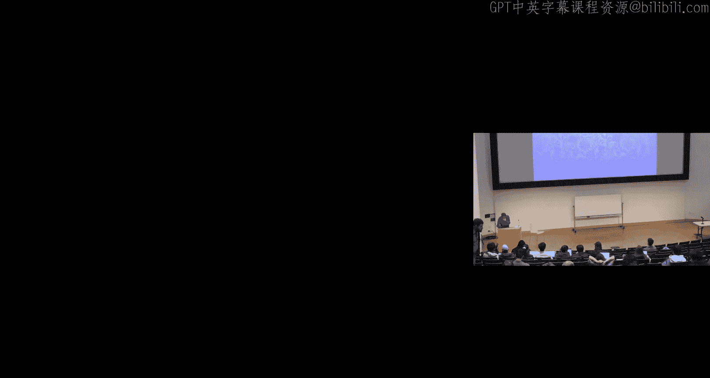

上一节我们介绍了降维的概念，本节中我们来看看高维数据通常从何而来。理解数据来源有助于我们判断何时需要应用降维技术。

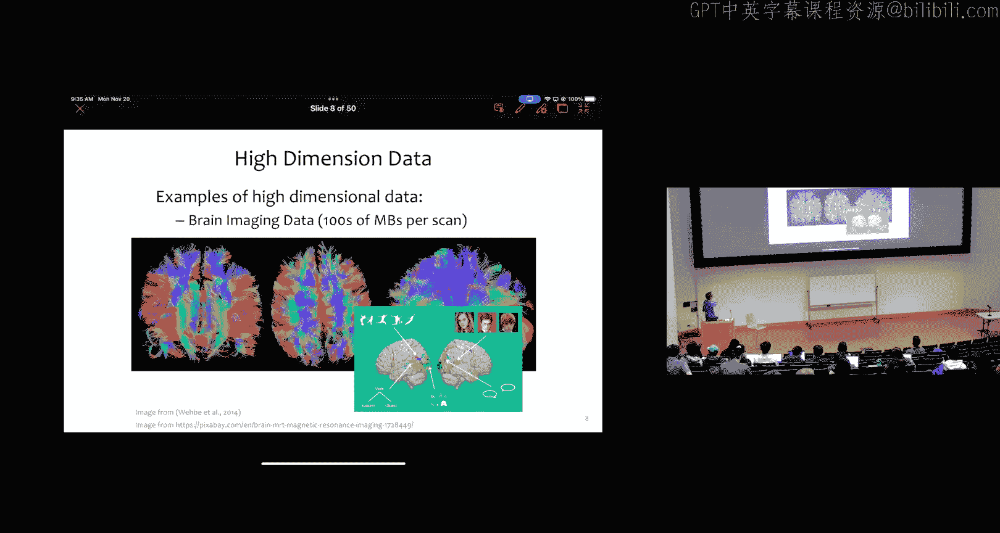

以下是高维数据的一些常见来源：

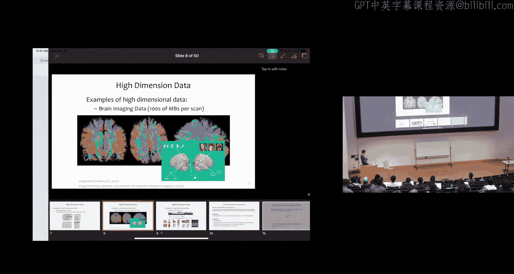

*   **高分辨率图像**：例如，具有数百万像素的图像。
*   **多语言新闻故事**：每种语言可能包含数十万个单词，多种语言结合在一起可能超过一百万个单词。
*   **脑成像数据**：例如，来自功能磁共振成像（fMRI）或脑电图（EEG）的数据。
*   **客户购买数据**：包含大量历史购买记录的客户数据。

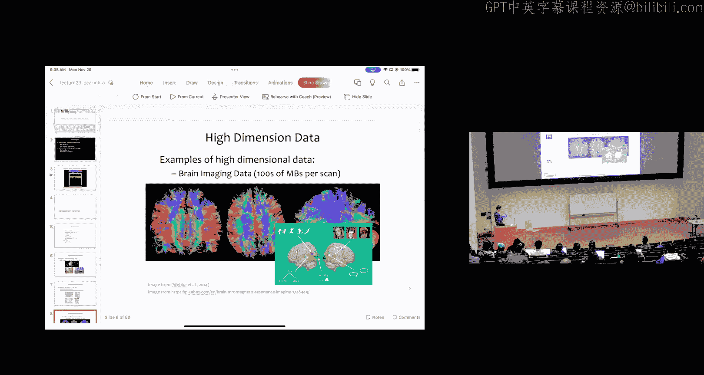

## 为何需要降维？🎯

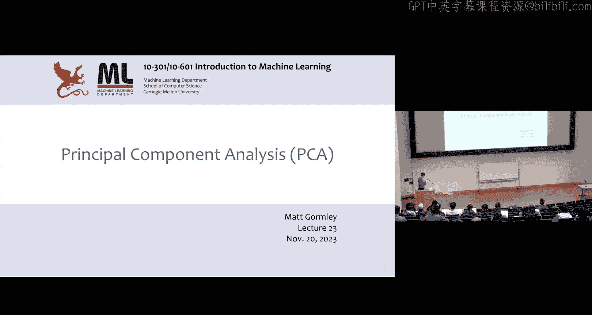

了解了高维数据的普遍性后，一个自然的问题是：我们为什么要进行降维？高维数据直接处理不就可以了吗？

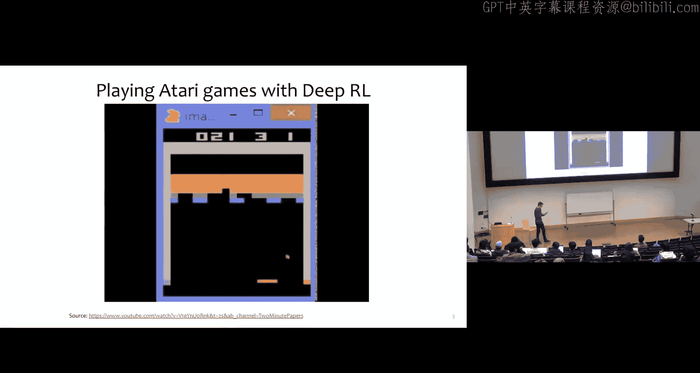

降维主要服务于以下几个目的：

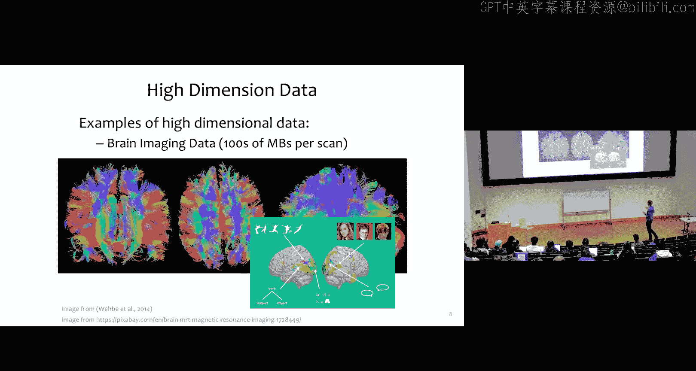

*   **数据可视化**：人类难以直观理解三维以上的空间。通过将数据投影到二维或三维空间，我们可以更直观地观察数据的结构和模式。
*   **提升计算效率**：高维数据会显著增加算法的计算和存储开销。降低维度可以加快模型训练和预测速度。
*   **改善模型泛化能力**：根据统计学习理论，过高的维度可能导致“维度灾难”，使模型更容易过拟合。降维有助于缓解这个问题。
*   **去除噪声**：数据中常包含不相关的噪声。降维过程（如PCA）可以过滤掉方差较小的方向，这些方向往往对应着噪声。

## 常见的降维算法概览 🛠️

在深入PCA之前，我们先快速浏览一下降维领域的其他方法。这有助于我们理解PCA在其中的位置。

以下是一些常见的降维算法：

*   **主成分分析（PCA）**：一种无监督的线性降维方法，寻找数据方差最大的方向。
*   **自编码器（Autoencoder）**：一种基于神经网络的无监督方法，通过编码和解码过程学习数据的紧凑表示。
*   **矩阵分解（Matrix Factorization）**：例如奇异值分解（SVD），将数据矩阵分解为低秩矩阵的乘积。

## 深入主成分分析（PCA）🔍

现在，让我们聚焦于本节课的核心——主成分分析。PCA是一种线性、无监督的降维方法，其目标是找到数据中最重要的“主成分”方向。

### PCA的核心目标

PCA的核心目标是：找到 **K** 个新的正交坐标轴（即主成分），使得将原始数据投影到这些坐标轴上时，投影数据的**方差最大化**。第一个主成分是方差最大的方向，第二个主成分是与第一个正交的方差次大的方向，依此类推。

### PCA的数学描述

假设我们有 **N** 个数据点，每个点都是 **M** 维的。我们可以将数据组织成一个 **N × M** 的矩阵 **X**（通常假设数据已经中心化，即每列均值为0）。

PCA寻找的是一组标准正交基向量 **v₁, v₂, ..., vₖ**，它们实际上是数据协方差矩阵 **Σ** 的前 **K** 个特征向量。协方差矩阵的计算公式为：

**Σ = (1/N) * XᵀX**

其中，**Xᵀ** 是 **X** 的转置。第 **k** 个主成分方向 **vₖ** 就是协方差矩阵 **Σ** 的第 **k** 大特征值 **λₖ** 所对应的特征向量。

### 如何求解PCA？

在实际计算中，我们通常不直接计算协方差矩阵再求特征值分解，而是采用更高效稳定的方法。

以下是两种主要的求解方法：

*   **对协方差矩阵进行特征分解**：直接计算 **Σ** 的特征值和特征向量。当特征维度 **M** 不是特别大时适用。
*   **对数据矩阵进行奇异值分解（SVD）**：这是更常用且数值稳定的方法。对中心化后的数据矩阵 **X** 进行SVD分解：
    **X = U S Vᵀ**
    其中，右奇异矩阵 **V** 的列向量就是我们需要的主成分方向 **vₖ**，奇异值矩阵 **S** 对角线上的值的平方与特征值 **λₖ** 成正比。

## 如何选择主成分的数量K？🤔

应用PCA时，一个关键问题是：我们应该保留多少个主成分？保留太少会丢失信息，保留太多则达不到降维的目的。

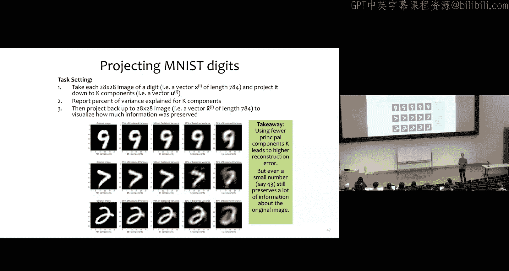

选择K值通常基于以下准则：

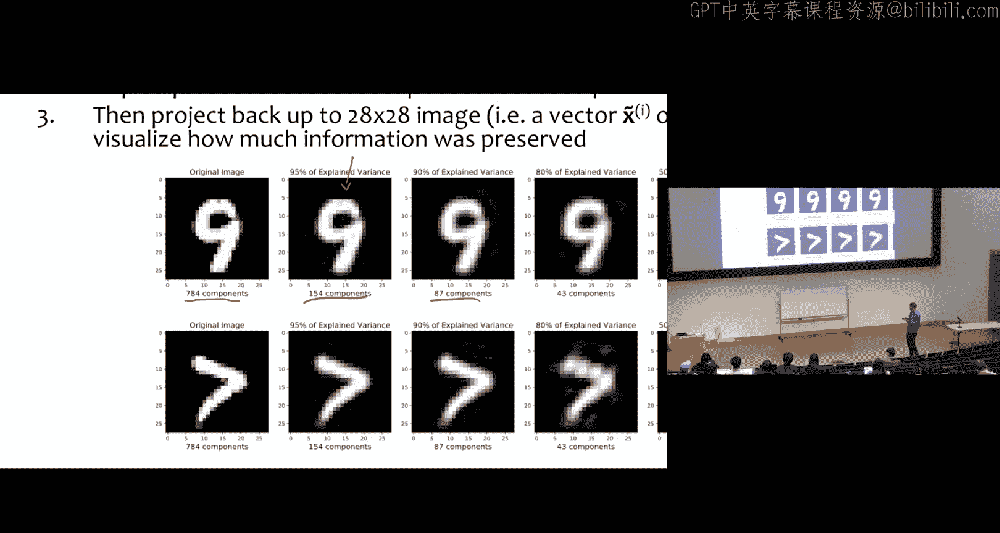

*   **方差解释率**：每个主成分贡献的方差等于其对应的特征值 **λᵢ**。我们通常选择最小的 **K**，使得前 **K** 个主成分的累计方差解释率达到一个阈值（例如95%或99%）。累计方差解释率公式为：
    **累计方差解释率 = (Σᵢ₌₁ᴷ λᵢ) / (Σⱼ₌₁ᴹ λⱼ)**
*   **碎石图**：绘制所有特征值按大小排序的折线图（碎石图），寻找拐点（“肘部”），拐点之后的特征值变得很小且平缓，拐点对应的K值通常是一个合理的选择。

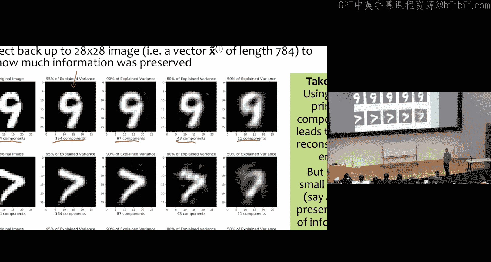

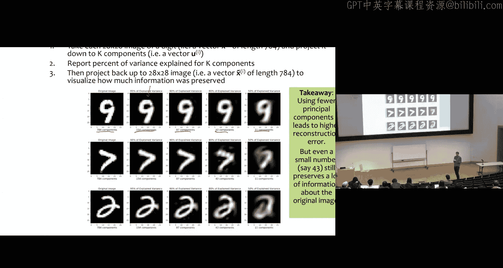

## 总结 📝

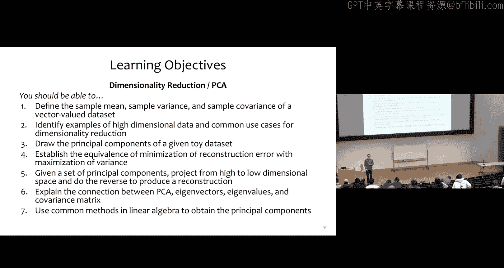

本节课中，我们一起学习了降维技术及其重要意义。我们深入探讨了主成分分析这一经典方法：

1.  **动机**：高维数据普遍存在，但直接处理面临可视化困难、计算成本高、易过拟合等问题，降维是有效的解决方案。
2.  **PCA原理**：PCA是一种线性降维方法，通过寻找数据方差最大的正交方向（主成分）来重新表示数据。其数学基础是数据协方差矩阵的特征值分解或数据矩阵的奇异值分解。
3.  **核心公式**：目标是找到协方差矩阵 **Σ = (1/N) XᵀX** 的前K个最大特征值对应的特征向量。
4.  **K值选择**：通常基于**累计方差解释率**或观察**碎石图**的拐点来确定保留的主成分数量，以在降维和信息保留之间取得平衡。

通过掌握PCA，你便拥有了一把处理高维数据、提取关键特征、并提升后续机器学习模型性能的强大工具。

