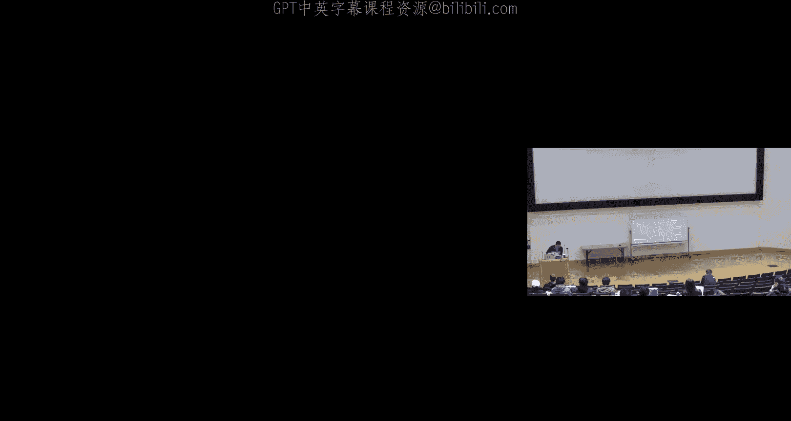
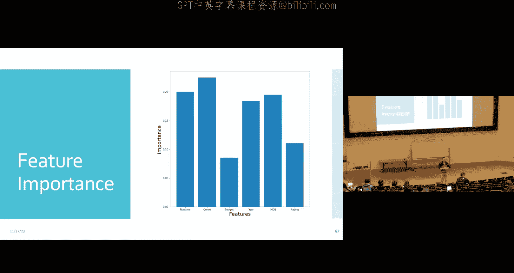

# 机器学习导论：第24讲：K-Means与集成方法

## 概述

在本节课中，我们将学习两种重要的机器学习技术：聚类和集成方法。聚类是一种无监督学习技术，用于将数据点分组为相似的集合。集成方法则是一种将多个模型组合起来以提高整体预测性能的技术。

---

## 聚类

上一节我们介绍了本课的两个主题。本节中，我们来看看第一个主题——聚类。

### 聚类概述

聚类是一种无监督学习技术，其目标是将数据点划分为多个组或簇。划分的原则是使同一簇内的数据点尽可能相似，而不同簇之间的数据点尽可能不同。

### K-Means 聚类算法

K-Means 是一种最常用的聚类算法。它的核心思想是通过迭代优化来找到簇的中心点。

以下是 K-Means 算法的基本步骤：

1.  **初始化**：随机选择 K 个数据点作为初始聚类中心。
2.  **分配**：将每个数据点分配到距离其最近的聚类中心所在的簇。
3.  **更新**：计算每个簇中所有数据点的平均值，将其作为新的聚类中心。
4.  **迭代**：重复步骤 2 和 3，直到聚类中心不再发生显著变化或达到预设的最大迭代次数。

该过程可以形式化为优化以下目标函数（也称为畸变函数）：
`J = Σ Σ ||x - μ_i||²`，其中内层求和针对簇 `i` 中的所有点 `x`，`μ_i` 是簇 `i` 的中心。

### K-Means 算法的优化

K-Means 的优化过程可以看作是两个交替进行的步骤：

1.  **固定中心，优化分配**：在聚类中心固定的情况下，通过将每个点分配给最近的中心来最小化目标函数。
2.  **固定分配，优化中心**：在数据点分配固定的情况下，通过将每个簇的中心更新为该簇所有点的均值来最小化目标函数。

算法通过交替执行这两个步骤，直至收敛。

### K-Means 算法的初始化

初始聚类中心的选择对最终结果和收敛速度有重要影响。以下是两种常见的初始化方法：

*   **随机选择**：直接从数据点中随机选取 K 个点作为初始中心。这种方法简单，但可能导致结果不稳定或陷入局部最优。
*   **K-Means++**：这是一种更智能的初始化方法。它首先随机选择一个点作为第一个中心，然后选择下一个中心时，会倾向于选择距离已选中心较远的点。这个过程重复进行，直到选出 K 个中心。K-Means++ 通常能带来更快地收敛和更好的聚类效果。

---

## 集成方法

了解了如何将数据分组后，我们接下来看看如何组合多个模型以做出更好的预测，这就是集成方法。

### 集成方法概述

集成方法的核心思想是“集思广益”。它通过构建并结合多个学习器（称为基学习器）来完成学习任务。通常，集成多个模型获得的性能会优于单个模型。

其通用流程如下：
1.  训练多个（通常是不同的）模型。
2.  将这些模型的预测结果以某种方式（如平均、投票）组合起来，形成最终的预测。

### 随机森林

随机森林是集成方法的一个经典代表，它专门集成了多个决策树模型。

以下是随机森林的构建过程：

1.  **自助采样**：使用 Bootstrapping 技术，从原始训练集中有放回地随机抽取多个样本子集。
2.  **构建决策树**：在每个样本子集上独立训练一棵决策树。在树的分裂过程中，通常还会随机选取一个特征子集进行候选，这增加了树之间的差异性。
3.  **聚合结果**：对于分类任务，采用投票法；对于回归任务，采用平均法。将所有树的预测结果汇总，得到随机森林的最终预测。

### 随机森林的优化

为了使随机森林性能更佳，可以进行以下优化：

*   **超参数调优**：通过交叉验证等方法，调整森林中树的数量、每棵树分裂时考虑的最大特征数等超参数。
*   **特征重要性分析**：随机森林可以输出每个特征的重要性评分，这有助于我们理解数据并可能进行特征选择。

---

## 总结

在本节课中，我们一起学习了两种强大的机器学习技术。

首先，我们探讨了 **K-Means 聚类算法**，这是一种无监督学习方法，通过迭代寻找簇中心来对数据进行分组。我们讨论了其步骤、优化视角以及重要的初始化策略 K-Means++。

接着，我们学习了 **集成方法**，特别是 **随机森林**。这种方法通过构建并结合大量决策树，利用“群体智慧”来提升模型的准确性和鲁棒性。我们了解了其基于自助采样的构建过程以及常见的优化方向。

聚类和集成方法是机器学习工具箱中非常重要且实用的组成部分，广泛应用于各种数据分析和预测任务中。