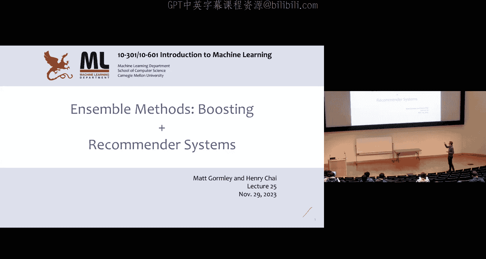
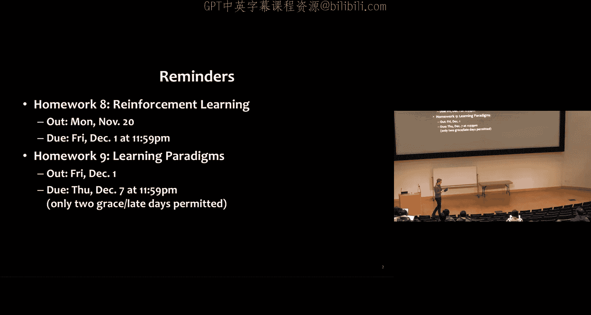
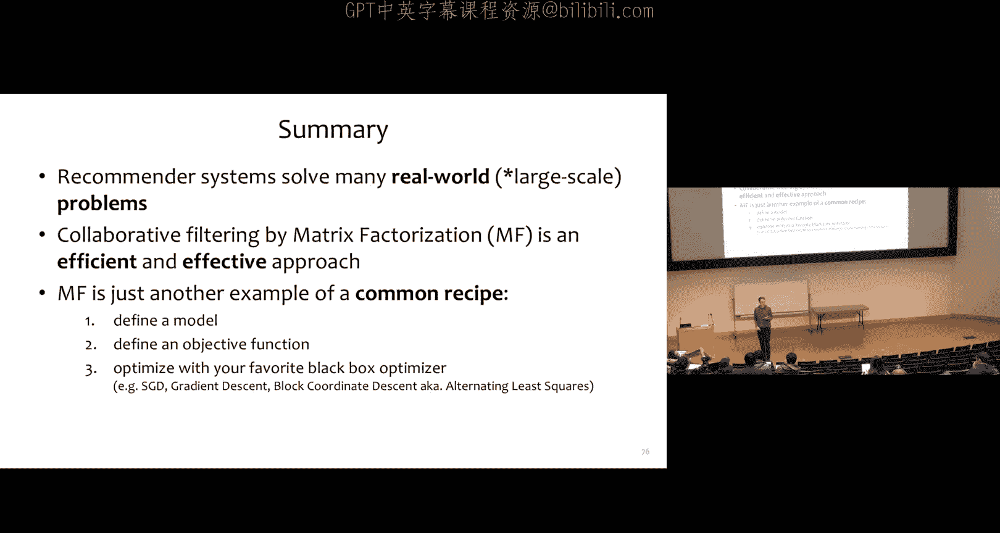

# 机器学习导论：课程25：集成方法、提升法与推荐系统 🚀

## 概述

在本节课中，我们将学习两种重要的机器学习技术：**集成方法**与**推荐系统**。集成方法通过组合多个模型来提升预测性能，而推荐系统则致力于根据用户偏好提供个性化建议。我们将重点探讨提升法中的经典算法Adaboost，以及推荐系统中的协同过滤与矩阵分解技术。

---

## 1. 集成方法概述 🤝

集成方法的核心思想是“集思广益”。它通过将多个相对简单或性能一般的模型（称为“基学习器”）组合起来，构建一个更强大、更稳定的最终模型。

**集成方法**的定义是：将多个分类器组合成一个更强大的分类器。

集成方法有多种实现方式，其中一种重要的分支是**提升法**。提升法的特点是，它能够同时学习每个基分类器本身，并为它们分配合适的权重。

另一种基础方法是**加权多数算法**：给定一组预先训练好的分类器，算法根据它们的历史表现分配权重，并使用这些加权后的预测来做出新的、更可靠的决策。

---

## 2. 深入提升法 📈

上一节我们介绍了集成方法的基本概念，本节中我们来看看其中一种强大的技术——提升法。提升法旨在将一系列“弱”模型转化为一个“强”模型。

这里涉及两个核心概念：
*   **弱学习器**：指性能仅比随机猜测略好的假设或模型。其误差率 `ε` 略小于 0.5。
*   **强学习器**：指可以产生任意低误差的假设或模型。

提升法的代表算法是 **Adaboost**。它的核心目标正是将多个弱学习器组合成一个强学习器。

### Adaboost 算法步骤

以下是Adaboost算法的具体执行流程：

1.  **初始化权重**：为训练数据集中的每一个样本分配初始权重，通常设置为均匀分布，即 `D1(i) = 1/m`，其中 `m` 是样本总数。
2.  **训练弱学习器**：基于当前的样本权重分布 `Dt`，训练得到一个弱分类器 `ht`。
3.  **计算误差**：计算该弱分类器 `ht` 的加权误差 `εt`。
    *公式：* `εt = Σ (Dt(i) * I(ht(xi) ≠ yi))`
4.  **计算分类器权重**：根据误差 `εt` 为该弱分类器计算权重 `αt`。误差越小的分类器，权重越大。
    *公式：* `αt = 0.5 * ln((1 - εt) / εt)`
5.  **更新样本权重**：增加被当前分类器 `ht` 错误分类的样本的权重，减少正确分类样本的权重。这使得后续的弱学习器更关注之前被分错的“困难”样本。
    *更新规则：* `Dt+1(i) = (Dt(i) / Zt) * exp(-αt * yi * ht(xi))`，其中 `Zt` 是归一化因子。
6.  **重复步骤**：重复步骤2至5，训练一系列弱分类器 `h1, h2, ..., hT`。
7.  **组合最终模型**：将所有弱分类器根据其权重 `αt` 进行线性组合，得到最终的强分类器。
    *最终模型：* `H(x) = sign( Σ (αt * ht(x)) )`

### Adaboost 的优势

Adaboost 具有以下显著优点：
*   **提高性能**：通过聚焦于错误样本并组合多个弱模型的优势，它能显著提升整体分类性能。
*   **泛化能力强**：在实践中，Adaboost 通常表现出良好的泛化能力，不易过拟合。

---

## 3. 推荐系统 🎯

现在，让我们将目光转向另一个广泛应用机器学习技术的领域——推荐系统。推荐系统的目标是根据用户的历史行为和偏好，自动预测并推荐其可能感兴趣的项目（如商品、电影、新闻等）。

推荐系统主要有两种技术路线：
*   **内容过滤**：基于项目本身的特征属性进行推荐。例如，根据电影的导演、演员、类型来推荐相似电影。
*   **协同过滤**：基于用户群体的行为数据进行推荐。其核心假设是：兴趣相似的用户会喜欢相似的东西。

### 协同过滤方法

协同过滤是推荐系统的核心，它主要有两类实现方式：

**1. 邻居方法**
这种方法直接寻找用户或项目之间的相似性。
*   **用户-用户协同过滤**：找到与目标用户兴趣相似的其他用户，将这些“邻居”喜欢的项目推荐给目标用户。
*   **物品-物品协同过滤**：找到与目标物品相似的其他物品，将喜欢目标物品的用户也可能喜欢的相似物品推荐给他们。

**2. 潜在因子方法（矩阵分解）**
这是一种更现代、更强大的方法。它假设存在一个低维的“潜在空间”，所有用户和物品都可以用这个空间中的向量（潜在因子）来表示。用户对物品的评分，可以近似为用户向量和物品向量的内积。

矩阵分解的目标是学习这些用户和物品的潜在因子表示。

#### 矩阵分解模型

给定用户-物品评分矩阵 `R`（维度为 `m x n`，`m` 个用户，`n` 个物品），其中包含大量缺失值（未评分项）。矩阵分解旨在找到两个低维矩阵：
*   用户潜在因子矩阵 `P`（维度 `m x k`）
*   物品潜在因子矩阵 `Q`（维度 `n x k`）

使得它们的乘积能够近似还原原始的评分矩阵：`R ≈ P * Q^T`。

**目标函数**：通过最小化预测评分与实际观测评分之间的差异来学习 `P` 和 `Q`。
*公式：* `min Σ (R_ij - P_i · Q_j^T)^2 + λ(||P||^2 + ||Q||^2)`，其中求和仅针对已观测到的评分，后一项是正则化项，用于防止过拟合。

**优化算法**：常用的优化算法包括随机梯度下降（SGD）和交替最小二乘法（ALS）。

#### 矩阵分解的优势
*   **提高性能**：能够有效挖掘用户和物品的潜在特征，通常比邻居方法获得更高的预测精度。
*   **可解释性**：学习到的潜在因子有时可以对应到具体的语义概念（如电影的风格偏向、用户的兴趣维度），提供了一定程度的可解释性。

---

## 4. 总结 🎓

本节课中，我们一起学习了机器学习中两个关键且实用的主题。

首先，我们探讨了**集成方法**，特别是**提升法**。我们了解到，通过巧妙地组合多个弱学习器（如使用Adaboost算法），可以构建出性能强大的强学习器。该算法通过迭代调整样本权重，让后续模型专注于之前分错的样本，最终以加权投票的方式做出决策。

接着，我们转向了**推荐系统**。我们介绍了基于内容的过滤和协同过滤两种主要思路，并深入讲解了协同过滤中的**矩阵分解**技术。该方法通过将用户和物品映射到低维潜在空间，用向量内积来预测评分，是现代推荐系统的基石。

掌握这些方法，你将有能力构建更鲁棒的分类模型和更智能的个性化推荐引擎。