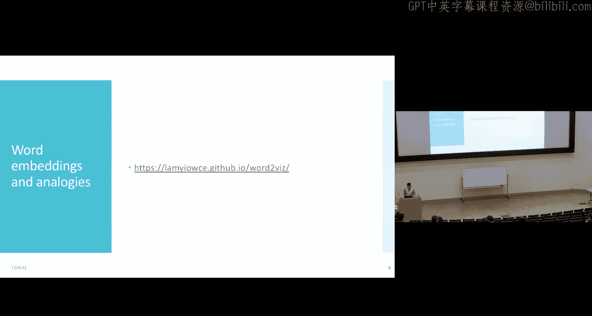
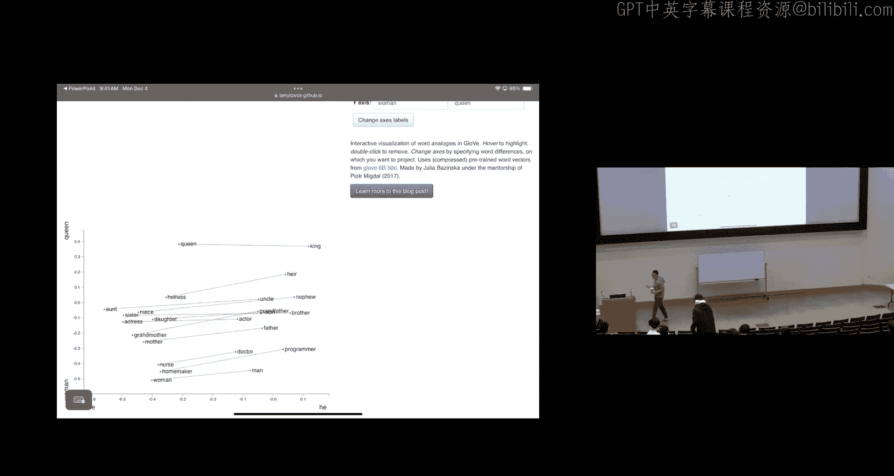
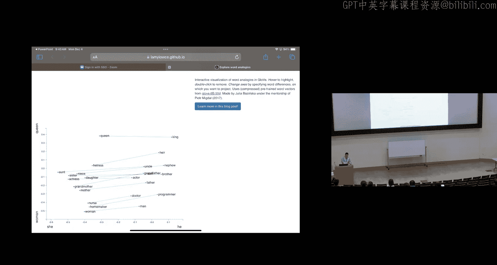
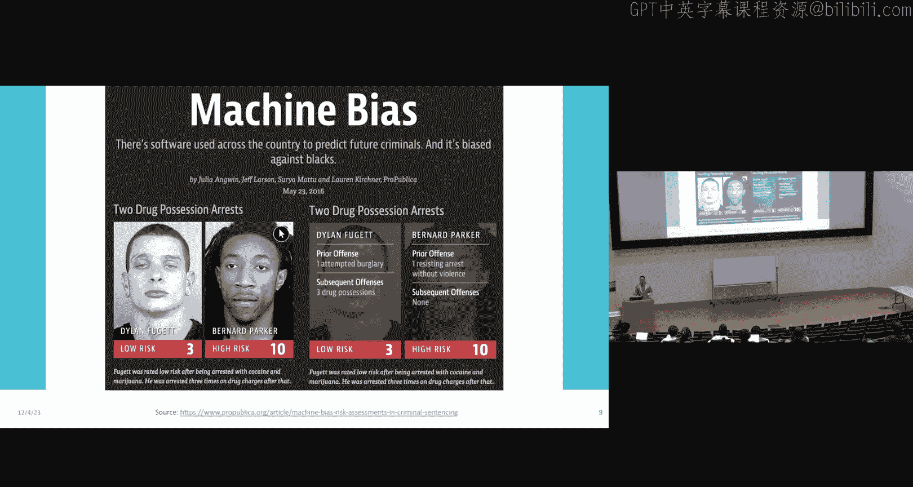
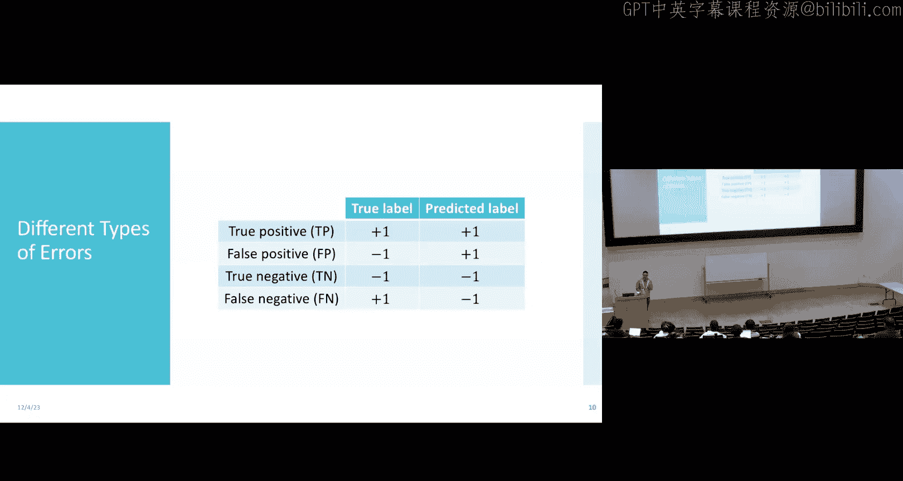
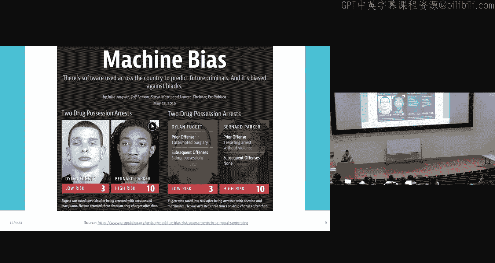
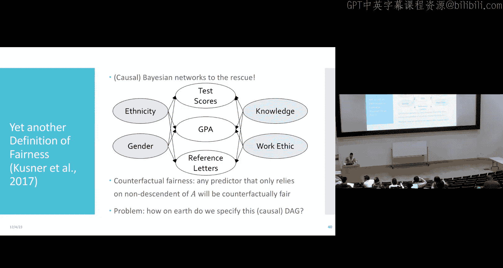

# 机器学习导论：第26讲：算法偏差 🧠

## 概述

在本节课中，我们将探讨机器学习中的算法偏差问题。我们将通过一系列案例研究来了解算法偏差的潜在风险，并讨论如何定义和减轻偏差。

## 算法偏差案例

上一节我们概述了算法偏差，本节中我们来看看几个具体的案例研究，以理解偏差在现实世界中的表现。

以下是几个算法偏差的案例：

*   **相机误识别**：一台相机在识别眨眼时出现偏差，因为它主要在白人面孔上训练，导致对亚洲面孔的误识别。
*   **苹果iPhone面部识别**：苹果iPhone的面部识别软件最初在训练时主要使用白人男性面孔数据，导致对某些用户无法正确识别。
*   **大型语言模型**：一些大型语言模型在处理性别相关词汇时表现出性别偏见，例如将“程序员”与男性相关联，将“家庭主妇”与女性相关联。
*   **Compass软件**：一款用于预测犯罪者再犯风险的软件在预测白人和黑人犯罪者的再犯风险时存在偏差。

## 偏差定义

了解了偏差的案例后，我们需要更精确地定义什么是算法偏差。以下是几种常见的算法偏差定义：

*   **独立性**：模型的预测与受保护特征（例如性别）不相关。公式表示为：`P(Ŷ | A) = P(Ŷ)`，其中 Ŷ 是预测，A 是受保护属性。
*   **分离性**：给定真实结果，模型的预测与受保护特征独立。公式表示为：`P(Ŷ | Y, A) = P(Ŷ | Y)`。
*   **充分性**：目标变量与属性独立，给定模型的预测。公式表示为：`P(Y | Ŷ, A) = P(Y | Ŷ)`。

## 减轻偏差的方法

定义了偏差之后，我们来看看如何在实际中减轻这些偏差。以下是几种减轻算法偏差的方法：

*   **数据预处理**：通过数据增强或数据重采样来平衡数据集，确保不同群体的数据得到公平代表。
*   **训练时间干预**：通过正则化或约束优化来限制模型的预测，使其满足特定的公平性准则。
*   **后处理预测**：在模型预测后调整标签，以纠正预测结果中的偏差。

## 总结

在本节课中，我们一起学习了算法偏差的概念、案例、定义和减轻方法。算法偏差是一个复杂且重要的主题，需要我们持续关注和努力解决。