# 机器学习导论：第27讲：显著性检验与视觉生成模型 🧠

## 概述

在本节课中，我们将探讨机器学习中的两个重要主题：**显著性检验**和**计算机视觉中的图像生成**。我们将首先学习如何科学地评估和比较机器学习模型的性能，然后深入了解如何让机器学会“创造”图像，特别是通过生成对抗网络（GANs）这一强大工具。

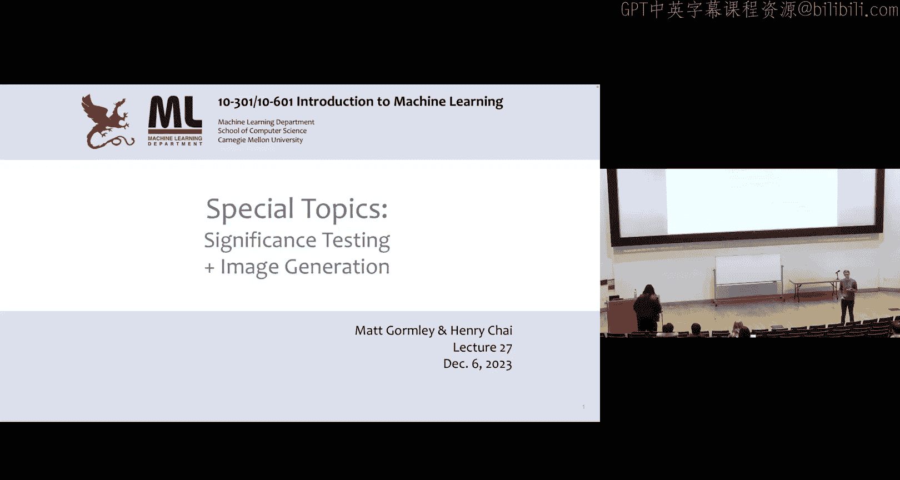

---

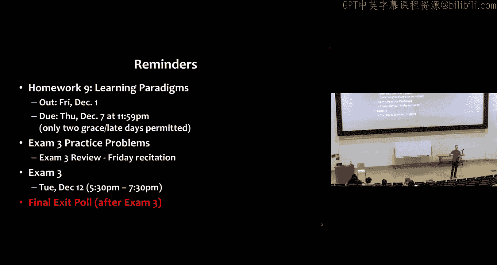

## 显著性检验 📊

上一节我们介绍了机器学习模型评估的基本概念。本节中，我们来看看如何通过统计学方法，严谨地判断一个模型是否真的比另一个模型更好，而不仅仅是运气使然。

### 核心问题

我们如何确定一个机器学习算法是否真正有效，而不是仅仅因为随机性而表现良好？

### 基本方法

以下是评估模型性能并考虑其随机性的基本思路：

*   **比较分类器**：例如，比较新算法 **H** 和基线算法 **Hb** 在相同测试集上的准确率。
*   **考虑随机性**：必须认识到，无论是训练数据还是测试数据的划分，都带有随机性，这会影响最终的性能指标。
*   **报告置信区间**：更严谨的做法是报告性能指标的置信区间。例如，模型 **HA** 的平均准确率为 **45% ± 5%**。

### 显著性检验详解

为了进行更严格的比较，我们引入统计学中的假设检验：

*   **假设检验**：首先提出**原假设**——通常假设两个分类器的性能没有显著差异（即性能相同）。
*   **计算P值**：通过统计方法计算出一个**P值**。P值表示在原假设成立的前提下，观察到当前实验数据（或更极端数据）的概率。
*   **做出决策**：如果P值小于一个预先设定的阈值（如 **0.05** 或 **0.01**），我们就有足够的证据**拒绝原假设**，认为两个模型的性能存在显著差异。

### 一个具体例子：配对自助法

以下是使用配对自助法进行显著性检验的步骤：

1.  **重复采样**：从原始测试集中**有放回地**随机抽取多个（例如，1000个）新的测试子集。
2.  **计算差异**：在每个子集上，分别计算两个模型（A和B）的准确率，并记录它们的差值 **diff_i = accuracy_A_i - accuracy_B_i**。
3.  **形成分布**：这1000个差值就构成了一个经验分布。
4.  **计算P值**：观察这个差值分布。如果差值分布的中心在0附近，说明两个模型性能相近。P值可以计算为差值小于或等于0的比例（对于检验A是否优于B）。如果这个比例很小（如<0.05），则拒绝“两者性能相同”的原假设。

---

## 计算机视觉中的图像生成 🎨

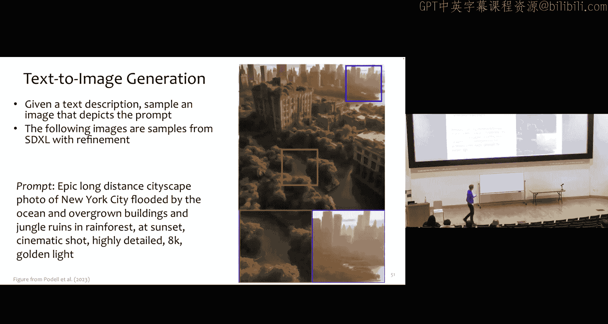

在掌握了如何科学评估模型之后，我们将视角转向一个更具创造性的领域：让机器生成图像。这是计算机视觉中一项激动人心的任务。

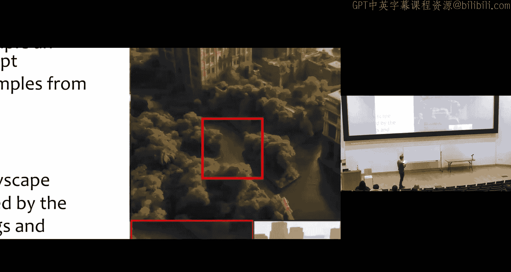

### 计算机视觉的常见任务

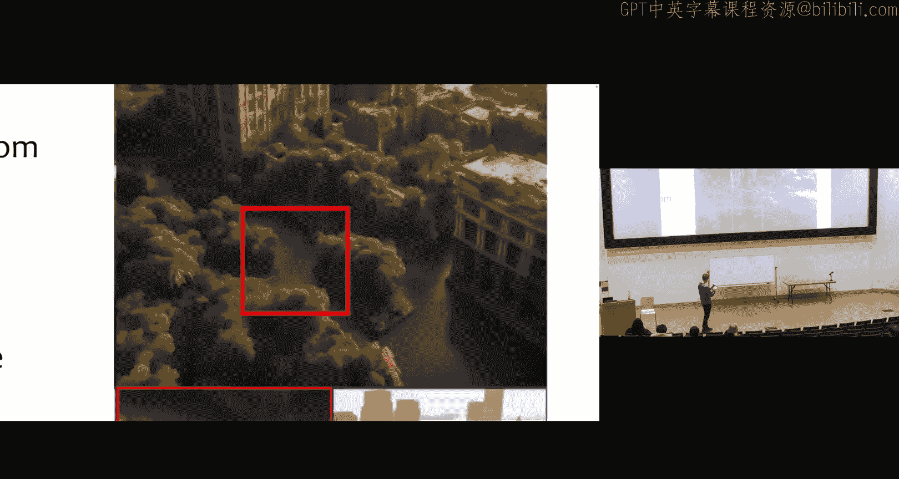

在深入生成之前，我们先回顾一下计算机视觉的主要任务：

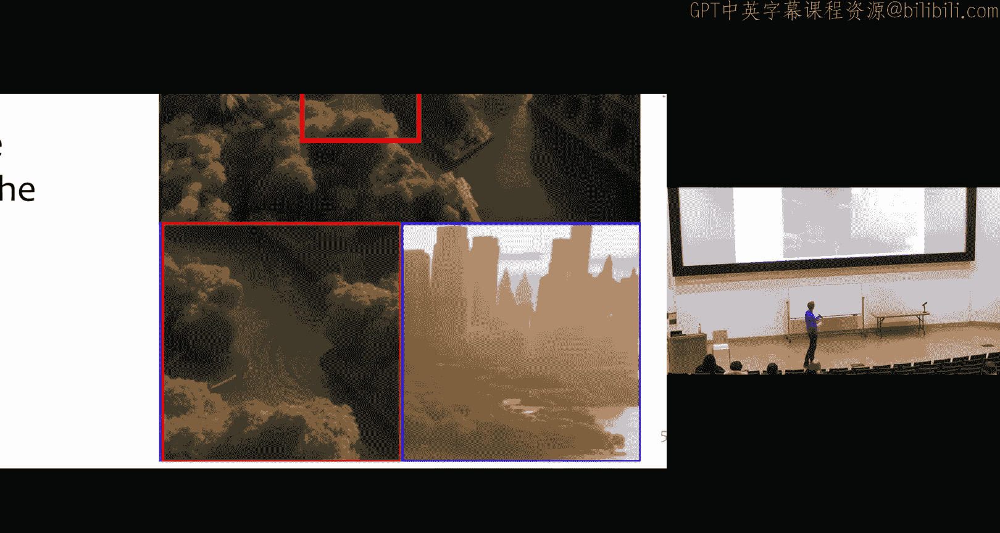

*   **图像分类**：识别图像中的主要物体是什么。
*   **图像分类 + 定位**：不仅识别物体，还要用边界框标出它的位置。
*   **人体姿态估计**：从图像中估计出人体的关节和骨骼位置。
*   **语义分割**：为图像中的每一个像素分配一个类别标签。
*   **目标检测**：找出图像中所有感兴趣的物体并标出它们的位置和类别。
*   **图像字幕**：为给定的图像生成一段描述性的文字。
*   **医学图像分析**：应用上述技术于医疗领域，如眼底病变检测、肺结节分类等。

### 图像生成任务

现在，我们聚焦于“生成”而非“识别”。图像生成任务多种多样：

*   **条件生成**：给定一个类别标签（如“猫”），生成一张属于该类别的逼真图像。
*   **超分辨率**：将一张低分辨率、模糊的图像，恢复成高分辨率、清晰的图像。
*   **图像编辑/修复**：例如，将图像中不需要的物体移除，并智能地填充被移除区域的背景。
*   **图像着色**：将黑白或灰度图像，自动转换为合理的彩色图像。
*   **风格迁移**：将一张图像的“内容”与另一张图像的“艺术风格”相结合，生成新图像。
*   **文本到图像生成**：根据一段文字描述（如“一只戴着牛仔帽的柯基犬在冲浪”），生成符合描述的图像。

---

## 生成对抗网络（GANs）⚔️

在众多图像生成方法中，**生成对抗网络**因其出色的效果而备受关注。它的核心思想非常巧妙：让两个神经网络相互竞争、共同进步。

### 模型架构

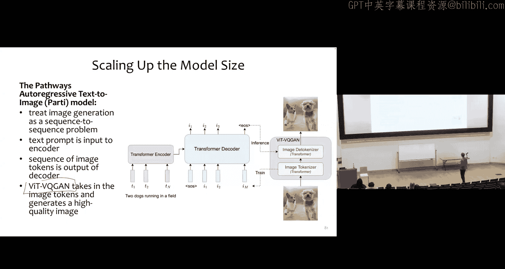

GAN由两个核心部分组成：

*   **生成器**：它的目标是“造假”。它接收一个随机的噪声向量 **z** 作为输入，并试图输出一张看起来像真实数据的图像 **G(z)**。
*   **判别器**：它的目标是“打假”。它接收一张图像（可能来自真实数据集，也可能来自生成器）作为输入，并输出一个概率值 **D(x)**，用于判断该图像是真实的还是生成器伪造的。

### 训练过程


GAN的训练是一个动态的博弈过程：

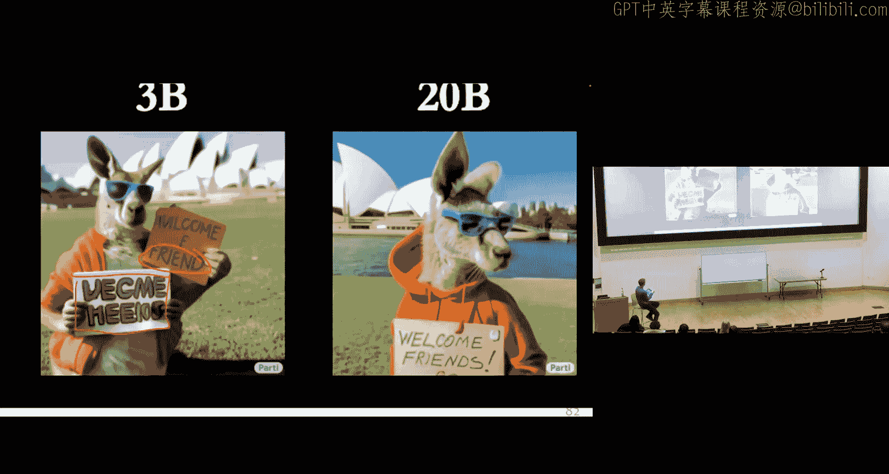

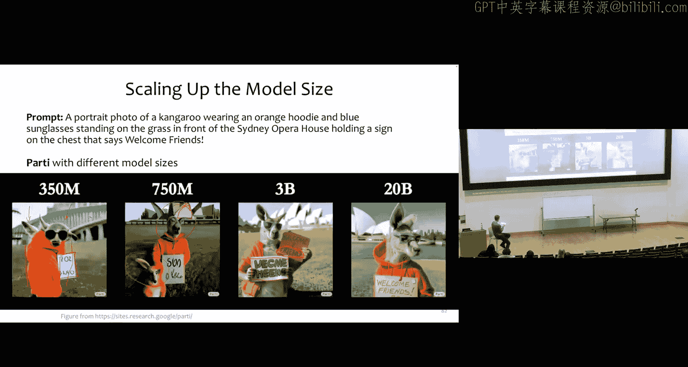

*   **判别器的目标**：最大化正确区分真实图像和伪造图像的能力。其损失函数鼓励它对真实图像输出高概率，对伪造图像输出低概率。
*   **生成器的目标**：最小化被判别器识破的概率。其损失函数鼓励它生成的图像 **G(z)** 能让判别器 **D(G(z))** 输出高概率（即误认为是真实图像）。

它们的对抗目标可以用一个**极小极大博弈**公式来描述：
```
min_G max_D V(D, G) = E_{x~p_data(x)}[log D(x)] + E_{z~p_z(z)}[log(1 - D(G(z)))]
```
训练时，通常交替优化生成器 **G** 和判别器 **D**。

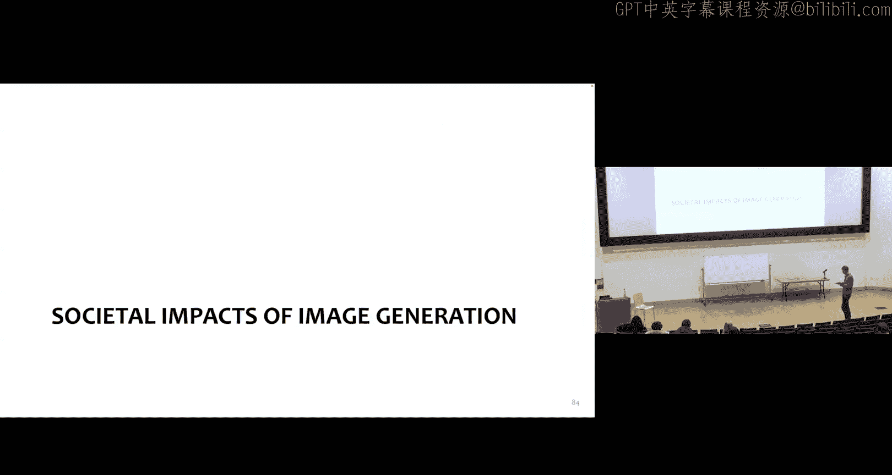

### 应用

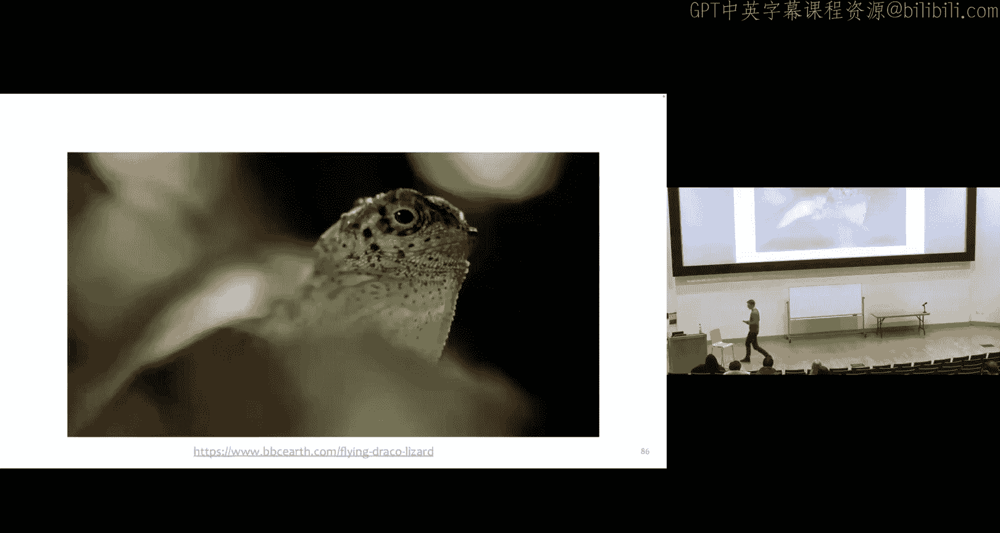

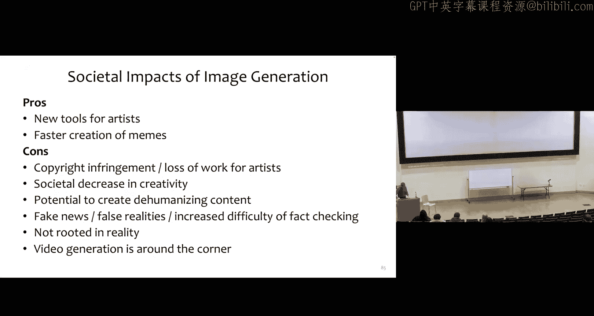

GAN在图像生成领域有广泛应用，包括但不限于我们前面提到的：生成逼真人脸、进行风格迁移、实现文本到图像的生成等。

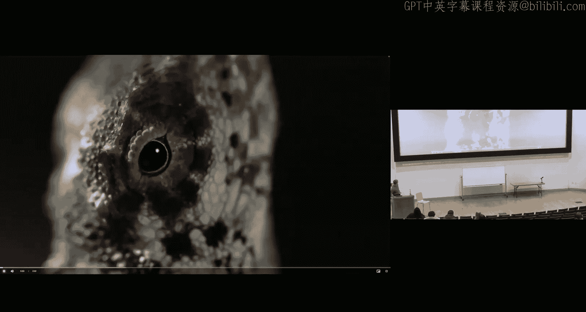

---

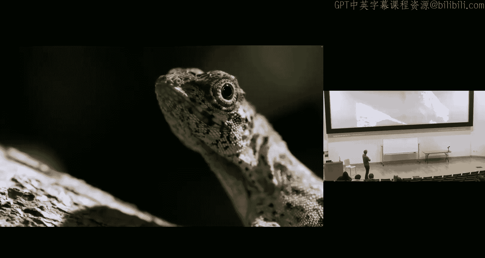

## 总结

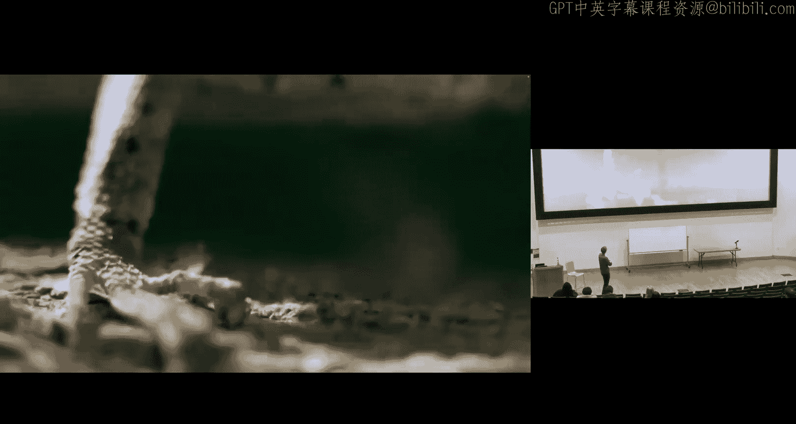

在本节课中，我们一起学习了两个关键主题。

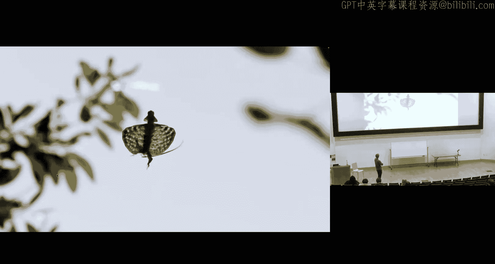

首先，我们探讨了**显著性检验**。它为我们提供了一套严谨的统计学工具，帮助我们判断机器学习模型性能的提升是真实有效的，还是可能源于偶然因素。这是进行可靠研究和比较的基石。

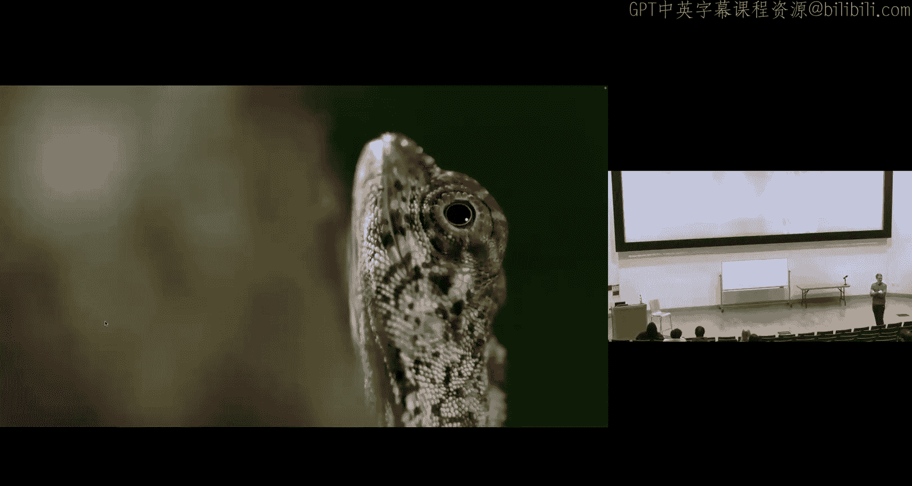

接着，我们进入了充满创造力的**图像生成**世界。从理解各种生成任务，到重点学习了**生成对抗网络**的原理。GAN通过让生成器和判别器相互对抗、共同进化的方式，学会了从噪声中创造出足以乱真的图像，代表了当前生成模型的一个重要方向。

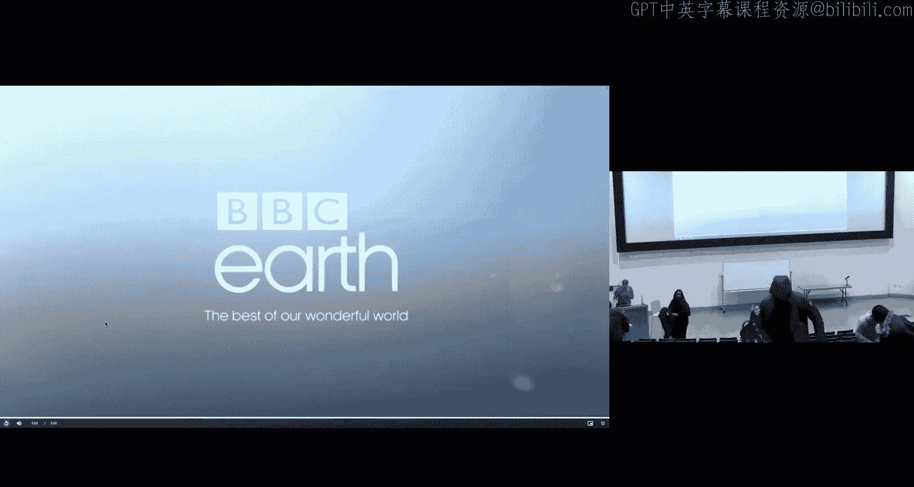

**本节课中我们一起学习了**：
*   如何使用假设检验和P值来评估模型性能的显著性。
*   计算机视觉中丰富的图像生成任务及其应用场景。
*   生成对抗网络的基本架构、训练思想和核心公式。

通过学习，你不仅应该知道如何评判一个模型的好坏，也应该对机器如何学会“创造”图像有了初步的认识。这两个技能，一个是评估的“尺子”，一个是创造的“画笔”，对于深入理解机器学习至关重要。