# 机器学习导论：第2次考试复习：优化、最大似然估计与最大后验估计 📚

## 概述

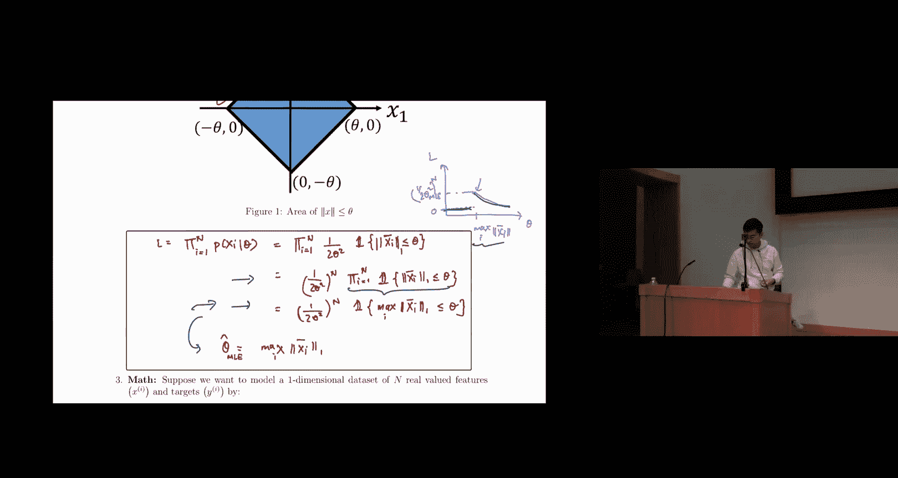

在本节课中，我们将学习CMU《机器学习导论》课程中关于优化、最大似然估计、最大后验估计、朴素贝叶斯和逻辑回归的核心概念。我们将通过具体的数学推导和问题解答，帮助你理解这些机器学习的基础方法。

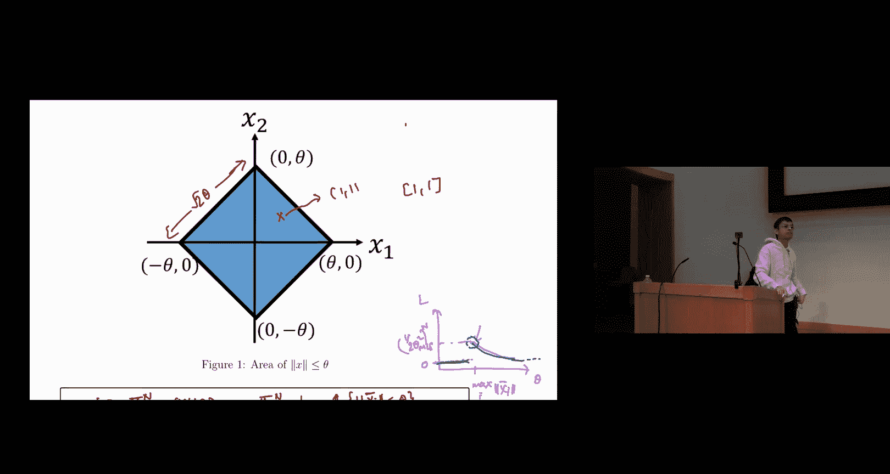

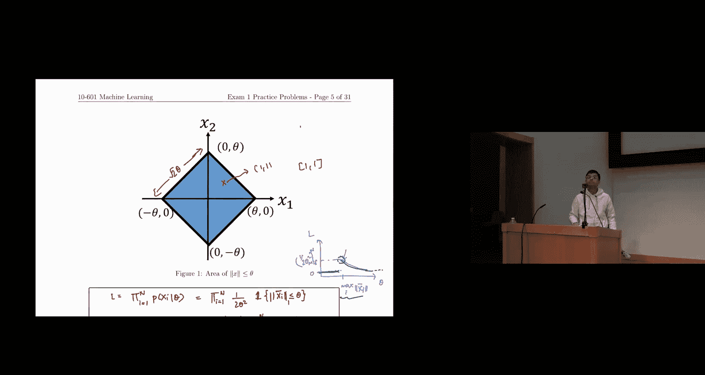

---

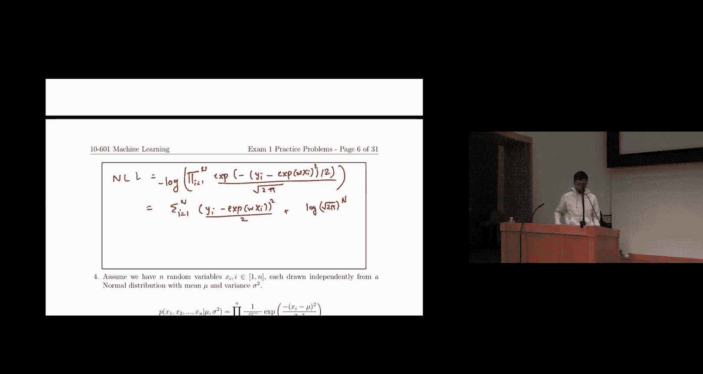

## 优化 🎯

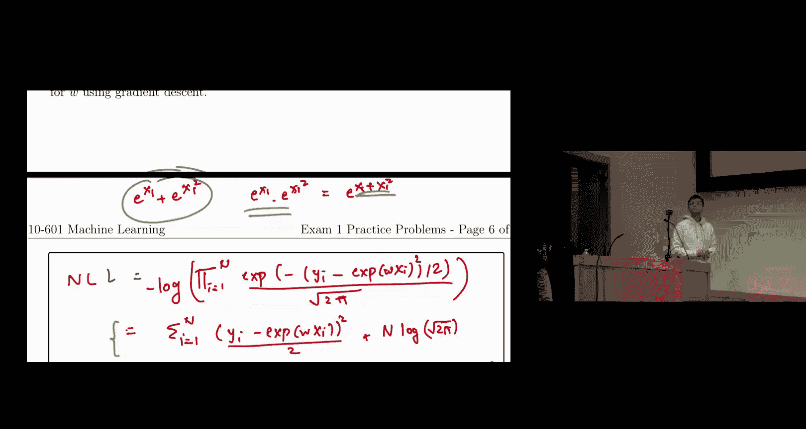

上一节我们介绍了本课程的整体框架，本节中我们来看看优化方法，特别是梯度下降法。


### 梯度下降法

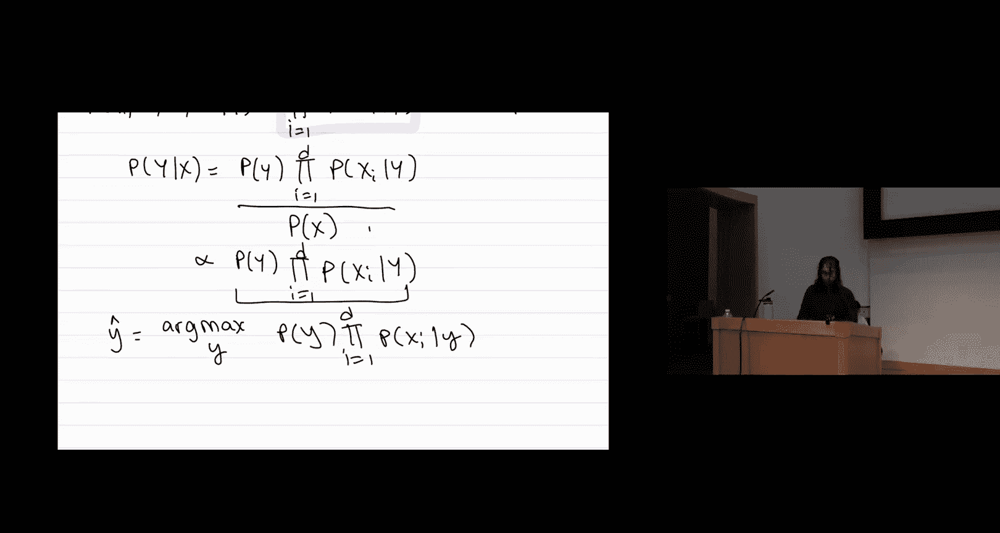

梯度下降法是一种用于寻找函数最小值的迭代优化算法。其核心思想是沿着函数梯度的反方向更新参数。

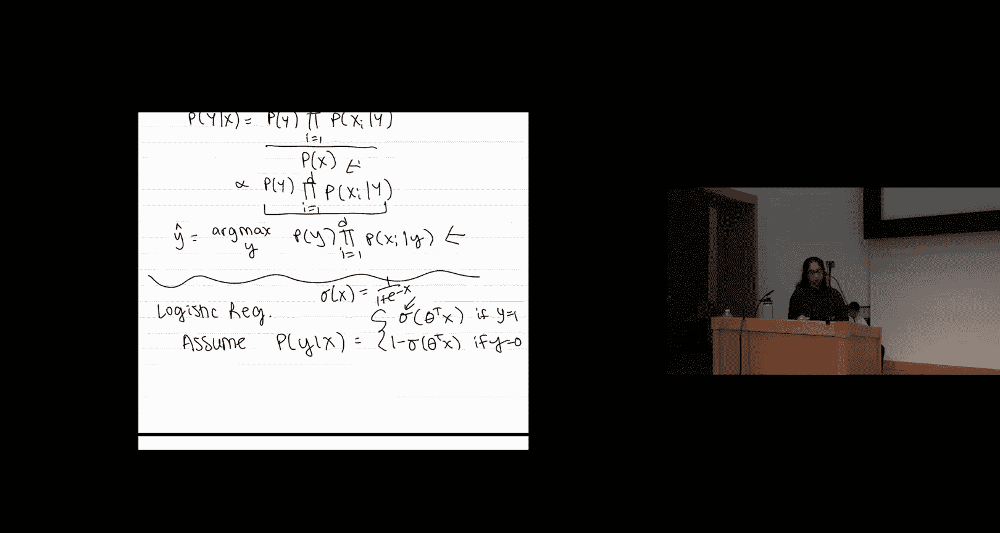

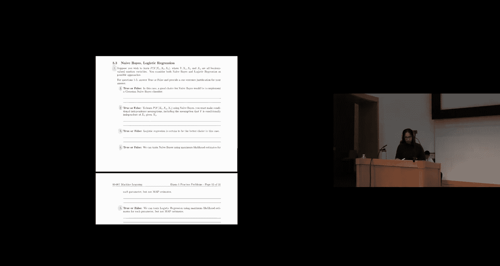

以下是梯度下降法的基本迭代公式：


```python
z_{t+1} = z_t - α * ∇f(z_t)
```

其中，`z_t` 是第 `t` 次迭代的参数值，`α` 是学习率，`∇f(z_t)` 是函数 `f` 在 `z_t` 处的梯度。

**问题**：考虑凸函数 `f(z) = z²` 和 `α` 为梯度下降法的学习率。对于哪些 `α` 值，我们的解序列的极限为 0，假设我们开始的初始值 `z` 为 1。

**解答**：

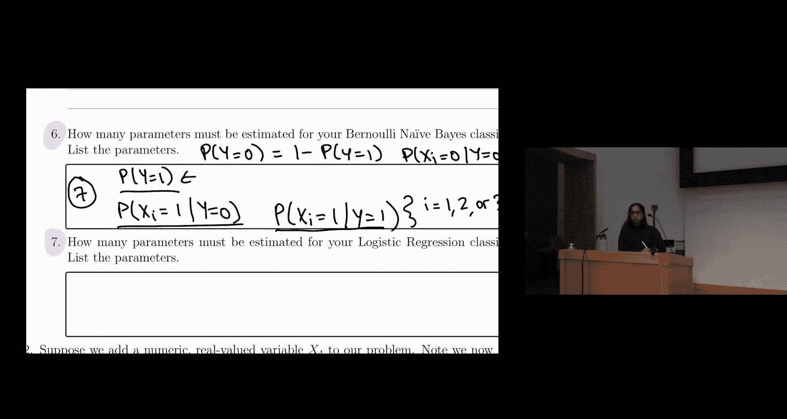

1.  首先，计算函数 `f(z) = z²` 的梯度：`∇f(z) = 2z`。
2.  将梯度代入梯度下降的迭代公式：`z_{t+1} = z_t - α * (2z_t) = (1 - 2α) * z_t`。
3.  这是一个等比数列。要使序列 `{z_t}` 的极限为 0，公比 `(1 - 2α)` 的绝对值必须小于 1。
4.  因此，条件为 `|1 - 2α| < 1`。解这个不等式，得到 `0 < α < 1`。

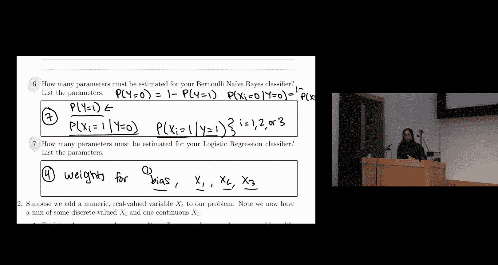

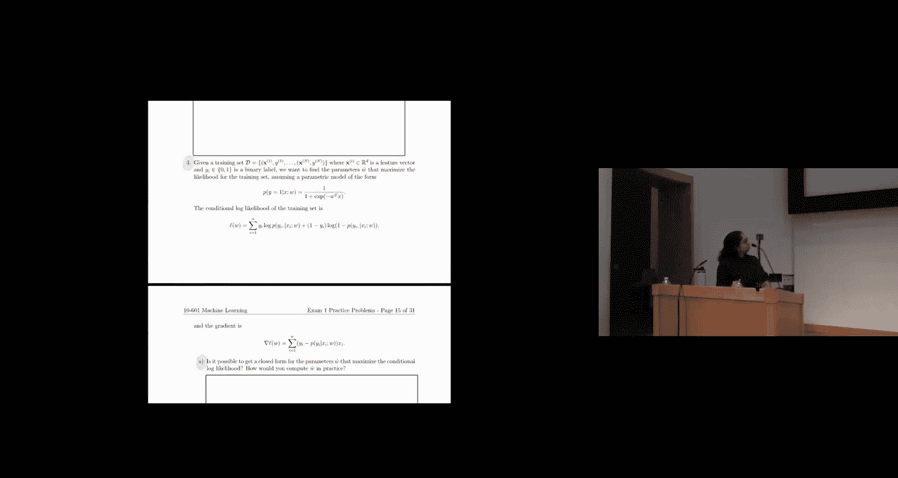

所以，当学习率 `α` 在 `(0, 1)` 区间内时，从 `z=1` 开始的梯度下降迭代序列将收敛到 0。

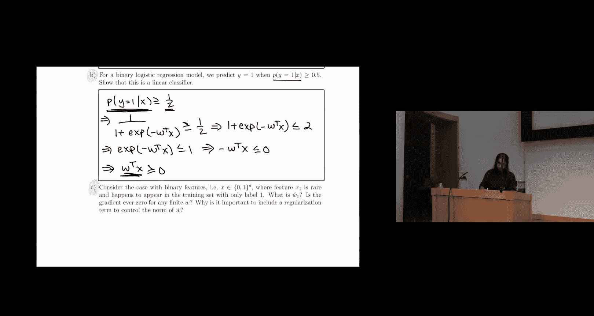

---

## 最大似然估计和最大后验估计 📊

上一节我们介绍了优化方法，本节中我们将探讨两种重要的参数估计方法：最大似然估计和最大后验估计。

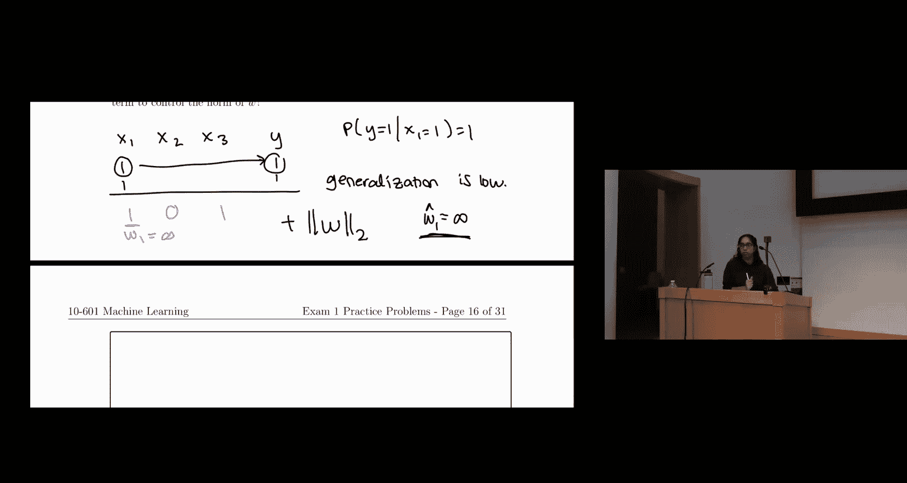

### 最大似然估计

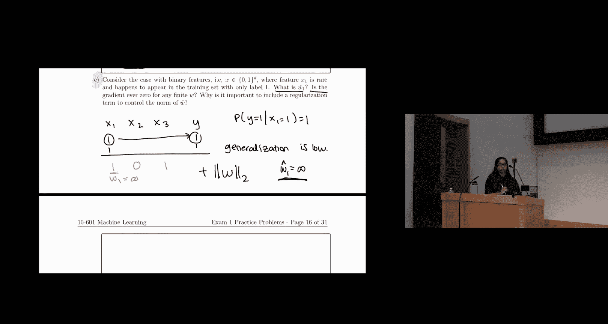

最大似然估计是一种在给定观测数据的情况下，寻找最有可能产生这些数据的参数值的方法。

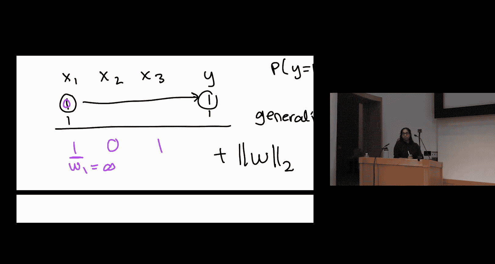

**问题**：设 `X₁, X₂, ..., Xₙ` 是从正态分布中独立抽取的样本，其概率密度函数为 `f(x; θ) = (1/√(2πσ²)) * exp(-(x-μ)²/(2σ²))`，其中 `μ` 和 `σ²` 是未知参数。求 `θ` 的最大似然估计值。

**解答**：

1.  **构建似然函数**：由于样本独立，联合概率密度（似然函数）为所有个体概率密度的乘积。
    `L(θ) = Π_{i=1}^n f(x_i; θ) = (1/(2πσ²)^{n/2}) * exp(-1/(2σ²) * Σ_{i=1}^n (x_i - μ)²)`

2.  **取对数似然函数**：为了简化求导，对似然函数取自然对数。
    `ln L(θ) = -(n/2) ln(2πσ²) - (1/(2σ²)) * Σ_{i=1}^n (x_i - μ)²`

3.  **对参数 `μ` 求导并令其为零**：
    `∂ ln L(θ) / ∂μ = (1/σ²) * Σ_{i=1}^n (x_i - μ) = 0`
    解得：`μ_MLE = (1/n) * Σ_{i=1}^n x_i`，即样本均值。

4.  **对参数 `σ²` 求导并令其为零**：
    `∂ ln L(θ) / ∂σ² = -n/(2σ²) + (1/(2σ⁴)) * Σ_{i=1}^n (x_i - μ)² = 0`
    解得：`σ²_MLE = (1/n) * Σ_{i=1}^n (x_i - μ_MLE)²`，即样本方差（有偏估计）。

### 最大后验估计

最大后验估计是最大似然估计的贝叶斯扩展。它不仅考虑观测数据，还结合了参数的先验知识，目标是找到使后验概率最大的参数值。

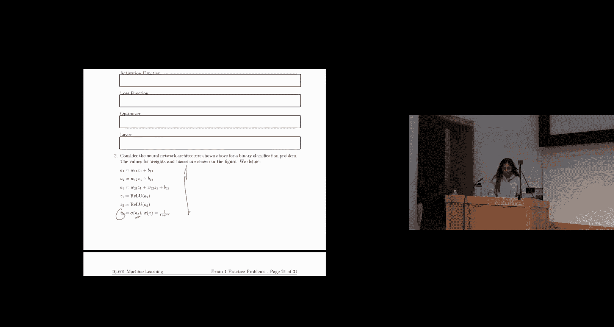

**问题**：设 `X₁, X₂, ..., Xₙ` 是从正态分布中独立抽取的样本，其概率密度函数为 `f(x; θ) = (1/√(2πσ²)) * exp(-(x-μ)²/(2σ²))`，其中 `μ` 和 `σ²` 是未知参数，且 `θ` 的先验分布为正态分布 `p(θ) = (1/√(2πσ₀²)) * exp(-(θ-μ₀)²/(2σ₀²))`。求 `θ` 的最大后验估计值。

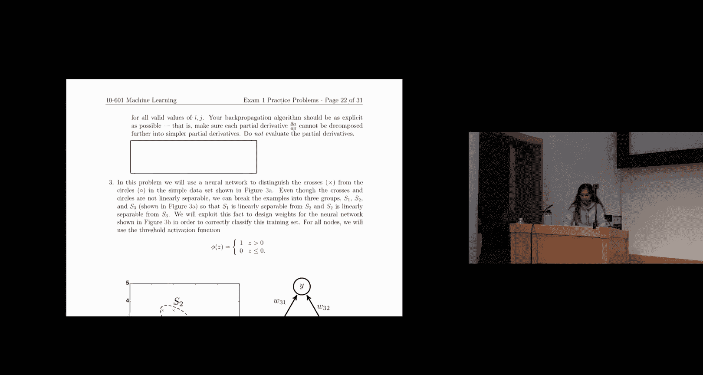

**解答**：

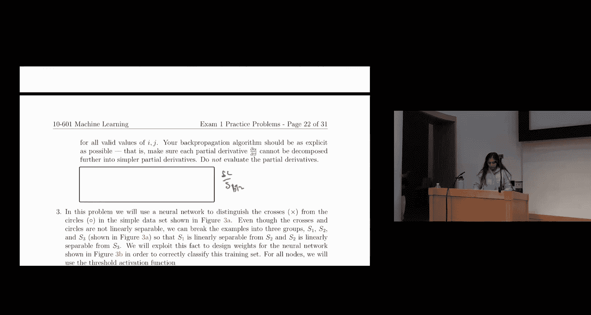

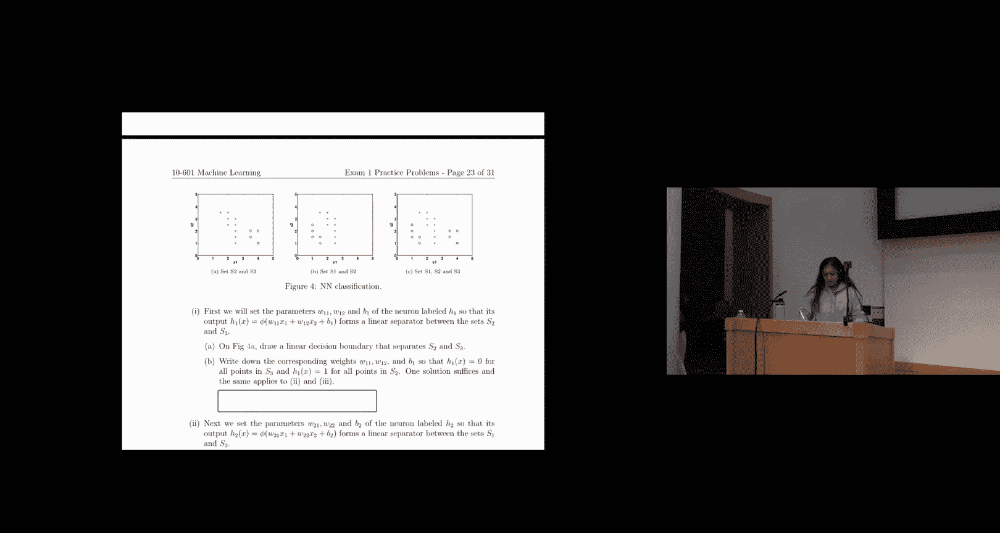

1.  **根据贝叶斯定理，后验分布与似然和先验的乘积成正比**：
    `p(θ | X) ∝ p(X | θ) * p(θ)`
    其中，`p(X | θ)` 就是似然函数 `L(θ)`。

2.  **目标是最大化后验概率 `p(θ | X)`**，这等价于最大化其对数：
    `argmax_θ [ln p(θ | X)] = argmax_θ [ln L(θ) + ln p(θ)]`

3.  **代入具体的似然函数和先验分布**：
    我们需要最大化的函数是：
    `[-(n/2) ln(2πσ²) - (1/(2σ²)) Σ (x_i - μ)²] + [-(1/2) ln(2πσ₀²) - (1/(2σ₀²)) (θ - μ₀)²]`

4.  **求解**：对上述关于 `θ`（在本例中即 `μ`）的表达式求导并令其为零。求解过程与MLE类似，但会多出一项来自先验的惩罚项。最终解 `μ_MAP` 是样本均值 `μ_MLE` 和先验均值 `μ₀` 的加权平均：
    `μ_MAP = ( (n/σ²) * μ_MLE + (1/σ₀²) * μ₀ ) / ( n/σ² + 1/σ₀² )`
    当样本量 `n` 很大或先验方差 `σ₀²` 很大（先验信息弱）时，`μ_MAP` 趋近于 `μ_MLE`。当样本量小或先验信息强时，估计值会向先验均值 `μ₀` 收缩。

---


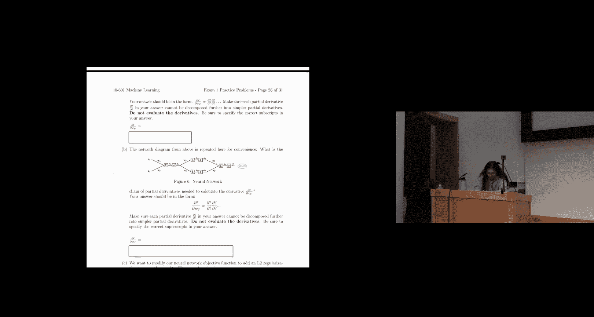

## 总结

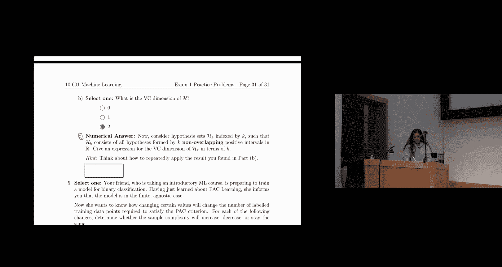

本节课中我们一起学习了机器学习中的几个基础但至关重要的概念。


*   **优化**：我们回顾了梯度下降法的原理，并通过一个简单的二次函数例子，分析了学习率对算法收敛性的影响。
*   **参数估计**：我们深入探讨了两种核心的估计方法。
    *   **最大似然估计**：完全基于观测数据，寻找最可能产生数据的参数。
    *   **最大后验估计**：在MLE的基础上引入了参数的先验分布，通过贝叶斯框架将数据证据与先验知识结合起来，得到更稳健的估计（尤其在数据量较少时）。

理解这些概念是掌握更复杂机器学习模型（如接下来会学到的朴素贝叶斯和逻辑回归）的基石。