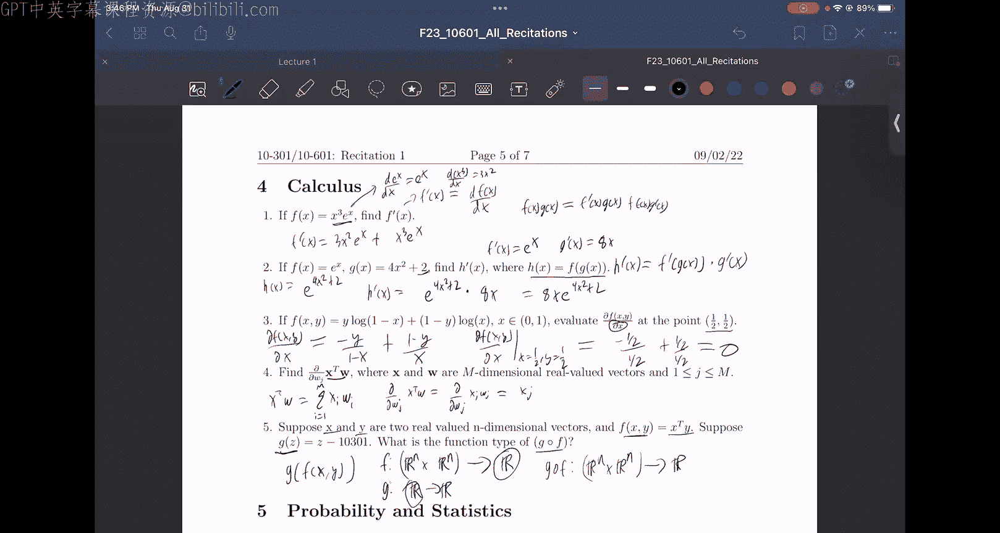

# 机器学习数学基础：1：微积分与函数类型入门 📚

在本课程中，我们将学习机器学习中至关重要的数学基础，包括求导法则、偏导数、向量值函数的导数以及如何理解函数的类型。这些概念是理解后续机器学习算法的基石。

## 1：求导法则 🔢

上一节我们介绍了本课程的目标，本节中我们来看看如何对函数进行求导。求导是计算函数变化率的核心操作。

### 1.1 乘积法则

当函数是两个函数的乘积时，其导数遵循乘积法则。

**公式**：若 `f(x) = u(x)v(x)`，则 `f'(x) = u'(x)v(x) + u(x)v'(x)`

**示例**：对于函数 `f(x) = x^3e^x`，其导数为 `f'(x) = 3x^2e^x + x^3e^x`

### 1.2 链式法则

当函数是复合函数时，其导数遵循链式法则。

**公式**：若 `f(g(x))`，则 `f'(g(x)) = f'(g(x))g'(x)`

**示例**：对于函数 `h(x) = e^{4x^2 + 2}`，其导数为 `h'(x) = e^{4x^2 + 2} * 8x`

## 2：偏导数 📐

上一节我们学习了单变量函数的求导，本节中我们将概念扩展到多变量函数，学习如何求偏导数。偏导数衡量的是函数在某一特定方向上的变化率。

### 2.1 偏导数的定义

偏导数是固定其他变量，仅对一个变量求导。

**公式**：`∂f/∂x = lim (Δx -> 0) [f(x + Δx, y) - f(x, y)] / Δx`

### 2.2 偏导数的计算

以下是计算偏导数的具体步骤。

**示例**：对于函数 `f(x, y) = ln(x - y)`：
*   对 `x` 求偏导：`∂f/∂x = 1/(x - y)`
*   对 `y` 求偏导：`∂f/∂y = -1/(x - y)`

## 3：向量值函数的导数 🧮

上一节我们处理了输出为标量的多变量函数，本节中我们来看看当函数的输出也是向量时，如何求导。这在机器学习中处理参数更新时非常常见。

### 3.1 向量值函数的导数

向量值函数对向量的导数是一个矩阵，称为雅可比矩阵。

**公式**：
`∂f/∂w = [ [∂f1/∂w1, ∂f1/∂w2, ..., ∂f1/∂wm],
          [∂f2/∂w1, ∂f2/∂w2, ..., ∂f2/∂wm],
          ...,
          [∂fn/∂w1, ∂fn/∂w2, ..., ∂fn/∂wm] ]`

**示例**：对于函数 `f(x) = x^T w`（结果为标量），其对向量 `w` 的导数为 `∂f/∂w = x`

## 4：函数类型 📊

在掌握了导数计算后，明确函数的输入和输出类型同样重要。本节中我们将学习如何确定函数的类型，这有助于理解数据在模型中的流动方式。

### 4.1 函数类型的定义

函数类型清晰地指明了输入来自哪个集合，输出映射到哪个集合。

**公式**：`f: A -> B` 表示函数 `f` 的定义域为 `A`，值域为 `B`。

### 4.2 函数类型的计算

以下是判断函数类型的例子。

**示例**：
*   函数 `f(x, y) = x^T y` 的类型为 `ℝ^n × ℝ^n -> ℝ`。它接受两个n维实向量，输出一个实数。
*   函数 `g(z) = z - 10` 的类型为 `ℝ -> ℝ`。它接受一个实数，输出一个实数。

---

本节课中我们一起学习了机器学习所需的几项核心数学工具：包括用于计算变化率的**求导法则**（乘积法则与链式法则），处理多变量函数的**偏导数**，描述参数如何影响多维输出的**向量值函数导数**（雅可比矩阵），以及明确模型输入输出结构的**函数类型**。理解这些概念将为后续学习梯度下降、反向传播等机器学习算法打下坚实的基础。