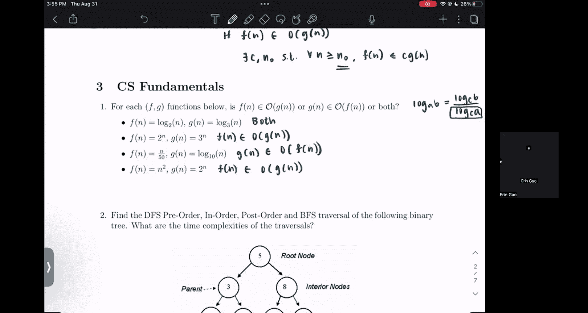

# 机器学习导论：1：时间复杂度基础

在本节课中，我们将学习时间复杂度的基础知识。理解时间复杂度是评估算法效率的关键，它帮助我们预测算法在处理大规模数据时的性能表现。

## 📚 1.1：时间复杂度定义

时间复杂度是衡量算法运行时间随输入规模增长而变化的趋势的一个指标。它不关注具体的运行秒数，而是关注运行时间的增长级数。

其核心定义可以用大O符号表示。**公式**：\( F(n) \in O(G(n)) \) 表示存在正常数 \( C \) 和 \( n_0 \)，使得对于所有 \( n \geq n_0 \)，都有 \( F(n) \leq C \times G(n) \)。这里，\( F(n) \) 代表算法实际的运行时间函数，\( G(n) \) 是我们用来描述其增长趋势的函数。

## 📚 1.2：时间复杂度问题类型

理解了定义后，本节我们来看看如何应用它来解决实际问题。以下是本节课将要分析的几种典型的时间复杂度比较问题。

1.  判断两个函数之间的渐进关系：是 \( F(n) \in O(G(n)) \)，还是 \( G(n) \in O(F(n)) \)，或者两者互相包含（即 \( \Theta \) 关系）。
2.  利用数学工具（如对数换底公式）来简化函数比较。
3.  分析不同函数类别（如指数函数、多项式函数、对数函数）的增长速度。

---

上一节我们介绍了时间复杂度的定义和常见问题类型，本节中我们将通过具体例子来解析这些问题。

## 📚 2.1：问题一解析 - 对数函数比较

**问题**：比较 \( F(n) = \log_3 n \) 和 \( G(n) = \log_{10} n \) 的渐进关系。

**分析**：\( F(n) \in O(G(n)) \) 和 \( G(n) \in O(F(n)) \) 都成立，即 \( F(n) = \Theta(G(n)) \)。

**原因**：利用对数换底公式 \( \log_a b = \frac{\log_c b}{\log_c a} \)，我们可以将两个函数转换为同底对数。例如，\( \log_3 n = \frac{\log_{10} n}{\log_{10} 3} \)。其中 \( \frac{1}{\log_{10} 3} \) 是一个常数。因此，两个函数只相差一个常数倍，属于相同的增长级。

## 📚 2.2：问题二解析 - 不同底数指数函数比较

**问题**：比较 \( S(n) = 2^n \) 和 \( G(n) = 3^n \) 的渐进关系。

**分析**：\( 2^n \) 的增长速度比 \( 3^n \) 慢。

**结论**：\( S(n) \in O(G(n)) \) 成立，但 \( G(n) \in O(S(n)) \) 不成立。因为对于任意常数 \( C \)，当 \( n \) 足够大时，\( 3^n \) 总会超过 \( C \times 2^n \)。

## 📚 2.3：问题三解析 - 多项式与对数函数比较

**问题**：比较 \( F(n) = n^2 \) 和 \( G(n) = 50n \log_{10} n \) 的渐进关系。

**分析**：虽然 \( \log_{10} n \) 在 \( n \) 较小时增长缓慢，但 \( n^2 \) 是二次增长，而 \( 50n \log n \) 是线性乘以对数的增长。随着 \( n \) 的增大，\( n^2 \) 的增长最终会远远快于 \( 50n \log n \)。

**结论**：\( G(n) \in O(F(n)) \) 成立，即 \( 50n \log_{10} n \) 的增长速度慢于 \( n^2 \)。

## 📚 2.4：问题四解析 - 指数与多项式函数比较

**问题**：比较 \( F(n) = 2^n \) 和 \( G(n) = n^{100} \) 的渐进关系。

**分析**：\( 2^n \) 是指数增长，\( n^{100} \) 是高次多项式增长。尽管100次方很大，但指数函数的增长速度最终会超越任何多项式函数。

**结论**：\( F(n) \in O(G(n)) \) 不成立，相反，\( G(n) \in O(F(n)) \) 成立。即 \( n^{100} \) 的增长速度慢于 \( 2^n \)。

---

本节课中我们一起学习了时间复杂度的核心概念。我们首先理解了大O符号的数学定义，然后通过四个典型例子，分析了对数函数之间、指数函数之间以及指数函数与多项式函数之间的渐进关系。关键结论是：**指数增长 > 多项式增长 > 线性增长 > 对数增长**。掌握这些比较方法，是分析算法效率的第一步。