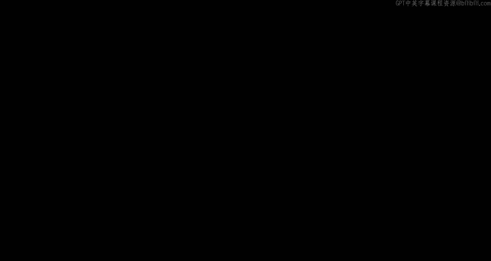
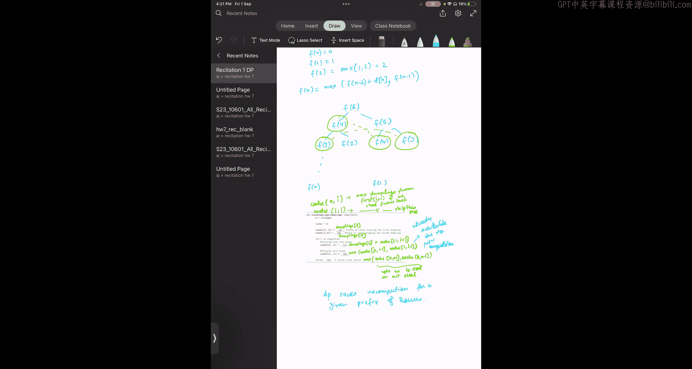

# 机器学习导论：第X章：动态规划与小笼包盗窃问题 🥟




在本节课中，我们将学习一种名为“动态规划”的强大算法设计技术。我们将通过一个生动有趣的例子——“小笼包盗窃问题”来理解其核心思想与应用步骤。

## 问题背景 🏘️

假设有一排房子，每个房子里都存放着数量不等的小笼包。一只功夫熊猫想要偷取这些小笼包。然而，房子之间装有安保系统：如果连续两间相邻的房子在同一次行动中被盗，警报就会被触发。我们的目标是帮助熊猫规划一次盗窃行动，在**不触发警报**的前提下，偷取到**最多数量**的小笼包。

上一节我们介绍了问题的背景，本节中我们来看看如何用系统化的方法解决它。

## 动态规划方法 🧠

动态规划是一种通过把复杂问题分解为更简单的子问题来求解的方法。它特别适用于具有“重叠子问题”和“最优子结构”性质的问题。对于盗窃问题，我们可以这样思考：对于第 `n` 间房子，熊猫有两种选择：
1.  偷这间房子，那么就不能偷第 `n-1` 间，最大收益是“偷前 `n-2` 间房子的最大收益”加上“第 `n` 间房子的收益”。
2.  不偷这间房子，那么最大收益就是“偷前 `n-1` 间房子的最大收益”。

我们需要在这两种选择中取收益更大的一个。这引出了我们的核心递推公式。

**核心公式**：
设 `f(n)` 代表面对前 `n` 间房子时能获得的最大收益，`val(n)` 代表第 `n` 间房子中的小笼包数量。
\[ f(n) = \max(f(n-1), \quad f(n-2) + val(n)) \]
其中，`f(0) = 0`（没有房子），`f(1) = val(1)`（只有一间房子）。

理解了核心公式后，接下来我们看看如何用代码实现这个计算过程。

## 动态规划实现 💻

我们可以用一个数组（通常称为 `dp` 数组）来存储子问题的解，从最小的子问题开始，逐步计算到原问题。以下是实现步骤：

以下是具体的算法步骤：
1.  初始化一个数组 `dp`，长度为 `n+1`（`n` 为房子总数）。`dp[i]` 表示面对前 `i` 间房子时的最大收益。
2.  设置基础情况：`dp[0] = 0`，`dp[1] = val[1]`。
3.  从 `i = 2` 开始循环到 `n`，根据递推公式计算 `dp[i]`：`dp[i] = max(dp[i-1], dp[i-2] + val[i])`。
4.  循环结束后，`dp[n]` 即为最终答案。

这种自底向上的计算方法天然避免了重复计算，因为每个子问题的解只计算一次并存储了下来。为了更清晰地展示，以下是该算法的Python代码实现：

**代码示例**：
```python
def rob_dumplings(values):
    """
    计算在不触发警报的情况下能偷取的最大小笼包数量。
    :param values: 列表，values[i]表示第i间房子的小笼包数量（i从1开始计数，values[0]可设为0）
    :return: 最大收益
    """
    n = len(values) - 1  # 房子总数
    if n == 0:
        return 0
    if n == 1:
        return values[1]

    dp = [0] * (n + 1)
    dp[1] = values[1]

    for i in range(2, n + 1):
        dp[i] = max(dp[i-1], dp[i-2] + values[i])

    return dp[n]

# 示例：房子收益为 [0, 2, 7, 9, 3, 1] (第0项为占位符)
print(rob_dumplings([0, 2, 7, 9, 3, 1]))  # 输出应为 12 (偷第2、4间房子：7+3=10？等等，我们算一下)
# 正确计算：偷第2间(7)和第4间(9) = 16？不对，不能连续偷。
# 偷第2间(7)和第5间(1) = 8。
# 偷第3间(9)和第1间(2) = 11？不能连续偷第2、3间。
# 最优解是偷第2间(7)和第4间(9)？不，第2间(7)和第4间(9)中间隔了第3间，可以偷，收益为16。
# 但根据代码，dp[2]=max(dp[1]=2, dp[0]+7=7)=7
# dp[3]=max(dp[2]=7, dp[1]+9=11)=11
# dp[4]=max(dp[3]=11, dp[2]+3=10)=11
# dp[5]=max(dp[4]=11, dp[3]+1=12)=12
# 所以最大收益是12（偷第3间和第5间，或第1、3、5间？9+1=10，2+9+1=12，后者正确）。
```



## 总结 📚


本节课中，我们一起学习了动态规划的基本思想。我们通过“小笼包盗窃问题”这个例子，理解了如何定义状态（`f(n)`），建立状态转移方程（`f(n) = max(f(n-1), f(n-2) + val(n))`），并利用自底向上的迭代方式高效求解。动态规划的关键在于**利用已解决的子问题的答案来构建更大问题的答案**，并避免重复计算。掌握这一范式，将帮助你解决许多复杂的优化问题。